<h1>
IF2150 REKAYASA PERANGKAT LUNAK
 
TUGAS 5
 
DESKRIPSI PERANCANGAN PERANGKAT LUNAK (DPPL)
</h1>
 

## Kerja-In
### *[Logo Perangkat Lunak]*

### Untuk: Agatha Tatianingseto

Dipersiapkan oleh:
| Informasi | Keterangan |
| --- | --- |
| Kelas | 03 |
| Kelompok | Shifu  |

| NIM | Nama |
| --- | --- |
| 13525033 | Davin Farel Santoso |
| 13525039 | Aditya Rasyid|
| 13525096 | Muhammad Ridwan Nasir Firdaus |
| 13525102 | Karmel Tua Haloho |
| 13525123 | Sebastio Nugroho |
---

## Daftar Perubahan

| Revisi | Deskripsi |
| :--- | :--- |
| *A* | *Deskripsikan perubahan yang dilakukan dari dokumen sebelumnya pada dokumen ini. Jika tidak terdapat perubahan, harap kosongkan tabel.* |
| *B* |  |
| *C* |  |
| ... |  |

---

 

> **Petunjuk pengerjaan:** *[Silahkan hapus bagian ini setelah selesai mengerjakan]*
>
> Dokumen ini melanjutkan **Spesifikasi Kebutuhan Perangkat Lunak (SKPL)** dan **Arsitektur Perangkat Lunak (APL)**. Gunakan nama, ID, kebutuhan, dan use case yang konsisten dengan kedua dokumen tersebut. Contoh pola ID baru di bawah dapat disesuaikan dengan kesepakatan kelompok, ID yang sudah ada tetap dipertahankan.

 

---

# BAB 1: Pendahuluan

## 1.1 Tujuan Penulisan Dokumen

Dokumen Deskripsi Perancangan Perangkat Lunak (DPPL) ini disusun untuk menjabarkan kebutuhan Kerja-In pada SKPL dan arsitektur pada APL menjadi rancangan komponen, realisasi use case, kelas, serta keterkaitannya. Dokumen ini menjadi acuan bagi tim pengembang dalam implementasi dan pengujian, serta bagi dosen dan asisten dalam meninjau kesesuaian rancangan dengan kebutuhan perangkat lunak.

## 1.2 Lingkup Masalah

Kerja-In merupakan platform marketplace jasa berbasis web yang mempertemukan Penyedia Kerja dengan Tenaga Kerja sektor informal untuk mempermudah pencarian dan penyediaan pekerjaan harian. Aplikasi ini mendukung registrasi dan verifikasi identitas, pengelolaan lowongan, pengajuan penawaran, pemilihan tenaga kerja, pembayaran melalui Payment Gateway, penyerahan dan pemeriksaan hasil pekerjaan, serta pencairan upah. Rating, ulasan, dan portofolio membantu pengguna menilai reputasi tenaga kerja, sedangkan Customer Service membantu menangani keluhan dan sengketa terkait penggunaan platform.

## 1.3 Definisi, Istilah, dan Singkatan

Tabel 1.3. Definisi Istilah dan Singkatan

| Singkatan, Akronim, atau Istilah | Penjelasan |
| :--- | :--- |
| P/L | Perangkat Lunak, yaitu aplikasi yang menyediakan fungsi sesuai kebutuhan pengguna. |
| SKPL | Spesifikasi Kebutuhan Perangkat Lunak, yaitu dokumen yang menjelaskan kebutuhan perangkat lunak sebagai acuan pengembangan. |
| KF | Kebutuhan Fungsional, yaitu fungsi atau layanan yang harus disediakan sistem. |
| KNF | Kebutuhan Non-Fungsional, yaitu persyaratan kualitas dan batasan operasional sistem, seperti keamanan, ketersediaan, dan waktu respons. |
| UC / Use Case | Gambaran interaksi aktor dengan sistem untuk mencapai suatu tujuan. |
| EARS | Easy Approach to Requirements Syntax, yaitu pola penulisan kebutuhan berdasarkan kondisi atau pemicu dan respons sistem. |
| Aktor | Peran pengguna yang berinteraksi langsung dengan perangkat lunak. |
| Tenaga Kerja | Pengguna yang mencari lowongan, mengajukan penawaran, melaksanakan pekerjaan, dan menerima upah setelah hasil pekerjaan diverifikasi. |
| Penyedia Kerja | Pengguna yang membuat lowongan, memilih tenaga kerja, membayar pekerjaan, dan memeriksa hasilnya. |
| CS / Customer Service | Petugas internal yang membantu menangani kendala akun, pekerjaan, pembayaran, serta keluhan dan sengketa pengguna. |
| Lowongan Pekerjaan | Informasi kebutuhan pekerjaan yang memuat deskripsi, kuota tenaga kerja, lokasi, dan upah. |
| Pengajuan Penawaran | Pengajuan Tenaga Kerja untuk melamar suatu lowongan, disertai pesan penawaran dan data pelamar. |
| Transaksi Pekerjaan | Catatan kesepakatan antara Penyedia Kerja dan Tenaga Kerja terpilih beserta status pelaksanaan pekerjaannya. |
| Portofolio | Rekam jejak pengalaman dan hasil pekerjaan yang menunjukkan kemampuan serta reputasi pengguna. |
| Rating dan Ulasan | Penilaian berupa bintang 1-5 dan komentar setelah pekerjaan selesai. |
| Payment Gateway | Layanan eksternal yang digunakan sistem untuk memproses pembayaran dan penyaluran dana. |
| Dummy | Simulasi layanan atau sistem eksternal untuk menjalankan alur aplikasi tanpa menggunakan layanan produksi yang sesungguhnya. |
| Commission Fee | Biaya layanan platform yang dikenakan dalam transaksi pekerjaan. |
| Invoice | Tagihan yang memuat rincian upah, biaya layanan, dan total pembayaran. |
| E-wallet | Dompet digital yang digunakan sebagai sarana pembayaran atau tujuan pencairan dana. |
| Disbursement | Penyaluran dana ke rekening bank atau e-wallet penerima melalui layanan pembayaran. |
| Refund | Pengembalian dana kepada pihak pembayar sesuai tindak lanjut transaksi atau keputusan sengketa. |
| Dispute / Sengketa | Perselisihan terkait pekerjaan atau pembayaran yang ditangani oleh Customer Service. |
| Timestamp | Catatan tanggal dan waktu terjadinya suatu aktivitas sistem. |
| API | Application Programming Interface, yaitu antarmuka untuk pertukaran data dan permintaan layanan antarsistem. |
| UI | User Interface, yaitu antarmuka untuk memasukkan data dan menampilkan informasi kepada pengguna. |
| Entitas | Kelas yang merepresentasikan data dan perilaku objek dalam sistem. |
| Controller | Kelas yang mengendalikan pemrosesan tindakan pengguna sesuai fungsi yang ditangani. |
| Traceability | Keterlacakan hubungan antara kebutuhan fungsional, use case, dan kelas yang mendukungnya. |
| DPPL | Deskripsi Perancangan Perangkat Lunak, yaitu dokumen yang menjelaskan rancangan perangkat lunak berdasarkan kebutuhan dan arsitektur yang telah ditetapkan. |
| APL | Arsitektur Perangkat Lunak, yaitu dokumen yang menjelaskan pola arsitektur, komponen, dan model arsitektur sistem. |
| MVC | Model-View-Controller, yaitu pola pemisahan pengelolaan data, tampilan, dan pengendalian interaksi pengguna. |
| Model | Bagian arsitektur yang mengelola data dan perilaku entitas aplikasi. |
| View | Bagian arsitektur yang menampilkan antarmuka dan menerima interaksi pengguna. |
| DBMS | Database Management System, yaitu perangkat lunak untuk mengelola basis data. |
| Logical View | Sudut pandang arsitektur yang memperlihatkan struktur dan hubungan komponen logis aplikasi. |

## 1.4 Aturan Penomoran

Tabel 1.4. Aturan Penomoran

| Hal/Bagian | Penomoran | Keterangan |
| :--- | :--- | :--- |
| Kebutuhan | RXX | Mengacu pada ID dalam tabel Pemetaan Kebutuhan pada dokumen Requirement Gathering, misalnya R01. |
| Kebutuhan Fungsional | KFXX | Menandai fungsi atau layanan sistem, misalnya KF01. |
| Kebutuhan Non-Fungsional | KNFXX | Menandai persyaratan kualitas atau batasan operasional sistem, misalnya KNF01. |
| Aktor | AXX | Menandai peran pengguna: A01 untuk Tenaga Kerja, A02 untuk Penyedia Kerja, dan A03 untuk Customer Service. |
| Use Case | UCXX | Menandai use case beserta skenarionya, misalnya UC01 untuk Melakukan Registrasi. |
| Kelas | CXX | Menandai kelas pada identifikasi, diagram kelas, dan traceability, misalnya C01. |

ID kelas C01-C45 mengikuti identifikasi kelas SKPL 5.1, diagram per use case SKPL 5.2, dan tabel kerunutan Bab 6 SKPL. Tabel keseluruhan SKPL 5.3 masih memakai beberapa ID berbeda untuk nama kelas yang sama, sehingga ID dari tabel tersebut tidak disalin ke DPPL.

## 1.5 Referensi

1. [M1 - Topic Brainstorming](../M1/K03_G06_FInal_TB.md): latar belakang, tujuan, dan lingkup awal Kerja-In.
2. [M2 - Requirement Gathering](../M2/K03_G06_RG.md): kebutuhan pengguna dan pemetaan kebutuhan.
3. [M3 - Use Case & Scenario Use Case](../M3/K03_G06_UC.md): aktor, use case, serta skenario normal dan alternatif.
4. [M4 - Class Diagram](../M4/K03_G06_CD.md): identifikasi dan diagram kelas analisis.
5. [M5 - Spesifikasi Kebutuhan Perangkat Lunak (SKPL)](../M5/K03_G06_SKPL.md): lingkup, aturan penomoran, skenario, kelas analisis, dan kerunutan.
6. [M6 - Arsitektur Perangkat Lunak (APL)](../M6/K03_G06_APL.md): lingkungan operasi, pola MVC, komponen, dan Logical View.

## 1.6 Deskripsi Umum Dokumen (Ikhtisar)

Bab 1 menjelaskan tujuan, lingkup masalah, istilah, aturan penomoran, dan referensi dokumen. Bab 2 menjelaskan lingkungan implementasi, pola arsitektur, komponen, dan model arsitektur Kerja-In. Bab 3 memuat realisasi setiap use case melalui identifikasi kelas, sequence diagram, dan diagram kelas. Bab 4 menyajikan diagram serta daftar kelas keseluruhan, sedangkan Bab 5 memetakan kelas terhadap use case untuk menelusuri kesesuaian rancangan dengan kebutuhan.

---

# BAB 2: Perancangan Arsitektur

## 2.1 Rancangan Lingkungan Implementasi

Lingkungan berikut mengacu pada SKPL 2.5 dan Bab 1 APL.

| Komponen | Spesifikasi |
| :--- | :--- |
| OS client | Aplikasi web dapat diakses melalui browser pada Windows, Linux, macOS, Android, dan iOS. |
| OS server | Belum dinyatakan secara spesifik dalam M1-M6. |
| Server dan framework | Node.js dengan framework Hono, dijalankan pada layanan Railway. |
| Client | Web browser modern yang mendukung JavaScript, seperti Google Chrome, Mozilla Firefox, Microsoft Edge, dan Safari. |
| DBMS | PostgreSQL melalui layanan Supabase. |
| Autentikasi | Supabase Auth untuk autentikasi dan pengelolaan sesi pengguna. |
| Penyimpanan berkas | Supabase Storage untuk penyimpanan berkas aplikasi; jenis filesystem OS server belum dinyatakan. |
| Bahasa pemrograman | Dokumen sumber menyebut Node.js/Hono dan dukungan JavaScript pada browser, tetapi belum menetapkan bahasa implementasi frontend/backend secara eksplisit. |
| Development tools | Editor/IDE, alat build, dan alat pengujian belum dinyatakan dalam M1-M6. |

**Belum selesai:** penetapan OS server, bahasa pemrograman, development tools, dan rincian filesystem jika diperlukan oleh lingkungan implementasi.

## 2.2 Style/Pattern Arsitektur Acuan

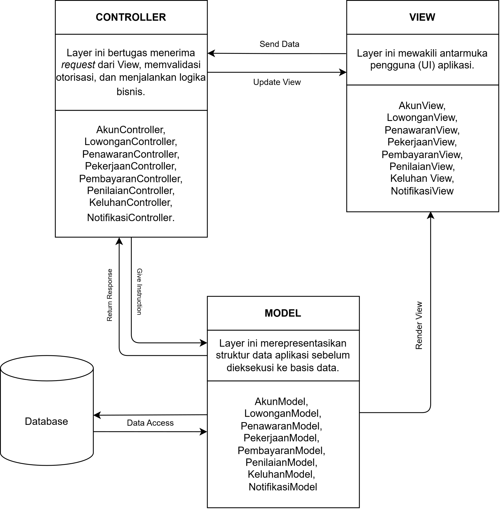

<i>Gambar 1.  Arsitektur MVC</i>

Pemilihan arsitektur Model-View-Controller (MVC) sebagai acuan untuk perangkat lunak Kerja-In didasarkan pada kesesuaiannya yang kuat dengan karakteristik pengguna, alur proses bisnis, serta lingkungan teknologi sistem. Sebagai aplikasi marketplace jasa, Kerja-In melayani tiga jenis pengguna dengan kebutuhan antarmuka yang berbeda yakni Tenaga Kerja, Penyedia Kerja, dan Customer Service (CS). Pola MVC memungkinkan sistem untuk menyajikan antarmuka (View) dan logika pemrosesan (Controller) yang spesifik untuk masing-masing peran, tetapi tetap terintegrasi secara terpusat pada pengelolaan entitas data (Model) yang sama. Hal ini efektif mencegah duplikasi data dan memastikan konsistensi informasi lintas pengguna.

Selain itu, alur proses bisnis pada aplikasi ini sangat interaktif dan sepenuhnya digerakkan oleh aksi pengguna, seperti pengajuan pekerjaan, konfirmasi penyelesaian, penanganan sengketa, hingga proses pembayaran. Arsitektur MVC dirancang secara natural untuk menangani siklus permintaan dan repons yang dinamis ini, View menangkap interaksi pengguna, Controller bertindak sebagai penengah untuk memvalidasi dan memproses logika bisnis, dan Model memperbarui status pada basis data secara aman.

Dari segi pengembangan, MVC menerapkan pemisahan tanggung jawab yang tegas antara tampilan antarmuka, logika bisnis, dan aturan data. Pemisahan ini sangat menguntungkan tim pengembang karena memungkinkan pengerjaan frontend dan backend dilakukan secara paralel dan modular tanpa saling mengganggu. Terakhir, MVC merupakan fondasi bawaan dari mayoritas framework web modern yang menjadi lingkungan operasi perangkat lunak ini. Dengan menerapkan MVC, pengembangan sistem tidak hanya mematuhi standard industri, tetapi juga menjamin skalabilitas dan kemudahan pemeliharaan perangkat lunak di masa depan.

## 2.3 Identifikasi Komponen / Modul / Subsistem

Komponen Kerja-In dikelompokkan berdasarkan pola MVC menjadi Model, View, dan Controller. Kelas yang memiliki fungsi berkaitan ditempatkan dalam satu komponen dengan nama kelas utama yang mewakilinya. Komponen autentikasi, basis data, dan penyimpanan berkas mendukung pengoperasian aplikasi.

Tabel 2.3. Identifikasi Komponen/Modul/Subsistem

| Nama Komponen/Modul/Subsistem | Jenis | Penjelasan |
| :--- | :--- | :--- |
| Pengguna | Model | Mengelola identitas akun, profil sesuai peran, portofolio, saldo, dan status verifikasi pengguna. Mencakup kelas Pengguna, TenagaKerja, PenyediaKerja dan CustomerService. |
| LowonganPekerjaan | Model | Model yang menyimpan spesifikasi pekerjaan meliputi judul, deskripsi, batas kuota, nominal upah, dan status (*Open/Closed*). |
| PengajuanPenawaran | Model | Model yang menyimpan data lamaran dari Tenaga Kerja, berisi pesan penawaran, *timestamp*, dan status lamaran. |
| TransaksiPekerjaan | Model | Mengelola kesepakatan, status pengerjaan, deskripsi hasil, lampiran bukti, dan waktu penyerahan. Mencakup kelas TransaksiPekerjaan dan BuktiPenyerahan. |
| TagihanPembayaran | Model | Mengelola tagihan, upah dan biaya layanan, permintaan penarikan pendapatan, tujuan transfer, serta catatan dan status transaksi pembayaran. Mencakup kelas TagihanPembayaran, PencairanDana dan PaymentGateway. |
| UlasanRating | Model | Model yang menyimpan data penilaian pasca-pekerjaan (skala 1-5) dan ulasan teks untuk mencegah *double review*. |
| TiketSengketa | Model | Mengelola laporan keluhan, bukti, status tiket, keputusan, dan riwayat penanganan. Mencakup kelas TiketSengketa dan RiwayatSengketa. |
| Notifikasi | Model | Model yang menyimpan pesan pemberitahuan ke *dashboard* pengguna terkait aktivitas akun maupun transaksi. |
| PenggunaUI | View | Menampilkan formulir registrasi/login, profil, dashboard pengguna, dan pengajuan serta pemeriksaan identitas. Mencakup kelas PenggunaUI, TenagaKerjaUI, PenyediaKerjaUI dan CustomerServiceUI. |
| LowonganPekerjaanUI | View | Antarmuka yang menyediakan formulir pembuatan lowongan dan katalog pencarian pekerjaan. Meneruskan aksi pengguna yang terkait ke LowonganPekerjaanController. |
| PengajuanPenawaranUI | View | Antarmuka yang menampilkan formulir pengisian pesan penawaran bagi Tenaga Kerja. Meneruskan aksi pengguna yang terkait ke PengajuanPenawaranController. |
| TransaksiPekerjaanUI | View | Menampilkan rincian dan status pekerjaan, formulir unggah hasil, serta pilihan persetujuan atau revisi. Mencakup kelas TransaksiPekerjaanUI dan BuktiPenyerahanUI. |
| TagihanPembayaranUI | View | Menampilkan invoice, metode dan instruksi pembayaran, formulir penarikan pendapatan, serta status transaksi dana. Mencakup kelas TagihanPembayaranUI, PencairanDanaUI dan PaymentGatewayUI. |
| UlasanRatingUI | View | Antarmuka yang merender formulir pemberian bintang dan komentar ulasan. Meneruskan aksi pengguna yang terkait ke UlasanRatingController. |
| TiketSengketaUI | View | Menampilkan formulir dan rincian keluhan, bukti tambahan, keputusan, serta urutan aktivitas penanganan. Mencakup kelas TiketSengketaUI dan RiwayatSengketaUI. |
| NotifikasiUI | View | Antarmuka berupa *pop-up*, bel, atau menu *dropdown* pesan masuk bagi pengguna. Meneruskan aksi pengguna yang terkait ke NotifikasiController. |
| PenggunaController | Controller | Memproses registrasi/login, pembaruan profil, pemeriksaan hak akses, dan keputusan verifikasi identitas. Mencakup kelas PenggunaController, TenagaKerjaController, PenyediaKerjaController dan CustomerServiceController. |
| LowonganPekerjaanController | Controller | Pengendali untuk memvalidasi isian *create* lowongan, pemfilteran pencarian, dan kalkulasi sisa kuota. |
| PengajuanPenawaranController | Controller | Pengendali untuk memvalidasi persyaratan melamar dan merekam data pelamar ke *database*. |
| TransaksiPekerjaanController | Controller | Memproses perubahan status pekerjaan, validasi dan penyimpanan bukti, serta konfirmasi penyelesaian atau permintaan revisi. Mencakup kelas TransaksiPekerjaanController dan BuktiPenyerahanController. |
| TagihanPembayaranController | Controller | Menghitung tagihan, memvalidasi saldo serta tujuan transfer, mengirim instruksi pembayaran, pencairan atau refund, dan memproses konfirmasi layanan pembayaran eksternal. Mencakup kelas TagihanPembayaranController, PencairanDanaController dan PaymentGatewayController. |
| UlasanRatingController | Controller | Pengendali untuk mencegah ulasan ganda dan merekapitulasi rata-rata rating. |
| TiketSengketaController | Controller | Memvalidasi laporan serta kewenangan petugas, mencatat keputusan dan riwayat, serta memproses tindak lanjut penyelesaian sengketa. Mencakup kelas TiketSengketaController dan RiwayatSengketaController. |
| NotifikasiController | Controller | Pengendali untuk memicu pengiriman pesan otomatis secara *real-time* ke penerima yang tepat. |
| Autentikasi | Pendukung | Memverifikasi kredensial dan mengelola sesi pengguna agar akses aplikasi sesuai dengan identitas serta hak pengguna. |
| Database | Penyimpanan Data | Menyimpan data aplikasi secara persisten, termasuk akun, lowongan, penawaran, pekerjaan, pembayaran, penilaian, keluhan, dan riwayat aktivitas. |
| PenyimpananBerkas | Penyimpanan Data | Menyimpan dokumen identitas, lampiran hasil pekerjaan, dan bukti keluhan serta menyediakan akses berkas sesuai hak pengguna. |

## 2.4 Model Arsitektur Perangkat Lunak

### 2.4.1 Logical View

Pada Kerja-In, pola MVC membagi aplikasi menjadi tiga bagian. *View* menampilkan halaman yang digunakan pengguna, *Controller* memproses aksi dan aturan aplikasi, sedangkan *Model* mengelola data. Pembagian ini terlihat pada diagram berikut.

  

  <i>Gambar 2. Class Diagram Logical View Kerja-In</i>

Di dalam diagram, aksi dari halaman pengguna diteruskan ke *Controller*, lalu *Controller* membaca atau memperbarui data pada *Model*. Data disimpan di Database. Autentikasi digunakan untuk memeriksa kredensial dan sesi pengguna, sementara PenyimpananBerkas digunakan untuk menyimpan dokumen identitas dan bukti pekerjaan maupun sengketa.

Pembayaran melibatkan PaymentGatewayEksternal, yaitu layanan di luar Kerja-In yang menerima instruksi pembayaran dan mengirimkan status transaksi kembali ke aplikasi. Sementara itu, PaymentGateway pada bagian Model mencatat transaksi dan komunikasi dengan layanan tersebut. Diagram juga mencakup komponen untuk mengelola lowongan, lamaran, pekerjaan, ulasan, sengketa, dan notifikasi.

---

# BAB 3: Realisasi Use Case

Identifikasi kelas dan diagram analisis berikut diambil dari SKPL 5.2 sebagai dasar perancangan. Nama dan ID dipertahankan. Pemetaan nama yang sama merupakan pemetaan awal; pemisahan atau penambahan kelas perancangan belum ditetapkan. Sequence diagram serta penyempurnaan diagram kelas harus diselesaikan sebelum bab ini dinyatakan final.

## 3.1 Use Case Melakukan Registrasi

**ID Use Case:** UC01  
**Nama Use Case:** Melakukan Registrasi

### 3.1.1 Identifikasi Kelas

Tabel 3.1. Identifikasi Awal Kelas Use Case UC01

| No | Nama Kelas Perancangan (Awal) | Nama Kelas Analisis Terkait |
| :--- | :--- | :--- |
| 1 | C01 - Pengguna | C01 - Pengguna |
| 2 | C02 - TenagaKerja | C02 - TenagaKerja |
| 3 | C03 - PenyediaKerja | C03 - PenyediaKerja |
| 4 | C16 - PenggunaUI | C16 - PenggunaUI |
| 5 | C17 - TenagaKerjaUI | C17 - TenagaKerjaUI |
| 6 | C18 - PenyediaKerjaUI | C18 - PenyediaKerjaUI |
| 7 | C31 - PenggunaController | C31 - PenggunaController |
| 8 | C32 - TenagaKerjaController | C32 - TenagaKerjaController |
| 9 | C33 - PenyediaKerjaController | C33 - PenyediaKerjaController |

### 3.1.2 Sequence Diagram

**Belum dikerjakan:** sequence diagram belum tersedia pada M1-M6. Gunakan [skenario UC01 pada SKPL](../M5/K03_G06_SKPL.md#441-skenario-uc01) sebagai acuan untuk:

- Skenario Normal.
- Skenario Alternatif 1: Batas Usia Tidak Valid.
- Skenario Alternatif 2: Email Sudah Terdaftar.

### 3.1.3 Diagram Kelas

Diagram kelas analisis acuan dari SKPL:

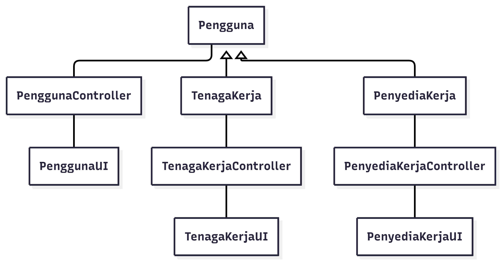

<i>Gambar 3.1. Diagram Kelas Use Case UC01</i>

**Belum selesai:** sesuaikan diagram ini menjadi diagram perancangan dengan visibilitas dan tipe atribut, parameter dan tipe kembalian operasi, serta relasi dan multiplisitas. Pastikan semua operasi pada sequence diagram tercantum dan konsisten dengan Bab 4.

## 3.2 Use Case Mengelola Verifikasi Identitas

**ID Use Case:** UC02  
**Nama Use Case:** Mengelola Verifikasi Identitas

### 3.2.1 Identifikasi Kelas

Tabel 3.2. Identifikasi Awal Kelas Use Case UC02

| No | Nama Kelas Perancangan (Awal) | Nama Kelas Analisis Terkait |
| :--- | :--- | :--- |
| 1 | C02 - TenagaKerja | C02 - TenagaKerja |
| 2 | C04 - CustomerService | C04 - CustomerService |
| 3 | C14 - Notifikasi | C14 - Notifikasi |
| 4 | C17 - TenagaKerjaUI | C17 - TenagaKerjaUI |
| 5 | C19 - CustomerServiceUI | C19 - CustomerServiceUI |
| 6 | C29 - NotifikasiUI | C29 - NotifikasiUI |
| 7 | C32 - TenagaKerjaController | C32 - TenagaKerjaController |
| 8 | C34 - CustomerServiceController | C34 - CustomerServiceController |
| 9 | C44 - NotifikasiController | C44 - NotifikasiController |

### 3.2.2 Sequence Diagram

**Belum dikerjakan:** sequence diagram belum tersedia pada M1-M6. Gunakan [skenario UC02 pada SKPL](../M5/K03_G06_SKPL.md#442-skenario-uc02) sebagai acuan untuk:

- Skenario Normal.
- Skenario Alternatif 1: Format atau Ukuran Dokumen Tidak Valid.
- Skenario Alternatif 2: Dokumen Ditolak oleh Customer Service.
- Skenario Alternatif 3: Mengakses Fitur Utama Sebelum Terverifikasi.

### 3.2.3 Diagram Kelas

Diagram kelas analisis acuan dari SKPL:

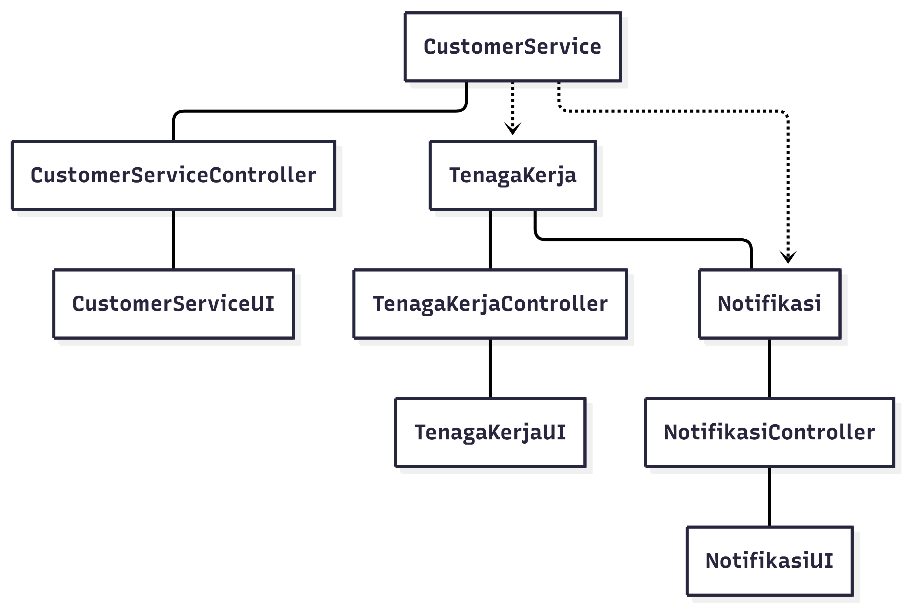

<i>Gambar 3.2. Diagram Kelas Use Case UC02</i>

**Belum selesai:** sesuaikan diagram ini menjadi diagram perancangan dengan visibilitas dan tipe atribut, parameter dan tipe kembalian operasi, serta relasi dan multiplisitas. Pastikan semua operasi pada sequence diagram tercantum dan konsisten dengan Bab 4.

## 3.3 Use Case Mengelola Lowongan Pekerjaan

**ID Use Case:** UC03  
**Nama Use Case:** Mengelola Lowongan Pekerjaan

### 3.3.1 Identifikasi Kelas

Tabel 3.3. Identifikasi Awal Kelas Use Case UC03

| No | Nama Kelas Perancangan (Awal) | Nama Kelas Analisis Terkait |
| :--- | :--- | :--- |
| 1 | C03 - PenyediaKerja | C03 - PenyediaKerja |
| 2 | C05 - LowonganPekerjaan | C05 - LowonganPekerjaan |
| 3 | C18 - PenyediaKerjaUI | C18 - PenyediaKerjaUI |
| 4 | C20 - LowonganPekerjaanUI | C20 - LowonganPekerjaanUI |
| 5 | C33 - PenyediaKerjaController | C33 - PenyediaKerjaController |
| 6 | C35 - LowonganPekerjaanController | C35 - LowonganPekerjaanController |

### 3.3.2 Sequence Diagram

**Belum dikerjakan:** sequence diagram belum tersedia pada M1-M6. Gunakan [skenario UC03 pada SKPL](../M5/K03_G06_SKPL.md#443-skenario-uc03) sebagai acuan untuk:

- Skenario Normal.
- Skenario Alternatif 1: Isian Formulir Kosong atau Tidak Valid.
- Skenario Alternatif 2: Membatalkan Pembuatan Lowongan.

### 3.3.3 Diagram Kelas

Diagram kelas analisis acuan dari SKPL:

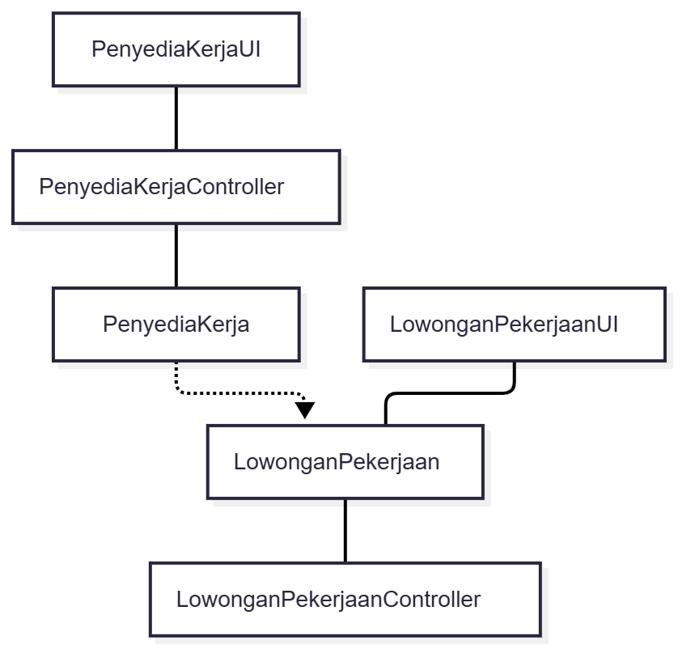

<i>Gambar 3.3. Diagram Kelas Use Case UC03</i>

**Belum selesai:** sesuaikan diagram ini menjadi diagram perancangan dengan visibilitas dan tipe atribut, parameter dan tipe kembalian operasi, serta relasi dan multiplisitas. Pastikan semua operasi pada sequence diagram tercantum dan konsisten dengan Bab 4.

## 3.4 Use Case Mencari Lowongan Pekerjaan

**ID Use Case:** UC04  
**Nama Use Case:** Mencari Lowongan Pekerjaan

### 3.4.1 Identifikasi Kelas

Tabel 3.4. Identifikasi Awal Kelas Use Case UC04

| No | Nama Kelas Perancangan (Awal) | Nama Kelas Analisis Terkait |
| :--- | :--- | :--- |
| 1 | C02 - TenagaKerja | C02 - TenagaKerja |
| 2 | C05 - LowonganPekerjaan | C05 - LowonganPekerjaan |
| 3 | C17 - TenagaKerjaUI | C17 - TenagaKerjaUI |
| 4 | C20 - LowonganPekerjaanUI | C20 - LowonganPekerjaanUI |
| 5 | C32 - TenagaKerjaController | C32 - TenagaKerjaController |
| 6 | C35 - LowonganPekerjaanController | C35 - LowonganPekerjaanController |

### 3.4.2 Sequence Diagram

**Belum dikerjakan:** sequence diagram belum tersedia pada M1-M6. Gunakan [skenario UC04 pada SKPL](../M5/K03_G06_SKPL.md#444-skenario-uc04) sebagai acuan untuk:

- Skenario Normal.
- Skenario Alternatif 1: Pencarian Tidak Ditemukan.

### 3.4.3 Diagram Kelas

Diagram kelas analisis acuan dari SKPL:

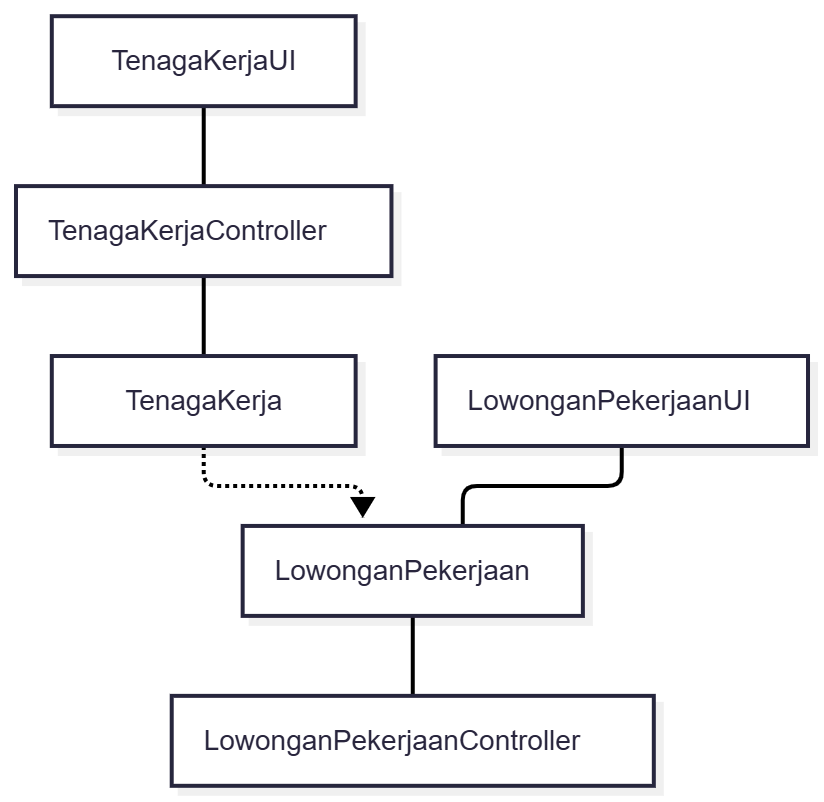

<i>Gambar 3.4. Diagram Kelas Use Case UC04</i>

**Belum selesai:** sesuaikan diagram ini menjadi diagram perancangan dengan visibilitas dan tipe atribut, parameter dan tipe kembalian operasi, serta relasi dan multiplisitas. Pastikan semua operasi pada sequence diagram tercantum dan konsisten dengan Bab 4.

## 3.5 Use Case Mengajukan Penawaran Pekerjaan

**ID Use Case:** UC05  
**Nama Use Case:** Mengajukan Penawaran Pekerjaan

### 3.5.1 Identifikasi Kelas

Tabel 3.5. Identifikasi Awal Kelas Use Case UC05

| No | Nama Kelas Perancangan (Awal) | Nama Kelas Analisis Terkait |
| :--- | :--- | :--- |
| 1 | C02 - TenagaKerja | C02 - TenagaKerja |
| 2 | C05 - LowonganPekerjaan | C05 - LowonganPekerjaan |
| 3 | C06 - PengajuanPenawaran | C06 - PengajuanPenawaran |
| 4 | C14 - Notifikasi | C14 - Notifikasi |
| 5 | C21 - PengajuanPenawaranUI | C21 - PengajuanPenawaranUI |
| 6 | C29 - NotifikasiUI | C29 - NotifikasiUI |
| 7 | C36 - PengajuanPenawaranController | C36 - PengajuanPenawaranController |
| 8 | C44 - NotifikasiController | C44 - NotifikasiController |

### 3.5.2 Sequence Diagram

**Belum dikerjakan:** sequence diagram belum tersedia pada M1-M6. Gunakan [skenario UC05 pada SKPL](../M5/K03_G06_SKPL.md#445-skenario-uc05) sebagai acuan untuk:

- Skenario Normal.
- Skenario Alternatif 1: Akun Belum Terverifikasi.
- Skenario Alternatif 2: Pembatalan Pengajuan.

### 3.5.3 Diagram Kelas

Diagram kelas analisis acuan dari SKPL:

<i>Gambar 3.5. Diagram Kelas Use Case UC05</i>

**Belum selesai:** sesuaikan diagram ini menjadi diagram perancangan dengan visibilitas dan tipe atribut, parameter dan tipe kembalian operasi, serta relasi dan multiplisitas. Pastikan semua operasi pada sequence diagram tercantum dan konsisten dengan Bab 4.

## 3.6 Use Case Memilih Tenaga Kerja

**ID Use Case:** UC06  
**Nama Use Case:** Memilih Tenaga Kerja

### 3.6.1 Identifikasi Kelas

Tabel 3.6. Identifikasi Awal Kelas Use Case UC06

| No | Nama Kelas Perancangan (Awal) | Nama Kelas Analisis Terkait |
| :--- | :--- | :--- |
| 1 | C03 - PenyediaKerja | C03 - PenyediaKerja |
| 2 | C05 - LowonganPekerjaan | C05 - LowonganPekerjaan |
| 3 | C06 - PengajuanPenawaran | C06 - PengajuanPenawaran |
| 4 | C07 - TransaksiPekerjaan | C07 - TransaksiPekerjaan |
| 5 | C14 - Notifikasi | C14 - Notifikasi |
| 6 | C18 - PenyediaKerjaUI | C18 - PenyediaKerjaUI |
| 7 | C20 - LowonganPekerjaanUI | C20 - LowonganPekerjaanUI |
| 8 | C21 - PengajuanPenawaranUI | C21 - PengajuanPenawaranUI |
| 9 | C22 - TransaksiPekerjaanUI | C22 - TransaksiPekerjaanUI |
| 10 | C29 - NotifikasiUI | C29 - NotifikasiUI |
| 11 | C33 - PenyediaKerjaController | C33 - PenyediaKerjaController |
| 12 | C35 - LowonganPekerjaanController | C35 - LowonganPekerjaanController |
| 13 | C36 - PengajuanPenawaranController | C36 - PengajuanPenawaranController |
| 14 | C37 - TransaksiPekerjaanController | C37 - TransaksiPekerjaanController |
| 15 | C44 - NotifikasiController | C44 - NotifikasiController |

### 3.6.2 Sequence Diagram

**Belum dikerjakan:** sequence diagram belum tersedia pada M1-M6. Gunakan [skenario UC06 pada SKPL](../M5/K03_G06_SKPL.md#446-skenario-uc06) sebagai acuan untuk:

- Skenario Normal.
- Skenario Alternatif 1: Kuota Lowongan Sudah Penuh Saat Konfirmasi.
- Skenario Alternatif 2: Penyedia Kerja Membatalkan Pemilihan Pelamar.

### 3.6.3 Diagram Kelas

Diagram kelas analisis acuan dari SKPL:

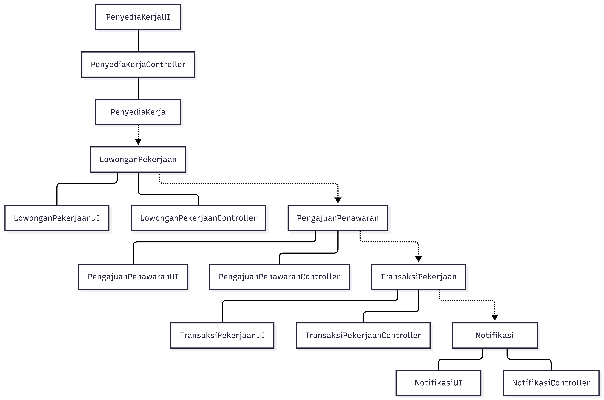

<i>Gambar 3.6. Diagram Kelas Use Case UC06</i>

**Belum selesai:** sesuaikan diagram ini menjadi diagram perancangan dengan visibilitas dan tipe atribut, parameter dan tipe kembalian operasi, serta relasi dan multiplisitas. Pastikan semua operasi pada sequence diagram tercantum dan konsisten dengan Bab 4.

## 3.7 Use Case Melakukan Pembayaran Pekerjaan

**ID Use Case:** UC07  
**Nama Use Case:** Melakukan Pembayaran Pekerjaan

### 3.7.1 Identifikasi Kelas

Tabel 3.7. Identifikasi Awal Kelas Use Case UC07

| No | Nama Kelas Perancangan (Awal) | Nama Kelas Analisis Terkait |
| :--- | :--- | :--- |
| 1 | C03 - PenyediaKerja | C03 - PenyediaKerja |
| 2 | C07 - TransaksiPekerjaan | C07 - TransaksiPekerjaan |
| 3 | C09 - TagihanPembayaran | C09 - TagihanPembayaran |
| 4 | C14 - Notifikasi | C14 - Notifikasi |
| 5 | C15 - PaymentGateway | C15 - PaymentGateway |
| 6 | C18 - PenyediaKerjaUI | C18 - PenyediaKerjaUI |
| 7 | C22 - TransaksiPekerjaanUI | C22 - TransaksiPekerjaanUI |
| 8 | C24 - TagihanPembayaranUI | C24 - TagihanPembayaranUI |
| 9 | C29 - NotifikasiUI | C29 - NotifikasiUI |
| 10 | C30 - PaymentGatewayUI | C30 - PaymentGatewayUI |
| 11 | C33 - PenyediaKerjaController | C33 - PenyediaKerjaController |
| 12 | C37 - TransaksiPekerjaanController | C37 - TransaksiPekerjaanController |
| 13 | C39 - TagihanPembayaranController | C39 - TagihanPembayaranController |
| 14 | C44 - NotifikasiController | C44 - NotifikasiController |
| 15 | C45 - PaymentGatewayController | C45 - PaymentGatewayController |

### 3.7.2 Sequence Diagram

**Belum dikerjakan:** sequence diagram belum tersedia pada M1-M6. Gunakan [skenario UC07 pada SKPL](../M5/K03_G06_SKPL.md#447-skenario-uc07) sebagai acuan untuk:

- Skenario Normal.
- Skenario Alternatif 1: Pembayaran Gagal atau Dibatalkan oleh Payment Gateway.
- Skenario Alternatif 2: Waktu Pembayaran Habis (Timeout / Expired).

### 3.7.3 Diagram Kelas

Diagram kelas analisis acuan dari SKPL:

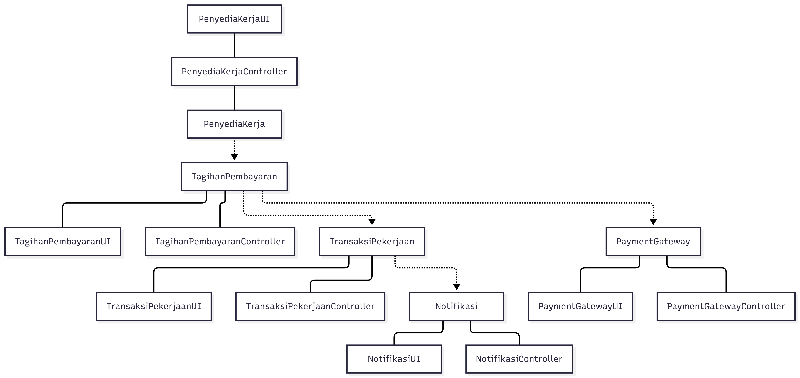

<i>Gambar 3.7. Diagram Kelas Use Case UC07</i>

**Belum selesai:** sesuaikan diagram ini menjadi diagram perancangan dengan visibilitas dan tipe atribut, parameter dan tipe kembalian operasi, serta relasi dan multiplisitas. Pastikan semua operasi pada sequence diagram tercantum dan konsisten dengan Bab 4.

## 3.8 Use Case Menyerahkan Hasil Pekerjaan

**ID Use Case:** UC08  
**Nama Use Case:** Menyerahkan Hasil Pekerjaan

### 3.8.1 Identifikasi Kelas

Tabel 3.8. Identifikasi Awal Kelas Use Case UC08

| No | Nama Kelas Perancangan (Awal) | Nama Kelas Analisis Terkait |
| :--- | :--- | :--- |
| 1 | C02 - TenagaKerja | C02 - TenagaKerja |
| 2 | C07 - TransaksiPekerjaan | C07 - TransaksiPekerjaan |
| 3 | C08 - BuktiPenyerahan | C08 - BuktiPenyerahan |
| 4 | C14 - Notifikasi | C14 - Notifikasi |
| 5 | C17 - TenagaKerjaUI | C17 - TenagaKerjaUI |
| 6 | C22 - TransaksiPekerjaanUI | C22 - TransaksiPekerjaanUI |
| 7 | C23 - BuktiPenyerahanUI | C23 - BuktiPenyerahanUI |
| 8 | C29 - NotifikasiUI | C29 - NotifikasiUI |
| 9 | C32 - TenagaKerjaController | C32 - TenagaKerjaController |
| 10 | C37 - TransaksiPekerjaanController | C37 - TransaksiPekerjaanController |
| 11 | C38 - BuktiPenyerahanController | C38 - BuktiPenyerahanController |
| 12 | C44 - NotifikasiController | C44 - NotifikasiController |

### 3.8.2 Sequence Diagram

**Belum dikerjakan:** sequence diagram belum tersedia pada M1-M6. Gunakan [skenario UC08 pada SKPL](../M5/K03_G06_SKPL.md#448-skenario-uc08) sebagai acuan untuk:

- Skenario Normal.
- Skenario Alternatif 1: Ukuran Berkas Melebihi Batas Maksimal.
- Skenario Alternatif 2: Tenaga Kerja Belum Mengunggah Berkas Wajib.

### 3.8.3 Diagram Kelas

Diagram kelas analisis acuan dari SKPL:

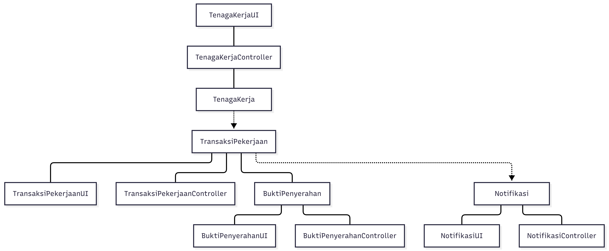

<i>Gambar 3.8. Diagram Kelas Use Case UC08</i>

**Belum selesai:** sesuaikan diagram ini menjadi diagram perancangan dengan visibilitas dan tipe atribut, parameter dan tipe kembalian operasi, serta relasi dan multiplisitas. Pastikan semua operasi pada sequence diagram tercantum dan konsisten dengan Bab 4.

## 3.9 Use Case Memverifikasi Penyelesaian Pekerjaan

**ID Use Case:** UC09  
**Nama Use Case:** Memverifikasi Penyelesaian Pekerjaan

### 3.9.1 Identifikasi Kelas

Tabel 3.9. Identifikasi Awal Kelas Use Case UC09

| No | Nama Kelas Perancangan (Awal) | Nama Kelas Analisis Terkait |
| :--- | :--- | :--- |
| 1 | C03 - PenyediaKerja | C03 - PenyediaKerja |
| 2 | C07 - TransaksiPekerjaan | C07 - TransaksiPekerjaan |
| 3 | C08 - BuktiPenyerahan | C08 - BuktiPenyerahan |
| 4 | C14 - Notifikasi | C14 - Notifikasi |
| 5 | C18 - PenyediaKerjaUI | C18 - PenyediaKerjaUI |
| 6 | C22 - TransaksiPekerjaanUI | C22 - TransaksiPekerjaanUI |
| 7 | C23 - BuktiPenyerahanUI | C23 - BuktiPenyerahanUI |
| 8 | C29 - NotifikasiUI | C29 - NotifikasiUI |
| 9 | C33 - PenyediaKerjaController | C33 - PenyediaKerjaController |
| 10 | C37 - TransaksiPekerjaanController | C37 - TransaksiPekerjaanController |
| 11 | C38 - BuktiPenyerahanController | C38 - BuktiPenyerahanController |
| 12 | C44 - NotifikasiController | C44 - NotifikasiController |

### 3.9.2 Sequence Diagram

**Belum dikerjakan:** sequence diagram belum tersedia pada M1-M6. Gunakan [skenario UC09 pada SKPL](../M5/K03_G06_SKPL.md#449-skenario-uc09) sebagai acuan untuk:

- Skenario Normal.
- Skenario Alternatif 1: Hasil Pekerjaan Belum Sesuai (Penyedia Kerja Meminta Revisi).
- Skenario Alternatif 2: Terjadi Ketidaksepakatan / Perselisihan Hasil Kerja.

### 3.9.3 Diagram Kelas

Diagram kelas analisis acuan dari SKPL:

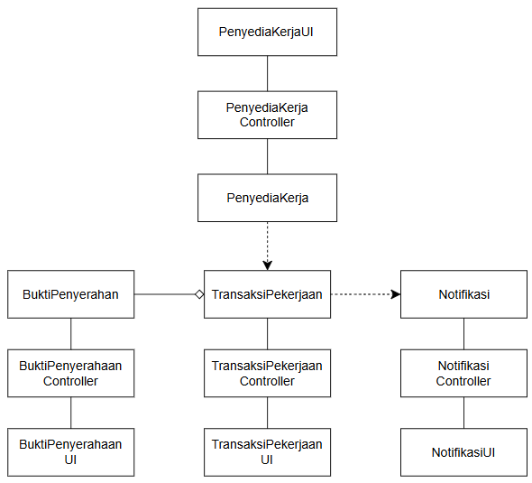

<i>Gambar 3.9. Diagram Kelas Use Case UC09</i>

**Belum selesai:** sesuaikan diagram ini menjadi diagram perancangan dengan visibilitas dan tipe atribut, parameter dan tipe kembalian operasi, serta relasi dan multiplisitas. Pastikan semua operasi pada sequence diagram tercantum dan konsisten dengan Bab 4.

## 3.10 Use Case Melakukan Pencairan Dana

**ID Use Case:** UC10  
**Nama Use Case:** Melakukan Pencairan Dana

### 3.10.1 Identifikasi Kelas

Tabel 3.10. Identifikasi Awal Kelas Use Case UC10

| No | Nama Kelas Perancangan (Awal) | Nama Kelas Analisis Terkait |
| :--- | :--- | :--- |
| 1 | C02 - TenagaKerja | C02 - TenagaKerja |
| 2 | C10 - PencairanDana | C10 - PencairanDana |
| 3 | C14 - Notifikasi | C14 - Notifikasi |
| 4 | C15 - PaymentGateway | C15 - PaymentGateway |
| 5 | C17 - TenagaKerjaUI | C17 - TenagaKerjaUI |
| 6 | C25 - PencairanDanaUI | C25 - PencairanDanaUI |
| 7 | C29 - NotifikasiUI | C29 - NotifikasiUI |
| 8 | C30 - PaymentGatewayUI | C30 - PaymentGatewayUI |
| 9 | C32 - TenagaKerjaController | C32 - TenagaKerjaController |
| 10 | C40 - PencairanDanaController | C40 - PencairanDanaController |
| 11 | C44 - NotifikasiController | C44 - NotifikasiController |
| 12 | C45 - PaymentGatewayController | C45 - PaymentGatewayController |

### 3.10.2 Sequence Diagram

**Belum dikerjakan:** sequence diagram belum tersedia pada M1-M6. Gunakan [skenario UC10 pada SKPL](../M5/K03_G06_SKPL.md#4410-skenario-uc10) sebagai acuan untuk:

- Skenario Normal.
- Skenario Alternatif 1: Data Rekening/E-wallet Tidak Valid.
- Skenario Alternatif 2: Nominal Penarikan Melebihi Saldo.

### 3.10.3 Diagram Kelas

Diagram kelas analisis acuan dari SKPL:

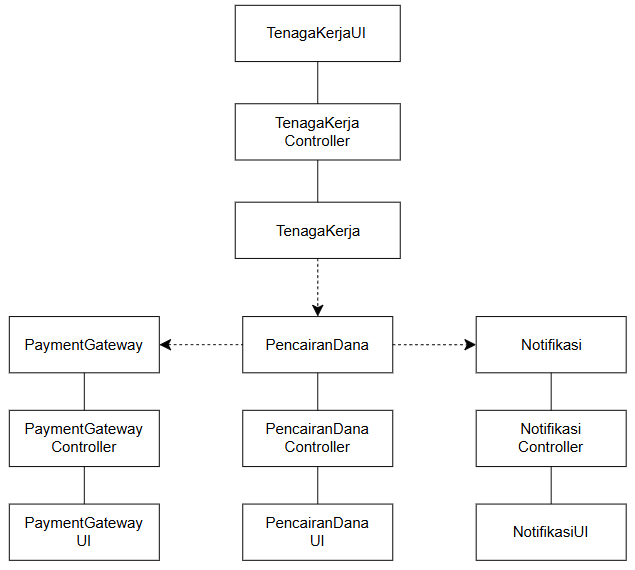

<i>Gambar 3.10. Diagram Kelas Use Case UC10</i>

**Belum selesai:** sesuaikan diagram ini menjadi diagram perancangan dengan visibilitas dan tipe atribut, parameter dan tipe kembalian operasi, serta relasi dan multiplisitas. Pastikan semua operasi pada sequence diagram tercantum dan konsisten dengan Bab 4.

## 3.11 Use Case Memberikan Penilaian Kerja

**ID Use Case:** UC11  
**Nama Use Case:** Memberikan Penilaian Kerja

### 3.11.1 Identifikasi Kelas

Tabel 3.11. Identifikasi Awal Kelas Use Case UC11

| No | Nama Kelas Perancangan (Awal) | Nama Kelas Analisis Terkait |
| :--- | :--- | :--- |
| 1 | C01 - Pengguna | C01 - Pengguna |
| 2 | C07 - TransaksiPekerjaan | C07 - TransaksiPekerjaan |
| 3 | C11 - UlasanRating | C11 - UlasanRating |
| 4 | C16 - PenggunaUI | C16 - PenggunaUI |
| 5 | C22 - TransaksiPekerjaanUI | C22 - TransaksiPekerjaanUI |
| 6 | C26 - UlasanRatingUI | C26 - UlasanRatingUI |
| 7 | C31 - PenggunaController | C31 - PenggunaController |
| 8 | C37 - TransaksiPekerjaanController | C37 - TransaksiPekerjaanController |
| 9 | C41 - UlasanRatingController | C41 - UlasanRatingController |

### 3.11.2 Sequence Diagram

**Belum dikerjakan:** sequence diagram belum tersedia pada M1-M6. Gunakan [skenario UC11 pada SKPL](../M5/K03_G06_SKPL.md#4411-skenario-uc11) sebagai acuan untuk:

- Skenario Normal.
- Skenario Alternatif 1: Pengiriman Ulasan Ganda.
- Skenario Alternatif 2: Rating Tidak Diisi.

### 3.11.3 Diagram Kelas

Diagram kelas analisis acuan dari SKPL:

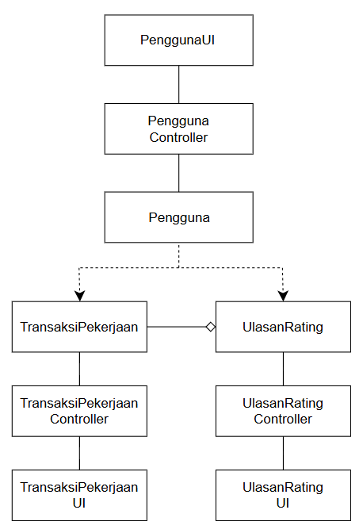

<i>Gambar 3.11. Diagram Kelas Use Case UC11</i>

**Belum selesai:** sesuaikan diagram ini menjadi diagram perancangan dengan visibilitas dan tipe atribut, parameter dan tipe kembalian operasi, serta relasi dan multiplisitas. Pastikan semua operasi pada sequence diagram tercantum dan konsisten dengan Bab 4.

## 3.12 Use Case Menangani Keluhan

**ID Use Case:** UC12  
**Nama Use Case:** Menangani Keluhan

### 3.12.1 Identifikasi Kelas

Tabel 3.12. Identifikasi Awal Kelas Use Case UC12

| No | Nama Kelas Perancangan (Awal) | Nama Kelas Analisis Terkait |
| :--- | :--- | :--- |
| 1 | C04 - CustomerService | C04 - CustomerService |
| 2 | C07 - TransaksiPekerjaan | C07 - TransaksiPekerjaan |
| 3 | C12 - TiketSengketa | C12 - TiketSengketa |
| 4 | C13 - RiwayatSengketa | C13 - RiwayatSengketa |
| 5 | C14 - Notifikasi | C14 - Notifikasi |
| 6 | C19 - CustomerServiceUI | C19 - CustomerServiceUI |
| 7 | C22 - TransaksiPekerjaanUI | C22 - TransaksiPekerjaanUI |
| 8 | C27 - TiketSengketaUI | C27 - TiketSengketaUI |
| 9 | C28 - RiwayatSengketaUI | C28 - RiwayatSengketaUI |
| 10 | C29 - NotifikasiUI | C29 - NotifikasiUI |
| 11 | C34 - CustomerServiceController | C34 - CustomerServiceController |
| 12 | C37 - TransaksiPekerjaanController | C37 - TransaksiPekerjaanController |
| 13 | C42 - TiketSengketaController | C42 - TiketSengketaController |
| 14 | C43 - RiwayatSengketaController | C43 - RiwayatSengketaController |
| 15 | C44 - NotifikasiController | C44 - NotifikasiController |

### 3.12.2 Sequence Diagram

**Belum dikerjakan:** sequence diagram belum tersedia pada M1-M6. Gunakan [skenario UC12 pada SKPL](../M5/K03_G06_SKPL.md#4412-skenario-uc12) sebagai acuan untuk:

- Skenario Normal.
- Skenario Alternatif 1: Permintaan Bukti Tambahan.
- Skenario Alternatif 2: Keluhan Ditolak karena Bukti Tidak Cukup.
- Skenario Alternatif 3: Pengguna Membatalkan Tiket Keluhan.

### 3.12.3 Diagram Kelas

Diagram kelas analisis acuan dari SKPL:

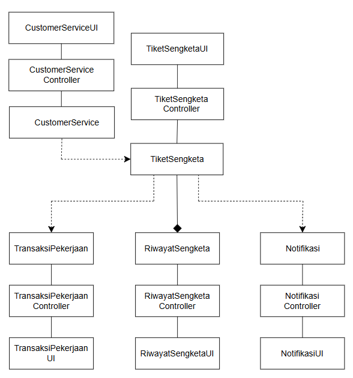

<i>Gambar 3.12. Diagram Kelas Use Case UC12</i>

**Belum selesai:** sesuaikan diagram ini menjadi diagram perancangan dengan visibilitas dan tipe atribut, parameter dan tipe kembalian operasi, serta relasi dan multiplisitas. Pastikan semua operasi pada sequence diagram tercantum dan konsisten dengan Bab 4.

---

# BAB 4: Diagram Kelas Keseluruhan

## 4.1 Diagram Kelas

**Belum dikerjakan:** diagram kelas keseluruhan Kerja-In belum tersedia pada M1-M6. SKPL 5.3 masih menampilkan gambar contoh, sehingga gambar tersebut tidak digunakan sebagai diagram Kerja-In.

Tabel 4.1. Daftar Awal Kelas Perancangan Keseluruhan

Daftar berikut menggabungkan atribut dan operasi dari tabel kelas per use case pada SKPL 5.2, dengan ID konsisten dari SKPL 5.1. Entri yang sama persis ditampilkan sekali; variasi nama dan operasi dari sumber tetap dipertahankan untuk ditinjau. Tabel ini belum menjadi spesifikasi perancangan final karena sumber belum melengkapi tipe data, seluruh signature operasi, dan konsistensi penamaan antarskenario.

| ID Kelas | Nama Kelas | Atribut dari Analisis | Metode/Operasi dari Analisis |
| :--- | :--- | :--- | :--- |
| C01 | Pengguna | #idPengguna #nama #email #password #tanggalLahir #tokenAuth -idPengguna -nama -akumulasiRating | +getUsia() +setToken() +getNama() +getEmail() +berikanUlasan(idTransaksi, nilai, deskripsi) |
| C02 | TenagaKerja | -statusVerifikasi -saldoPendapatan -ratingAkumulatif -dokumenIdentitas #idPengguna #nama -idTenagaKerja #email #idTenagaKerja #saldoPendapatan | +buatProfilPekerja() +getStatusVerifikasi() +getSaldo() +updateStatusVerifikasi() +setDokumenIdentitas() +cariLowongan(kataKunci) +filterLowongan(kategori) +ajukanPenawaran(idLowongan, pesan) +batalkanPengajuan() +serahkanPekerjaan(idTransaksi, deskripsi, berkas) +tarikSaldo() |
| C03 | PenyediaKerja | -idPenyedia #idPengguna #nama #email #idPenyediaKerja #ratingAkumulatif | +buatProfilPenyedia() +getIdPenyedia() +buatLowonganBaru(judul, deskripsi, kuota, lokasi, upah) +batalkanLowongan() +lihatDaftarPelamar() +pilihPelamar(idPenawaran) +bayarTagihan(idTagihan, metode) +setujuiHasilPekerjaan() |
| C04 | CustomerService | -idAdmin -hakAkses -idPengguna -nama -peran | +setujuiVerifikasi() +tolakVerifikasi() +tinjauTiket(idTiket) +putuskanSengketa(idTiket, keputusan) |
| C05 | LowonganPekerjaan | -idLowongan -judul -deskripsi -kuota -lokasi -upah -status -kategori -jumlahDiterima | -validasiIsianFormulir() +simpanLowongan() -setStatusDefault() +tampilkanDaftarLowongan(filter) +cekStatusOpen() +tampilkanTombolAjukan() +cekKuotaSisa() #updateStatusLowongan(statusBaru) -kurangiKuota() +tambahJumlahDiterima() |
| C06 | PengajuanPenawaran | -idPenawaran -idLowongan -idTenagaKerja -pesanPenawaran -timestamp -status | +simpanPengajuan() -validasiStatusAkun() +setStatusPersetujuan(status) +getStatus() |
| C07 | TransaksiPekerjaan | -idTransaksi -idLowongan -idTenagaKerja -idPenyediaKerja -statusPekerjaan -statusPengerjaan -nominalUpah | +buatTransaksiBaru() #updateStatusPekerjaan(status) +updateStatusPekerjaan(status) +getStatusPekerjaan() +verifikasiSelesai() +getDetailTransaksi() +cekStatusSelesai() +validasiUlasanGanda() |
| C08 | BuktiPenyerahan | -idPenyerahan -idTransaksi -deskripsiPengerjaan -fileUrl -ukuranFile -timestampPengiriman -waktuPengiriman | +simpanBukti() #validasiBukti() +getDetailBukti() |
| C09 | TagihanPembayaran | -idTagihan -idTransaksi -nominalUpah -commissionFee -totalBayar -expiryTimestamp -statusBayar | +hitungTotalTagihan() +buatInvoice() #updateStatusPembayaran() |
| C10 | PencairanDana | -idPencairan -nominal -tujuan -statusTransfer | +simpanDataPencairan() |
| C11 | UlasanRating | -idUlasan -idTransaksi -idPemberi -idPenerima -nilai -deskripsiUlasan | +simpanUlasan() |
| C12 | TiketSengketa | -idTiket -idTransaksi -idPelapor -kategoriMasalah -deskripsiKomplain -statusTiket | +buatTiket() +updateStatus(statusBaru) |
| C13 | RiwayatSengketa | -idRiwayat -idTiket -logAktivitas -timestamp | +catatRiwayat(aktivitas) |
| C14 | Notifikasi | -idNotifikasi -idPenerima -pesan -statusBaca -timestamp -idPengguna | +simpanPesanNotifikasi() +tandaiSudahDibaca() +kirimNotifikasiPengajuanBaru() +kirimNotifikasiPenerimaan() +kirimNotifikasiSiapKerja() +kirimNotifikasiPeninjauan() +kirimNotifikasi(pesan) |
| C15 | PaymentGateway | -idGateway -namaProvider -statusKoneksi -idTransaksiGateway -status | +prosesPembayaran() +dapatkanCallbackStatus() +prosesTransfer() |
| C16 | PenggunaUI | Tidak dicantumkan pada tabel sumber. | +tampilkanFormRegistrasi() +tampilkanFormLogin() +submitDataRegistrasi() +submitDataLogin() +tampilkanMenuUlasan() |
| C17 | TenagaKerjaUI | Tidak dicantumkan pada tabel sumber. | +tampilkanFormProfil() +tampilkanFormUnggahDokumen() +submitDokumenIdentitas() +tampilkanHalamanPencarian() +tampilkanDashboardPekerja() +tampilkanPekerjaanAktif() +tampilkanHalamanPencairan() |
| C18 | PenyediaKerjaUI | Tidak dicantumkan pada tabel sumber. | +tampilkanFormProfil() +tampilkanDashboard() +tampilkanDaftarPelamar() +tampilkanHalamanPembayaran() +tampilkanHalamanVerifikasi() |
| C19 | CustomerServiceUI | Tidak dicantumkan pada tabel sumber. | +tampilkanDaftarAntreanVerifikasi() +tekanTombolSetuju() +tekanTombolTolak() +tampilkanHalamanSengketa() |
| C20 | LowonganPekerjaanUI | Tidak dicantumkan pada tabel sumber. | +tampilkanFormLowongan() +submitDataLowongan() +tampilkanKatalogLowongan() +submitPencarian(kataKunci) +pilihFilter(kategori) +tampilkanDaftarPelamar() +pilihPelamar(idPenawaran) +tampilkanKonfirmasiPersetujuan() |
| C21 | PengajuanPenawaranUI | Tidak dicantumkan pada tabel sumber. | +tampilkanFormPenawaran() +submitPenawaran(idLowongan, pesan) +tampilkanDetailPenawaran() +renderStatusPenawaran() |
| C22 | TransaksiPekerjaanUI | Tidak dicantumkan pada tabel sumber. | +tampilkanNotifikasiTransaksi() +tampilkanStatusPembayaran() +tampilkanDetailPekerjaan() +tekanTombolSerahkanPekerjaan() +tampilkanDetailBukti() +konfirmasiPenyelesaian() +tampilkanDetailTransaksi() |
| C23 | BuktiPenyerahanUI | Tidak dicantumkan pada tabel sumber. | +tampilkanFormPenyerahan() +submitHasilPekerjaan(idTransaksi, deskripsi, berkas) +tampilkanKonfirmasiPenyerahan() +tampilkanFileBukti() |
| C24 | TagihanPembayaranUI | Tidak dicantumkan pada tabel sumber. | +tampilkanInvoice() +bayarTagihan(idTagihan, metode) |
| C25 | PencairanDanaUI | Tidak dicantumkan pada tabel sumber. | +tampilkanStatusPencairan() |
| C26 | UlasanRatingUI | Tidak dicantumkan pada tabel sumber. | +tampilkanFormRating() |
| C27 | TiketSengketaUI | Tidak dicantumkan pada tabel sumber. | +tampilkanFormTiket() |
| C28 | RiwayatSengketaUI | Tidak dicantumkan pada tabel sumber. | +tampilkanRiwayat() |
| C29 | NotifikasiUI | Tidak dicantumkan pada tabel sumber. | +renderPesanNotifikasi() +tampilkanPesanNotifikasi() +tampilkanNotifikasiPenerimaan() +tampilkanNotifikasiPeninjauan() |
| C30 | PaymentGatewayUI | Tidak dicantumkan pada tabel sumber. | +tampilkanHalamanGateway() +tampilkanStatusGateway() |
| C31 | PenggunaController | Tidak dicantumkan pada tabel sumber. | +prosesRegistrasi() -validasiBatasUsia() -enkripsiPassword() +prosesAutentikasi() +prosesPemberianUlasan() |
| C32 | TenagaKerjaController | Tidak dicantumkan pada tabel sumber. | +simpanProfilTenagaKerja() +ajukanProsesVerifikasi() -validasiFormatDokumen() -validasiUkuranDokumen() +arahkanKePencarian() +arahkanKeFormPenyerahan(idTransaksi) +ajukanPencairan() |
| C33 | PenyediaKerjaController | Tidak dicantumkan pada tabel sumber. | +simpanProfilPenyediaKerja() +arahkanKeFormLowongan() +arahkanKeDaftarPelamar() +arahkanKePembayaran() +arahkanKeTransaksi() |
| C34 | CustomerServiceController | Tidak dicantumkan pada tabel sumber. | +tinjauDokumenPekerja() +eksekusiPersetujuan() +eksekusiPenolakan() +prosesTiketSengketa() |
| C35 | LowonganPekerjaanController | Tidak dicantumkan pada tabel sumber. | +prosesBuatLowongan() +prosesCariLowongan(kataKunci) +prosesFilterLowongan(kategori) +prosesPilihPelamar(idPenawaran) -validasiKuota(idLowongan) +updateKuotaDanStatus(idLowongan) |
| C36 | PengajuanPenawaranController | Tidak dicantumkan pada tabel sumber. | +prosesPengajuan(idLowongan, pesan) -validasiPersyaratan() +ubahStatusPenawaran(idPenawaran, status) |
| C37 | TransaksiPekerjaanController | Tidak dicantumkan pada tabel sumber. | +prosesBuatTransaksi() +prosesUpdateStatusInprogress() +prosesTransisiPenyerahan(idTransaksi) -validasiStatusInProgress(idTransaksi) +prosesVerifikasiSelesai(id) -validasiStatus() +picuPembayaran() +validasiBisaDinilai() +ambilDataTransaksi() |
| C38 | BuktiPenyerahanController | Tidak dicantumkan pada tabel sumber. | +prosesSerahkanPekerjaan(idTransaksi, deskripsi, berkas) -validasiUkuranFile(berkas) -validasiFormatFile(berkas) +simpanPenyerahan(idTransaksi, deskripsi, fileUrl) +ambilDataBukti(id) |
| C39 | TagihanPembayaranController | Tidak dicantumkan pada tabel sumber. | +prosesTagihan(idTransaksi) +buatInvoice() |
| C40 | PencairanDanaController | Tidak dicantumkan pada tabel sumber. | +prosesPencairan(nominal) |
| C41 | UlasanRatingController | Tidak dicantumkan pada tabel sumber. | +prosesSimpanRating() |
| C42 | TiketSengketaController | Tidak dicantumkan pada tabel sumber. | +prosesBuatTiket() |
| C43 | RiwayatSengketaController | Tidak dicantumkan pada tabel sumber. | +prosesCatatRiwayat() |
| C44 | NotifikasiController | Tidak dicantumkan pada tabel sumber. | +buatNotifikasiVerifikasi() +prosesKirimNotifikasi() +kirimNotifikasiPenerimaan(idPenerima) -buatNotifikasiPersetujuan() +kirimNotifikasiSiapKerja(idPenerima) +kirimNotifikasiPeninjauan(idPenerima) -buatNotifikasiPenyerahan() +prosesKirimNotifikasi(pesan) |
| C45 | PaymentGatewayController | Tidak dicantumkan pada tabel sumber. | +prosesTransferPembayaran() +terimaCallbackGateway() +kirimInstruksiPencairan() |

**Belum selesai:** satukan variasi penamaan atribut dan operasi menjadi spesifikasi yang konsisten, lengkapi tipe/visibilitas/signature, kemudian buat diagram keseluruhan yang mencakup kelas dan relasi pada Bab 3.

---

# BAB 5: Matriks Kerunutan

Tabel berikut disalin berdasarkan hubungan kelas dan use case pada Bab 6 SKPL. Nama kelas menggunakan SKPL 5.1 dan nama use case menggunakan SKPL 4.2. Pemetaan ini merupakan acuan awal dan harus diperiksa kembali setelah kelas perancangan serta sequence diagram Bab 3 selesai.

Tabel 5.1. Matriks Awal Kerunutan Kelas terhadap Use Case

| Kelas | Use Case Terkait |
| :--- | :--- |
| C01 - Pengguna | UC01 - Melakukan Registrasi UC11 - Memberikan Penilaian Kerja |
| C02 - TenagaKerja | UC01 - Melakukan Registrasi UC02 - Mengelola Verifikasi Identitas UC04 - Mencari Lowongan Pekerjaan UC05 - Mengajukan Penawaran Pekerjaan UC08 - Menyerahkan Hasil Pekerjaan UC10 - Melakukan Pencairan Dana UC11 - Memberikan Penilaian Kerja |
| C03 - PenyediaKerja | UC01 - Melakukan Registrasi UC03 - Mengelola Lowongan Pekerjaan UC06 - Memilih Tenaga Kerja UC07 - Melakukan Pembayaran Pekerjaan UC09 - Memverifikasi Penyelesaian Pekerjaan UC11 - Memberikan Penilaian Kerja |
| C04 - CustomerService | UC02 - Mengelola Verifikasi Identitas UC12 - Menangani Keluhan |
| C05 - LowonganPekerjaan | UC03 - Mengelola Lowongan Pekerjaan UC04 - Mencari Lowongan Pekerjaan UC05 - Mengajukan Penawaran Pekerjaan UC06 - Memilih Tenaga Kerja |
| C06 - PengajuanPenawaran | UC05 - Mengajukan Penawaran Pekerjaan UC06 - Memilih Tenaga Kerja |
| C07 - TransaksiPekerjaan | UC06 - Memilih Tenaga Kerja UC07 - Melakukan Pembayaran Pekerjaan UC08 - Menyerahkan Hasil Pekerjaan UC09 - Memverifikasi Penyelesaian Pekerjaan UC11 - Memberikan Penilaian Kerja UC12 - Menangani Keluhan |
| C08 - BuktiPenyerahan | UC08 - Menyerahkan Hasil Pekerjaan UC09 - Memverifikasi Penyelesaian Pekerjaan |
| C09 - TagihanPembayaran | UC07 - Melakukan Pembayaran Pekerjaan |
| C10 - PencairanDana | UC10 - Melakukan Pencairan Dana |
| C11 - UlasanRating | UC11 - Memberikan Penilaian Kerja |
| C12 - TiketSengketa | UC12 - Menangani Keluhan |
| C13 - RiwayatSengketa | UC12 - Menangani Keluhan |
| C14 - Notifikasi | UC02 - Mengelola Verifikasi Identitas UC05 - Mengajukan Penawaran Pekerjaan UC07 - Melakukan Pembayaran Pekerjaan UC08 - Menyerahkan Hasil Pekerjaan UC09 - Memverifikasi Penyelesaian Pekerjaan UC12 - Menangani Keluhan |
| C15 - PaymentGateway | UC07 - Melakukan Pembayaran Pekerjaan UC10 - Melakukan Pencairan Dana |
| C16 - PenggunaUI | UC01 - Melakukan Registrasi |
| C17 - TenagaKerjaUI | UC01 - Melakukan Registrasi UC02 - Mengelola Verifikasi Identitas UC04 - Mencari Lowongan Pekerjaan UC10 - Melakukan Pencairan Dana |
| C18 - PenyediaKerjaUI | UC01 - Melakukan Registrasi UC03 - Mengelola Lowongan Pekerjaan |
| C19 - CustomerServiceUI | UC02 - Mengelola Verifikasi Identitas UC12 - Menangani Keluhan |
| C20 - LowonganPekerjaanUI | UC03 - Mengelola Lowongan Pekerjaan UC04 - Mencari Lowongan Pekerjaan UC06 - Memilih Tenaga Kerja |
| C21 - PengajuanPenawaranUI | UC05 - Mengajukan Penawaran Pekerjaan UC06 - Memilih Tenaga Kerja |
| C22 - TransaksiPekerjaanUI | UC07 - Melakukan Pembayaran Pekerjaan UC08 - Menyerahkan Hasil Pekerjaan UC09 - Memverifikasi Penyelesaian Pekerjaan |
| C23 - BuktiPenyerahanUI | UC08 - Menyerahkan Hasil Pekerjaan UC09 - Memverifikasi Penyelesaian Pekerjaan |
| C24 - TagihanPembayaranUI | UC07 - Melakukan Pembayaran Pekerjaan |
| C25 - PencairanDanaUI | UC10 - Melakukan Pencairan Dana |
| C26 - UlasanRatingUI | UC11 - Memberikan Penilaian Kerja |
| C27 - TiketSengketaUI | UC12 - Menangani Keluhan |
| C28 - RiwayatSengketaUI | UC12 - Menangani Keluhan |
| C29 - NotifikasiUI | UC02 - Mengelola Verifikasi Identitas UC05 - Mengajukan Penawaran Pekerjaan UC07 - Melakukan Pembayaran Pekerjaan UC08 - Menyerahkan Hasil Pekerjaan UC09 - Memverifikasi Penyelesaian Pekerjaan UC12 - Menangani Keluhan |
| C30 - PaymentGatewayUI | UC07 - Melakukan Pembayaran Pekerjaan UC10 - Melakukan Pencairan Dana |
| C31 - PenggunaController | UC01 - Melakukan Registrasi |
| C32 - TenagaKerjaController | UC01 - Melakukan Registrasi UC02 - Mengelola Verifikasi Identitas UC04 - Mencari Lowongan Pekerjaan UC08 - Menyerahkan Hasil Pekerjaan UC10 - Melakukan Pencairan Dana |
| C33 - PenyediaKerjaController | UC01 - Melakukan Registrasi UC03 - Mengelola Lowongan Pekerjaan UC09 - Memverifikasi Penyelesaian Pekerjaan |
| C34 - CustomerServiceController | UC02 - Mengelola Verifikasi Identitas UC12 - Menangani Keluhan |
| C35 - LowonganPekerjaanController | UC03 - Mengelola Lowongan Pekerjaan UC04 - Mencari Lowongan Pekerjaan UC06 - Memilih Tenaga Kerja |
| C36 - PengajuanPenawaranController | UC05 - Mengajukan Penawaran Pekerjaan UC06 - Memilih Tenaga Kerja |
| C37 - TransaksiPekerjaanController | UC07 - Melakukan Pembayaran Pekerjaan UC08 - Menyerahkan Hasil Pekerjaan UC09 - Memverifikasi Penyelesaian Pekerjaan |
| C38 - BuktiPenyerahanController | UC08 - Menyerahkan Hasil Pekerjaan UC09 - Memverifikasi Penyelesaian Pekerjaan |
| C39 - TagihanPembayaranController | UC07 - Melakukan Pembayaran Pekerjaan |
| C40 - PencairanDanaController | UC10 - Melakukan Pencairan Dana |
| C41 - UlasanRatingController | UC11 - Memberikan Penilaian Kerja |
| C42 - TiketSengketaController | UC12 - Menangani Keluhan |
| C43 - RiwayatSengketaController | UC12 - Menangani Keluhan |
| C44 - NotifikasiController | UC02 - Mengelola Verifikasi Identitas UC05 - Mengajukan Penawaran Pekerjaan UC07 - Melakukan Pembayaran Pekerjaan UC08 - Menyerahkan Hasil Pekerjaan UC09 - Memverifikasi Penyelesaian Pekerjaan UC12 - Menangani Keluhan |
| C45 - PaymentGatewayController | UC07 - Melakukan Pembayaran Pekerjaan UC10 - Melakukan Pencairan Dana |

**Belum selesai:** validasi matriks terhadap rancangan final Bab 3 dan Bab 4. Dokumen sumber masih memiliki perbedaan antara identifikasi kelas per use case (SKPL 5.2) dan tabel kerunutan (SKPL Bab 6):

| Kelas | Tercantum di SKPL 5.2, belum di kerunutan | Tercantum di kerunutan, belum di SKPL 5.2 |
| :--- | :--- | :--- |
| C02 - TenagaKerja | - | UC11 |
| C03 - PenyediaKerja | - | UC11 |
| C14 - Notifikasi | UC06, UC10 | - |
| C16 - PenggunaUI | UC11 | - |
| C17 - TenagaKerjaUI | UC08 | - |
| C18 - PenyediaKerjaUI | UC06, UC07, UC09 | - |
| C22 - TransaksiPekerjaanUI | UC06, UC11, UC12 | - |
| C29 - NotifikasiUI | UC06, UC10 | - |
| C31 - PenggunaController | UC11 | - |
| C33 - PenyediaKerjaController | UC06, UC07 | - |
| C37 - TransaksiPekerjaanController | UC06, UC11, UC12 | - |
| C44 - NotifikasiController | UC06, UC10 | - |

Perbedaan tersebut perlu diputuskan berdasarkan realisasi use case; tabel awal di atas tetap mempertahankan pemetaan Bab 6 SKPL.
