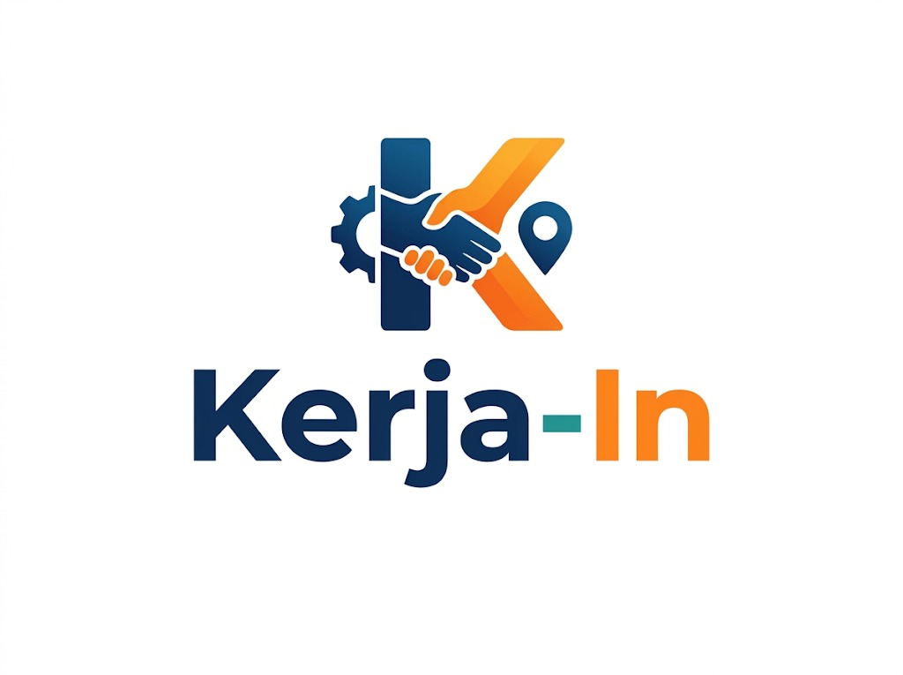
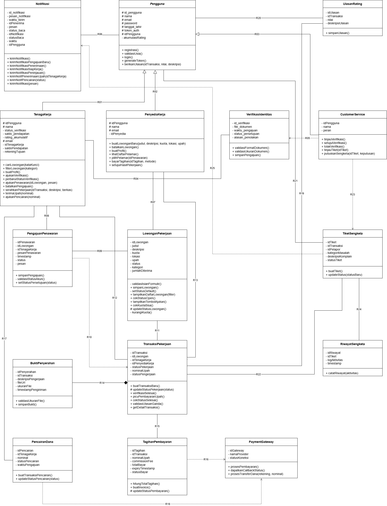

<h1>
IF2150 REKAYASA PERANGKAT LUNAK
 
TUGAS 5
 
DESKRIPSI PERANCANGAN PERANGKAT LUNAK (DPPL)
</h1>
 

## Kerja-In

### Untuk: Agatha Tatianingseto

Dipersiapkan oleh:
| Informasi | Keterangan |
| --- | --- |
| Kelas | 03 |
| Kelompok | Shifu  |

| NIM | Nama |
| --- | --- |
| 13525033 | Davin Farel Santoso |
| 13525039 | Aditya Rasyid|
| 13525096 | Muhammad Ridwan Nasir Firdaus |
| 13525102 | Karmel Tua Haloho |
| 13525123 | Sebastio Nugroho |
---

## Daftar Perubahan

| Revisi | Deskripsi |
| :--- | :--- |
| *A* | *Deskripsikan perubahan yang dilakukan dari dokumen sebelumnya pada dokumen ini. Jika tidak terdapat perubahan, harap kosongkan tabel.* |
| *B* |  |
| *C* |  |
| ... |  |

---

 

> **Petunjuk pengerjaan:** *[Silahkan hapus bagian ini setelah selesai mengerjakan]*
>
> Dokumen ini melanjutkan **Spesifikasi Kebutuhan Perangkat Lunak (SKPL)** dan **Arsitektur Perangkat Lunak (APL)**. Gunakan nama, ID, kebutuhan, dan use case yang konsisten dengan kedua dokumen tersebut. Contoh pola ID baru di bawah dapat disesuaikan dengan kesepakatan kelompok, ID yang sudah ada tetap dipertahankan.

 

---

# BAB 1: Pendahuluan

## 1.1 Tujuan Penulisan Dokumen
Dokumen Deskripsi Perancangan Perangkat Lunak (DPPL) disusun untuk menjelaskan arsitektur perangkat lunak yang digunakan, interaksi antara pengguna dengan sistem, proses sistem dalam memenuhi seluruh kebutuhan fungsional maupun non-fungsional, dan interaksi antar kelas beserta method dan atribut yang digunakan. Dokumen ini akan dijadikan sebagai acuan oleh tim pengembang dalam melakukan perancangan, implementasi, hingga pengujian.

## 1.2 Lingkup Masalah
Kerja-In merupakan platform marketplace jasa berbasis web yang mempertemukan Penyedia Kerja dengan Tenaga Kerja sektor informal untuk mempermudah pencarian dan penyediaan pekerjaan harian. Aplikasi ini mendukung registrasi dan verifikasi identitas, pengelolaan lowongan, pengajuan penawaran, pemilihan tenaga kerja, pembayaran melalui Payment Gateway, penyerahan dan pemeriksaan hasil pekerjaan, serta pencairan upah. Rating, ulasan, dan portofolio membantu pengguna menilai reputasi tenaga kerja, sedangkan Customer Service membantu menangani keluhan dan sengketa terkait penggunaan platform.

## 1.3 Definisi, Istilah, dan Singkatan
Tabel 1.3. Definisi Istilah dan Singkatan

| Singkatan, Akronim, atau Istilah | Penjelasan |
| :--- | :--- |
| P/L | Perangkat Lunak, yaitu aplikasi yang menyediakan fungsi sesuai kebutuhan pengguna. |
| SKPL | Spesifikasi Kebutuhan Perangkat Lunak, yaitu dokumen yang menjelaskan kebutuhan perangkat lunak sebagai acuan pengembangan. |
| KF | Kebutuhan Fungsional, yaitu fungsi atau layanan yang harus disediakan sistem. |
| KNF | Kebutuhan Non-Fungsional, yaitu persyaratan kualitas dan batasan operasional sistem, seperti keamanan, ketersediaan, dan waktu respons. |
| UC / Use Case | Gambaran interaksi aktor dengan sistem untuk mencapai suatu tujuan. |
| EARS | Easy Approach to Requirements Syntax, yaitu pola penulisan kebutuhan berdasarkan kondisi atau pemicu dan respons sistem. |
| Aktor | Peran pengguna yang berinteraksi langsung dengan perangkat lunak. |
| Tenaga Kerja | Pengguna yang mencari lowongan, mengajukan penawaran, melaksanakan pekerjaan, dan menerima upah setelah hasil pekerjaan diverifikasi. |
| Penyedia Kerja | Pengguna yang membuat lowongan, memilih tenaga kerja, membayar pekerjaan, dan memeriksa hasilnya. |
| CS / Customer Service | Petugas internal yang membantu menangani kendala akun, pekerjaan, pembayaran, serta keluhan dan sengketa pengguna. |
| Lowongan Pekerjaan | Informasi kebutuhan pekerjaan yang memuat deskripsi, kuota tenaga kerja, lokasi, dan upah. |
| Pengajuan Penawaran | Pengajuan Tenaga Kerja untuk melamar suatu lowongan, disertai pesan penawaran dan data pelamar. |
| Transaksi Pekerjaan | Catatan kesepakatan antara Penyedia Kerja dan Tenaga Kerja terpilih beserta status pelaksanaan pekerjaannya. |
| Portofolio | Rekam jejak pengalaman dan hasil pekerjaan yang menunjukkan kemampuan serta reputasi pengguna. |
| Rating dan Ulasan | Penilaian berupa bintang 1-5 dan komentar setelah pekerjaan selesai. |
| Payment Gateway | Layanan eksternal yang digunakan sistem untuk memproses pembayaran dan penyaluran dana. |
| Dummy | Simulasi layanan atau sistem eksternal untuk menjalankan alur aplikasi tanpa menggunakan layanan produksi yang sesungguhnya. |
| Commission Fee | Biaya layanan platform yang dikenakan dalam transaksi pekerjaan. |
| Invoice | Tagihan yang memuat rincian upah, biaya layanan, dan total pembayaran. |
| E-wallet | Dompet digital yang digunakan sebagai sarana pembayaran atau tujuan pencairan dana. |
| Disbursement | Penyaluran dana ke rekening bank atau e-wallet penerima melalui layanan pembayaran. |
| Refund | Pengembalian dana kepada pihak pembayar sesuai tindak lanjut transaksi atau keputusan sengketa. |
| Dispute / Sengketa | Perselisihan terkait pekerjaan atau pembayaran yang ditangani oleh Customer Service. |
| Timestamp | Catatan tanggal dan waktu terjadinya suatu aktivitas sistem. |
| API | Application Programming Interface, yaitu antarmuka untuk pertukaran data dan permintaan layanan antarsistem. |
| UI | User Interface, yaitu antarmuka untuk memasukkan data dan menampilkan informasi kepada pengguna. |
| Entitas | Kelas yang merepresentasikan data dan perilaku objek dalam sistem. |
| Controller | Kelas yang mengendalikan pemrosesan tindakan pengguna sesuai fungsi yang ditangani. |
| Traceability | Keterlacakan hubungan antara kebutuhan fungsional, use case, dan kelas yang mendukungnya. |

## 1.4 Aturan Penomoran
Tabel 1.4. Aturan Penomoran

| Hal/Bagian | Penomoran | Keterangan |
| :--- | :--- | :--- |
| Kebutuhan | RXX | Mengacu pada ID dalam tabel Pemetaan Kebutuhan pada dokumen Requirement Gathering, misalnya R01. |
| Kebutuhan Fungsional | KFXX | Menandai fungsi atau layanan sistem, misalnya KF01. |
| Kebutuhan Non-Fungsional | KNFXX | Menandai persyaratan kualitas atau batasan operasional sistem, misalnya KNF01. |
| Aktor | AXX | Menandai peran pengguna: A01 untuk Tenaga Kerja, A02 untuk Penyedia Kerja, dan A03 untuk Customer Service. |
| Use Case | UCXX | Menandai use case beserta skenarionya, misalnya UC01 untuk Melakukan Registrasi. |
| Kelas | CXX | Menandai kelas pada identifikasi, diagram kelas, dan traceability, misalnya C01. |

## 1.5 Referensi
Dokumen dan sumber yang digunakan sebagai acuan penyusunan DPPL Kerja-In adalah sebagai berikut:

1. [K03 G06 Final TB - Topic Brainstorming](../M1/K03_G06_FInal_TB.md), sebagai acuan latar belakang masalah, tujuan, dan gagasan awal perangkat lunak Kerja-In.
2. [K03 G06 RG - Requirement Gathering](../M2/K03_G06_RG.md), sebagai acuan identifikasi pengguna, kebutuhan pengguna, kebutuhan fungsional, dan kebutuhan non-fungsional.
3. [K03 G06 UC - Use Case & Scenario Use Case](../M3/K03_G06_UC.md), sebagai acuan identifikasi aktor, use case, diagram use case, serta skenario normal dan alternatif.
4. [K03 G06 CD - Class Diagram](../M4/K03_G06_CD.md), sebagai acuan identifikasi kelas, atribut, operasi, hubungan antarkelas, dan diagram kelas.
5. [draw.io](https://www.drawio.com/), sebagai alat untuk membuat dan menyunting diagram UML yang digunakan dalam dokumen.
6. [Badan Perencanaan Pembangunan Nasional - Tujuan 8: Pekerjaan Layak dan Pertumbuhan Ekonomi](https://sdgs.bappenas.go.id/17-goals/08), sebagai acuan konteks pembangunan berkelanjutan dan permasalahan pekerjaan layak yang melatarbelakangi pengembangan Kerja-In.
7. [Bank Indonesia - Perizinan Sistem Pembayaran](https://www.bi.go.id/id/fungsi-utama/sistem-pembayaran/perizinan/default.aspx), sebagai acuan batasan penggunaan layanan pembayaran dan keterlibatan penyelenggara jasa pembayaran dalam sistem.
8. [Undang-Undang Republik Indonesia Nomor 11 Tahun 2008 tentang Informasi dan Transaksi Elektronik](https://peraturan.bpk.go.id/details/37589/uu-no-11-tahun-2008), sebagai acuan umum penyelenggaraan informasi dan transaksi elektronik pada platform.
9. [Undang-Undang Republik Indonesia Nomor 27 Tahun 2022 tentang Perlindungan Data Pribadi](https://peraturan.bpk.go.id/Details/229798/uu-no-27-tahun-2022), sebagai acuan perlindungan data pribadi pengguna, termasuk data identitas dan data pembayaran.
10. [PostgreSQL Documentation - Transactions](https://www.postgresql.org/docs/current/tutorial-transactions.html), sebagai acuan pengelolaan transaksi basis data yang konsisten, terutama untuk pembayaran, pencairan dana, dan perubahan status pekerjaan.
11. [OWASP Cheat Sheet Series - Authentication](https://cheatsheetseries.owasp.org/cheatsheets/Authentication_Cheat_Sheet.html), sebagai acuan penerapan autentikasi, pengelolaan sesi, kata sandi, dan perlindungan akun pengguna.
12. [Web Content Accessibility Guidelines (WCAG) 2.2](https://www.w3.org/TR/WCAG22/), sebagai acuan aksesibilitas antarmuka web, navigasi, formulir, serta pencegahan kesalahan pada proses transaksi.

## 1.6 Deskripsi Umum Dokumen (Ikhtisar)
Dokumen Deskripsi Perancangan Perangkat Lunak (DPPL) Kerja-In disusun dalam lima bab. Bab 1 Pendahuluan menjelaskan tujuan penulisan dokumen, lingkup masalah, definisi dan istilah, aturan penomoran, referensi, serta sistematika pembahasan. Bab 2 Perancangan Arsitektur menguraikan lingkungan implementasi, pola arsitektur acuan, identifikasi komponen, modul, atau subsistem, serta model arsitektur perangkat lunak yang mengacu pada dokumen APL. Bab 3 Realisasi Use Case menjabarkan perancangan setiap use case berdasarkan SKPL melalui identifikasi kelas, sequence diagram untuk skenario normal dan alternatif, serta diagram kelas terkait. Bab 4 Diagram Kelas Keseluruhan menyajikan diagram kelas perancangan sistem secara menyeluruh beserta daftar kelas, atribut, dan metode atau operasinya. Bab 5 Matriks Kerunutan memetakan hubungan antara kelas perancangan dan use case untuk menunjukkan keterlacakan hasil perancangan terhadap fungsi sistem.

 

---

# BAB 2: Perancangan Arsitektur

## 2.1 Rancangan Lingkungan Implementasi
Tabel 2.1. Rancangan Lingkungan Implementasi

| Komponen | Spesifikasi |
| --- | --- |
| Backend | Node.js dengan framework Next.js. API Route Handlers digunakan untuk menangani permintaan dari client, menjalankan logika aplikasi, dan mengakses layanan Supabase. |
| Frontend | React dalam framework Next.js untuk membangun antarmuka pengguna berbasis web. |
| Bahasa Pemrograman | TypeScript untuk frontend dan backend, serta HTML dan CSS untuk struktur dan tampilan antarmuka. |
| Client | Web browser modern yang mendukung JavaScript, seperti Google Chrome, Mozilla Firefox, Microsoft Edge, dan Safari versi terbaru. |
| DBMS | PostgreSQL yang disediakan melalui layanan Supabase. |
| Authentication | Supabase Auth sebagai layanan autentikasi dan pengelolaan sesi pengguna. |
| File Storage | Supabase Storage untuk menyimpan berkas pengguna, seperti foto profil, dokumen verifikasi identitas, portofolio, dan bukti penyerahan hasil pekerjaan. |
| OS Server | Windows sebagai sistem operasi untuk menjalankan server aplikasi Node.js dan Next.js. |
| OS Client | Windows, Linux, macOS, Android, dan iOS melalui web browser yang mendukung aplikasi. |
| Development Tools | Visual Studio Code sebagai editor kode, Git untuk pengelolaan versi kode sumber, dan npm untuk pengelolaan dependensi serta menjalankan perintah pengembangan dan build aplikasi. |

## 2.2 Style/Pattern Arsitektur Acuan

<i>Gambar 1. Contoh Arsitektur MVC</i>

Pemilihan arsitektur Model-View-Controller (MVC) sebagai acuan untuk perangkat lunak Kerja-In didasarkan pada kesesuaiannya yang kuat dengan karakteristik pengguna, alur proses bisnis, serta lingkungan teknologi sistem. Sebagai aplikasi marketplace jasa, Kerja-In melayani tiga jenis pengguna dengan kebutuhan antarmuka yang berbeda yakni Tenaga Kerja, Penyedia Kerja, dan Customer Service (CS). Pola MVC memungkinkan sistem untuk menyajikan antarmuka (View) dan logika pemrosesan (Controller) yang spesifik untuk masing-masing peran, tetapi tetap terintegrasi secara terpusat pada pengelolaan entitas data (Model) yang sama. Hal ini efektif mencegah duplikasi data dan memastikan konsistensi informasi lintas pengguna.

Selain itu, alur proses bisnis pada aplikasi ini sangat interaktif dan sepenuhnya digerakkan oleh aksi pengguna, seperti pengajuan pekerjaan, konfirmasi penyelesaian, penanganan sengketa, hingga proses pembayaran. Arsitektur MVC dirancang secara natural untuk menangani siklus permintaan dan repons yang dinamis ini, View menangkap interaksi pengguna, Controller bertindak sebagai penengah untuk memvalidasi dan memproses logika bisnis, dan Model memperbarui status pada basis data secara aman.

Dari segi pengembangan, MVC menerapkan pemisahan tanggung jawab yang tegas antara tampilan antarmuka, logika bisnis, dan aturan data. Pemisahan ini sangat menguntungkan tim pengembang karena memungkinkan pengerjaan frontend dan backend dilakukan secara paralel dan modular tanpa saling mengganggu. Terakhir, MVC merupakan fondasi bawaan dari mayoritas framework web modern yang menjadi lingkungan operasi perangkat lunak ini. Dengan menerapkan MVC, pengembangan sistem tidak hanya mematuhi standard industri, tetapi juga menjamin skalabilitas dan kemudahan pemeliharaan perangkat lunak di masa depan.

## 2.3 Identifikasi Komponen / Modul / Subsistem
Komponen Kerja-In dikelompokkan berdasarkan pola MVC menjadi Model, View, dan Controller. Kelas yang memiliki fungsi berkaitan ditempatkan dalam satu komponen dengan nama kelas utama yang mewakilinya. Komponen autentikasi, basis data, dan penyimpanan berkas mendukung pengoperasian aplikasi.

Tabel 2.1. Identifikasi Komponen/Modul/Subsistem

| Nama Komponen/Modul/Subsistem | Jenis | Penjelasan |
| :--- | :--- | :--- |
| Pengguna | Model | Mengelola identitas akun, profil sesuai peran, portofolio, saldo, dan status verifikasi pengguna. Mencakup kelas Pengguna, TenagaKerja, PenyediaKerja dan CustomerService. |
| LowonganPekerjaan | Model | Model yang menyimpan spesifikasi pekerjaan meliputi judul, deskripsi, batas kuota, nominal upah, dan status (*Open/Closed*). |
| PengajuanPenawaran | Model | Model yang menyimpan data lamaran dari Tenaga Kerja, berisi pesan penawaran, *timestamp*, dan status lamaran. |
| TransaksiPekerjaan | Model | Mengelola kesepakatan, status pengerjaan, deskripsi hasil, lampiran bukti, dan waktu penyerahan. Mencakup kelas TransaksiPekerjaan dan BuktiPenyerahan. |
| TagihanPembayaran | Model | Mengelola tagihan, upah dan biaya layanan, permintaan penarikan pendapatan, tujuan transfer, serta catatan dan status transaksi pembayaran. Mencakup kelas TagihanPembayaran, PencairanDana dan PaymentGateway. |
| UlasanRating | Model | Model yang menyimpan data penilaian pasca-pekerjaan (skala 1-5) dan ulasan teks untuk mencegah *double review*. |
| TiketSengketa | Model | Mengelola laporan keluhan, bukti, status tiket, keputusan, dan riwayat penanganan. Mencakup kelas TiketSengketa dan RiwayatSengketa. |
| Notifikasi | Model | Model yang menyimpan pesan pemberitahuan ke *dashboard* pengguna terkait aktivitas akun maupun transaksi. |
| PenggunaUI | View | Menampilkan formulir registrasi/login, profil, dashboard pengguna, dan pengajuan serta pemeriksaan identitas. Mencakup kelas PenggunaUI, TenagaKerjaUI, PenyediaKerjaUI dan CustomerServiceUI. |
| LowonganPekerjaanUI | View | Antarmuka yang menyediakan formulir pembuatan lowongan dan katalog pencarian pekerjaan. Meneruskan aksi pengguna yang terkait ke LowonganPekerjaanController. |
| PengajuanPenawaranUI | View | Antarmuka yang menampilkan formulir pengisian pesan penawaran bagi Tenaga Kerja. Meneruskan aksi pengguna yang terkait ke PengajuanPenawaranController. |
| TransaksiPekerjaanUI | View | Menampilkan rincian dan status pekerjaan, formulir unggah hasil, serta pilihan persetujuan atau revisi. Mencakup kelas TransaksiPekerjaanUI dan BuktiPenyerahanUI. |
| TagihanPembayaranUI | View | Menampilkan invoice, metode dan instruksi pembayaran, formulir penarikan pendapatan, serta status transaksi dana. Mencakup kelas TagihanPembayaranUI, PencairanDanaUI dan PaymentGatewayUI. |
| UlasanRatingUI | View | Antarmuka yang merender formulir pemberian bintang dan komentar ulasan. Meneruskan aksi pengguna yang terkait ke UlasanRatingController. |
| TiketSengketaUI | View | Menampilkan formulir dan rincian keluhan, bukti tambahan, keputusan, serta urutan aktivitas penanganan. Mencakup kelas TiketSengketaUI dan RiwayatSengketaUI. |
| NotifikasiUI | View | Antarmuka berupa *pop-up*, bel, atau menu *dropdown* pesan masuk bagi pengguna. Meneruskan aksi pengguna yang terkait ke NotifikasiController. |
| PenggunaController | Controller | Memproses registrasi/login, pembaruan profil, pemeriksaan hak akses, dan keputusan verifikasi identitas. Mencakup kelas PenggunaController, TenagaKerjaController, PenyediaKerjaController dan CustomerServiceController. |
| LowonganPekerjaanController | Controller | Pengendali untuk memvalidasi isian *create* lowongan, pemfilteran pencarian, dan kalkulasi sisa kuota. |
| PengajuanPenawaranController | Controller | Pengendali untuk memvalidasi persyaratan melamar dan merekam data pelamar ke *database*. |
| TransaksiPekerjaanController | Controller | Memproses perubahan status pekerjaan, validasi dan penyimpanan bukti, serta konfirmasi penyelesaian atau permintaan revisi. Mencakup kelas TransaksiPekerjaanController dan BuktiPenyerahanController. |
| TagihanPembayaranController | Controller | Menghitung tagihan, memvalidasi saldo serta tujuan transfer, mengirim instruksi pembayaran, pencairan atau refund, dan memproses konfirmasi layanan pembayaran eksternal. Mencakup kelas TagihanPembayaranController, PencairanDanaController dan PaymentGatewayController. |
| UlasanRatingController | Controller | Pengendali untuk mencegah ulasan ganda dan merekapitulasi rata-rata rating. |
| TiketSengketaController | Controller | Memvalidasi laporan serta kewenangan petugas, mencatat keputusan dan riwayat, serta memproses tindak lanjut penyelesaian sengketa. Mencakup kelas TiketSengketaController dan RiwayatSengketaController. |
| NotifikasiController | Controller | Pengendali untuk memicu pengiriman pesan otomatis secara *real-time* ke penerima yang tepat. |
| Autentikasi | Pendukung | Memverifikasi kredensial dan mengelola sesi pengguna agar akses aplikasi sesuai dengan identitas serta hak pengguna. |
| Database | Penyimpanan Data | Menyimpan data aplikasi secara persisten, termasuk akun, lowongan, penawaran, pekerjaan, pembayaran, penilaian, keluhan, dan riwayat aktivitas. |
| PenyimpananBerkas | Penyimpanan Data | Menyimpan dokumen identitas, lampiran hasil pekerjaan, dan bukti keluhan serta menyediakan akses berkas sesuai hak pengguna. |

## 2.4 Model Arsitektur Perangkat Lunak
### 2.4.1 Logical View
Logical View dipilih karena dapat menggambarkan struktur fungsional Kerja-In melalui pembagian tanggung jawab dan hubungan antarkomponen berdasarkan pola Model-View-Controller (MVC). Kerja-In memiliki fitur yang saling berkaitan, seperti pengelolaan lowongan, pengajuan penawaran, pelaksanaan pekerjaan, pembayaran, dan penanganan sengketa. Melalui Logical View, tim pengembang dapat memahami komponen yang mendukung setiap fungsi serta ketergantungan antarkomponen tersebut. Representasi ini membantu pembagian tugas pengembangan, penelusuran dampak perubahan, serta penyusunan diagram kelas dan sequence diagram pada tahap perancangan terperinci.

<i>Gambar 2. Contoh Logical View pada P/L E-Commerce</i>

 

---

# BAB 3: Realisasi Use Case

## 3.1 Use Case [Nama Use Case 1]

**ID Use Case:** *[UC01 sesuai SKPL]*  
**Nama Use Case:** *[Nama use case sesuai SKPL]*

### 3.1.1 Identifikasi Kelas

Identifikasi kelas yang terkait dengan use case tersebut. Kelas di tahap perancangan dapat berbeda dengan dengan kelas di tahap analisis. Dapat menggunakan tabel di bawah:

Tabel 3.1. Identifikasi Kelas Use Case [UC01]

| No | Nama Kelas Perancangan | Nama Kelas Analisis Terkait |
|:--- | :--- | :--- |
| 1 | *[Nama kelas perancangan]* | *[Nama kelas analisis pada SKPL]* |
| 2 | *[Nama kelas perancangan]* | *[Nama kelas analisis pada SKPL]* |
| ... | *...* | *...* |

### 3.1.2 Sequence Diagram

Buat *sequence diagram* untuk **setiap skenario use case**, mencakup skenario normal dan alternatif pada subbab 4.4 SKPL. Diagram melibatkan kelas-kelas yang telah diidentifikasi pada SKPL. 

- **Skenario Normal**

<i>Gambar X. Sequence Diagram [UC01]</i>

- **Skenario Alternatif [Nomor]: [Nama Skenario]**

<i>Gambar X. Sequence Diagram [UC01] - [Nama skenario alternatif]</i>

### 3.1.3 Diagram Kelas

Buatlah diagram kelas untuk use case ini yang terdiri atas kelas-kelas dari 3.1.1. **Setiap kelas pada diagram wajib menampilkan atribut dan metode/operasi langsung di dalam kotak kelasnya**, sehingga tidak perlu membuat tabel daftar atribut dan metode per kelas pada subbab ini. Daftar lengkap atribut dan metode seluruh kelas disajikan pada Tabel 4.1 (Bab 4).

<i>Gambar X. Diagram Kelas [Nama Uce Case]</i>

Pada diagram, pastikan:
- Atribut dituliskan beserta visibilitas dan tipe datanya, misalnya `- email: String`.
- Operasi dituliskan beserta visibilitas, parameter, dan tipe kembaliannya, misalnya `+ login(email: String, password: String): Boolean`.
- Relasi antarkelas (asosiasi, agregasi, komposisi, generalisasi, dan dependensi) digambarkan lengkap dengan multiplisitas.
- Semua operasi yang dipanggil pada sequence diagram 3.1.2 (skenario normal dan alternatif) ada pada kelas yang bersangkutan.
- Kelas yang sama dengan kelas di use case lain memakai nama, atribut, dan metode yang konsisten.

## 3.2 Use Case XX
## 3.3 Use Case XX
## 3.4 Use Case XX
## 3.5 Use Case XX
## 3.6 Use Case Memilih Tenaga Kerja
**ID Use Case:** UC06   
**Nama Use Case:** Memilih Tenaga Kerja

### 3.6.1 Identifikasi Kelas
Tabel 3.6. Identifikasi Kelas Use Case UC06
| No | Nama Kelas Perancangan | Nama Kelas Analisis Terkait |
|:--- | :--- | :--- |
| 1 | PenyediaKerja | PenyediaKerja |
| 2 | LowonganPekerjaan | LowonganPekerjaan |
| 3 | PengajuanPenawaran | PengajuanPenawaran |
| 4 | TransaksiPekerjaan | TransaksiPekerjaan |
| 5 | Notifikasi | Notifikasi |
| 6 | PenyediaKerjaUI | PenyediaKerjaUI |
| 7 | LowonganPekerjaanUI | LowonganPekerjaanUI |
| 8 | PengajuanPenawaranUI | PengajuanPenawaranUI |
| 9 | TransaksiPekerjaanUI | TransaksiPekerjaanUI |
| 10 | NotifikasiUI | NotifikasiUI |
| 11 | PenyediaKerjaController | PenyediaKerjaController |
| 12 | LowonganPekerjaanController | LowonganPekerjaanController |
| 13 | PengajuanPenawaranController | PengajuanPenawaranController |
| 14 | TransaksiPekerjaanController | TransaksiPekerjaanController |
| 15 | NotifikasiController | NotifikasiController |

### 3.6.2 Sequence Diagram

- **Skenario Normal**

<i>Gambar 3.6.1. Sequence Diagram UC06 - Skenario Normal</i>

- **Skenario Alternatif 1 : Kuota Lowongan Sudah Penuh Saat Konfirmasi**

<i>Gambar 3.6.2. Sequence Diagram UC06 - Kuota Lowongan Sudah Penuh Saat Konfirmasi</i>

- **Skenario Alternatif 2 : Penyedia Kerja Membatalkan Pemilihan Pelamar**

<i>Gambar 3.6.3. Sequence Diagram UC06 - Penyedia Kerja Membatalkan Pemilihan Pelamar</i>

### 3.6.3 Diagram Kelas

<i>Gambar 3.6.4. Diagram Kelas Memilih Tenaga Kerja</i>

## 3.7 Use Case Melakukan Pembayaran Pekerjaan
**ID Use Case:** UC07   
**Nama Use Case:** Melakukan Pembayaran Pekerjaan

### 3.7.1 Identifikasi Kelas
Tabel 3.7. Identifikasi Kelas Use Case UC07
| No | Nama Kelas Perancangan | Nama Kelas Analisis Terkait |
|:--- | :--- | :--- |
| 1 | PenyediaKerja | PenyediaKerja |
| 2 | TransaksiPekerjaan | TransaksiPekerjaan |
| 3 | TagihanPembayaran | TagihanPembayaran |
| 4 | Notifikasi | Notifikasi |
| 5 | PaymentGateway | PaymentGateway |
| 6 | PenyediaKerjaUI | PenyediaKerjaUI |
| 7 | TransaksiPekerjaanUI | TransaksiPekerjaanUI |
| 8 | TagihanPembayaranUI | TagihanPembayaranUI |
| 9 | NotifikasiUI | NotifikasiUI |
| 10 | PaymentGatewayUI | PaymentGatewayUI |
| 11 | PenyediaKerjaController | PenyediaKerjaController |
| 12 | TransaksiPekerjaanController | TransaksiPekerjaanController |
| 13 | TagihanPembayaranController | TagihanPembayaranController |
| 14 | NotifikasiController | NotifikasiController |
| 15 | PaymentGatewayController | PaymentGatewayController |

### 3.7.2 Sequence Diagram

- **Skenario Normal**

<i>Gambar 3.7.1. Sequence Diagram UC07 - Skenario Normal</i>

- **Skenario Alternatif 1 : Pembayaran Gagal atau Dibatalkan oleh Payment Gateway**

<i>Gambar 3.7.2. Sequence Diagram UC07 - Pembayaran Gagal atau Dibatalkan oleh Payment Gateway</i>

- **Skenario Alternatif 2 : Waktu Pembayaran Habis (Timeout / Expired)**

<i>Gambar 3.7.3. Sequence Diagram UC07 - Waktu Pembayaran Habis (Timeout / Expired)</i>

### 3.7.3 Diagram Kelas

<i>Gambar 3.7.4. Diagram Kelas Melakukan Pembayaran Pekerjaan</i>

## 3.8 Use Case Menyerahkan Hasil Pekerjaan
**ID Use Case:** UC08   
**Nama Use Case:** Menyerahkan Hasil Pekerjaan

### 3.8.1 Identifikasi Kelas
Tabel 3.8. Identifikasi Kelas Use Case UC08
| No | Nama Kelas Perancangan | Nama Kelas Analisis Terkait |
|:--- | :--- | :--- |
| 1 | TenagaKerja | TenagaKerja |
| 2 | TransaksiPekerjaan | TransaksiPekerjaan |
| 3 | BuktiPenyerahan | BuktiPenyerahan |
| 4 | Notifikasi | Notifikasi |
| 5 | TenagaKerjaUI | TenagaKerjaUI |
| 6 | TransaksiPekerjaanUI | TransaksiPekerjaanUI |
| 7 | BuktiPenyerahanUI | BuktiPenyerahanUI |
| 8 | NotifikasiUI | NotifikasiUI |
| 9 | TenagaKerjaController | TenagaKerjaController |
| 10 | TransaksiPekerjaanController | TransaksiPekerjaanController |
| 11 | BuktiPenyerahanController | BuktiPenyerahanController |
| 12 | NotifikasiController | NotifikasiController |

### 3.8.2 Sequence Diagram

- **Skenario Normal**

<i>Gambar 3.8.1. Sequence Diagram UC08 - Skenario Normal</i>

- **Skenario Alternatif 1 : Ukuran Berkas Melebihi Batas Maksimal**

<i>Gambar 3.8.2. Sequence Diagram UC08 - Ukuran Berkas Melebihi Batas Maksimal</i>

- **Skenario Alternatif 2 : Tenaga Kerja Belum Mengunggah Berkas Wajib**

<i>Gambar 3.8.3. Sequence Diagram UC08 - Tenaga Kerja Belum Mengunggah Berkas Wajib</i>

### 3.8.3 Diagram Kelas

<i>Gambar 3.8.4. Diagram Kelas Menyerahkan Hasil Pekerjaan</i>

## 3.9 Use Case Memverifikasi Penyelesaian Pekerjaan

**ID Use Case:** UC09  
**Nama Use Case:** Memverifikasi Penyelesaian Pekerjaan

### 3.1.1 Identifikasi Kelas

Tabel 3.9. Identifikasi Kelas Use Case UC09

| No | Nama Kelas Perancangan | Nama Kelas Analisis Terkait |
|:--- | :--- | :--- |
| 1 | PenyediaKerja | PenyediaKerja |
| 2 | TransaksiPekerjaan | TransaksiPekerjaan |
| 3 | BuktiPenyerahan | BuktiPenyerahan |
| 4 | Notifikasi | Notifikasi |
| 5 | PenyediaKerjaUI | PenyediaKerjaUI |
| 6 | TransaksiPekerjaanUI | TransaksiPekerjaanUI |
| 7 | BuktiPenyerahanUI | BuktiPenyerahanUI |
| 8 | NotifikasiUI | NotifikasiUI |
| 9 | PenyediaKerjaController | PenyediaKerjaController |
| 10 | TransaksiPekerjaanController | TransaksiPekerjaanController |
| 11 | BuktiPenyerahanController | BuktiPenyerahanController |
| 12 | NotifikasiController | NotifikasiController |

### 3.1.2 Sequence Diagram 

- **Skenario Normal**

<i>Gambar X. Sequence Diagram UC09</i>

- **Skenario Alternatif 1 : Hasil Pekerjaan Belum Sesuai (Penyedia Kerja Meminta Revisi)**

<i>Gambar X. Sequence Diagram UC09 - Hasil Pekerjaan Belum Sesuai (Penyedia Kerja Meminta Revisi)</i>

- **Skenario Alternatif 2 : Terjadi Ketidaksepakatan / Perselisihan Hasil Kerja**

<i>Gambar X. Sequence Diagram UC09 - Terjadi Ketidaksepakatan / Perselisihan Hasil Kerja</i>

### 3.1.3 Diagram Kelas

<i>Gambar X. Diagram Kelas Memverifikasi Penyelesaian Pekerjaan</i>

## 3.10 Use Case XX
## 3.11 Use Case XX
## 3.12 Use Case XX

Silahkan lanjutkan untuk  *use case* berikutnya dengan content yang sama dengan 3.1

 

---

# BAB 4: Diagram Kelas Keseluruhan

## 4.1 Diagram Kelas

<i>Gambar 4.1. Diagram Kelas Perancangan Keseluruhan Kerja-In</i>

Tabel 4.1. Daftar Kelas Perancangan Keseluruhan

| ID Kelas | Nama Kelas | Atribut | Metode/Operasi |
| :--- | :--- | :--- | :--- |
| C01 | Pengguna | `# id_pengguna: String` `# nama: String` `# email: String` `# password: String` `# tanggal_lahir: Date` `# token_auth: String` `# idPengguna: String` `- akumulasiRating: Float` | `+ registrasi(): void` `+ validasiUsia(): Boolean` `+ login(): Boolean` `+ generateToken(): String` `+ berikanUlasan(idTransaksi, nilai, deskripsi): void` |
| C02 | TenagaKerja | `# idPengguna: String` `# nama: String` `- status_verifikasi: String` `- saldo_pendapatan: Decimal` `- rating_akumulatif: Float` `# email: String` `- idTenagaKerja: String` `- saldoPendapatan: Decimal` `- rekeningTujuan: String` | `+ cariLowongan(kataKunci): List<LowonganPekerjaan>` `+ filterLowongan(kategori): List<LowonganPekerjaan>` `+ buatProfil(): void` `+ ajukanVerifikasi(): void` `+ perbaruiStatusVerifikasi(): void` `+ ajukanPenawaran(idLowongan, pesan): void` `+ batalkanPengajuan(): void` `+ serahkanPekerjaan(idTransaksi, deskripsi, berkas): void` `+ terimaUpah(nominal): void` `+ ajukanPencairan(nominal): void` |
| C03 | PenyediaKerja | `# idPengguna: String` `# nama: String` `# email: String` `- idPenyedia: String` | `+ buatLowonganBaru(judul, deskripsi, kuota, lokasi, upah): void` `+ batalkanLowongan(): void` `+ buatProfil(): void` `+ lihatDaftarPelamar(): List<PengajuanPenawaran>` `+ pilihPelamar(idPenawaran): void` `+ bayarTagihan(idTagihan, metode): void` `+ setujuiHasilPekerjaan(): void` |
| C04 | CustomerService | `- idPengguna: String` `- nama: String` `- peran: String` | `+ tinjauVerifikasi(): void` `+ setujuiVerifikasi(): void` `+ tolakVerifikasi(): void` `+ tinjauTiket(idTiket): void` `+ putuskanSengketa(idTiket, keputusan): void` |
| C05 | LowonganPekerjaan | `- idLowongan: String` `- judul: String` `- deskripsi: String` `- kuota: Integer` `- lokasi: String` `- upah: Decimal` `- status: String` `- kategori: String` `- jumlahDiterima: Integer` | `- validasiIsianFormulir(): Boolean` `+ simpanLowongan(): void` `- setStatusDefault(): void` `+ tampilkanDaftarLowongan(filter): List<LowonganPekerjaan>` `+ cekStatusOpen(): Boolean` `+ tampilkanTombolAjukan(): void` `+ cekKuotaSisa(): Integer` `# updateStatusLowongan(): void` `- kurangiKuota(): void` |
| C06 | PengajuanPenawaran | `- idPenawaran: String` `- idLowongan: String` `- idTenagaKerja: String` `- pesanPenawaran: String` `- timestamp: Timestamp` `- status: String` `- pesan: String` | `+ simpanPengajuan(): void` `- validasiStatusAkun(): Boolean` `+ setStatusPersetujuan(status): void` |
| C07 | TransaksiPekerjaan | `- idTransaksi: String` `- idLowongan: String` `- idTenagaKerja: String` `- idPenyediaKerja: String` `- statusPekerjaan: String` `- nominalUpah: Decimal` `- statusPengerjaan: String` | `+ buatTransaksiBaru(): void` `# updateStatusPekerjaan(status): void` `+ verifikasiSelesai(): void` `+ picuPembayaranUpah(): void` `+ cekStatusSelesai(): Boolean` `+ validasiUlasanGanda(): Boolean` `+ getDetailTransaksi(): TransaksiPekerjaan` |
| C08 | BuktiPenyerahan | `- idPenyerahan: String` `- idTransaksi: String` `- deskripsiPengerjaan: String` `- fileUrl: String` `- ukuranFile: Integer` `- timestampPengiriman: Timestamp` | `+ validasiUkuranFile(): Boolean` `+ simpanBukti(): void` |
| C09 | TagihanPembayaran | `- idTagihan: String` `- idTransaksi: String` `- nominalUpah: Decimal` `- commissionFee: Decimal` `- totalBayar: Decimal` `- expiryTimestamp: Timestamp` `- statusBayar: String` | `+ hitungTotalTagihan(): Decimal` `+ buatInvoice(): void` `# updateStatusPembayaran(): void` |
| C10 | PencairanDana | `- idPencairan: String` `- idTenagaKerja: String` `- nominal: Decimal` `- statusPencairan: String` `- waktuPengajuan: Timestamp` | `+ buatTransaksiPencairan(): void` `+ updateStatusPencairan(status): void` |
| C11 | UlasanRating | `- idUlasan: String` `- idTransaksi: String` `- nilai: Integer` `- deskripsiUlasan: String` | `+ simpanUlasan(): void` |
| C12 | TiketSengketa | `- idTiket: String` `- idTransaksi: String` `- idPelapor: String` `- kategoriMasalah: String` `- deskripsiKomplain: String` `- statusTiket: String` | `+ buatTiket(): void` `+ updateStatus(statusBaru): void` |
| C13 | RiwayatSengketa | `- idRiwayat: String` `- idTiket: String` `- logAktivitas: String` `- timestamp: Timestamp` | `+ catatRiwayat(aktivitas): void` |
| C14 | Notifikasi | `- id_notifikasi: String` `- pesan_notifikasi: String` `- waktu_kirim: Timestamp` `- idPenerima: String` `- pesan: String` `- status_baca: Boolean` `- idNotifikasi: String` `- statusBaca: Boolean` `- waktu: Timestamp` `- idPengguna: String` | `+ kirimNotifikasi(): void` `+ kirimNotifikasiPengajuanBaru(): void` `+ kirimNotifikasiPenerimaan(): void` `+ kirimNotifikasiSiapKerja(): void` `+ kirimNotifikasiPeninjauan(): void` `+ kirimNotifPenerimaanUpah(idTenagaKerja): void` `+ kirimNotifPencairan(status): void` `+ kirimNotifikasi(pesan): void` |
| C15 | PaymentGateway | `- idGateway: String` `- namaProvider: String` `- statusKoneksi: String` | `+ prosesPembayaran(): void` `+ dapatkanCallbackStatus(): String` `+ prosesTransferDana(rekening, nominal): void` |
| C46 | VerifikasiIdentitas | `- id_verifikasi: String` `- file_dokumen: String` `- waktu_pengajuan: Timestamp` `- status_persetujuan: String` `- alasan_penolakan: String` | `+ validasiFormatDokumen(): Boolean` `+ validasiUkuranDokumen(): Boolean` `+ simpanPengajuan(): void` |

 

---

# BAB 5: Matriks Kerunutan

Petakan kelas perancangan dengan use case yang terkait. Gunakan **BAB 6 Traceability pada dokumen SKPL** sebagai acuan keterkaitan kelas analisis dan use case, lalu sesuaikan dengan realisasi use case dan kelas perancangan pada BAB 3–BAB 5 DPPL.

Tabel 7.1. Matriks Kerunutan Kelas terhadap Use Case

| Kelas | Use Case Terkait |
| :--- | :--- |
| *[ID kelas - Nama kelas]* | *[ID UC - Nama use case]* |
| *[ID kelas - Nama kelas]* | *[ID UC - Nama use case]* |
| *...* | *...* |
