<h1>
IF2150 REKAYASA PERANGKAT LUNAK
<br>
TUGAS 8
<br>
DESKRIPSI PERANCANGAN PERANGKAT LUNAK (DPPL2)
</h1>
<br>

## Kerja-In
<p align="center">

</p>
<p align="center">

### Untuk: Agatha Tatianingseto

Dipersiapkan oleh:
| Informasi | Keterangan |
| --- | --- |
| Kelas | 03 |
| Kelompok | Shifu |

| NIM | Nama |
| --- | --- |
| 13525033 | Davin Farel Santoso |
| 13525039 | Aditya Rasyid |
| 13525096 | Muhammad Ridwan Nasir Firdaus |
| 13525102 | Karmel Tua Haloho |
| 13525123 | Sebastio Nugroho |
---

## Daftar Perubahan

| Revisi | Deskripsi |
| :--- | :--- |
| *A* | Menggabungkan beberapa method yang memiliki fungsi sama, namun nama berbeda. |
| *B* |  |
| *C* |  |
| ... |  |

---

<br>

> **Petunjuk pengerjaan:** *[Silahkan hapus bagian ini setelah selesai mengerjakan]*
>
> Dokumen ini melanjutkan **Deskripsi Perancangan Perangkat Lunak**. Gunakan nama, ID, kebutuhan, dan use case yang konsisten dengan kedua dokumen tersebut. Contoh pola ID baru di bawah dapat disesuaikan dengan kesepakatan kelompok, ID yang sudah ada tetap dipertahankan.

<br>

---


# BAB 1: Pendahuluan

## 1.1 Tujuan Penulisan Dokumen
Dokumen Deskripsi Perancangan Perangkat Lunak (DPPL) disusun untuk menjelaskan arsitektur perangkat lunak yang digunakan, interaksi antara pengguna dengan sistem, proses sistem dalam memenuhi seluruh kebutuhan fungsional maupun non-fungsional, dan interaksi antar kelas beserta method dan atribut yang digunakan. Dokumen ini akan dijadikan sebagai acuan oleh tim pengembang dalam melakukan perancangan, implementasi, hingga pengujian.

## 1.2 Lingkup Masalah
Kerja-In merupakan platform marketplace jasa berbasis web yang mempertemukan Penyedia Kerja dengan Tenaga Kerja sektor informal untuk mempermudah pencarian dan penyediaan pekerjaan harian. Aplikasi ini mendukung registrasi dan verifikasi identitas, pengelolaan lowongan, pengajuan penawaran, pemilihan tenaga kerja, pembayaran melalui Payment Gateway, penyerahan dan pemeriksaan hasil pekerjaan, serta pencairan upah. Rating, ulasan, dan portofolio membantu pengguna menilai reputasi tenaga kerja, sedangkan Customer Service membantu menangani keluhan dan sengketa terkait penggunaan platform.

## 1.3 Definisi, Istilah, dan Singkatan
Tabel 1.3. Definisi Istilah dan Singkatan

| Singkatan, Akronim, atau Istilah | Penjelasan |
| :--- | :--- |
| P/L | Perangkat Lunak, yaitu aplikasi yang menyediakan fungsi sesuai kebutuhan pengguna. |
| SKPL | Spesifikasi Kebutuhan Perangkat Lunak, yaitu dokumen yang menjelaskan kebutuhan perangkat lunak sebagai acuan pengembangan. |
| KF | Kebutuhan Fungsional, yaitu fungsi atau layanan yang harus disediakan sistem. |
| KNF | Kebutuhan Non-Fungsional, yaitu persyaratan kualitas dan batasan operasional sistem, seperti keamanan, ketersediaan, dan waktu respons. |
| UC / Use Case | Gambaran interaksi aktor dengan sistem untuk mencapai suatu tujuan. |
| EARS | Easy Approach to Requirements Syntax, yaitu pola penulisan kebutuhan berdasarkan kondisi atau pemicu dan respons sistem. |
| Aktor | Peran pengguna yang berinteraksi langsung dengan perangkat lunak. |
| Tenaga Kerja | Pengguna yang mencari lowongan, mengajukan penawaran, melaksanakan pekerjaan, dan menerima upah setelah hasil pekerjaan diverifikasi. |
| Penyedia Kerja | Pengguna yang membuat lowongan, memilih tenaga kerja, membayar pekerjaan, dan memeriksa hasilnya. |
| CS / Customer Service | Petugas internal yang membantu menangani kendala akun, pekerjaan, pembayaran, serta keluhan dan sengketa pengguna. |
| Lowongan Pekerjaan | Informasi kebutuhan pekerjaan yang memuat deskripsi, kuota tenaga kerja, lokasi, dan upah. |
| Pengajuan Penawaran | Pengajuan Tenaga Kerja untuk melamar suatu lowongan, disertai pesan penawaran dan data pelamar. |
| Transaksi Pekerjaan | Catatan kesepakatan antara Penyedia Kerja dan Tenaga Kerja terpilih beserta status pelaksanaan pekerjaannya. |
| Portofolio | Rekam jejak pengalaman dan hasil pekerjaan yang menunjukkan kemampuan serta reputasi pengguna. |
| Rating dan Ulasan | Penilaian berupa bintang 1-5 dan komentar setelah pekerjaan selesai. |
| Payment Gateway | Layanan eksternal yang digunakan sistem untuk memproses pembayaran dan penyaluran dana. |
| Dummy | Simulasi layanan atau sistem eksternal untuk menjalankan alur aplikasi tanpa menggunakan layanan produksi yang sesungguhnya. |
| Commission Fee | Biaya layanan platform yang dikenakan dalam transaksi pekerjaan. |
| Invoice | Tagihan yang memuat rincian upah, biaya layanan, dan total pembayaran. |
| E-wallet | Dompet digital yang digunakan sebagai sarana pembayaran atau tujuan pencairan dana. |
| Disbursement | Penyaluran dana ke rekening bank atau e-wallet penerima melalui layanan pembayaran. |
| Refund | Pengembalian dana kepada pihak pembayar sesuai tindak lanjut transaksi atau keputusan sengketa. |
| Dispute / Sengketa | Perselisihan terkait pekerjaan atau pembayaran yang ditangani oleh Customer Service. |
| Timestamp | Catatan tanggal dan waktu terjadinya suatu aktivitas sistem. |
| API | Application Programming Interface, yaitu antarmuka untuk pertukaran data dan permintaan layanan antarsistem. |
| UI | User Interface, yaitu antarmuka untuk memasukkan data dan menampilkan informasi kepada pengguna. |
| Entitas | Kelas yang merepresentasikan data dan perilaku objek dalam sistem. |
| Controller | Kelas yang mengendalikan pemrosesan tindakan pengguna sesuai fungsi yang ditangani. |
| Traceability | Keterlacakan hubungan antara kebutuhan fungsional, use case, dan kelas yang mendukungnya. |

## 1.4 Aturan Penomoran
Tabel 1.4. Aturan Penomoran

| Hal/Bagian | Penomoran | Keterangan |
| :--- | :--- | :--- |
| Kebutuhan | RXX | Mengacu pada ID dalam tabel Pemetaan Kebutuhan pada dokumen Requirement Gathering, misalnya R01. |
| Kebutuhan Fungsional | KFXX | Menandai fungsi atau layanan sistem, misalnya KF01. |
| Kebutuhan Non-Fungsional | KNFXX | Menandai persyaratan kualitas atau batasan operasional sistem, misalnya KNF01. |
| Aktor | AXX | Menandai peran pengguna: A01 untuk Tenaga Kerja, A02 untuk Penyedia Kerja, dan A03 untuk Customer Service. |
| Use Case | UCXX | Menandai use case beserta skenarionya, dari UC01 untuk Melakukan Registrasi hingga UC12 untuk Menangani Keluhan. |
| Kelas | CXX | Menandai 45 kelas perancangan, dari C01 untuk Pengguna hingga C45 untuk PaymentGatewayController. ID yang sama digunakan pada identifikasi kelas, diagram, perancangan rinci, dan matriks kerunutan. |
| Algoritma | Algo-NNN | Menandai algoritma operasi kelas, misalnya Algo-001. Nomor diurutkan lintas kelas dan setiap algoritma memiliki ID unik; penomoran tidak dimulai ulang pada kelas berikutnya. |
| Query | Q-NNN | Menandai query yang dirujuk dalam pseudocode dan tabel query setiap algoritma, misalnya Q-001. Nomor diurutkan lintas kelas dan harus sesuai dengan referensinya pada pseudocode. |
| Antarmuka/Layar | I-XX | Menandai 29 rancangan antarmuka pada Bab 6, dari I-01 hingga I-29. XX merupakan nomor layar dua digit. ID yang sama digunakan pada judul rancangan, gambar, spesifikasi layar, tautan layar tujuan, dan daftar antarmuka keseluruhan. |
| Objek Antarmuka | I-XX-OYY | Menandai objek pada suatu layar. XX mengikuti nomor layar dan YY merupakan nomor urut objek dua digit yang dimulai dari 01 pada setiap layar. Contoh: I-01-O01 untuk objek pertama pada layar I-01 dan I-02-O01 untuk objek pertama pada layar I-02. |
| Gambar Antarmuka | Gambar 6.N | Menandai gambar rancangan layar sesuai nomor subbab pada Bab 6, misalnya Gambar 6.1 untuk layar I-01 dan Gambar 6.29 untuk layar I-29. |
| Tabel Antarmuka | Tabel 6.N | Menandai tabel spesifikasi objek sesuai nomor subbab pada Bab 6, misalnya Tabel 6.1 untuk layar I-01. Tabel 6.30 memuat daftar rancangan antarmuka keseluruhan. |

## 1.5 Referensi
Dokumen dan sumber yang digunakan sebagai acuan penyusunan DPPL Kerja-In adalah sebagai berikut:

1. [K03 G06 Final TB - Topic Brainstorming](../M1/K03_G06_FInal_TB.md), sebagai acuan latar belakang masalah, tujuan, dan gagasan awal perangkat lunak Kerja-In.
2. [K03 G06 RG - Requirement Gathering](../M2/K03_G06_RG.md), sebagai acuan identifikasi pengguna, kebutuhan pengguna, kebutuhan fungsional, dan kebutuhan non-fungsional.
3. [K03 G06 UC - Use Case & Scenario Use Case](../M3/K03_G06_UC.md), sebagai acuan identifikasi aktor, use case, diagram use case, serta skenario normal dan alternatif.
4. [K03 G06 CD - Class Diagram](../M4/K03_G06_CD.md), sebagai acuan identifikasi kelas, atribut, operasi, hubungan antarkelas, dan diagram kelas.
5. [draw.io](https://www.drawio.com/), sebagai alat untuk membuat dan menyunting diagram UML yang digunakan dalam dokumen.
6. [Badan Perencanaan Pembangunan Nasional - Tujuan 8: Pekerjaan Layak dan Pertumbuhan Ekonomi](https://sdgs.bappenas.go.id/17-goals/08), sebagai acuan konteks pembangunan berkelanjutan dan permasalahan pekerjaan layak yang melatarbelakangi pengembangan Kerja-In.
7. [Bank Indonesia - Perizinan Sistem Pembayaran](https://www.bi.go.id/id/fungsi-utama/sistem-pembayaran/perizinan/default.aspx), sebagai acuan batasan penggunaan layanan pembayaran dan keterlibatan penyelenggara jasa pembayaran dalam sistem.
8. [Undang-Undang Republik Indonesia Nomor 11 Tahun 2008 tentang Informasi dan Transaksi Elektronik](https://peraturan.bpk.go.id/details/37589/uu-no-11-tahun-2008), sebagai acuan umum penyelenggaraan informasi dan transaksi elektronik pada platform.
9. [Undang-Undang Republik Indonesia Nomor 27 Tahun 2022 tentang Perlindungan Data Pribadi](https://peraturan.bpk.go.id/Details/229798/uu-no-27-tahun-2022), sebagai acuan perlindungan data pribadi pengguna, termasuk data identitas dan data pembayaran.
10. [PostgreSQL Documentation - Transactions](https://www.postgresql.org/docs/current/tutorial-transactions.html), sebagai acuan pengelolaan transaksi basis data yang konsisten, terutama untuk pembayaran, pencairan dana, dan perubahan status pekerjaan.
11. [OWASP Cheat Sheet Series - Authentication](https://cheatsheetseries.owasp.org/cheatsheets/Authentication_Cheat_Sheet.html), sebagai acuan penerapan autentikasi, pengelolaan sesi, kata sandi, dan perlindungan akun pengguna.
12. [Web Content Accessibility Guidelines (WCAG) 2.2](https://www.w3.org/TR/WCAG22/), sebagai acuan aksesibilitas antarmuka web, navigasi, formulir, serta pencegahan kesalahan pada proses transaksi.

## 1.6 Deskripsi Umum Dokumen (Ikhtisar)
Dokumen Deskripsi Perancangan Perangkat Lunak (DPPL) Kerja-In disusun dalam lima bab. Bab 1 Pendahuluan menjelaskan tujuan penulisan dokumen, lingkup masalah, definisi dan istilah, aturan penomoran, referensi, serta sistematika pembahasan. Bab 2 Perancangan Arsitektur menguraikan lingkungan implementasi, pola arsitektur acuan, identifikasi komponen, modul, atau subsistem, serta model arsitektur perangkat lunak yang mengacu pada dokumen APL. Bab 3 Realisasi Use Case menjabarkan perancangan setiap use case berdasarkan SKPL melalui identifikasi kelas, sequence diagram untuk skenario normal dan alternatif, serta diagram kelas terkait. Bab 4 Diagram Kelas Keseluruhan menyajikan diagram kelas perancangan sistem secara menyeluruh beserta daftar kelas, atribut, dan metode atau operasinya. Bab 5 Matriks Kerunutan memetakan hubungan antara kelas perancangan dan use case untuk menunjukkan keterlacakan hasil perancangan terhadap fungsi sistem.

<br>

---

# BAB 2: Perancangan Arsitektur

## 2.1 Rancangan Lingkungan Implementasi
Tabel 2.1. Rancangan Lingkungan Implementasi

| Komponen | Spesifikasi |
| --- | --- |
| Backend | Node.js dengan framework Next.js. API Route Handlers digunakan untuk menangani permintaan dari client, menjalankan logika aplikasi, dan mengakses layanan Supabase. |
| Frontend | React dalam framework Next.js untuk membangun antarmuka pengguna berbasis web. |
| Bahasa Pemrograman | TypeScript untuk frontend dan backend, serta HTML dan CSS untuk struktur dan tampilan antarmuka. |
| Client | Web browser modern yang mendukung JavaScript, seperti Google Chrome, Mozilla Firefox, Microsoft Edge, dan Safari versi terbaru. |
| DBMS | PostgreSQL yang disediakan melalui layanan Supabase. |
| Authentication | Supabase Auth sebagai layanan autentikasi dan pengelolaan sesi pengguna. |
| File Storage | Supabase Storage untuk menyimpan berkas pengguna, seperti foto profil, dokumen verifikasi identitas, portofolio, dan bukti penyerahan hasil pekerjaan. |
| OS Server | Windows sebagai sistem operasi untuk menjalankan server aplikasi Node.js dan Next.js. |
| OS Client | Windows, Linux, macOS, Android, dan iOS melalui web browser yang mendukung aplikasi. |
| Development Tools | Visual Studio Code sebagai editor kode, Git untuk pengelolaan versi kode sumber, dan npm untuk pengelolaan dependensi serta menjalankan perintah pengembangan dan build aplikasi. |

## 2.2 Style/Pattern Arsitektur Acuan
<p align="center">

</p>
<p align="center">
<i>Gambar 2.2.1. Arsitektur MVC Kerja-In</i>
</p>

Pemilihan arsitektur Model-View-Controller (MVC) sebagai acuan untuk perangkat lunak Kerja-In didasarkan pada kesesuaiannya yang kuat dengan karakteristik pengguna, alur proses bisnis, serta lingkungan teknologi sistem. Sebagai aplikasi marketplace jasa, Kerja-In melayani tiga jenis pengguna dengan kebutuhan antarmuka yang berbeda yakni Tenaga Kerja, Penyedia Kerja, dan Customer Service (CS). Pola MVC memungkinkan sistem untuk menyajikan antarmuka (View) dan logika pemrosesan (Controller) yang spesifik untuk masing-masing peran, tetapi tetap terintegrasi secara terpusat pada pengelolaan entitas data (Model) yang sama. Hal ini efektif mencegah duplikasi data dan memastikan konsistensi informasi lintas pengguna.

Selain itu, alur proses bisnis pada aplikasi ini sangat interaktif dan sepenuhnya digerakkan oleh aksi pengguna, seperti pengajuan pekerjaan, konfirmasi penyelesaian, penanganan sengketa, hingga proses pembayaran. Arsitektur MVC dirancang secara natural untuk menangani siklus permintaan dan repons yang dinamis ini, View menangkap interaksi pengguna, Controller bertindak sebagai penengah untuk memvalidasi dan memproses logika bisnis, dan Model memperbarui status pada basis data secara aman.

Dari segi pengembangan, MVC menerapkan pemisahan tanggung jawab yang tegas antara tampilan antarmuka, logika bisnis, dan aturan data. Pemisahan ini sangat menguntungkan tim pengembang karena memungkinkan pengerjaan frontend dan backend dilakukan secara paralel dan modular tanpa saling mengganggu. Terakhir, MVC merupakan fondasi bawaan dari mayoritas framework web modern yang menjadi lingkungan operasi perangkat lunak ini. Dengan menerapkan MVC, pengembangan sistem tidak hanya mematuhi standard industri, tetapi juga menjamin skalabilitas dan kemudahan pemeliharaan perangkat lunak di masa depan.

## 2.3 Identifikasi Komponen / Modul / Subsistem
Komponen Kerja-In dikelompokkan berdasarkan pola MVC menjadi Model, View, dan Controller. Kelas yang memiliki fungsi berkaitan ditempatkan dalam satu komponen dengan nama kelas utama yang mewakilinya. Komponen autentikasi, basis data, dan penyimpanan berkas mendukung pengoperasian aplikasi.

Tabel 2.3. Identifikasi Komponen/Modul/Subsistem

| Nama Komponen/Modul/Subsistem | Jenis | Penjelasan |
| :--- | :--- | :--- |
| Pengguna | Model | Mengelola identitas akun, profil sesuai peran, portofolio, saldo, dan status verifikasi pengguna. Mencakup kelas Pengguna, TenagaKerja, PenyediaKerja dan CustomerService. |
| LowonganPekerjaan | Model | Model yang menyimpan spesifikasi pekerjaan meliputi judul, deskripsi, batas kuota, nominal upah, dan status (*Open/Closed*). |
| PengajuanPenawaran | Model | Model yang menyimpan data lamaran dari Tenaga Kerja, berisi pesan penawaran, *timestamp*, dan status lamaran. |
| TransaksiPekerjaan | Model | Mengelola kesepakatan, status pengerjaan, deskripsi hasil, lampiran bukti, dan waktu penyerahan. Mencakup kelas TransaksiPekerjaan dan BuktiPenyerahan. |
| TagihanPembayaran | Model | Mengelola tagihan, upah dan biaya layanan, permintaan penarikan pendapatan, tujuan transfer, serta catatan dan status transaksi pembayaran. Mencakup kelas TagihanPembayaran, PencairanDana dan PaymentGateway. |
| UlasanRating | Model | Model yang menyimpan data penilaian pasca-pekerjaan (skala 1-5) dan ulasan teks untuk mencegah *double review*. |
| TiketSengketa | Model | Mengelola laporan keluhan, bukti, status tiket, keputusan, dan riwayat penanganan. Mencakup kelas TiketSengketa dan RiwayatSengketa. |
| Notifikasi | Model | Model yang menyimpan pesan pemberitahuan ke *dashboard* pengguna terkait aktivitas akun maupun transaksi. |
| PenggunaUI | View | Menampilkan formulir registrasi/login, profil, dashboard pengguna, dan pengajuan serta pemeriksaan identitas. Mencakup kelas PenggunaUI, TenagaKerjaUI, PenyediaKerjaUI dan CustomerServiceUI. |
| LowonganPekerjaanUI | View | Antarmuka yang menyediakan formulir pembuatan lowongan dan katalog pencarian pekerjaan. Meneruskan aksi pengguna yang terkait ke LowonganPekerjaanController. |
| PengajuanPenawaranUI | View | Antarmuka yang menampilkan formulir pengisian pesan penawaran bagi Tenaga Kerja. Meneruskan aksi pengguna yang terkait ke PengajuanPenawaranController. |
| TransaksiPekerjaanUI | View | Menampilkan rincian dan status pekerjaan, formulir unggah hasil, serta pilihan persetujuan atau revisi. Mencakup kelas TransaksiPekerjaanUI dan BuktiPenyerahanUI. |
| TagihanPembayaranUI | View | Menampilkan invoice, metode dan instruksi pembayaran, formulir penarikan pendapatan, serta status transaksi dana. Mencakup kelas TagihanPembayaranUI, PencairanDanaUI dan PaymentGatewayUI. |
| UlasanRatingUI | View | Antarmuka yang merender formulir pemberian bintang dan komentar ulasan. Meneruskan aksi pengguna yang terkait ke UlasanRatingController. |
| TiketSengketaUI | View | Menampilkan formulir dan rincian keluhan, bukti tambahan, keputusan, serta urutan aktivitas penanganan. Mencakup kelas TiketSengketaUI dan RiwayatSengketaUI. |
| NotifikasiUI | View | Antarmuka berupa *pop-up*, bel, atau menu *dropdown* pesan masuk bagi pengguna. Meneruskan aksi pengguna yang terkait ke NotifikasiController. |
| PenggunaController | Controller | Memproses registrasi/login, pembaruan profil, pemeriksaan hak akses, dan keputusan verifikasi identitas. Mencakup kelas PenggunaController, TenagaKerjaController, PenyediaKerjaController dan CustomerServiceController. |
| LowonganPekerjaanController | Controller | Pengendali untuk memvalidasi isian *create* lowongan, pemfilteran pencarian, dan kalkulasi sisa kuota. |
| PengajuanPenawaranController | Controller | Pengendali untuk memvalidasi persyaratan melamar dan merekam data pelamar ke *database*. |
| TransaksiPekerjaanController | Controller | Memproses perubahan status pekerjaan, validasi dan penyimpanan bukti, serta konfirmasi penyelesaian atau permintaan revisi. Mencakup kelas TransaksiPekerjaanController dan BuktiPenyerahanController. |
| TagihanPembayaranController | Controller | Menghitung tagihan, memvalidasi saldo serta tujuan transfer, mengirim instruksi pembayaran, pencairan atau refund, dan memproses konfirmasi layanan pembayaran eksternal. Mencakup kelas TagihanPembayaranController, PencairanDanaController dan PaymentGatewayController. |
| UlasanRatingController | Controller | Pengendali untuk mencegah ulasan ganda dan merekapitulasi rata-rata rating. |
| TiketSengketaController | Controller | Memvalidasi laporan serta kewenangan petugas, mencatat keputusan dan riwayat, serta memproses tindak lanjut penyelesaian sengketa. Mencakup kelas TiketSengketaController dan RiwayatSengketaController. |
| NotifikasiController | Controller | Pengendali untuk memicu pengiriman pesan otomatis secara *real-time* ke penerima yang tepat. |
| Autentikasi | Pendukung | Memverifikasi kredensial dan mengelola sesi pengguna agar akses aplikasi sesuai dengan identitas serta hak pengguna. |
| Database | Penyimpanan Data | Menyimpan data aplikasi secara persisten, termasuk akun, lowongan, penawaran, pekerjaan, pembayaran, penilaian, keluhan, dan riwayat aktivitas. |
| PenyimpananBerkas | Penyimpanan Data | Menyimpan dokumen identitas, lampiran hasil pekerjaan, dan bukti keluhan serta menyediakan akses berkas sesuai hak pengguna. |

## 2.4 Model Arsitektur Perangkat Lunak
### 2.4.1 Logical View
Logical View dipilih karena dapat menggambarkan struktur fungsional Kerja-In melalui pembagian tanggung jawab dan hubungan antarkomponen berdasarkan pola Model-View-Controller (MVC). Kerja-In memiliki fitur yang saling berkaitan, seperti pengelolaan lowongan, pengajuan penawaran, pelaksanaan pekerjaan, pembayaran, dan penanganan sengketa. Melalui Logical View, tim pengembang dapat memahami komponen yang mendukung setiap fungsi serta ketergantungan antarkomponen tersebut. Representasi ini membantu pembagian tugas pengembangan, penelusuran dampak perubahan, serta penyusunan diagram kelas dan sequence diagram pada tahap perancangan terperinci.

<p align="center">

</p>
<p align="center">
<i>Gambar 2.4.1. Logical View pada Kerja-In</i>
</p>

<br>

---

# BAB 3: Realisasi Use Case

## 3.1 Use Case Melakukan Registrasi

**ID Use Case:** UC01

**Nama Use Case:** Melakukan Registrasi

### 3.1.1 Identifikasi Kelas
Tabel 3.1. Identifikasi Kelas Use Case UC01

| No | Nama Kelas Perancangan | Nama Kelas Analisis Terkait |
|:--- | :--- | :--- |
| 1 | Pengguna | C01 - Pengguna |
| 2 | TenagaKerja | C02 - TenagaKerja |
| 3 | PenyediaKerja | C03 - PenyediaKerja |
| 4 | PenggunaUI | C16 - PenggunaUI |
| 5 | TenagaKerjaUI | C17 - TenagaKerjaUI |
| 6 | PenyediaKerjaUI | C18 - PenyediaKerjaUI |
| 7 | PenggunaController | C31 - PenggunaController |
| 8 | TenagaKerjaController | C32 - TenagaKerjaController |
| 9 | PenyediaKerjaController | C33 - PenyediaKerjaController |

### 3.1.2 Sequence Diagram

- **Skenario Normal**

<p align="center">

</p>
<p align="center">
<i>Gambar 3.1.1. Sequence Diagram UC01</i>
</p>

- **Skenario Alternatif 1: Batas Usia Tidak Valid**

<p align="center">

</p>
<p align="center">
<i>Gambar 3.1.2. Sequence Diagram UC01 - Batas Usia Tidak Valid</i>
</p>

- **Skenario Alternatif 2: Email Sudah Terdaftar**

<p align="center">

</p>
<p align="center">
<i>Gambar 3.1.3. Sequence Diagram UC01 - Email Sudah Terdaftar</i>
</p>


### 3.1.3 Diagram Kelas

<p align="center">

</p>
<p align="center">
<i>Gambar 3.1.4. Diagram Kelas Melakukan Registrasi</i>
</p>

## 3.2 Use Case Mengelola Verifikasi Identitas

**ID Use Case:** UC02

**Nama Use Case:** Mengelola Verifikasi Identitas

### 3.2.1 Identifikasi Kelas

Tabel 3.2. Identifikasi Kelas Use Case UC02

| No | Nama Kelas Perancangan | Nama Kelas Analisis Terkait |
| :--- | :--- | :--- |
| 1 | TenagaKerja | C02 - TenagaKerja |
| 2 | CustomerService | C04 - CustomerService |
| 3 | Notifikasi | C14 - Notifikasi |
| 4 | TenagaKerjaUI | C17 - TenagaKerjaUI |
| 5 | CustomerServiceUI | C19 - CustomerServiceUI |
| 6 | NotifikasiUI | C29 - NotifikasiUI |
| 7 | TenagaKerjaController | C32 - TenagaKerjaController |
| 8 | CustomerServiceController | C34 - CustomerServiceController |
| 9 | NotifikasiController | C44 - NotifikasiController |

### 3.2.2 Sequence Diagram

- **Skenario Normal**

<p align="center">

</p>
<p align="center">
<i>Gambar 3.2.1. Sequence Diagram UC02</i>
</p>

- **Skenario Alternatif 1: Format atau Ukuran Dokumen Tidak Valid**

<p align="center">

</p>
<p align="center">
<i>Gambar 3.2.2. Sequence Diagram UC02 - Format atau Ukuran Dokumen Tidak Valid</i>
</p>

- **Skenario Alternatif 2: Dokumen Ditolak oleh Customer Service**

<p align="center">

</p>
<p align="center">
<i>Gambar 3.2.3. Sequence Diagram UC02 - Dokumen Ditolak oleh Customer Service</i>
</p>

- **Skenario Alternatif 3: Mengakses Fitur Utama Sebelum Terverifikasi**

<p align="center">

</p>
<p align="center">
<i>Gambar 3.2.4. Sequence Diagram UC02 - Mengakses Fitur Utama Sebelum Terverifikasi</i>
</p>

### 3.2.3 Diagram Kelas

<p align="center">

</p>
<p align="center">
<i>Gambar 3.2.5. Diagram Kelas Mengelola Verifikasi Identitas</i>
</p>

## 3.3 Use Case Mengelola Lowongan Pekerjaan

**ID Use Case:** UC03

**Nama Use Case:** Mengelola Lowongan Pekerjaan

### 3.3.1 Identifikasi Kelas

Tabel 3.3. Identifikasi Kelas Use Case UC03

| No | Nama Kelas Perancangan | Nama Kelas Analisis Terkait |
|:--- | :--- | :--- |
| 1 | PenyediaKerja | PenyediaKerja |
| 2 | LowonganPekerjaan | LowonganPekerjaan |
| 3 | PenyediaKerjaUI | PenyediaKerjaUI |
| 4 | LowonganPekerjaanUI | LowonganPekerjaanUI |
| 5 | PenyediaKerjaController | PenyediaKerjaController |
| 6 | LowonganPekerjaanController | LowonganPekerjaanController |

### 3.3.2 Sequence Diagram

- **Skenario Normal**

<p align="center">

</p>
<p align="center"><i>Gambar 3.3.1. Sequence Diagram UC03 - Skenario Normal</i></p>

- **Skenario Alternatif 1: Isian Formulir Kosong atau Tidak Valid**

<p align="center">

</p>
<p align="center"><i>Gambar 3.3.2. Sequence Diagram UC03 - Isian Formulir Tidak Valid</i></p>

- **Skenario Alternatif 2: Membatalkan Pembuatan Lowongan**

<p align="center">

</p>
<p align="center"><i>Gambar 3.3.3. Sequence Diagram UC03 - Membatalkan Pembuatan Lowongan</i></p>

### 3.3.3 Diagram Kelas

<p align="center">

</p>
<p align="center"><i>Gambar 3.3.4. Diagram Kelas Mengelola Lowongan Pekerjaan</i></p>

## 3.4 Use Case Mencari Lowongan Pekerjaan

**ID Use Case:** UC04

**Nama Use Case:** Mencari Lowongan Pekerjaan

### 3.4.1 Identifikasi Kelas

Tabel 3.4. Identifikasi Kelas Use Case UC04

| No | Nama Kelas Perancangan | Nama Kelas Analisis Terkait |
|:--- | :--- | :--- |
| 1 | TenagaKerja | TenagaKerja |
| 2 | LowonganPekerjaan | LowonganPekerjaan |
| 3 | TenagaKerjaUI | TenagaKerjaUI |
| 4 | LowonganPekerjaanUI | LowonganPekerjaanUI |
| 5 | TenagaKerjaController | TenagaKerjaController |
| 6 | LowonganPekerjaanController | LowonganPekerjaanController |

### 3.4.2 Sequence Diagram

- **Skenario Normal**

<p align="center">

</p>
<p align="center"><i>Gambar 3.4.1. Sequence Diagram UC04 - Skenario Normal</i></p>

- **Skenario Alternatif 1: Pencarian Tidak Ditemukan**

<p align="center">

</p>
<p align="center"><i>Gambar 3.4.2. Sequence Diagram UC04 - Pencarian Tidak Ditemukan</i></p>

### 3.4.3 Diagram Kelas

<p align="center">

</p>
<p align="center"><i>Gambar 3.4.3. Diagram Kelas Mencari Lowongan Pekerjaan</i></p>

## 3.5 Use Case Mengajukan Penawaran Pekerjaan

**ID Use Case:** UC05

**Nama Use Case:** Mengajukan Penawaran Pekerjaan

### 3.5.1 Identifikasi Kelas

Tabel 3.5. Identifikasi Kelas Use Case UC05

| No | Nama Kelas Perancangan | Nama Kelas Analisis Terkait |
|:--- | :--- | :--- |
| 1 | TenagaKerja | TenagaKerja |
| 2 | LowonganPekerjaan | LowonganPekerjaan |
| 3 | PengajuanPenawaran | PengajuanPenawaran |
| 4 | Notifikasi | Notifikasi |
| 5 | PengajuanPenawaranUI | PengajuanPenawaranUI |
| 6 | NotifikasiUI | NotifikasiUI |
| 7 | PengajuanPenawaranController | PengajuanPenawaranController |
| 8 | NotifikasiController | NotifikasiController |

### 3.5.2 Sequence Diagram

- **Skenario Normal**

<p align="center">

</p>
<p align="center"><i>Gambar 3.5.1. Sequence Diagram UC05 - Skenario Normal</i></p>

- **Skenario Alternatif 1: Akun Belum Terverifikasi**

<p align="center">

</p>
<p align="center"><i>Gambar 3.5.2. Sequence Diagram UC05 - Akun Belum Terverifikasi</i></p>

- **Skenario Alternatif 2: Pembatalan Pengajuan**

<p align="center">

</p>
<p align="center"><i>Gambar 3.5.3. Sequence Diagram UC05 - Pembatalan Pengajuan</i></p>

### 3.5.3 Diagram Kelas

<p align="center">
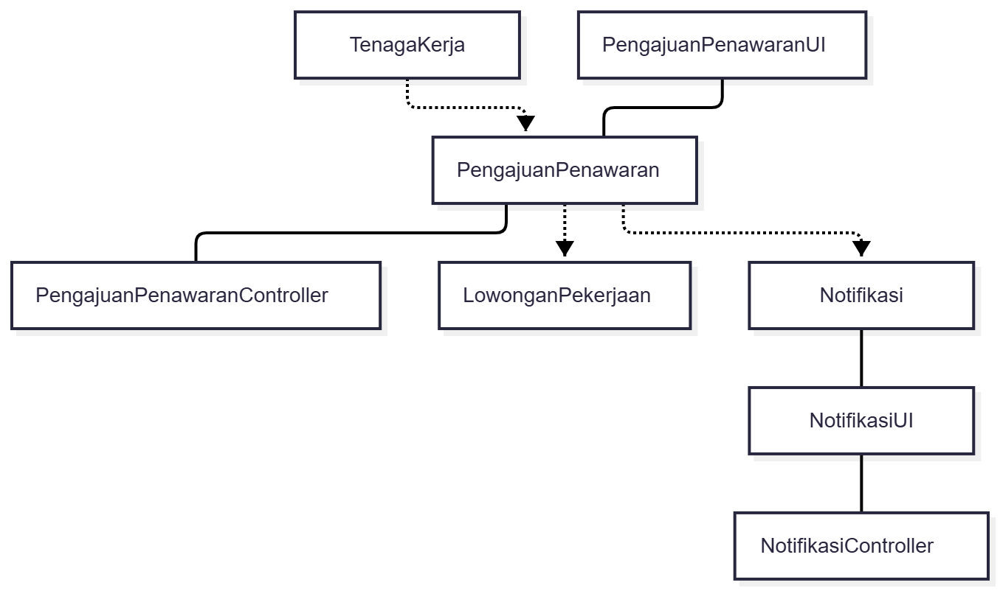
</p>
<p align="center"><i>Gambar 3.5.4. Diagram Kelas Mengajukan Penawaran Pekerjaan</i></p>
## 3.6 Use Case Memilih Tenaga Kerja

**ID Use Case:** UC06   
**Nama Use Case:** Memilih Tenaga Kerja

### 3.6.1 Identifikasi Kelas

Tabel 3.6. Identifikasi Kelas Use Case UC06

| No | Nama Kelas Perancangan | Nama Kelas Analisis Terkait |
|:--- | :--- | :--- |
| 1 | PenyediaKerja | PenyediaKerja |
| 2 | LowonganPekerjaan | LowonganPekerjaan |
| 3 | PengajuanPenawaran | PengajuanPenawaran |
| 4 | TransaksiPekerjaan | TransaksiPekerjaan |
| 5 | Notifikasi | Notifikasi |
| 6 | PenyediaKerjaUI | PenyediaKerjaUI |
| 7 | LowonganPekerjaanUI | LowonganPekerjaanUI |
| 8 | PengajuanPenawaranUI | PengajuanPenawaranUI |
| 9 | TransaksiPekerjaanUI | TransaksiPekerjaanUI |
| 10 | NotifikasiUI | NotifikasiUI |
| 11 | PenyediaKerjaController | PenyediaKerjaController |
| 12 | LowonganPekerjaanController | LowonganPekerjaanController |
| 13 | PengajuanPenawaranController | PengajuanPenawaranController |
| 14 | TransaksiPekerjaanController | TransaksiPekerjaanController |
| 15 | NotifikasiController | NotifikasiController |

### 3.6.2 Sequence Diagram

- **Skenario Normal**
<p align="center">

</p>
<p align="center">
<i>Gambar 3.6.1. Sequence Diagram UC06 - Skenario Normal</i>
</p>

- **Skenario Alternatif 1: Kuota Lowongan Sudah Penuh Saat Konfirmasi**
<p align="center">

</p>
<p align="center">
<i>Gambar 3.6.2. Sequence Diagram UC06 - Kuota Lowongan Sudah Penuh Saat Konfirmasi</i>
</p>

- **Skenario Alternatif 2: Penyedia Kerja Membatalkan Pemilihan Pelamar**
<p align="center">

</p>
<p align="center">
<i>Gambar 3.6.3. Sequence Diagram UC06 - Penyedia Kerja Membatalkan Pemilihan Pelamar</i>
</p>

### 3.6.3 Diagram Kelas
<p align="center">

</p>
<p align="center">
<i>Gambar 3.6.4. Diagram Kelas Memilih Tenaga Kerja</i>
</p>


## 3.7 Use Case Melakukan Pembayaran Pekerjaan

**ID Use Case:** UC07   
**Nama Use Case:** Melakukan Pembayaran Pekerjaan

### 3.7.1 Identifikasi Kelas

Tabel 3.7. Identifikasi Kelas Use Case UC07

| No | Nama Kelas Perancangan | Nama Kelas Analisis Terkait |
|:--- | :--- | :--- |
| 1 | PenyediaKerja | PenyediaKerja |
| 2 | TransaksiPekerjaan | TransaksiPekerjaan |
| 3 | TagihanPembayaran | TagihanPembayaran |
| 4 | Notifikasi | Notifikasi |
| 5 | PaymentGateway | PaymentGateway |
| 6 | PenyediaKerjaUI | PenyediaKerjaUI |
| 7 | TransaksiPekerjaanUI | TransaksiPekerjaanUI |
| 8 | TagihanPembayaranUI | TagihanPembayaranUI |
| 9 | NotifikasiUI | NotifikasiUI |
| 10 | PaymentGatewayUI | PaymentGatewayUI |
| 11 | PenyediaKerjaController | PenyediaKerjaController |
| 12 | TransaksiPekerjaanController | TransaksiPekerjaanController |
| 13 | TagihanPembayaranController | TagihanPembayaranController |
| 14 | NotifikasiController | NotifikasiController |
| 15 | PaymentGatewayController | PaymentGatewayController |

### 3.7.2 Sequence Diagram

- **Skenario Normal**
<p align="center">

</p>
<p align="center">
<i>Gambar 3.7.1. Sequence Diagram UC07 - Skenario Normal</i>
</p>

- **Skenario Alternatif 1: Pembayaran Gagal atau Dibatalkan oleh Payment Gateway**
<p align="center">

</p>
<p align="center">
<i>Gambar 3.7.2. Sequence Diagram UC07 - Pembayaran Gagal atau Dibatalkan oleh Payment Gateway</i>
</p>

- **Skenario Alternatif 2 : Waktu Pembayaran Habis (Timeout / Expired)**
<p align="center">

</p>
<p align="center">
<i>Gambar 3.7.3. Sequence Diagram UC07 - Waktu Pembayaran Habis (Timeout / Expired)</i>
</p>

### 3.7.3 Diagram Kelas
<p align="center">

</p>
<p align="center">
<i>Gambar 3.7.4. Diagram Kelas Melakukan Pembayaran Pekerjaan</i>
</p>


## 3.8 Use Case Menyerahkan Hasil Pekerjaan

**ID Use Case:** UC08   
**Nama Use Case:** Menyerahkan Hasil Pekerjaan

### 3.8.1 Identifikasi Kelas

Tabel 3.8. Identifikasi Kelas Use Case UC08

| No | Nama Kelas Perancangan | Nama Kelas Analisis Terkait |
|:--- | :--- | :--- |
| 1 | TenagaKerja | TenagaKerja |
| 2 | TransaksiPekerjaan | TransaksiPekerjaan |
| 3 | BuktiPenyerahan | BuktiPenyerahan |
| 4 | Notifikasi | Notifikasi |
| 5 | TenagaKerjaUI | TenagaKerjaUI |
| 6 | TransaksiPekerjaanUI | TransaksiPekerjaanUI |
| 7 | BuktiPenyerahanUI | BuktiPenyerahanUI |
| 8 | NotifikasiUI | NotifikasiUI |
| 9 | TenagaKerjaController | TenagaKerjaController |
| 10 | TransaksiPekerjaanController | TransaksiPekerjaanController |
| 11 | BuktiPenyerahanController | BuktiPenyerahanController |
| 12 | NotifikasiController | NotifikasiController |

### 3.8.2 Sequence Diagram

- **Skenario Normal**
<p align="center">

</p>
<p align="center">
<i>Gambar 3.8.1. Sequence Diagram UC08 - Skenario Normal</i>
</p>

- **Skenario Alternatif 1: Ukuran Berkas Melebihi Batas Maksimal**
<p align="center">

</p>
<p align="center">
<i>Gambar 3.8.2. Sequence Diagram UC08 - Ukuran Berkas Melebihi Batas Maksimal</i>
</p>

- **Skenario Alternatif 2: Tenaga Kerja Belum Mengunggah Berkas Wajib**
<p align="center">

</p>
<p align="center">
<i>Gambar 3.8.3. Sequence Diagram UC08 - Tenaga Kerja Belum Mengunggah Berkas Wajib</i>
</p>

### 3.8.3 Diagram Kelas
<p align="center">

</p>
<p align="center">
<i>Gambar 3.8.4. Diagram Kelas Menyerahkan Hasil Pekerjaan</i>
</p>

## 3.9 Use Case Memverifikasi Penyelesaian Pekerjaan

**ID Use Case:** UC09  
**Nama Use Case:** Memverifikasi Penyelesaian Pekerjaan

### 3.9.1 Identifikasi Kelas

Tabel 3.9. Identifikasi Kelas Use Case UC09

| No | Nama Kelas Perancangan | Nama Kelas Analisis Terkait |
|:--- | :--- | :--- |
| 1 | PenyediaKerja | PenyediaKerja |
| 2 | TransaksiPekerjaan | TransaksiPekerjaan |
| 3 | BuktiPenyerahan | BuktiPenyerahan |
| 4 | Notifikasi | Notifikasi |
| 5 | PenyediaKerjaUI | PenyediaKerjaUI |
| 6 | TransaksiPekerjaanUI | TransaksiPekerjaanUI |
| 7 | BuktiPenyerahanUI | BuktiPenyerahanUI |
| 8 | NotifikasiUI | NotifikasiUI |
| 9 | PenyediaKerjaController | PenyediaKerjaController |
| 10 | TransaksiPekerjaanController | TransaksiPekerjaanController |
| 11 | BuktiPenyerahanController | BuktiPenyerahanController |
| 12 | NotifikasiController | NotifikasiController |

### 3.9.2 Sequence Diagram

- **Skenario Normal**

<p align="center">

</p>
<p align="center">
<i>Gambar 3.9.1. Sequence Diagram UC09 - Skenario Normal</i>
</p>

- **Skenario Alternatif 1 : Hasil Pekerjaan Belum Sesuai (Penyedia Kerja Meminta Revisi)**

<p align="center">

</p>
<p align="center">
<i>Gambar 3.9.2. Sequence Diagram UC09 - Hasil Pekerjaan Belum Sesuai (Penyedia Kerja Meminta Revisi)</i>
</p>

- **Skenario Alternatif 2 : Terjadi Ketidaksepakatan / Perselisihan Hasil Kerja**

<p align="center">

</p>
<p align="center">
<i>Gambar 3.9.3. Sequence Diagram UC09 - Terjadi Ketidaksepakatan / Perselisihan Hasil Kerja</i>
</p>

### 3.9.3 Diagram Kelas

<p align="center">

</p>
<p align="center">
<i>Gambar 3.9.4. Diagram Kelas Memverifikasi Penyelesaian Pekerjaan</i>
</p>

## 3.10 Use Case Melakukan Pencairan Dana

**ID Use Case:** UC10
**Nama Use Case:** Melakukan Pencairan Dana

### 3.10.1 Identifikasi Kelas

Tabel 3.10. Identifikasi Kelas Use Case UC10

| No | Nama Kelas Perancangan | Nama Kelas Analisis Terkait |
|:--- | :--- | :--- |
| 1 | TenagaKerja | TenagaKerja |
| 2 | PencairanDana | PencairanDana |
| 3 | PaymentGateway | PaymentGateway |
| 4 | Notifikasi | Notifikasi |
| 5 | TenagaKerjaUI | TenagaKerjaUI |
| 6 | PencairanDanaUI | PencairanDanaUI |
| 7 | PaymentGatewayUI | PaymentGatewayUI |
| 8 | NotifikasiUI | NotifikasiUI |
| 9 | TenagaKerjaController | TenagaKerjaController |
| 10 | PencairanDanaController | PencairanDanaController |
| 11 | PaymentGatewayController | PaymentGatewayController |
| 12 | NotifikasiController | NotifikasiController |

### 3.10.2 Sequence Diagram 

- **Skenario Normal**

<p align="center">

</p>
<p align="center">
<i>Gambar 3.10.1. Sequence Diagram UC10</i>
</p>

- **Skenario Alternatif 1 : Data Rekening/E-wallet Tidak Valid**

<p align="center">

</p>
<p align="center">
<i>Gambar 3.10.2. Sequence Diagram UC10 - Data Rekening/E-wallet Tidak Valid</i>
</p>

- **Skenario Alternatif 2 : Nominal Penarikan Melebihi Saldo**

<p align="center">

</p>
<p align="center">
<i>Gambar 3.10.3. Sequence Diagram UC10 - Nominal Penarikan Melebihi Saldo</i>
</p>

### 3.10.3 Diagram Kelas

<p align="center">

</p>
<p align="center">
<i>Gambar 3.10.4. Diagram Kelas Melakukan Pencairan Dana</i>
</p>

## 3.11 Use Case Memberikan Penilaian Kerja

**ID Use Case:** UC11
**Nama Use Case:** Memberikan Penilaian Kerja

### 3.11.1 Identifikasi Kelas

Tabel 3.11. Identifikasi Kelas Use Case UC11

| No | Nama Kelas Perancangan | Nama Kelas Analisis Terkait |
|:--- | :--- | :--- |
| 1 | Pengguna | Pengguna |
| 2 | TransaksiPekerjaan | TransaksiPekerjaan |
| 3 | UlasanRating | UlasanRating |
| 4 | PenggunaUI | PenggunaUI |
| 5 | TransaksiPekerjaanUI | TransaksiPekerjaanUI |
| 6 | UlasanRatingUI | UlasanRatingUI |
| 7 | PenggunaController | PenggunaController |
| 8 | TransaksiPekerjaanController | TransaksiPekerjaanController |
| 9 | UlasanRatingController | UlasanRatingController |

### 3.11.2 Sequence Diagram 

- **Skenario Normal dan Skenario Alternatif 1**

<p align="center">

</p>
<p align="center">
<i>Gambar 3.11.1. Sequence Diagram UC11</i>
</p>

- **Skenario Alternatif 2 : Rating Tidak Diisi**

<p align="center">

</p>
<p align="center">
<i>Gambar 3.11.2. Sequence Diagram UC11 - Rating Tidak Diisi</i>
</p>

### 3.11.3 Diagram Kelas 

<p align="center">

</p>
<p align="center">
<i>Gambar 3.11.3. Diagram Kelas Memberikan Penilaian Kerja</i>
</p>

## 3.12 Use Case Menangani Keluhan

**ID Use Case:** UC12

**Nama Use Case:** Menangani Keluhan

### 3.12.1 Identifikasi Kelas

Tabel 3.12. Identifikasi Kelas Use Case UC12

| No | Nama Kelas Perancangan | Nama Kelas Analisis Terkait |
|:--- | :--- | :--- |
| 1 | TenagaKerja | TenagaKerja |
| 2 | PencairanDana | PencairanDana |
| 3 | PaymentGateway | PaymentGateway |
| 4 | Notifikasi | Notifikasi |
| 5 | TenagaKerjaUI | TenagaKerjaUI |
| 6 | PencairanDanaUI | PencairanDanaUI |
| 7 | PaymentGatewayUI | PaymentGatewayUI |
| 8 | NotifikasiUI | NotifikasiUI |
| 9 | TenagaKerjaController | TenagaKerjaController |
| 10 | PencairanDanaController | PencairanDanaController |
| 11 | PaymentGatewayController | PaymentGatewayController |
| 12 | NotifikasiController | NotifikasiController |

### 3.12.2 Sequence Diagram 

- **Skenario Normal dan Skenario Alternatif 1**

<p align="center">

</p>
<p align="center">
<i>Gambar 3.12.1. Sequence Diagram UC12</i>
</p>

- **Skenario Alternatif 1 dan 2 : Permintaan Bukti Tambahan & Ditolak**

<p align="center">

</p>
<p align="center">
<i>Gambar 3.12.2. Sequence Diagram UC12 - Permintaan Bukti Tambahan & Ditolak</i>
</p>

- **Skenario Alternatif 3 : Pengguna Membatalkan Tiket Keluhan**

<p align="center">

</p>
<p align="center">
<i>Gambar 3.12.3. Sequence Diagram UC12 - Pengguna Membatalkan Tiket Keluhan</i>
</p>

### 3.12.3 Diagram Kelas 

<p align="center">

</p>
<p align="center">
<i>Gambar 3.12.4. Diagram Kelas Menangani Keluhan</i>
</p>

<br>

---

# BAB 4: Diagram Kelas Keseluruhan

## 4.1 Diagram Kelas

<p align="center">

</p>
<p align="center">
<i>Gambar 4.1.1. Diagram Kelas Perancangan Keseluruhan Kerja-In</i>
</p>

Tabel 4.1. Daftar Kelas Perancangan Keseluruhan


| ID Kelas | Nama Kelas | Atribut | Metode/Operasi |
| :--- | :--- | :--- | :--- |
| C01 | Pengguna | `# id_pengguna: String`<br>`# nama: String`<br>`# email: String`<br>`# peran: String`<br>`# tanggal_lahir: Date`<br>`# token_auth: String`<br>`# idPengguna: String`<br>`- akumulasiRating: Float` | `+ registrasi(): void`<br>`+ validasiUsia(): Boolean`<br>`+ login(): Boolean`<br>`+ generateToken(): String`<br>`+ berikanUlasan(idTransaksi, nilai, deskripsi): void` |
| C02 | TenagaKerja | `# idPengguna: String`<br>`# nama: String`<br>`- status_verifikasi: String`<br>`- saldo_pendapatan: Decimal`<br>`- rating_akumulatif: Float`<br>`# email: String`<br>`- idTenagaKerja: String`<br>`- saldoPendapatan: Decimal`<br>`- rekeningTujuan: String` | `+ cariLowongan(kataKunci): List<LowonganPekerjaan>`<br>`+ filterLowongan(kategori): List<LowonganPekerjaan>`<br>`+ buatProfil(): void`<br>`+ ajukanVerifikasi(): void`<br>`+ perbaruiStatusVerifikasi(): void`<br>`+ ajukanPenawaran(idLowongan, pesan): void`<br>`+ batalkanPengajuan(): void`<br>`+ serahkanPekerjaan(idTransaksi, deskripsi, berkas): void`<br>`+ terimaUpah(nominal): void`<br>`+ ajukanPencairan(nominal): void` |
| C03 | PenyediaKerja | `# idPengguna: String`<br>`# nama: String`<br>`# email: String`<br>`- idPenyedia: String` | `+ buatLowonganBaru(judul, deskripsi, kuota, lokasi, upah): void`<br>`+ batalkanLowongan(): void`<br>`+ buatProfil(): void`<br>`+ lihatDaftarPelamar(): List<PengajuanPenawaran>`<br>`+ pilihPelamar(idPenawaran): void`<br>`+ bayarTagihan(idTagihan, metode): void`<br>`+ setujuiHasilPekerjaan(): void` |
| C04 | CustomerService | `- idPengguna: String`<br>`- nama: String`<br>`- peran: String` | `+ tinjauVerifikasi(): void`<br>`+ setujuiVerifikasi(): void`<br>`+ tolakVerifikasi(): void`<br>`+ tinjauTiket(idTiket): void`<br>`+ putuskanSengketa(idTiket, keputusan): void` |
| C05 | LowonganPekerjaan | `- idLowongan: String`<br>`- judul: String`<br>`- deskripsi: String`<br>`- kuota: Integer`<br>`- lokasi: String`<br>`- upah: Decimal`<br>`- status: String`<br>`- kategori: String`<br>`- jumlahDiterima: Integer` | `- validasiIsianFormulir(): Boolean`<br>`+ simpanLowongan(): void`<br>`- setStatusDefault(): void`<br>`+ tampilkanDaftarLowongan(filter): List<LowonganPekerjaan>`<br>`+ cekStatusOpen(): Boolean`<br>`+ tampilkanTombolAjukan(): void`<br>`+ cekKuotaSisa(): Integer`<br>`# updateStatusLowongan(): void`<br>`- kurangiKuota(): void` |
| C06 | PengajuanPenawaran | `- idPenawaran: String`<br>`- idLowongan: String`<br>`- idTenagaKerja: String`<br>`- pesanPenawaran: String`<br>`- timestamp: Timestamp`<br>`- status: String`<br>`- pesan: String` | `+ simpanPengajuan(): void`<br>`- validasiStatusAkun(): Boolean`<br>`+ setStatusPersetujuan(status): void` |
| C07 | TransaksiPekerjaan | `- idTransaksi: String`<br>`- idLowongan: String`<br>`- idTenagaKerja: String`<br>`- idPenyediaKerja: String`<br>`- statusPekerjaan: String`<br>`- nominalUpah: Decimal`<br>`- statusPengerjaan: String` | `+ buatTransaksiBaru(): void`<br>`# updateStatusPekerjaan(status): void`<br>`+ verifikasiSelesai(): void`<br>`+ picuPembayaranUpah(): void`<br>`+ cekStatusSelesai(): Boolean`<br>`+ validasiUlasanGanda(): Boolean`<br>`+ getDetailTransaksi(): TransaksiPekerjaan` |
| C08 | BuktiPenyerahan | `- idPenyerahan: String`<br>`- idTransaksi: String`<br>`- deskripsiPengerjaan: String`<br>`- fileUrl: String`<br>`- ukuranFile: Integer`<br>`- timestampPengiriman: Timestamp` | `+ validasiUkuranFile(): Boolean`<br>`+ simpanBukti(): void` |
| C09 | TagihanPembayaran | `- idTagihan: String`<br>`- idTransaksi: String`<br>`- nominalUpah: Decimal`<br>`- commissionFee: Decimal`<br>`- totalBayar: Decimal`<br>`- expiryTimestamp: Timestamp`<br>`- statusBayar: String` | `+ hitungTotalTagihan(): Decimal`<br>`+ buatInvoice(): void`<br>`# updateStatusPembayaran(): void` |
| C10 | PencairanDana | `- idPencairan: String`<br>`- idTenagaKerja: String`<br>`- nominal: Decimal`<br>`- statusPencairan: String`<br>`- waktuPengajuan: Timestamp` | `+ buatTransaksiPencairan(): void`<br>`+ updateStatusPencairan(status): void` |
| C11 | UlasanRating | `- idUlasan: String`<br>`- idTransaksi: String`<br>`- nilai: Integer`<br>`- deskripsiUlasan: String` | `+ simpanUlasan(): void` |
| C12 | TiketSengketa | `- idTiket: String`<br>`- idTransaksi: String`<br>`- idPelapor: String`<br>`- kategoriMasalah: String`<br>`- deskripsiKomplain: String`<br>`- statusTiket: String` | `+ buatTiket(): void`<br>`+ updateStatus(statusBaru): void` |
| C13 | RiwayatSengketa | `- idRiwayat: String`<br>`- idTiket: String`<br>`- logAktivitas: String`<br>`- timestamp: Timestamp` | `+ catatRiwayat(aktivitas): void` |
| C14 | Notifikasi | `- id_notifikasi: String`<br>`- pesan_notifikasi: String`<br>`- waktu_kirim: Timestamp`<br>`- idPenerima: String`<br>`- pesan: String`<br>`- status_baca: Boolean`<br>`- idNotifikasi: String`<br>`- statusBaca: Boolean`<br>`- waktu: Timestamp`<br>`- idPengguna: String` | `+ kirimNotifikasi(): void`<br>`+ kirimNotifikasiPengajuanBaru(): void`<br>`+ kirimNotifikasiPenerimaan(): void`<br>`+ kirimNotifikasiSiapKerja(): void`<br>`+ kirimNotifikasiPeninjauan(): void`<br>`+ kirimNotifPenerimaanUpah(idTenagaKerja): void`<br>`+ kirimNotifPencairan(status): void`<br>`+ kirimNotifikasi(pesan): void` |
| C15 | PaymentGateway | `- idGateway: String`<br>`- namaProvider: String`<br>`- statusKoneksi: String` | `+ prosesPembayaran(): void`<br>`+ dapatkanCallbackStatus(): String`<br>`+ prosesTransferDana(rekening, nominal): void` |

<br>

---

# BAB 5: Perancangan Rinci Kelas

Bagian ini diisi dengan daftar seluruh kelas dalam tabel berikut:

Tabel 5.1. Daftar Kelas Perancangan dan Kelas Analisis Terkait

| No | Nama Kelas Perancangan | Nama Kelas Analisis Terkait |
| :--- | :--- | :--- |
| 1 | Pengguna | C01 - Pengguna |
| 2 | TenagaKerja | C02 - TenagaKerja |
| 3 | PenyediaKerja | C03 - PenyediaKerja |
| 4 | CustomerService | C04 - CustomerService |
| 5 | LowonganPekerjaan | C05 - LowonganPekerjaan |
| 6 | PengajuanPenawaran | C06 - PengajuanPenawaran |
| 7 | TransaksiPekerjaan | C07 - TransaksiPekerjaan |
| 8 | BuktiPenyerahan | C08 - BuktiPenyerahan |
| 9 | TagihanPembayaran | C09 - TagihanPembayaran |
| 10 | PencairanDana | C10 - PencairanDana |
| 11 | UlasanRating | C11 - UlasanRating |
| 12 | TiketSengketa | C12 - TiketSengketa |
| 13 | RiwayatSengketa | C13 - RiwayatSengketa |
| 14 | Notifikasi | C14 - Notifikasi |
| 15 | PaymentGateway | C15 - PaymentGateway |
| 16 | PenggunaUI | C16 - PenggunaUI |
| 17 | TenagaKerjaUI | C17 - TenagaKerjaUI |
| 18 | PenyediaKerjaUI | C18 - PenyediaKerjaUI |
| 19 | CustomerServiceUI | C19 - CustomerServiceUI |
| 20 | LowonganPekerjaanUI | C20 - LowonganPekerjaanUI |
| 21 | PengajuanPenawaranUI | C21 - PengajuanPenawaranUI |
| 22 | TransaksiPekerjaanUI | C22 - TransaksiPekerjaanUI |
| 23 | BuktiPenyerahanUI | C23 - BuktiPenyerahanUI |
| 24 | TagihanPembayaranUI | C24 - TagihanPembayaranUI |
| 25 | PencairanDanaUI | C25 - PencairanDanaUI |
| 26 | UlasanRatingUI | C26 - UlasanRatingUI |
| 27 | TiketSengketaUI | C27 - TiketSengketaUI |
| 28 | RiwayatSengketaUI | C28 - RiwayatSengketaUI |
| 29 | NotifikasiUI | C29 - NotifikasiUI |
| 30 | PaymentGatewayUI | C30 - PaymentGatewayUI |
| 31 | PenggunaController | C31 - PenggunaController |
| 32 | TenagaKerjaController | C32 - TenagaKerjaController |
| 33 | PenyediaKerjaController | C33 - PenyediaKerjaController |
| 34 | CustomerServiceController | C34 - CustomerServiceController |
| 35 | LowonganPekerjaanController | C35 - LowonganPekerjaanController |
| 36 | PengajuanPenawaranController | C36 - PengajuanPenawaranController |
| 37 | TransaksiPekerjaanController | C37 - TransaksiPekerjaanController |
| 38 | BuktiPenyerahanController | C38 - BuktiPenyerahanController |
| 39 | TagihanPembayaranController | C39 - TagihanPembayaranController |
| 40 | PencairanDanaController | C40 - PencairanDanaController |
| 41 | UlasanRatingController | C41 - UlasanRatingController |
| 42 | TiketSengketaController | C42 - TiketSengketaController |
| 43 | RiwayatSengketaController | C43 - RiwayatSengketaController |
| 44 | NotifikasiController | C44 - NotifikasiController |
| 45 | PaymentGatewayController | C45 - PaymentGatewayController |

Untuk **setiap kelas**, identifikasi operasi berdasarkan tanggung jawab kelas beserta *visibility*-nya, serta atribut beserta *visibility* dan tipenya. Buat subbab tersendiri untuk setiap kelas.

## 5.1 Kelas Pengguna

**Nama Kelas:** Pengguna  
**ID Kelas:** C01

Tabel 5.1.1. Operasi Kelas Pengguna

| Nama Operasi | Visibility |
| :--- | :--- |
| `getUsia(): Integer` | public |
| `setToken(tokenAuth: string): void` | public |
| `getNama(): string` | public |
| `getEmail(): string` | public |
| `perbaruiAkumulasiRating(): void` | public |

Tabel 5.1.2. Atribut Kelas Pengguna

| Nama Atribut | Visibility | Tipe |
| :--- | :--- | :--- |
| `idPengguna` | protected | `string` |
| `nama` | protected | `string` |
| `email` | protected | `string` |
| `peran` | protected | `string` |
| `tanggalLahir` | protected | `Date` |
| `tokenAuth` | protected | `string` |
| `akumulasiRating` | private | `Float` |

### 5.1.1 Algoritma/Query

Bagian ini diisi untuk kerangka algoritma proses yang dianggap cukup penting. Algoritma dapat dituliskan sebagai *pseudocode*. Implementasi *skeleton code* juga dapat digunakan untuk kelas yang sudah terdefinisi pada bahasa pemrograman tertentu.

**Nama Kelas:** Pengguna  
**Nama Operasi:** `getUsia(): Integer`  
**ID Algoritma:** Algo-001

```text
function getUsia() -> Integer
    hariIni <- currentDate()
    if not isValidDate(this.tanggalLahir) or this.tanggalLahir > hariIni then
        throw Error("Tanggal lahir tidak valid")
    usia <- year(hariIni) - year(this.tanggalLahir)
    if (month(hariIni), day(hariIni)) < (month(this.tanggalLahir), day(this.tanggalLahir)) then
        usia <- usia - 1
    -> usia
```

Jika operasi mengacu pada query tertentu, lengkapi tabel berikut.

Tabel 5.1.3. Query Operasi getUsia

| No Query | Query | Keterangan |
| :--- | :--- | :--- |
| - | - | Tidak menggunakan query; operasi dilakukan pada atribut objek. |

### 5.1.2 Algoritma/Query

**Nama Kelas:** Pengguna  
**Nama Operasi:** `setToken(tokenAuth: string): void`  
**ID Algoritma:** Algo-002

```text
function setToken(tokenAuth: string) -> void
    if not isString(tokenAuth) then
        throw Error("Token tidak valid")
    this.tokenAuth <- tokenAuth
    { Token kosong menghapus token pada objek saat sesi berakhir; tidak memerlukan SQL. }
```

Jika operasi mengacu pada query tertentu, lengkapi tabel berikut.

Tabel 5.1.4. Query Operasi setToken

| No Query | Query | Keterangan |
| :--- | :--- | :--- |
| - | - | Tidak menggunakan query; operasi dilakukan pada atribut objek. |

### 5.1.3 Algoritma/Query

**Nama Kelas:** Pengguna  
**Nama Operasi:** `getNama(): string`  
**ID Algoritma:** Algo-003

```text
function getNama() -> string
    -> this.nama
```

Jika operasi mengacu pada query tertentu, lengkapi tabel berikut.

Tabel 5.1.5. Query Operasi getNama

| No Query | Query | Keterangan |
| :--- | :--- | :--- |
| - | - | Tidak menggunakan query; operasi dilakukan pada atribut objek. |

### 5.1.4 Algoritma/Query

**Nama Kelas:** Pengguna  
**Nama Operasi:** `getEmail(): string`  
**ID Algoritma:** Algo-004

```text
function getEmail() -> string
    -> this.email
```

Jika operasi mengacu pada query tertentu, lengkapi tabel berikut.

Tabel 5.1.6. Query Operasi getEmail

| No Query | Query | Keterangan |
| :--- | :--- | :--- |
| - | - | Tidak menggunakan query; operasi dilakukan pada atribut objek. |

### 5.1.5 Algoritma/Query

**Nama Kelas:** Pengguna  
**Nama Operasi:** `perbaruiAkumulasiRating(): void`  
**ID Algoritma:** Algo-005

```text
function perbaruiAkumulasiRating() -> void
    transaction
        hasil <- queryOne("Q-001", this.idPengguna)
        ratingBaru <- hasil.rating
        wajibAda(queryOne("Q-002", this.idPengguna, ratingBaru))
    this.akumulasiRating <- ratingBaru
```

Jika operasi mengacu pada query tertentu, lengkapi tabel berikut.

Tabel 5.1.7. Query Operasi perbaruiAkumulasiRating

| No Query | Query | Keterangan |
| :--- | :--- | :--- |
| Q-001 | `SELECT COALESCE(AVG(nilai), 0) AS rating FROM ulasan_rating WHERE "idPenerima" = $1;` | perbaruiAkumulasiRating(): rata-rata ulasan penerima; $1 = idPengguna. |
| Q-002 | `UPDATE pengguna SET "akumulasiRating" = $2 WHERE "idPengguna" = $1 RETURNING "akumulasiRating";` | perbaruiAkumulasiRating(): menyimpan rata-rata; $1 = idPengguna, $2 = rating. |

## 5.2 Kelas TenagaKerja

**Nama Kelas:** TenagaKerja  
**ID Kelas:** C02

Tabel 5.2.1. Operasi Kelas TenagaKerja

| Nama Operasi | Visibility |
| :--- | :--- |
| `buatProfil(dataProfil: Record<string, unknown>, idPenggunaAuth: string): void` | public |
| `getStatusVerifikasi(): string` | public |
| `setStatusVerifikasi(status: string): void` | public |
| `setDokumenIdentitas(dokumen: File): void` | public |
| `getDokumenIdentitas(): File` | public |
| `getSaldoPendapatan(): Decimal` | public |
| `tambahSaldoPendapatan(nominal: Decimal): void` | public |
| `kurangiSaldoPendapatan(nominal: Decimal): void` | public |

Tabel 5.2.2. Atribut Kelas TenagaKerja

| Nama Atribut | Visibility | Tipe |
| :--- | :--- | :--- |
| `idTenagaKerja` | private | `string` |
| `statusVerifikasi` | private | `string` |
| `dokumenIdentitas` | private | `File` |
| `waktuPengajuanVerifikasi` | private | `Date` |
| `alasanPenolakanVerifikasi` | private | `string` |
| `saldoPendapatan` | private | `Decimal` |
| `rekeningTujuan` | private | `string` |

### 5.2.1 Algoritma/Query

Bagian ini diisi untuk kerangka algoritma proses yang dianggap cukup penting. Algoritma dapat dituliskan sebagai *pseudocode*. Implementasi *skeleton code* juga dapat digunakan untuk kelas yang sudah terdefinisi pada bahasa pemrograman tertentu.

**Nama Kelas:** TenagaKerja  
**Nama Operasi:** `buatProfil(dataProfil: Record<string, unknown>, idPenggunaAuth: string): void`  
**ID Algoritma:** Algo-006

```text
function buatProfil(dataProfil: Record<string, unknown>, idPenggunaAuth: string) -> void
    { Validasi registrasi umum telah dilakukan Controller. }
    if not lengkap(dataProfil, ["nama", "email", "tanggalLahir"]) or isBlank(idPenggunaAuth) then
        throw Error("Data profil atau ID pengguna dari Supabase Auth belum lengkap")
    idProfilBaru <- uuid()
    transaction
        wajibAda(execute("Q-003", idPenggunaAuth, dataProfil.nama, normalizeEmail(dataProfil.email), "TenagaKerja", dataProfil.tanggalLahir))
        wajibAda(execute("Q-004", idProfilBaru, idPenggunaAuth, "Belum Terverifikasi", "", ""))
    this.idPengguna <- idPenggunaAuth
    this.idTenagaKerja <- idProfilBaru
    this.nama <- dataProfil.nama
    this.email <- dataProfil.email
    this.peran <- "TenagaKerja"
    this.tanggalLahir <- dataProfil.tanggalLahir
    this.tokenAuth <- ""
    this.akumulasiRating <- 0
    this.statusVerifikasi <- "Belum Terverifikasi"
    this.saldoPendapatan <- 0
    this.rekeningTujuan <- ""
    this.dokumenIdentitas <- null
    this.waktuPengajuanVerifikasi <- null
    this.alasanPenolakanVerifikasi <- ""
```

Jika operasi mengacu pada query tertentu, lengkapi tabel berikut.

Tabel 5.2.3. Query Operasi buatProfil

| No Query | Query | Keterangan |
| :--- | :--- | :--- |
| Q-003 | `INSERT INTO pengguna ("idPengguna", nama, email, peran, "tanggalLahir", "akumulasiRating") VALUES ($1, $2, $3, $4, $5, 0) RETURNING "idPengguna";` | buatProfil(): $1-$5 = ID pengguna dari Supabase Auth, nama, email, peran, tanggalLahir. Kredensial dan sesi dikelola Supabase Auth. |
| Q-004 | `INSERT INTO tenaga_kerja ("idTenagaKerja", "idPengguna", "statusVerifikasi", "saldoPendapatan", "rekeningTujuan", "dokumenIdentitas", "waktuPengajuanVerifikasi", "alasanPenolakanVerifikasi") VALUES ($1, $2, $3, 0, $4, NULL, NULL, $5);` | buatProfil(): $1?$5 = idTenagaKerja, idPengguna, status awal, rekeningTujuan, alasan awal. |

### 5.2.2 Algoritma/Query

**Nama Kelas:** TenagaKerja  
**Nama Operasi:** `getStatusVerifikasi(): string`  
**ID Algoritma:** Algo-007

```text
function getStatusVerifikasi() -> string
    -> this.statusVerifikasi
```

Jika operasi mengacu pada query tertentu, lengkapi tabel berikut.

Tabel 5.2.4. Query Operasi getStatusVerifikasi

| No Query | Query | Keterangan |
| :--- | :--- | :--- |
| - | - | Tidak menggunakan query; operasi dilakukan pada atribut objek. |

### 5.2.3 Algoritma/Query

**Nama Kelas:** TenagaKerja  
**Nama Operasi:** `setStatusVerifikasi(status: string): void`  
**ID Algoritma:** Algo-008

```text
function setStatusVerifikasi(status: string) -> void
    { Otorisasi dan transisi status telah diperiksa Controller. }
    if status not in STATUS_VERIFIKASI then
        throw Error("Status verifikasi tidak valid")
    wajibAda(queryOne("Q-005", this.idTenagaKerja, status))
    this.statusVerifikasi <- status
```

Jika operasi mengacu pada query tertentu, lengkapi tabel berikut.

Tabel 5.2.5. Query Operasi setStatusVerifikasi

| No Query | Query | Keterangan |
| :--- | :--- | :--- |
| Q-005 | `UPDATE tenaga_kerja SET "statusVerifikasi" = $2 WHERE "idTenagaKerja" = $1 RETURNING "statusVerifikasi";` | setStatusVerifikasi(): $1 = idTenagaKerja, $2 = status yang sudah divalidasi Controller. |

### 5.2.4 Algoritma/Query

**Nama Kelas:** TenagaKerja  
**Nama Operasi:** `setDokumenIdentitas(dokumen: File): void`  
**ID Algoritma:** Algo-009

```text
function setDokumenIdentitas(dokumen: File) -> void
    { Controller telah memvalidasi format, ukuran, dan persetujuan. }
    if dokumen = null or dokumen.size = 0 then
        throw Error("Dokumen identitas belum tersedia")
    pathBaru <- storage.uploadPrivate(dokumen)
    waktuBaru <- now()
    try
        wajibAda(queryOne("Q-006", this.idTenagaKerja, pathBaru, waktuBaru))
    catch error
        storage.deleteIfUnreferenced(pathBaru)
        throw error
    this.dokumenIdentitas <- dokumen
    this.waktuPengajuanVerifikasi <- waktuBaru
    { Database menyimpan path; objek memuat File. Controller mengatur status pengajuan. }
```

Jika operasi mengacu pada query tertentu, lengkapi tabel berikut.

Tabel 5.2.6. Query Operasi setDokumenIdentitas

| No Query | Query | Keterangan |
| :--- | :--- | :--- |
| Q-006 | `UPDATE tenaga_kerja SET "dokumenIdentitas" = $2, "waktuPengajuanVerifikasi" = $3 WHERE "idTenagaKerja" = $1 RETURNING "waktuPengajuanVerifikasi";` | setDokumenIdentitas(): $1 = idTenagaKerja, $2 = path berkas pada storage privat, $3 = waktu pengajuan; isi File tidak disimpan langsung sebagai kolom. |

### 5.2.5 Algoritma/Query

**Nama Kelas:** TenagaKerja  
**Nama Operasi:** `getDokumenIdentitas(): File`  
**ID Algoritma:** Algo-010

```text
function getDokumenIdentitas() -> File
    { Controller telah memeriksa hak akses dan memuat berkas dari storage privat. }
    if this.dokumenIdentitas = null then
        throw Error("Dokumen identitas belum tersedia")
    -> this.dokumenIdentitas
```

Jika operasi mengacu pada query tertentu, lengkapi tabel berikut.

Tabel 5.2.7. Query Operasi getDokumenIdentitas

| No Query | Query | Keterangan |
| :--- | :--- | :--- |
| - | - | Tidak menggunakan query; operasi dilakukan pada atribut objek. |

### 5.2.6 Algoritma/Query

**Nama Kelas:** TenagaKerja  
**Nama Operasi:** `getSaldoPendapatan(): Decimal`  
**ID Algoritma:** Algo-011

```text
function getSaldoPendapatan() -> Decimal
    -> this.saldoPendapatan
```

Jika operasi mengacu pada query tertentu, lengkapi tabel berikut.

Tabel 5.2.8. Query Operasi getSaldoPendapatan

| No Query | Query | Keterangan |
| :--- | :--- | :--- |
| - | - | Tidak menggunakan query; operasi dilakukan pada atribut objek. |

### 5.2.7 Algoritma/Query

**Nama Kelas:** TenagaKerja  
**Nama Operasi:** `tambahSaldoPendapatan(nominal: Decimal): void`  
**ID Algoritma:** Algo-012

```text
function tambahSaldoPendapatan(nominal: Decimal) -> void
    if not isFinite(nominal) or nominal <= 0 then
        throw Error("Nominal tidak valid")
    { Controller menjamin upah/pencairan yang sama hanya diproses satu kali. }
    transaction
        data <- wajibAda(queryOne("Q-007", this.idTenagaKerja))
        saldoBaru <- data.saldoPendapatan + nominal
        wajibAda(queryOne("Q-008", this.idTenagaKerja, saldoBaru))
    this.saldoPendapatan <- saldoBaru
```

Jika operasi mengacu pada query tertentu, lengkapi tabel berikut.

Tabel 5.2.9. Query Operasi tambahSaldoPendapatan

| No Query | Query | Keterangan |
| :--- | :--- | :--- |
| Q-007 | `SELECT "saldoPendapatan" FROM tenaga_kerja WHERE "idTenagaKerja" = $1 FOR UPDATE;` | tambahSaldoPendapatan()/kurangiSaldoPendapatan(): mengunci saldo; $1 = idTenagaKerja. |
| Q-008 | `UPDATE tenaga_kerja SET "saldoPendapatan" = $2 WHERE "idTenagaKerja" = $1 RETURNING "saldoPendapatan";` | tambahSaldoPendapatan()/kurangiSaldoPendapatan(): $1 = idTenagaKerja, $2 = saldo baru dalam transaksi yang sama. |

### 5.2.8 Algoritma/Query

**Nama Kelas:** TenagaKerja  
**Nama Operasi:** `kurangiSaldoPendapatan(nominal: Decimal): void`  
**ID Algoritma:** Algo-013

```text
function kurangiSaldoPendapatan(nominal: Decimal) -> void
    if not isFinite(nominal) or nominal <= 0 then
        throw Error("Nominal tidak valid")
    { Controller menjamin upah/pencairan yang sama hanya diproses satu kali. }
    transaction
        data <- wajibAda(queryOne("Q-007", this.idTenagaKerja))
        if data.saldoPendapatan < nominal then
            throw Error("Saldo tidak cukup")
        saldoBaru <- data.saldoPendapatan - nominal
        wajibAda(queryOne("Q-008", this.idTenagaKerja, saldoBaru))
    this.saldoPendapatan <- saldoBaru
```

Jika operasi mengacu pada query tertentu, lengkapi tabel berikut.

Tabel 5.2.10. Query Operasi kurangiSaldoPendapatan

| No Query | Query | Keterangan |
| :--- | :--- | :--- |
| Q-007 | `SELECT "saldoPendapatan" FROM tenaga_kerja WHERE "idTenagaKerja" = $1 FOR UPDATE;` | tambahSaldoPendapatan()/kurangiSaldoPendapatan(): mengunci saldo; $1 = idTenagaKerja. |
| Q-008 | `UPDATE tenaga_kerja SET "saldoPendapatan" = $2 WHERE "idTenagaKerja" = $1 RETURNING "saldoPendapatan";` | tambahSaldoPendapatan()/kurangiSaldoPendapatan(): $1 = idTenagaKerja, $2 = saldo baru dalam transaksi yang sama. |

## 5.3 Kelas PenyediaKerja

**Nama Kelas:** PenyediaKerja  
**ID Kelas:** C03

Tabel 5.3.1. Operasi Kelas PenyediaKerja

| Nama Operasi | Visibility |
| :--- | :--- |
| `buatProfil(dataProfil: Record<string, unknown>, idPenggunaAuth: string): void` | public |

Tabel 5.3.2. Atribut Kelas PenyediaKerja

| Nama Atribut | Visibility | Tipe |
| :--- | :--- | :--- |
| `idPenyediaKerja` | private | `string` |

### 5.3.1 Algoritma/Query

Bagian ini diisi untuk kerangka algoritma proses yang dianggap cukup penting. Algoritma dapat dituliskan sebagai *pseudocode*. Implementasi *skeleton code* juga dapat digunakan untuk kelas yang sudah terdefinisi pada bahasa pemrograman tertentu.

**Nama Kelas:** PenyediaKerja  
**Nama Operasi:** `buatProfil(dataProfil: Record<string, unknown>, idPenggunaAuth: string): void`  
**ID Algoritma:** Algo-014

```text
function buatProfil(dataProfil: Record<string, unknown>, idPenggunaAuth: string) -> void
    { Validasi registrasi umum telah dilakukan Controller. }
    if not lengkap(dataProfil, ["nama", "email", "tanggalLahir"]) or isBlank(idPenggunaAuth) then
        throw Error("Data profil atau ID pengguna dari Supabase Auth belum lengkap")
    idProfilBaru <- uuid()
    transaction
        wajibAda(execute("Q-003", idPenggunaAuth, dataProfil.nama, normalizeEmail(dataProfil.email), "PenyediaKerja", dataProfil.tanggalLahir))
        wajibAda(execute("Q-009", idProfilBaru, idPenggunaAuth))
    this.idPengguna <- idPenggunaAuth
    this.idPenyediaKerja <- idProfilBaru
    this.nama <- dataProfil.nama
    this.email <- dataProfil.email
    this.peran <- "PenyediaKerja"
    this.tanggalLahir <- dataProfil.tanggalLahir
    this.tokenAuth <- ""
    this.akumulasiRating <- 0
```

Jika operasi mengacu pada query tertentu, lengkapi tabel berikut.

Tabel 5.3.3. Query Operasi buatProfil

| No Query | Query | Keterangan |
| :--- | :--- | :--- |
| Q-003 | `INSERT INTO pengguna ("idPengguna", nama, email, peran, "tanggalLahir", "akumulasiRating") VALUES ($1, $2, $3, $4, $5, 0) RETURNING "idPengguna";` | buatProfil(): $1-$5 = ID pengguna dari Supabase Auth, nama, email, peran, tanggalLahir. Kredensial dan sesi dikelola Supabase Auth. |
| Q-009 | `INSERT INTO penyedia_kerja ("idPenyediaKerja", "idPengguna") VALUES ($1, $2);` | buatProfil(): $1 = idPenyediaKerja, $2 = idPengguna; satu transaksi dengan penyimpanan pengguna. |

## 5.4 Kelas CustomerService

**Nama Kelas:** CustomerService  
**ID Kelas:** C04

Tabel 5.4.1. Operasi Kelas CustomerService

| Nama Operasi | Visibility |
| :--- | :--- |
| `tinjauVerifikasi(idTenagaKerja: string): Record<string, unknown>` | public |
| `setujuiVerifikasi(idTenagaKerja: string): void` | public |
| `tolakVerifikasi(idTenagaKerja: string, alasan: string): void` | public |
| `tinjauTiket(idTiket: string): Record<string, unknown>` | public |
| `putuskanSengketa(idTiket: string, keputusan: string): void` | public |

Tabel 5.4.2. Atribut Kelas CustomerService

| Nama Atribut | Visibility | Tipe |
| :--- | :--- | :--- |
| `idAdmin` | private | `string` |
| `hakAkses` | private | `string` |
| `peran` | private | `string` |

### 5.4.1 Algoritma/Query

Bagian ini diisi untuk kerangka algoritma proses yang dianggap cukup penting. Algoritma dapat dituliskan sebagai *pseudocode*. Implementasi *skeleton code* juga dapat digunakan untuk kelas yang sudah terdefinisi pada bahasa pemrograman tertentu.

**Nama Kelas:** CustomerService  
**Nama Operasi:** `tinjauVerifikasi(idTenagaKerja: string): Record<string, unknown>`  
**ID Algoritma:** Algo-015

```text
function tinjauVerifikasi(idTenagaKerja: string) -> Record<string, unknown>
    requirePermission(this.hakAkses, "tinjauVerifikasi")
    data <- wajibAda(queryOne("Q-010", idTenagaKerja))
    if isBlank(data.dokumenIdentitas) then
        throw Error("Pengajuan verifikasi tidak ditemukan")
    { Controller/UI memuat dokumen privat dari path data.dokumenIdentitas. }
    -> data
```

Jika operasi mengacu pada query tertentu, lengkapi tabel berikut.

Tabel 5.4.3. Query Operasi tinjauVerifikasi

| No Query | Query | Keterangan |
| :--- | :--- | :--- |
| Q-010 | `SELECT "idTenagaKerja", "dokumenIdentitas", "statusVerifikasi", "waktuPengajuanVerifikasi", "alasanPenolakanVerifikasi" FROM tenaga_kerja WHERE "idTenagaKerja" = $1;` | tinjauVerifikasi(): $1 = idTenagaKerja; Controller/UI memuat berkas melalui storage privat. |

### 5.4.2 Algoritma/Query

**Nama Kelas:** CustomerService  
**Nama Operasi:** `setujuiVerifikasi(idTenagaKerja: string): void`  
**ID Algoritma:** Algo-016

```text
function setujuiVerifikasi(idTenagaKerja: string) -> void
    requirePermission(this.hakAkses, "setujuiVerifikasi")
    transaction
        data <- wajibAda(queryOne("Q-011", idTenagaKerja))
        if data.statusVerifikasi != "Menunggu Verifikasi" or isBlank(data.dokumenIdentitas) then
            throw Error("Pengajuan tidak dapat diproses")
        wajibAda(queryOne("Q-012", idTenagaKerja, "Terverifikasi", ""))
    { Controller mengirim notifikasi setelah transaksi berhasil. }
```

Jika operasi mengacu pada query tertentu, lengkapi tabel berikut.

Tabel 5.4.4. Query Operasi setujuiVerifikasi

| No Query | Query | Keterangan |
| :--- | :--- | :--- |
| Q-011 | `SELECT "dokumenIdentitas", "statusVerifikasi" FROM tenaga_kerja WHERE "idTenagaKerja" = $1 FOR UPDATE;` | setujuiVerifikasi()/tolakVerifikasi(): mengunci pengajuan; $1 = idTenagaKerja. |
| Q-012 | `UPDATE tenaga_kerja SET "statusVerifikasi" = $2, "alasanPenolakanVerifikasi" = $3 WHERE "idTenagaKerja" = $1 RETURNING "statusVerifikasi";` | setujuiVerifikasi()/tolakVerifikasi(): $1 = idTenagaKerja, $2 = status hasil pemeriksaan, $3 = alasan atau string kosong. |

### 5.4.3 Algoritma/Query

**Nama Kelas:** CustomerService  
**Nama Operasi:** `tolakVerifikasi(idTenagaKerja: string, alasan: string): void`  
**ID Algoritma:** Algo-017

```text
function tolakVerifikasi(idTenagaKerja: string, alasan: string) -> void
    requirePermission(this.hakAkses, "tolakVerifikasi")
    if isBlank(alasan) then
        throw Error("Alasan penolakan wajib diisi")
    transaction
        data <- wajibAda(queryOne("Q-011", idTenagaKerja))
        if data.statusVerifikasi != "Menunggu Verifikasi" or isBlank(data.dokumenIdentitas) then
            throw Error("Pengajuan tidak dapat diproses")
        wajibAda(queryOne("Q-012", idTenagaKerja, "Ditolak", trim(alasan)))
    { Controller mengirim notifikasi setelah transaksi berhasil. }
```

Jika operasi mengacu pada query tertentu, lengkapi tabel berikut.

Tabel 5.4.5. Query Operasi tolakVerifikasi

| No Query | Query | Keterangan |
| :--- | :--- | :--- |
| Q-011 | `SELECT "dokumenIdentitas", "statusVerifikasi" FROM tenaga_kerja WHERE "idTenagaKerja" = $1 FOR UPDATE;` | setujuiVerifikasi()/tolakVerifikasi(): mengunci pengajuan; $1 = idTenagaKerja. |
| Q-012 | `UPDATE tenaga_kerja SET "statusVerifikasi" = $2, "alasanPenolakanVerifikasi" = $3 WHERE "idTenagaKerja" = $1 RETURNING "statusVerifikasi";` | setujuiVerifikasi()/tolakVerifikasi(): $1 = idTenagaKerja, $2 = status hasil pemeriksaan, $3 = alasan atau string kosong. |

### 5.4.4 Algoritma/Query

**Nama Kelas:** CustomerService  
**Nama Operasi:** `tinjauTiket(idTiket: string): Record<string, unknown>`  
**ID Algoritma:** Algo-018

```text
function tinjauTiket(idTiket: string) -> Record<string, unknown>
    requirePermission(this.hakAkses, "tinjauTiket")
    tiket <- wajibAda(queryOne("Q-013", idTiket))
    transaksi <- wajibAda(queryOne("Q-014", tiket.idTransaksi))
    bukti <- queryAll("Q-015", tiket.idTransaksi)
    riwayat <- queryAll("Q-016", idTiket)
    -> { tiket: tiket, transaksi: transaksi, bukti: bukti, riwayat: riwayat }
```

Jika operasi mengacu pada query tertentu, lengkapi tabel berikut.

Tabel 5.4.6. Query Operasi tinjauTiket

| No Query | Query | Keterangan |
| :--- | :--- | :--- |
| Q-013 | `SELECT * FROM tiket_sengketa WHERE "idTiket" = $1;` | tinjauTiket(): $1 = idTiket. |
| Q-014 | `SELECT * FROM transaksi_pekerjaan WHERE "idTransaksi" = $1;` | tinjauTiket(): $1 = idTransaksi pada tiket. |
| Q-015 | `SELECT * FROM bukti_penyerahan WHERE "idTransaksi" = $1 ORDER BY "timestampPengiriman" DESC;` | tinjauTiket(): mengambil bukti pekerjaan; $1 = idTransaksi; bukti laporan juga ada pada urlBukti tiket. |
| Q-016 | `SELECT * FROM riwayat_sengketa WHERE "idTiket" = $1 ORDER BY timestamp ASC, "idRiwayat" ASC;` | tinjauTiket(): $1 = idTiket. |

### 5.4.5 Algoritma/Query

**Nama Kelas:** CustomerService  
**Nama Operasi:** `putuskanSengketa(idTiket: string, keputusan: string): void`  
**ID Algoritma:** Algo-019

```text
function putuskanSengketa(idTiket: string, keputusan: string) -> void
    requirePermission(this.hakAkses, "putuskanSengketa")
    if keputusan not in KEPUTUSAN_SENGKETA then
        throw Error("Keputusan tidak valid")
    { Controller telah memastikan bukti cukup dan keputusan sesuai hasil pemeriksaan. }
    transaction
        tiket <- wajibAda(queryOne("Q-017", idTiket))
        if tiket.statusTiket in ["Ditutup", "Ditolak", "Dibatalkan"] or not isBlank(tiket.keputusan) then
            throw Error("Tiket sudah final atau keputusan telah dicatat")
        wajibAda(queryOne("Q-018", idTiket, keputusan))
        aktivitas <- "Keputusan: " + keputusan + "; petugas: " + this.idAdmin
        execute("Q-019", uuid(), idTiket, aktivitas, now())
    { Controller menindaklanjuti refund/pencairan, penutupan tiket, dan notifikasi. }
```

Jika operasi mengacu pada query tertentu, lengkapi tabel berikut.

Tabel 5.4.7. Query Operasi putuskanSengketa

| No Query | Query | Keterangan |
| :--- | :--- | :--- |
| Q-017 | `SELECT * FROM tiket_sengketa WHERE "idTiket" = $1 FOR UPDATE;` | putuskanSengketa(): mengunci tiket; $1 = idTiket. |
| Q-018 | `UPDATE tiket_sengketa SET keputusan = $2 WHERE "idTiket" = $1 RETURNING keputusan;` | putuskanSengketa(): $1 = idTiket, $2 = keputusan; dipakai setelah pemeriksaan status dan keputusan lama. |
| Q-019 | `INSERT INTO riwayat_sengketa ("idRiwayat", "idTiket", "logAktivitas", timestamp) VALUES ($1, $2, $3, $4);` | putuskanSengketa(): $1?$4 = id riwayat baru, idTiket, teks keputusan beserta idAdmin, waktu pencatatan. |

## 5.5 Kelas LowonganPekerjaan

**Nama Kelas:** LowonganPekerjaan  
**ID Kelas:** C05

Tabel 5.5.1. Operasi Kelas LowonganPekerjaan

| Nama Operasi | Visibility |
| :--- | :--- |
| `validasiDataLowongan(): boolean` | private |
| `simpanLowongan(): void` | public |
| `setStatusAwal(): void` | private |
| `getDaftarLowongan(kriteria: Record<string, unknown>): Array<LowonganPekerjaan>` | public |
| `cekStatusTerbuka(): boolean` | public |
| `getSisaKuota(): Integer` | public |
| `cekKuotaTersedia(): boolean` | public |
| `kurangiKuota(jumlah: Integer): void` | public |
| `setStatusLowongan(status: string): void` | public |

Tabel 5.5.2. Atribut Kelas LowonganPekerjaan

| Nama Atribut | Visibility | Tipe |
| :--- | :--- | :--- |
| `idLowongan` | private | `string` |
| `idPenyediaKerja` | private | `string` |
| `judul` | private | `string` |
| `deskripsi` | private | `string` |
| `kuota` | private | `Integer` |
| `lokasi` | private | `string` |
| `upah` | private | `Decimal` |
| `statusLowongan` | private | `string` |
| `kategori` | private | `string` |
| `jumlahDiterima` | private | `Integer` |

### 5.5.1 Algoritma/Query

Bagian ini diisi untuk kerangka algoritma proses yang dianggap cukup penting. Algoritma dapat dituliskan sebagai *pseudocode*. Implementasi *skeleton code* juga dapat digunakan untuk kelas yang sudah terdefinisi pada bahasa pemrograman tertentu.

**Nama Kelas:** LowonganPekerjaan  
**Nama Operasi:** `validasiDataLowongan(): boolean`  
**ID Algoritma:** Algo-020

```text
function validasiDataLowongan() -> boolean
    for nilai in [this.judul, this.deskripsi, this.lokasi, this.kategori, this.idPenyediaKerja] do
        if isBlank(nilai) then
            -> false
    if not isInteger(this.kuota) or this.kuota <= 0 then
        -> false
    if not isFinite(this.upah) or this.upah <= 0 then
        -> false
    -> isInteger(this.jumlahDiterima) and 0 <= this.jumlahDiterima and this.jumlahDiterima <= this.kuota
```

Jika operasi mengacu pada query tertentu, lengkapi tabel berikut.

Tabel 5.5.3. Query Operasi validasiDataLowongan

| No Query | Query | Keterangan |
| :--- | :--- | :--- |
| - | - | Tidak menggunakan query; operasi dilakukan pada atribut objek. |

### 5.5.2 Algoritma/Query

**Nama Kelas:** LowonganPekerjaan  
**Nama Operasi:** `simpanLowongan(): void`  
**ID Algoritma:** Algo-021

```text
function simpanLowongan() -> void
    { Hanya untuk objek baru; Controller telah memeriksa pemilik lowongan. }
    this.jumlahDiterima <- 0
    if not validasiDataLowongan() then
        throw Error("Data lowongan tidak valid")
    this.idLowongan <- uuid()
    setStatusAwal()
    execute("Q-020", this.idLowongan, this.idPenyediaKerja, this.judul,
            this.deskripsi, this.kuota, this.lokasi, this.upah, this.statusLowongan, this.kategori)
```

Jika operasi mengacu pada query tertentu, lengkapi tabel berikut.

Tabel 5.5.4. Query Operasi simpanLowongan

| No Query | Query | Keterangan |
| :--- | :--- | :--- |
| Q-020 | `INSERT INTO lowongan_pekerjaan ("idLowongan", "idPenyediaKerja", judul, deskripsi, kuota, lokasi, upah, "statusLowongan", kategori, "jumlahDiterima") VALUES ($1, $2, $3, $4, $5, $6, $7, $8, $9, 0);` | simpanLowongan(): $1?$9 = idLowongan, idPenyediaKerja, judul, deskripsi, kuota, lokasi, upah, status awal, kategori. |

### 5.5.3 Algoritma/Query

**Nama Kelas:** LowonganPekerjaan  
**Nama Operasi:** `setStatusAwal(): void`  
**ID Algoritma:** Algo-022

```text
function setStatusAwal() -> void
    { Dipanggil hanya sebelum lowongan baru disimpan. }
    this.statusLowongan <- "Open"
```

Jika operasi mengacu pada query tertentu, lengkapi tabel berikut.

Tabel 5.5.5. Query Operasi setStatusAwal

| No Query | Query | Keterangan |
| :--- | :--- | :--- |
| - | - | Tidak menggunakan query; operasi dilakukan pada atribut objek. |

### 5.5.4 Algoritma/Query

**Nama Kelas:** LowonganPekerjaan  
**Nama Operasi:** `getDaftarLowongan(kriteria: Record<string, unknown>): Array<LowonganPekerjaan>`  
**ID Algoritma:** Algo-023

```text
function getDaftarLowongan(kriteria: Record<string, unknown>) -> Array<LowonganPekerjaan>
    if not semuaKeyDiizinkan(kriteria, ["kataKunci", "kategori"]) then
        throw Error("Filter tidak valid")
    kataKunci <- kriteria.get("kataKunci", "")
    kategori <- kriteria.get("kategori", null)
    if isBlank(kataKunci) then
        pola <- null
    else
        pola <- "%" + escapeLike(kataKunci) + "%"
    if isBlank(kategori) then
        kategori <- null
    -> mapToObjects(LowonganPekerjaan, queryAll("Q-021", pola, kategori))
```

Jika operasi mengacu pada query tertentu, lengkapi tabel berikut.

Tabel 5.5.6. Query Operasi getDaftarLowongan

| No Query | Query | Keterangan |
| :--- | :--- | :--- |
| Q-021 | `SELECT * FROM lowongan_pekerjaan WHERE "statusLowongan" = 'Open' AND "jumlahDiterima" < kuota AND ($1::text IS NULL OR judul ILIKE $1 OR deskripsi ILIKE $1) AND ($2::text IS NULL OR kategori = $2);` | getDaftarLowongan(): $1 = pola kata kunci atau NULL, $2 = kategori atau NULL; wildcard input di-escape sebelum ditambah % untuk pencarian substring. |

### 5.5.5 Algoritma/Query

**Nama Kelas:** LowonganPekerjaan  
**Nama Operasi:** `cekStatusTerbuka(): boolean`  
**ID Algoritma:** Algo-024

```text
function cekStatusTerbuka() -> boolean
    -> this.statusLowongan = "Open"
```

Jika operasi mengacu pada query tertentu, lengkapi tabel berikut.

Tabel 5.5.7. Query Operasi cekStatusTerbuka

| No Query | Query | Keterangan |
| :--- | :--- | :--- |
| - | - | Tidak menggunakan query; operasi dilakukan pada atribut objek. |

### 5.5.6 Algoritma/Query

**Nama Kelas:** LowonganPekerjaan  
**Nama Operasi:** `getSisaKuota(): Integer`  
**ID Algoritma:** Algo-025

```text
function getSisaKuota() -> Integer
    if this.jumlahDiterima < 0 or this.jumlahDiterima > this.kuota then
        throw Error("Data kuota tidak konsisten")
    -> this.kuota - this.jumlahDiterima
```

Jika operasi mengacu pada query tertentu, lengkapi tabel berikut.

Tabel 5.5.8. Query Operasi getSisaKuota

| No Query | Query | Keterangan |
| :--- | :--- | :--- |
| - | - | Tidak menggunakan query; operasi dilakukan pada atribut objek. |

### 5.5.7 Algoritma/Query

**Nama Kelas:** LowonganPekerjaan  
**Nama Operasi:** `cekKuotaTersedia(): boolean`  
**ID Algoritma:** Algo-026

```text
function cekKuotaTersedia() -> boolean
    -> cekStatusTerbuka() and getSisaKuota() > 0
```

Jika operasi mengacu pada query tertentu, lengkapi tabel berikut.

Tabel 5.5.9. Query Operasi cekKuotaTersedia

| No Query | Query | Keterangan |
| :--- | :--- | :--- |
| - | - | Tidak menggunakan query; operasi dilakukan pada atribut objek. |

### 5.5.8 Algoritma/Query

**Nama Kelas:** LowonganPekerjaan  
**Nama Operasi:** `kurangiKuota(jumlah: Integer): void`  
**ID Algoritma:** Algo-027

```text
function kurangiKuota(jumlah: Integer) -> void
    if not isInteger(jumlah) or jumlah <= 0 then
        throw Error("Jumlah tenaga kerja tidak valid")
    { Wajib bergabung dengan transaksi pemilihan pelamar pada Controller. }
    transaction
        data <- wajibAda(queryOne("Q-022", this.idLowongan))
        if data.statusLowongan != "Open" or jumlah > data.kuota - data.jumlahDiterima then
            throw Error("Lowongan ditutup atau kuota tidak cukup")
        jumlahBaru <- data.jumlahDiterima + jumlah
        statusBaru <- data.statusLowongan
        if jumlahBaru = data.kuota then
            statusBaru <- "Closed/Full"
        wajibAda(queryOne("Q-023", this.idLowongan, jumlahBaru, statusBaru))
    this.jumlahDiterima <- jumlahBaru
    this.statusLowongan <- statusBaru
    { Kapasitas total kuota tetap; yang bertambah adalah jumlahDiterima. }
```

Jika operasi mengacu pada query tertentu, lengkapi tabel berikut.

Tabel 5.5.10. Query Operasi kurangiKuota

| No Query | Query | Keterangan |
| :--- | :--- | :--- |
| Q-022 | `SELECT kuota, "jumlahDiterima", "statusLowongan" FROM lowongan_pekerjaan WHERE "idLowongan" = $1 FOR UPDATE;` | kurangiKuota()/setStatusLowongan(): $1 = idLowongan; kunci bertahan sampai transaksi selesai. |
| Q-023 | `UPDATE lowongan_pekerjaan SET "jumlahDiterima" = $2, "statusLowongan" = $3 WHERE "idLowongan" = $1 RETURNING "jumlahDiterima", "statusLowongan";` | kurangiKuota(): $1 = idLowongan, $2 = jumlahDiterima baru, $3 = status baru. |

### 5.5.9 Algoritma/Query

**Nama Kelas:** LowonganPekerjaan  
**Nama Operasi:** `setStatusLowongan(status: string): void`  
**ID Algoritma:** Algo-028

```text
function setStatusLowongan(status: string) -> void
    if status not in ["Open", "Closed/Full"] then
        throw Error("Status lowongan tidak valid")
    transaction
        data <- wajibAda(queryOne("Q-022", this.idLowongan))
        if status = "Open" and data.jumlahDiterima >= data.kuota then
            throw Error("Kuota sudah penuh")
        wajibAda(queryOne("Q-024", this.idLowongan, status))
    this.statusLowongan <- status
```

Jika operasi mengacu pada query tertentu, lengkapi tabel berikut.

Tabel 5.5.11. Query Operasi setStatusLowongan

| No Query | Query | Keterangan |
| :--- | :--- | :--- |
| Q-022 | `SELECT kuota, "jumlahDiterima", "statusLowongan" FROM lowongan_pekerjaan WHERE "idLowongan" = $1 FOR UPDATE;` | kurangiKuota()/setStatusLowongan(): $1 = idLowongan; kunci bertahan sampai transaksi selesai. |
| Q-024 | `UPDATE lowongan_pekerjaan SET "statusLowongan" = $2 WHERE "idLowongan" = $1 RETURNING "statusLowongan";` | setStatusLowongan(): $1 = idLowongan, $2 = status. |

## 5.6 Kelas PengajuanPenawaran

**Nama Kelas:** PengajuanPenawaran  
**ID Kelas:** C06

Tabel 5.6.1. Operasi Kelas PengajuanPenawaran

| Nama Operasi | Visibility |
| :--- | :--- |
| `simpanPengajuan(): void` | public |
| `setStatusPersetujuan(status: string): void` | public |
| `getDetailPenawaran(): PengajuanPenawaran` | public |

Tabel 5.6.2. Atribut Kelas PengajuanPenawaran

| Nama Atribut | Visibility | Tipe |
| :--- | :--- | :--- |
| `idPenawaran` | private | `string` |
| `idLowongan` | private | `string` |
| `idTenagaKerja` | private | `string` |
| `pesanPenawaran` | private | `string` |
| `timestamp` | private | `Date` |
| `statusPenawaran` | private | `string` |

### 5.6.1 Algoritma/Query

Bagian ini diisi untuk kerangka algoritma proses yang dianggap cukup penting. Algoritma dapat dituliskan sebagai *pseudocode*. Implementasi *skeleton code* juga dapat digunakan untuk kelas yang sudah terdefinisi pada bahasa pemrograman tertentu.

**Nama Kelas:** PengajuanPenawaran  
**Nama Operasi:** `simpanPengajuan(): void`  
**ID Algoritma:** Algo-029

```text
function simpanPengajuan() -> void
    { Controller telah memvalidasi akun terverifikasi dan lowongan terbuka. }
    if isBlank(this.idLowongan) or isBlank(this.idTenagaKerja) or isBlank(this.pesanPenawaran) then
        throw Error("Data pengajuan belum lengkap")
    idBaru <- uuid()
    waktuBaru <- now()
    execute("Q-025", idBaru, this.idLowongan, this.idTenagaKerja,
            this.pesanPenawaran, waktuBaru, "Menunggu Pemilihan")
    this.idPenawaran <- idBaru
    this.timestamp <- waktuBaru
    this.statusPenawaran <- "Menunggu Pemilihan"
```

Jika operasi mengacu pada query tertentu, lengkapi tabel berikut.

Tabel 5.6.3. Query Operasi simpanPengajuan

| No Query | Query | Keterangan |
| :--- | :--- | :--- |
| Q-025 | `INSERT INTO pengajuan_penawaran ("idPenawaran", "idLowongan", "idTenagaKerja", "pesanPenawaran", timestamp, "statusPenawaran") VALUES ($1, $2, $3, $4, $5, $6) RETURNING "idPenawaran";` | simpanPengajuan(): $1-$6 = idPenawaran, idLowongan, idTenagaKerja, pesanPenawaran, waktu pengajuan, status awal. |

### 5.6.2 Algoritma/Query

**Nama Kelas:** PengajuanPenawaran  
**Nama Operasi:** `setStatusPersetujuan(status: string): void`  
**ID Algoritma:** Algo-030

```text
function setStatusPersetujuan(status: string) -> void
    if status not in STATUS_PENAWARAN then
        throw Error("Status penawaran tidak valid")
    { Penerimaan bergabung dengan transaksi pengurangan kuota dan pembuatan pekerjaan. }
    transaction
        data <- wajibAda(queryOne("Q-026", this.idPenawaran))
        if data.statusPenawaran != status then
            if not transisiDiizinkan("penawaran", data.statusPenawaran, status) then
                throw Error("Perubahan status tidak diizinkan")
            wajibAda(queryOne("Q-027", this.idPenawaran, status))
    this.statusPenawaran <- status
```

Jika operasi mengacu pada query tertentu, lengkapi tabel berikut.

Tabel 5.6.4. Query Operasi setStatusPersetujuan

| No Query | Query | Keterangan |
| :--- | :--- | :--- |
| Q-026 | `SELECT "statusPenawaran" FROM pengajuan_penawaran WHERE "idPenawaran" = $1 FOR UPDATE;` | setStatusPersetujuan(): $1 = idPenawaran. |
| Q-027 | `UPDATE pengajuan_penawaran SET "statusPenawaran" = $2 WHERE "idPenawaran" = $1 RETURNING "statusPenawaran";` | setStatusPersetujuan(): $1 = idPenawaran, $2 = status. |

### 5.6.3 Algoritma/Query

**Nama Kelas:** PengajuanPenawaran  
**Nama Operasi:** `getDetailPenawaran(): PengajuanPenawaran`  
**ID Algoritma:** Algo-031

```text
function getDetailPenawaran() -> PengajuanPenawaran
    -> mapToObject(PengajuanPenawaran, wajibAda(queryOne("Q-028", this.idPenawaran)))
```

Jika operasi mengacu pada query tertentu, lengkapi tabel berikut.

Tabel 5.6.5. Query Operasi getDetailPenawaran

| No Query | Query | Keterangan |
| :--- | :--- | :--- |
| Q-028 | `SELECT * FROM pengajuan_penawaran WHERE "idPenawaran" = $1;` | getDetailPenawaran(): $1 = idPenawaran. |

## 5.7 Kelas TransaksiPekerjaan

**Nama Kelas:** TransaksiPekerjaan  
**ID Kelas:** C07

Tabel 5.7.1. Operasi Kelas TransaksiPekerjaan

| Nama Operasi | Visibility |
| :--- | :--- |
| `createTransaksi(): void` | public |
| `setStatusPekerjaan(status: string): void` | public |
| `tandaiSelesai(): void` | public |
| `cekStatusSelesai(): boolean` | public |
| `isUlasanGanda(idPenilai: string): boolean` | public |
| `getDetailTransaksi(): TransaksiPekerjaan` | public |
| `validasiStatus(statusDiharapkan: string): boolean` | public |

Tabel 5.7.2. Atribut Kelas TransaksiPekerjaan

| Nama Atribut | Visibility | Tipe |
| :--- | :--- | :--- |
| `idTransaksi` | private | `string` |
| `idLowongan` | private | `string` |
| `idTenagaKerja` | private | `string` |
| `idPenyediaKerja` | private | `string` |
| `statusPekerjaan` | private | `string` |
| `nominalUpah` | private | `Decimal` |

### 5.7.1 Algoritma/Query

Bagian ini diisi untuk kerangka algoritma proses yang dianggap cukup penting. Algoritma dapat dituliskan sebagai *pseudocode*. Implementasi *skeleton code* juga dapat digunakan untuk kelas yang sudah terdefinisi pada bahasa pemrograman tertentu.

**Nama Kelas:** TransaksiPekerjaan  
**Nama Operasi:** `createTransaksi(): void`  
**ID Algoritma:** Algo-032

```text
function createTransaksi() -> void
    { Controller memvalidasi penawaran diterima, pihak terkait, dan pembuatan hanya sekali. }
    if isBlank(this.idLowongan) or isBlank(this.idTenagaKerja) or isBlank(this.idPenyediaKerja) then
        throw Error("Data pihak transaksi belum lengkap")
    if not isFinite(this.nominalUpah) or this.nominalUpah <= 0 then
        throw Error("Nominal upah tidak valid")
    { Wajib berada dalam transaksi pemilihan pelamar bersama pengurangan kuota. }
    idBaru <- uuid()
    execute("Q-029", idBaru, this.idLowongan, this.idTenagaKerja,
            this.idPenyediaKerja, "Menunggu Pembayaran", this.nominalUpah)
    this.idTransaksi <- idBaru
    this.statusPekerjaan <- "Menunggu Pembayaran"
```

Jika operasi mengacu pada query tertentu, lengkapi tabel berikut.

Tabel 5.7.3. Query Operasi createTransaksi

| No Query | Query | Keterangan |
| :--- | :--- | :--- |
| Q-029 | `INSERT INTO transaksi_pekerjaan ("idTransaksi", "idLowongan", "idTenagaKerja", "idPenyediaKerja", "statusPekerjaan", "nominalUpah") VALUES ($1, $2, $3, $4, $5, $6);` | createTransaksi(): $1?$6 = idTransaksi, idLowongan, idTenagaKerja, idPenyediaKerja, status awal, nominalUpah. |

### 5.7.2 Algoritma/Query

**Nama Kelas:** TransaksiPekerjaan  
**Nama Operasi:** `setStatusPekerjaan(status: string): void`  
**ID Algoritma:** Algo-033

```text
function setStatusPekerjaan(status: string) -> void
    { Controller telah memeriksa hak akses dan prasyarat bisnis status tujuan. }
    if status not in STATUS_PEKERJAAN then
        throw Error("Status pekerjaan tidak valid")
    transaction
        data <- wajibAda(queryOne("Q-030", this.idTransaksi))
        if data.statusPekerjaan != status then
            if not transisiDiizinkan("pekerjaan", data.statusPekerjaan, status) then
                throw Error("Perubahan status tidak diizinkan")
            wajibAda(queryOne("Q-031", this.idTransaksi, status))
    this.statusPekerjaan <- status
```

Jika operasi mengacu pada query tertentu, lengkapi tabel berikut.

Tabel 5.7.4. Query Operasi setStatusPekerjaan

| No Query | Query | Keterangan |
| :--- | :--- | :--- |
| Q-030 | `SELECT "statusPekerjaan" FROM transaksi_pekerjaan WHERE "idTransaksi" = $1 FOR UPDATE;` | setStatusPekerjaan(): $1 = idTransaksi. |
| Q-031 | `UPDATE transaksi_pekerjaan SET "statusPekerjaan" = $2 WHERE "idTransaksi" = $1 RETURNING "statusPekerjaan";` | setStatusPekerjaan()/tandaiSelesai(): $1 = idTransaksi, $2 = status yang prasyaratnya sudah diperiksa Controller. |

### 5.7.3 Algoritma/Query

**Nama Kelas:** TransaksiPekerjaan  
**Nama Operasi:** `tandaiSelesai(): void`  
**ID Algoritma:** Algo-034

```text
function tandaiSelesai() -> void
    { Controller telah memeriksa persetujuan penyedia; transisi diperiksa ulang pada data terkunci. }
    setStatusPekerjaan("Completed")
    { Controller mengatur pembayaran upah tepat satu kali setelah persetujuan sah. }
```

Jika operasi mengacu pada query tertentu, lengkapi tabel berikut.

Tabel 5.7.5. Query Operasi tandaiSelesai

| No Query | Query | Keterangan |
| :--- | :--- | :--- |
| - | - | Tidak menggunakan query; operasi dilakukan pada atribut objek. |

### 5.7.4 Algoritma/Query

**Nama Kelas:** TransaksiPekerjaan  
**Nama Operasi:** `cekStatusSelesai(): boolean`  
**ID Algoritma:** Algo-035

```text
function cekStatusSelesai() -> boolean
    -> this.statusPekerjaan = "Completed"
```

Jika operasi mengacu pada query tertentu, lengkapi tabel berikut.

Tabel 5.7.6. Query Operasi cekStatusSelesai

| No Query | Query | Keterangan |
| :--- | :--- | :--- |
| - | - | Tidak menggunakan query; operasi dilakukan pada atribut objek. |

### 5.7.5 Algoritma/Query

**Nama Kelas:** TransaksiPekerjaan  
**Nama Operasi:** `isUlasanGanda(idPenilai: string): boolean`  
**ID Algoritma:** Algo-036

```text
function isUlasanGanda(idPenilai: string) -> boolean
    if idPenilai != this.idTenagaKerja and idPenilai != this.idPenyediaKerja then
        throw Error("Penilai tidak terkait dengan transaksi")
    hasil <- queryOne("Q-032", this.idTransaksi, idPenilai)
    -> hasil.ada
    { Penyimpanan ulasan juga memakai UNIQUE(idTransaksi, idPenilai). }
```

Jika operasi mengacu pada query tertentu, lengkapi tabel berikut.

Tabel 5.7.7. Query Operasi isUlasanGanda

| No Query | Query | Keterangan |
| :--- | :--- | :--- |
| Q-032 | `SELECT EXISTS (SELECT 1 FROM ulasan_rating WHERE "idTransaksi" = $1 AND "idPenilai" = $2) AS ada;` | isUlasanGanda(): $1 = idTransaksi, $2 = idPenilai. |

### 5.7.6 Algoritma/Query

**Nama Kelas:** TransaksiPekerjaan  
**Nama Operasi:** `getDetailTransaksi(): TransaksiPekerjaan`  
**ID Algoritma:** Algo-037

```text
function getDetailTransaksi() -> TransaksiPekerjaan
    -> mapToObject(TransaksiPekerjaan, wajibAda(queryOne("Q-014", this.idTransaksi)))
```

Jika operasi mengacu pada query tertentu, lengkapi tabel berikut.

Tabel 5.7.8. Query Operasi getDetailTransaksi

| No Query | Query | Keterangan |
| :--- | :--- | :--- |
| Q-014 | `SELECT * FROM transaksi_pekerjaan WHERE "idTransaksi" = $1;` | getDetailTransaksi(): $1 = idTransaksi. |

### 5.7.7 Algoritma/Query

**Nama Kelas:** TransaksiPekerjaan  
**Nama Operasi:** `validasiStatus(statusDiharapkan: string): boolean`  
**ID Algoritma:** Algo-038

```text
function validasiStatus(statusDiharapkan: string) -> boolean
    -> this.statusPekerjaan = statusDiharapkan
```

Jika operasi mengacu pada query tertentu, lengkapi tabel berikut.

Tabel 5.7.9. Query Operasi validasiStatus

| No Query | Query | Keterangan |
| :--- | :--- | :--- |
| - | - | Tidak menggunakan query; operasi dilakukan pada atribut objek. |

## 5.8 Kelas BuktiPenyerahan

**Nama Kelas:** BuktiPenyerahan  
**ID Kelas:** C08

Tabel 5.8.1. Operasi Kelas BuktiPenyerahan

| Nama Operasi | Visibility |
| :--- | :--- |
| `simpanBukti(): void` | public |
| `getDetailBukti(): BuktiPenyerahan` | public |

Tabel 5.8.2. Atribut Kelas BuktiPenyerahan

| Nama Atribut | Visibility | Tipe |
| :--- | :--- | :--- |
| `idPenyerahan` | private | `string` |
| `idTransaksi` | private | `string` |
| `deskripsiPengerjaan` | private | `string` |
| `fileUrl` | private | `string` |
| `ukuranFile` | private | `Integer` |
| `timestampPengiriman` | private | `Date` |

### 5.8.1 Algoritma/Query

Bagian ini diisi untuk kerangka algoritma proses yang dianggap cukup penting. Algoritma dapat dituliskan sebagai *pseudocode*. Implementasi *skeleton code* juga dapat digunakan untuk kelas yang sudah terdefinisi pada bahasa pemrograman tertentu.

**Nama Kelas:** BuktiPenyerahan  
**Nama Operasi:** `simpanBukti(): void`  
**ID Algoritma:** Algo-039

```text
function simpanBukti() -> void
    { Controller telah memvalidasi pemilik pekerjaan, berkas, dan status pekerjaan. }
    if isBlank(this.idTransaksi) or isBlank(this.fileUrl) then
        throw Error("Data bukti belum lengkap")
    if not isFinite(this.ukuranFile) or this.ukuranFile <= 0 then
        throw Error("Ukuran berkas tidak valid")
    if not storage.exists(this.fileUrl) then
        throw Error("Berkas belum berhasil disimpan")
    idBaru <- uuid()
    waktuBaru <- now()
    { Wajib berada dalam transaksi penyerahan bersama status pekerjaan Submitted. }
    execute("Q-033", idBaru, this.idTransaksi, this.deskripsiPengerjaan,
            this.fileUrl, this.ukuranFile, waktuBaru)
    this.idPenyerahan <- idBaru
    this.timestampPengiriman <- waktuBaru
    { Penyerahan revisi menjadi catatan baru; bukti sebelumnya tetap tersimpan. }
```

Jika operasi mengacu pada query tertentu, lengkapi tabel berikut.

Tabel 5.8.3. Query Operasi simpanBukti

| No Query | Query | Keterangan |
| :--- | :--- | :--- |
| Q-033 | `INSERT INTO bukti_penyerahan ("idPenyerahan", "idTransaksi", "deskripsiPengerjaan", "fileUrl", "ukuranFile", "timestampPengiriman") VALUES ($1, $2, $3, $4, $5, $6);` | simpanBukti(): $1?$6 = idPenyerahan, idTransaksi, deskripsiPengerjaan, fileUrl, ukuranFile, timestampPengiriman. |

### 5.8.2 Algoritma/Query

**Nama Kelas:** BuktiPenyerahan  
**Nama Operasi:** `getDetailBukti(): BuktiPenyerahan`  
**ID Algoritma:** Algo-040

```text
function getDetailBukti() -> BuktiPenyerahan
    -> mapToObject(BuktiPenyerahan, wajibAda(queryOne("Q-034", this.idPenyerahan)))
```

Jika operasi mengacu pada query tertentu, lengkapi tabel berikut.

Tabel 5.8.4. Query Operasi getDetailBukti

| No Query | Query | Keterangan |
| :--- | :--- | :--- |
| Q-034 | `SELECT * FROM bukti_penyerahan WHERE "idPenyerahan" = $1;` | getDetailBukti(): $1 = idPenyerahan; Controller memeriksa hak akses. |

## 5.9 Kelas TagihanPembayaran

**Nama Kelas:** TagihanPembayaran  
**ID Kelas:** C09

Tabel 5.9.1. Operasi Kelas TagihanPembayaran

| Nama Operasi | Visibility |
| :--- | :--- |
| `hitungTotalTagihan(): Decimal` | public |
| `buatTagihan(): void` | public |
| `setStatusPembayaran(status: string): void` | public |

Tabel 5.9.2. Atribut Kelas TagihanPembayaran

| Nama Atribut | Visibility | Tipe |
| :--- | :--- | :--- |
| `idTagihan` | private | `string` |
| `idTransaksi` | private | `string` |
| `nominalUpah` | private | `Decimal` |
| `commissionFee` | private | `Decimal` |
| `totalBayar` | private | `Decimal` |
| `expiryTimestamp` | private | `Date` |
| `statusPembayaran` | private | `string` |

### 5.9.1 Algoritma/Query

Bagian ini diisi untuk kerangka algoritma proses yang dianggap cukup penting. Algoritma dapat dituliskan sebagai *pseudocode*. Implementasi *skeleton code* juga dapat digunakan untuk kelas yang sudah terdefinisi pada bahasa pemrograman tertentu.

**Nama Kelas:** TagihanPembayaran  
**Nama Operasi:** `hitungTotalTagihan(): Decimal`  
**ID Algoritma:** Algo-041

```text
function hitungTotalTagihan() -> Decimal
    if not isFinite(this.nominalUpah) or this.nominalUpah <= 0 then
        throw Error("Nominal upah tidak valid")
    if not isFinite(this.commissionFee) or this.commissionFee < 0 then
        throw Error("Biaya layanan tidak valid")
    total <- this.nominalUpah + this.commissionFee
    if not isFinite(total) then
        throw Error("Total tagihan tidak valid")
    -> total
    { commissionFee berupa nominal rupiah, bukan persentase. }
```

Jika operasi mengacu pada query tertentu, lengkapi tabel berikut.

Tabel 5.9.3. Query Operasi hitungTotalTagihan

| No Query | Query | Keterangan |
| :--- | :--- | :--- |
| - | - | Tidak menggunakan query; operasi dilakukan pada atribut objek. |

### 5.9.2 Algoritma/Query

**Nama Kelas:** TagihanPembayaran  
**Nama Operasi:** `buatTagihan(): void`  
**ID Algoritma:** Algo-042

```text
function buatTagihan() -> void
    if isBlank(this.idTransaksi) or not isValidDate(this.expiryTimestamp) or this.expiryTimestamp <= now() then
        throw Error("Data tagihan atau batas pembayaran tidak valid")
    totalBaru <- hitungTotalTagihan()
    idBaru <- uuid()
    transaction
        pekerjaan <- wajibAda(queryOne("Q-030", this.idTransaksi))
        if pekerjaan.statusPekerjaan != "Menunggu Pembayaran" then
            throw Error("Pekerjaan tidak dapat ditagihkan")
        if queryOne("Q-035", this.idTransaksi).ada then
            throw Error("Tagihan aktif atau lunas sudah ada")
        execute("Q-036", idBaru, this.idTransaksi, this.nominalUpah,
                this.commissionFee, totalBaru, this.expiryTimestamp, "Menunggu Pembayaran")
    this.idTagihan <- idBaru
    this.totalBayar <- totalBaru
    this.statusPembayaran <- "Menunggu Pembayaran"
```

Jika operasi mengacu pada query tertentu, lengkapi tabel berikut.

Tabel 5.9.4. Query Operasi buatTagihan

| No Query | Query | Keterangan |
| :--- | :--- | :--- |
| Q-030 | `SELECT "statusPekerjaan" FROM transaksi_pekerjaan WHERE "idTransaksi" = $1 FOR UPDATE;` | buatTagihan(): $1 = idTransaksi; semua pembuatan tagihan untuk pekerjaan yang sama wajib mengambil kunci ini. |
| Q-035 | `SELECT EXISTS (SELECT 1 FROM tagihan_pembayaran WHERE "idTransaksi" = $1 AND "statusPembayaran" IN ('Menunggu Pembayaran', 'Diproses', 'Berhasil')) AS ada;` | buatTagihan(): $1 = idTransaksi; mencegah tagihan aktif atau lunas dibuat ulang. |
| Q-036 | `INSERT INTO tagihan_pembayaran ("idTagihan", "idTransaksi", "nominalUpah", "commissionFee", "totalBayar", "expiryTimestamp", "statusPembayaran") VALUES ($1, $2, $3, $4, $5, $6, $7);` | buatTagihan(): $1?$7 = idTagihan, idTransaksi, nominalUpah, commissionFee, totalBayar, expiryTimestamp, status awal. |

### 5.9.3 Algoritma/Query

**Nama Kelas:** TagihanPembayaran  
**Nama Operasi:** `setStatusPembayaran(status: string): void`  
**ID Algoritma:** Algo-043

```text
function setStatusPembayaran(status: string) -> void
    { Controller memverifikasi callback gateway atau hasil pemeriksaan kedaluwarsa. }
    if status not in STATUS_PEMBAYARAN then
        throw Error("Status pembayaran tidak valid")
    transaction
        data <- wajibAda(queryOne("Q-037", this.idTagihan))
        if data.statusPembayaran != status then
            if not transisiDiizinkan("pembayaran", data.statusPembayaran, status) then
                throw Error("Perubahan status pembayaran tidak diizinkan")
            wajibAda(queryOne("Q-038", this.idTagihan, status))
    this.statusPembayaran <- status
    { Controller menyelaraskan status pekerjaan dalam transaksi yang sama bila diperlukan. }
```

Jika operasi mengacu pada query tertentu, lengkapi tabel berikut.

Tabel 5.9.5. Query Operasi setStatusPembayaran

| No Query | Query | Keterangan |
| :--- | :--- | :--- |
| Q-037 | `SELECT "statusPembayaran" FROM tagihan_pembayaran WHERE "idTagihan" = $1 FOR UPDATE;` | setStatusPembayaran(): $1 = idTagihan. |
| Q-038 | `UPDATE tagihan_pembayaran SET "statusPembayaran" = $2 WHERE "idTagihan" = $1 RETURNING "statusPembayaran";` | setStatusPembayaran(): $1 = idTagihan, $2 = status hasil validasi. |

## 5.10 Kelas PencairanDana

**Nama Kelas:** PencairanDana  
**ID Kelas:** C10

Tabel 5.10.1. Operasi Kelas PencairanDana

| Nama Operasi | Visibility |
| :--- | :--- |
| `createPencairanDana(idTenagaKerja: string, nominal: Decimal, rekeningTujuan: string): void` | public |
| `setStatusPencairan(status: string): void` | public |

Tabel 5.10.2. Atribut Kelas PencairanDana

| Nama Atribut | Visibility | Tipe |
| :--- | :--- | :--- |
| `idPencairan` | private | `string` |
| `idTenagaKerja` | private | `string` |
| `nominal` | private | `Decimal` |
| `rekeningTujuan` | private | `string` |
| `statusPencairan` | private | `string` |
| `waktuPengajuan` | private | `Date` |

### 5.10.1 Algoritma/Query

**Nama Kelas:** PencairanDana  
**Nama Operasi:** createPencairanDana(idTenagaKerja: string, nominal: number, rekeningTujuan: string): void
**ID Algoritma:** Algo-044

```text
procedure createPencairanDana(idTenagaKerja: string, nominal: number, rekeningTujuan: string)
    this.idPencairan <- generateUUID()
    this.idTenagaKerja <- idTenagaKerja
    this.nominal <- nominal
    this.rekeningTujuan <- rekeningTujuan
    this.statusPencairan <- "Menunggu Proses"
    this.waktuPengajuan <- getCurrentTimestamp()

    execute Q-039 with (this.idPencairan, this.idTenagaKerja, this.nominal, this.rekeningTujuan, this.statusPencairan, this.waktuPengajuan)
end procedure
```

Tabel 5.10.3. Query Operasi createPencairanDana(idTenagaKerja: string, nominal: number, rekeningTujuan: string): void

| No Query | Query | Keterangan |
| :--- | :--- | :--- |
| Q-039 | INSERT INTO pencairanDana (idPencairan, idTenagaKerja, nominal, rekeningTujuan, statusPencairan, waktuPengajuan) VALUES (:idPencairan, :idTenagaKerja, :nominal, :rekeningTujuan, :statusPencairan, :waktuPengajuan); | Menyimpan permohonan pencairan dana baru tenaga kerja ke basis data. |

### 5.10.2 Algoritma/Query

**Nama Kelas:** PencairanDana  
**Nama Operasi:** setStatusPencairan(status: string): void
**ID Algoritma:** Algo-045

```text
procedure setStatusPencairan(status: string)
    this.statusPencairan <- status
    execute Q-040 with (status, this.idPencairan)
end procedure
```

Tabel 5.10.4. Query Operasi setStatusPencairan(status: string): void

| No Query | Query | Keterangan |
| :--- | :--- | :--- |
| Q-040 | UPDATE pencairanDana SET statusPencairan = :status WHERE idPencairan = :idPencairan; | Memperbarui status pemrosesan pencairan dana. |


## 5.11 Kelas UlasanRating

**Nama Kelas:** UlasanRating  
**ID Kelas:** C11

Tabel 5.11.1. Operasi Kelas UlasanRating

| Nama Operasi | Visibility |
| :--- | :--- |
| `simpanUlasan(): void` | public |

Tabel 5.11.2. Atribut Kelas UlasanRating

| Nama Atribut | Visibility | Tipe |
| :--- | :--- | :--- |
| `idUlasan` | private | `string` |
| `idTransaksi` | private | `string` |
| `idPenilai` | private | `string` |
| `idPenerima` | private | `string` |
| `nilai` | private | `Integer` |
| `deskripsiUlasan` | private | `string` |

### 5.11.1 Algoritma/Query

**Nama Kelas:** UlasanRating  
**Nama Operasi:** simpanUlasan(): void  
**ID Algoritma:** Algo-046

```text
procedure simpanUlasan()
    // Validasi domain: nilai rating wajib berada pada rentang 1 hingga 5
    if this.nilai < 1 or this.nilai > 5 then
        throw Error("Nilai rating tidak valid. Harus berada di antara 1 dan 5.")
    end if

    // Cek pencegahan double review pada transaksi yang sama
    riwayatUlasan <- execute Q-041 with (this.idTransaksi, this.idPenilai)
    if riwayatUlasan.totalUlasan > 0 then
        throw Error("Pengguna telah memberikan ulasan pada transaksi ini.")
    end if

    this.idUlasan <- generateUUID()
    execute Q-042 with (this.idUlasan, this.idTransaksi, this.idPenilai, this.idPenerima, this.nilai, this.deskripsiUlasan)
end procedure
```

Jika operasi mengacu pada query tertentu, lengkapi tabel berikut.

Tabel 5.11.3. Query Operasi simpanUlasan(): void

| No Query | Query | Keterangan |
| :--- | :--- | :--- |
| Q-041 | SELECT COUNT(*) AS totalUlasan FROM ulasanRating WHERE idTransaksi = :idTransaksi AND idPenilai = :idPenilai; | Memeriksa apakah penilai telah memberikan ulasan pada transaksi yang sama untuk mencegah ulasan ganda. |
| Q-042 | INSERT INTO ulasanRating (idUlasan, idTransaksi, idPenilai, idPenerima, nilai, deskripsiUlasan) VALUES (:idUlasan, :idTransaksi, :idPenilai, :idPenerima, :nilai, :deskripsiUlasan); | Menyimpan data penilaian dan ulasan baru ke basis data. |


## 5.12 Kelas TiketSengketa

**Nama Kelas:** TiketSengketa  
**ID Kelas:** C12

Tabel 5.12.1. Operasi Kelas TiketSengketa

| Nama Operasi | Visibility |
| :--- | :--- |
| `buatTiket(): void` | public |
| `setStatusTiket(status: string): void` | public |

Tabel 5.12.2. Atribut Kelas TiketSengketa

| Nama Atribut | Visibility | Tipe |
| :--- | :--- | :--- |
| `idTiket` | private | `string` |
| `idTransaksi` | private | `string` |
| `idPelapor` | private | `string` |
| `kategoriMasalah` | private | `string` |
| `deskripsiKomplain` | private | `string` |
| `urlBukti` | private | `string` |
| `statusTiket` | private | `string` |
| `keputusan` | private | `string` |

### 5.12.1 Algoritma/Query

**Nama Kelas:** TiketSengketa  
**Nama Operasi:** buatTiket(): void
**ID Algoritma:** Algo-047

```text
procedure buatTiket()
    this.idTiket <- generateUUID()
    this.statusTiket <- "Diajukan"
    this.keputusan <- ""

    execute Q-043 with (this.idTiket, this.idTransaksi, this.idPelapor, this.kategoriMasalah, this.deskripsiKomplain, this.urlBukti, this.statusTiket, this.keputusan)
end procedure
```

Tabel 5.12.3. Query Operasi buatTiket(): void

| No Query | Query | Keterangan |
| :--- | :--- | :--- |
| Q-043 | INSERT INTO tiketSengketa (idTiket, idTransaksi, idPelapor, kategoriMasalah, deskripsiKomplain, urlBukti, statusTiket, keputusan) VALUES (:idTiket, :idTransaksi, :idPelapor, :kategoriMasalah, :deskripsiKomplain, :urlBukti, :statusTiket, :keputusan); | Menyimpan berkas tiket sengketa baru ke basis data. |

### 5.12.2 Algoritma/Query

**Nama Kelas:** TiketSengketa  
**Nama Operasi:** setStatusTiket(status: string): void
**ID Algoritma:** Algo-048

```text
procedure setStatusTiket(status: string)
    this.statusTiket <- status
    execute Q-044 with (status, this.idTiket)
end procedure
```

Tabel 5.12.4. Query Operasi setStatusTiket(status: string): void

| No Query | Query | Keterangan |
| :--- | :--- | :--- |
| Q-044 | UPDATE tiketSengketa SET statusTiket = :status WHERE idTiket = :idTiket; | Memperbarui status penanganan tiket sengketa. |


## 5.13 Kelas RiwayatSengketa

**Nama Kelas:** RiwayatSengketa  
**ID Kelas:** C13

Tabel 5.13.1. Operasi Kelas RiwayatSengketa

| Nama Operasi | Visibility |
| :--- | :--- |
| `catatRiwayat(aktivitas: string): void` | public |

Tabel 5.13.2. Atribut Kelas RiwayatSengketa

| Nama Atribut | Visibility | Tipe |
| :--- | :--- | :--- |
| `idRiwayat` | private | `string` |
| `idTiket` | private | `string` |
| `logAktivitas` | private | `string` |
| `timestamp` | private | `Date` |

### 5.13.1 Algoritma/Query

**Nama Kelas:** RiwayatSengketa  
**Nama Operasi:** catatRiwayat(aktivitas: string): void  
**ID Algoritma:** Algo-049

```text
procedure catatRiwayat(aktivitas: string)
    this.idRiwayat <- generateUUID()
    this.logAktivitas <- aktivitas
    this.timestamp <- getCurrentTimestamp()

    execute Q-045 with (this.idRiwayat, this.idTiket, this.logAktivitas, this.timestamp)
end procedure
```

Tabel 5.13.3. Query Operasi catatRiwayat(aktivitas: string): void

| No Query | Query | Keterangan |
| :--- | :--- | :--- |
| Q-045 | INSERT INTO riwayatSengketa (idRiwayat, idTiket, logAktivitas, timestamp) VALUES (:idRiwayat, :idTiket, :logAktivitas, :timestamp); | Mencatat riwayat log aktivitas penyelesaian tiket sengketa ke basis data. |


## 5.14 Kelas Notifikasi

**Nama Kelas:** Notifikasi  
**ID Kelas:** C14

Tabel 5.14.1. Operasi Kelas Notifikasi

| Nama Operasi | Visibility |
| :--- | :--- |
| `simpanNotifikasi(): void` | public |
| `tandaiSudahDibaca(idPenerima: string): boolean` | public |

Tabel 5.14.2. Atribut Kelas Notifikasi

| Nama Atribut | Visibility | Tipe |
| :--- | :--- | :--- |
| `idNotifikasi` | private | `string` |
| `idPenerima` | private | `string` |
| `pesanNotifikasi` | private | `string` |
| `statusBaca` | private | `boolean` |
| `waktuKirim` | private | `Date` |

### 5.14.1 Algoritma/Query

**Nama Kelas:** Notifikasi  
**Nama Operasi:** simpanNotifikasi(): void  
**ID Algoritma:** Algo-050

```text
procedure simpanNotifikasi()
    this.idNotifikasi <- generateUUID()
    this.statusBaca <- false
    this.waktuKirim <- getCurrentTimestamp()

    execute Q-046 with (this.idNotifikasi, this.idPenerima, this.pesanNotifikasi, this.statusBaca, this.waktuKirim)
end procedure
```

Tabel 5.14.3. Query Operasi [Nama Operasi]

| No Query | Query | Keterangan |
| :--- | :--- | :--- |
| Q-046 | `INSERT INTO notifikasi ("idNotifikasi", "idPenerima", "pesanNotifikasi", "statusBaca", "waktuKirim") VALUES ($1, $2, $3, $4, $5) RETURNING "idNotifikasi";` | Menyimpan pesan pemberitahuan baru; $1-$5 = idNotifikasi, idPenerima, pesanNotifikasi, statusBaca, waktuKirim. |

### 5.14.2 Algoritma/Query

**Nama Kelas:** Notifikasi  
**Nama Operasi:** `tandaiSudahDibaca(idPenerima: string): boolean`
**ID Algoritma:** Algo-051

```text
function tandaiSudahDibaca(idPenerima: string) → boolean
    hasil <- queryOne(Q-047, this.idNotifikasi, idPenerima) != null
    if hasil then
        this.statusBaca <- true
    -> hasil
```

Tabel 5.14.4. Query Operasi tandaiSudahDibaca

| No Query | Query | Keterangan |
| :--- | :--- | :--- |
| Q-047 | `UPDATE notifikasi SET "statusBaca" = TRUE WHERE "idNotifikasi" = $1 AND "idPenerima" = $2 RETURNING "idNotifikasi";` | Memperbarui status hanya jika notifikasi dimiliki penerima; $1 = idNotifikasi, $2 = idPenerima sesi. |


## 5.15 Kelas PaymentGateway

**Nama Kelas:** PaymentGateway  
**ID Kelas:** C15

Tabel 5.15.1. Operasi Kelas PaymentGateway

| Nama Operasi | Visibility |
| :--- | :--- |
| `prosesPembayaran(idTagihan: string, nominal: Decimal): boolean` | public |
| `getStatusPembayaran(idTagihan: string): string` | public |
| `transferDana(rekeningTujuan: string, nominal: Decimal): boolean` | public |

Tabel 5.15.2. Atribut Kelas PaymentGateway

| Nama Atribut | Visibility | Tipe |
| :--- | :--- | :--- |
| `idGateway` | private | `string` |
| `namaProvider` | private | `string` |
| `statusKoneksi` | private | `string` |

### 5.15.1 Algoritma/Query

**Nama Kelas:** PaymentGateway  
**Nama Operasi:** prosesPembayaran(idTagihan: string, nominal: number): boolean
**ID Algoritma:** Algo-052

```text
function prosesPembayaran(idTagihan: string, nominal: number): boolean
    payloadPembayaran <- createPaymentPayload(idTagihan, nominal)
    responseGateway <- callPaymentGatewayApi("POST", "/charge", payloadPembayaran)

    if responseGateway.statusCode == 200 and responseGateway.statusTransaksi == "settlement" then
        execute Q-048 with (idTagihan)
        return true
    else if responseGateway.statusCode == 201 and responseGateway.statusTransaksi == "pending" then
        return true
    else
        return false
    end if
end function
```

Tabel 5.15.3. Query Operasi prosesPembayaran(idTagihan: string, nominal: number): boolean

| No Query | Query | Keterangan |
| :--- | :--- | :--- |
| Q-048 | UPDATE tagihanPembayaran SET statusBayar = 'Lunas' WHERE idTagihan = :idTagihan; | Memperbarui status bayar tagihan menjadi Lunas setelah verifikasi gateway berhasil. |

### 5.15.2 Algoritma/Query

**Nama Kelas:** PaymentGateway  
**Nama Operasi:** transferDana(rekeningTujuan: string, nominal: number): boolean
**ID Algoritma:** Algo-053

```text
function transferDana(rekeningTujuan: string, nominal: number): boolean
    payloadPencairan <- createDisbursementPayload(rekeningTujuan, nominal)
    responseGateway <- callPaymentGatewayApi("POST", "/disbursement", payloadPencairan)

    if responseGateway.statusCode == 200 and responseGateway.statusTransaksi == "completed" then
        return true
    else
        return false
    end if
end function
```

Tabel 5.15.4. Query Operasi transferDana(rekeningTujuan: string, nominal: number): boolean

| No Query | Query | Keterangan |
| :--- | :--- | :--- |
| - | Tidak ada query langsung ke basis data lokal (interaksi dilakukan via REST API payment gateway pihak ketiga). | Pengiriman instruksi pencairan dana upah ke rekening/e-wallet tujuan. |


## 5.16 Kelas PenggunaUI

**Nama Kelas:** PenggunaUI  
**ID Kelas:** C16

Tabel 5.16.1. Operasi Kelas PenggunaUI

| Nama Operasi | Visibility |
| :--- | :--- |
| `tampilkanFormRegistrasi(): void` | public |
| `tampilkanFormLogin(): void` | public |
| `kirimDataRegistrasi(dataProfil: Record<string, unknown>, peran: string, persetujuanPrivasi: boolean): void` | public |
| `kirimDataLogin(email: string, kataSandi: string): void` | public |
| `tampilkanPesanKesalahan(pesan: string): void` | public |
| `tampilkanPesanBerhasil(pesan: string): void` | public |

Tabel 5.16.2. Atribut Kelas PenggunaUI

| Nama Atribut | Visibility | Tipe |
| :--- | :--- | :--- |
| - | - | Tidak ada atribut khusus yang ditetapkan pada rancangan ini. |

### 5.16.1 Algoritma/Query

**Nama Kelas:** PenggunaUI  
**Nama Operasi:** kirimDataRegistrasi(dataProfil: Record<string, unknown>, peran: string, persetujuanPrivasi: boolean): void
**ID Algoritma:** Algo-054

```text
procedure kirimDataRegistrasi(dataProfil: Record<string, unknown>, peran: string, persetujuanPrivasi: boolean)
    if not persetujuanPrivasi then
        tampilkanPesanKesalahan("Anda wajib menyetujui syarat & ketentuan dan kebijakan privasi.")
        return
    end if

    statusRegistrasi <- PenggunaController.registrasi(dataProfil, peran)
    if statusRegistrasi.isSuccess then
        tampilkanPesanBerhasil("Registrasi berhasil. Silakan periksa email untuk verifikasi akun.")
        arahkanKeHalamanLogin()
    else
        tampilkanPesanKesalahan(statusRegistrasi.pesanKesalahan)
    end if
end procedure
```

Tabel 5.16.3. Query Operasi kirimDataRegistrasi(dataProfil: Record<string, unknown>, peran: string, persetujuanPrivasi: boolean): void

| No Query | Query | Keterangan |
| :--- | :--- | :--- |
| - | Tidak ada query langsung (operasi berada pada layer View antarmuka pengguna). | Pemrosesan basis data didelegasikan ke PenggunaController dan Model Pengguna. |

### 5.16.2 Algoritma/Query

**Nama Kelas:** PenggunaUI  
**Nama Operasi:** kirimDataLogin(email: string, kataSandi: string): void
**ID Algoritma:** Algo-055

```text
procedure kirimDataLogin(email: string, kataSandi: string)
    if email.trim() == "" or kataSandi.trim() == "" then
        tampilkanPesanKesalahan("Email dan kata sandi wajib diisi.")
        return
    end if

    statusLogin <- PenggunaController.prosesLogin(email, kataSandi)
    if statusLogin.isAuthenticated then
        arahkanKeDashboard(statusLogin.peran)
    else
        tampilkanPesanKesalahan(statusLogin.pesanKesalahan)
    end if
end procedure
```

Tabel 5.16.4. Query Operasi kirimDataLogin(email: string, kataSandi: string): void

| No Query | Query | Keterangan |
| :--- | :--- | :--- |
| - | Tidak ada query langsung (operasi berada pada layer View antarmuka pengguna). | Validasi autentikasi didelegasikan ke PenggunaController dan Supabase Auth. |


## 5.17 Kelas TenagaKerjaUI

**Nama Kelas:** TenagaKerjaUI  
**ID Kelas:** C17

Tabel 5.17.1. Operasi Kelas TenagaKerjaUI

| Nama Operasi | Visibility |
| :--- | :--- |
| `tampilkanFormProfil(): void` | public |
| `tampilkanFormUnggahDokumen(): void` | public |
| `kirimDokumenIdentitas(dokumen: File, persetujuan: boolean): void` | public |
| `aksesFiturUtama(namaFitur: string): void` | public |
| `tampilkanHalamanPencarian(): void` | public |
| `tampilkanHalamanPenyerahan(): void` | public |
| `pilihPencairanDana(): void` | public |

Tabel 5.17.2. Atribut Kelas TenagaKerjaUI

| Nama Atribut | Visibility | Tipe |
| :--- | :--- | :--- |
| - | - | Tidak ada atribut khusus yang ditetapkan pada rancangan ini. |

### 5.17.1 Algoritma/Query

**Nama Kelas:** TenagaKerjaUI  
**Nama Operasi:** kirimDokumenIdentitas(dokumen: File, persetujuan: boolean): void
**ID Algoritma:** Algo-056

```text
procedure kirimDokumenIdentitas(dokumen: File, persetujuan: boolean)
    if not persetujuan then
        tampilkanPesanKesalahan("Harap centang konfirmasi keabsahan dokumen.")
        return
    end if

    if dokumen.size > 5 * 1024 * 1024 then
        tampilkanPesanKesalahan("Ukuran dokumen tidak boleh melebihi 5 MB.")
        return
    end if

    formatDiizinkan <- ["application/pdf", "image/jpeg", "image/png"]
    if not formatDiizinkan.contains(dokumen.type) then
        tampilkanPesanKesalahan("Format dokumen harus PDF, JPG, atau PNG.")
        return
    end if

    statusVerifikasi <- TenagaKerjaController.ajukanVerifikasi(dokumen)
    if statusVerifikasi.isSuccess then
        tampilkanPesanBerhasil("Dokumen identitas berhasil dikirim untuk diverifikasi.")
    else
        tampilkanPesanKesalahan(statusVerifikasi.pesanKesalahan)
    end if
end procedure
```

Tabel 5.17.3. Query Operasi kirimDokumenIdentitas(dokumen: File, persetujuan: boolean): void

| No Query | Query | Keterangan |
| :--- | :--- | :--- |
| - | Tidak ada query langsung (operasi berada pada layer View antarmuka pengguna). | Pengunggahan berkas dan status verifikasi didelegasikan ke TenagaKerjaController. |

### 5.17.2 Algoritma/Query

**Nama Kelas:** TenagaKerjaUI  
**Nama Operasi:** pilihPencairanDana(): void
**ID Algoritma:** Algo-057

```text
procedure pilihPencairanDana()
    saldoPendapatan <- TenagaKerjaController.getSaldoPendapatan()
    tampilkanModalPencairanDana(saldoPendapatan)
end procedure
```

Tabel 5.17.4. Query Operasi pilihPencairanDana(): void

| No Query | Query | Keterangan |
| :--- | :--- | :--- |
| - | Tidak ada query langsung (operasi berada pada layer View antarmuka pengguna). | Nilai saldo pendapatan diambil melalui TenagaKerjaController. |


## 5.18 Kelas PenyediaKerjaUI

**Nama Kelas:** PenyediaKerjaUI  
**ID Kelas:** C18

Tabel 5.18.1. Operasi Kelas PenyediaKerjaUI

| Nama Operasi | Visibility |
| :--- | :--- |
| `tampilkanFormProfil(): void` | public |
| `pilihPembuatanLowongan(): void` | public |
| `tampilkanDaftarPelamar(pelamar: Array<PengajuanPenawaran>): void` | public |
| `tampilkanHalamanPembayaran(): void` | public |

Tabel 5.18.2. Atribut Kelas PenyediaKerjaUI

| Nama Atribut | Visibility | Tipe |
| :--- | :--- | :--- |
| - | - | Tidak ada atribut khusus yang ditetapkan pada rancangan ini. |

### 5.18.1 Algoritma/Query

**Nama Kelas:** PenyediaKerjaUI  
**Nama Operasi:** pilihPembuatanLowongan(): void
**ID Algoritma:** Algo-058

```text
procedure pilihPembuatanLowongan()
    statusAkun <- PenyediaKerjaController.cekStatusAkun()
    if statusAkun != "Aktif" then
        tampilkanPesanPeringatan("Akun Penyedia Kerja belum aktif untuk mempublikasikan lowongan.")
        return
    end if

    bukaFormulirLowongan()
end procedure
```

Tabel 5.18.3. Query Operasi pilihPembuatanLowongan(): void

| No Query | Query | Keterangan |
| :--- | :--- | :--- |
| - | Tidak ada query langsung (operasi berada pada layer View antarmuka pengguna). | Pemeriksaan status akun dilakukan melalui PenyediaKerjaController. |

### 5.18.2 Algoritma/Query

**Nama Kelas:** PenyediaKerjaUI  
**Nama Operasi:** tampilkanDaftarPelamar(pelamar: Array<PengajuanPenawaran>): void
**ID Algoritma:** Algo-059

```text
procedure tampilkanDaftarPelamar(pelamar: Array<PengajuanPenawaran>)
    if pelamar.length == 0 then
        tampilkanPesanKosong("Belum ada penawaran tenaga kerja untuk lowongan ini.")
    else
        for each itemPelamar in pelamar do
            renderKartuPelamar(
                itemPelamar.idPenawaran,
                itemPelamar.idTenagaKerja,
                itemPelamar.pesanPenawaran,
                itemPelamar.timestamp
            )
        end for
    end if
end procedure
```

Tabel 5.18.4. Query Operasi tampilkanDaftarPelamar(pelamar: Array<PengajuanPenawaran>): void

| No Query | Query | Keterangan |
| :--- | :--- | :--- |
| - | Tidak ada query langsung (operasi berada pada layer View antarmuka pengguna). | Data daftar penawaran diambil dari Model PengajuanPenawaran melalui Controller. |


## 5.19 Kelas CustomerServiceUI

**Nama Kelas:** CustomerServiceUI  
**ID Kelas:** C19

Tabel 5.19.1. Operasi Kelas CustomerServiceUI

| Nama Operasi | Visibility |
| :--- | :--- |
| `tampilkanDaftarAntreanVerifikasi(pengajuan: Array<TenagaKerja>): void` | public |
| `pilihPersetujuanVerifikasi(idTenagaKerja: string): void` | public |
| `pilihPenolakanVerifikasi(idTenagaKerja: string, alasan: string): void` | public |
| `tampilkanHalamanSengketa(): void` | public |

Tabel 5.19.2. Atribut Kelas CustomerServiceUI

| Nama Atribut | Visibility | Tipe |
| :--- | :--- | :--- |
| - | - | Tidak ada atribut khusus yang ditetapkan pada rancangan ini. |

### 5.19.1 Algoritma/Query

**Nama Kelas:** CustomerServiceUI  
**Nama Operasi:** tampilkanDaftarAntreanVerifikasi(pengajuan: Array<TenagaKerja>): void  
**ID Algoritma:** Algo-060

```text
procedure tampilkanDaftarAntreanVerifikasi(pengajuan: Array<TenagaKerja>)
    if input tampilan tidak tersedia or tidak valid then
        tampilkan pesan kesalahan pada antarmuka
        -> false
    siapkan data dan komponen yang diperlukan
    render tampilan pada halaman aplikasi
    -> hasil tampilan
end procedure
```

Jika operasi mengacu pada query tertentu, lengkapi tabel berikut.

Tabel 5.19.3. Query Operasi tampilkanDaftarAntreanVerifikasi

| No Query | Query | Keterangan |
| :--- | :--- | :--- |
| - | - | Tidak menggunakan query; operasi hanya mengelola interaksi antarmuka. |

### 5.19.2 Algoritma/Query

**Nama Kelas:** CustomerServiceUI  
**Nama Operasi:** pilihPersetujuanVerifikasi(idTenagaKerja: string): void  
**ID Algoritma:** Algo-061

```text
procedure pilihPersetujuanVerifikasi(idTenagaKerja: string)
    if input tampilan tidak tersedia or tidak valid then
        tampilkan pesan kesalahan pada antarmuka
        -> false
    siapkan data dan komponen yang diperlukan
    render tampilan pada halaman aplikasi
    -> hasil tampilan
end procedure
```

Jika operasi mengacu pada query tertentu, lengkapi tabel berikut.

Tabel 5.19.4. Query Operasi pilihPersetujuanVerifikasi

| No Query | Query | Keterangan |
| :--- | :--- | :--- |
| - | - | Tidak menggunakan query; operasi hanya mengelola interaksi antarmuka. |


## 5.20 Kelas LowonganPekerjaanUI

**Nama Kelas:** LowonganPekerjaanUI  
**ID Kelas:** C20

Tabel 5.20.1. Operasi Kelas LowonganPekerjaanUI

| Nama Operasi | Visibility |
| :--- | :--- |
| `tampilkanFormLowongan(): void` | public |
| `kirimDataLowongan(dataLowongan: Record<string, unknown>): void` | public |
| `batalkanPengisian(): void` | public |
| `kirimPencarian(kataKunci: string): void` | public |
| `kirimFilter(kategori: string): void` | public |
| `tampilkanDaftarLowongan(lowongan: Array<LowonganPekerjaan>): void` | public |
| `tampilkanPesanKuotaPenuh(): void` | public |
| `tampilkanPesanKesalahan(pesan: string): void` | public |
| `tampilkanPesanBerhasil(pesan: string): void` | public |

Tabel 5.20.2. Atribut Kelas LowonganPekerjaanUI

| Nama Atribut | Visibility | Tipe |
| :--- | :--- | :--- |
| - | - | Tidak ada atribut khusus yang ditetapkan pada rancangan ini. |

### 5.20.1 Algoritma/Query

**Nama Kelas:** LowonganPekerjaanUI  
**Nama Operasi:** tampilkanFormLowongan(): void  
**ID Algoritma:** Algo-062

```text
procedure tampilkanFormLowongan
    if input tampilan tidak tersedia or tidak valid then
        tampilkan pesan kesalahan pada antarmuka
        -> false
    siapkan data dan komponen yang diperlukan
    render tampilan pada halaman aplikasi
    -> hasil tampilan
end procedure
```

Jika operasi mengacu pada query tertentu, lengkapi tabel berikut.

Tabel 5.20.3. Query Operasi tampilkanFormLowongan

| No Query | Query | Keterangan |
| :--- | :--- | :--- |
| - | - | Tidak menggunakan query; operasi hanya mengelola interaksi antarmuka. |

### 5.20.2 Algoritma/Query

**Nama Kelas:** LowonganPekerjaanUI  
**Nama Operasi:** kirimDataLowongan(dataLowongan: Record<string, unknown>): void  
**ID Algoritma:** Algo-063

```text
procedure kirimDataLowongan(dataLowongan: Record<string, unknown>)
    if input tidak lengkap or tidak valid then
        tampilkanPesanKesalahan("Data tidak valid")
        -> false
    panggil controller terkait untuk memproses permintaan
    if respons controller gagal then
        tampilkanPesanKesalahan(respons pesan)
        -> false
    tampilkanPesanBerhasil(respons pesan)
    -> true
end procedure
```

Jika operasi mengacu pada query tertentu, lengkapi tabel berikut.

Tabel 5.20.4. Query Operasi kirimDataLowongan

| No Query | Query | Keterangan |
| :--- | :--- | :--- |
| - | - | Tidak menggunakan query; operasi hanya mengelola interaksi antarmuka. |


## 5.21 Kelas PengajuanPenawaranUI

**Nama Kelas:** PengajuanPenawaranUI  
**ID Kelas:** C21

Tabel 5.21.1. Operasi Kelas PengajuanPenawaranUI

| Nama Operasi | Visibility |
| :--- | :--- |
| `tampilkanTombolAjukan(diizinkan: boolean): void` | public |
| `tampilkanFormPenawaran(): void` | public |
| `kirimPenawaran(idLowongan: string, pesan: string): void` | public |
| `batalkanPengisian(): void` | public |
| `tampilkanDetailPenawaran(penawaran: PengajuanPenawaran): void` | public |
| `konfirmasiPilihan(idPenawaran: string): void` | public |
| `tampilkanPesanKesalahan(pesan: string): void` | public |
| `tampilkanPesanBerhasil(pesan: string): void` | public |

Tabel 5.21.2. Atribut Kelas PengajuanPenawaranUI

| Nama Atribut | Visibility | Tipe |
| :--- | :--- | :--- |
| - | - | Tidak ada atribut khusus yang ditetapkan pada rancangan ini. |

### 5.21.1 Algoritma/Query

**Nama Kelas:** PengajuanPenawaranUI  
**Nama Operasi:** tampilkanTombolAjukan(diizinkan: boolean): void  
**ID Algoritma:** Algo-064

```text
procedure tampilkanTombolAjukan(diizinkan: boolean)
    if input tampilan tidak tersedia or tidak valid then
        tampilkan pesan kesalahan pada antarmuka
        -> false
    siapkan data dan komponen yang diperlukan
    render tampilan pada halaman aplikasi
    -> hasil tampilan
end procedure
```

Jika operasi mengacu pada query tertentu, lengkapi tabel berikut.

Tabel 5.21.3. Query Operasi tampilkanTombolAjukan

| No Query | Query | Keterangan |
| :--- | :--- | :--- |
| - | - | Tidak menggunakan query; operasi hanya mengelola interaksi antarmuka. |

### 5.21.2 Algoritma/Query

**Nama Kelas:** PengajuanPenawaranUI  
**Nama Operasi:** kirimPenawaran(idLowongan: string, pesan: string): void  
**ID Algoritma:** Algo-065

```text
procedure kirimPenawaran(idLowongan: string, pesan: string)
    if input tidak lengkap or tidak valid then
        tampilkanPesanKesalahan("Data tidak valid")
        -> false
    panggil controller terkait untuk memproses permintaan
    if respons controller gagal then
        tampilkanPesanKesalahan(respons pesan)
        -> false
    tampilkanPesanBerhasil(respons pesan)
    -> true
end procedure
```

Jika operasi mengacu pada query tertentu, lengkapi tabel berikut.

Tabel 5.21.4. Query Operasi kirimPenawaran

| No Query | Query | Keterangan |
| :--- | :--- | :--- |
| - | - | Tidak menggunakan query; operasi hanya mengelola interaksi antarmuka. |


## 5.22 Kelas TransaksiPekerjaanUI

**Nama Kelas:** TransaksiPekerjaanUI  
**ID Kelas:** C22

Tabel 5.22.1. Operasi Kelas TransaksiPekerjaanUI

| Nama Operasi | Visibility |
| :--- | :--- |
| `tampilkanDetailTransaksi(transaksi: TransaksiPekerjaan): void` | public |
| `tampilkanStatusTransaksi(status: string): void` | public |
| `tampilkanHalamanPenyerahan(): void` | public |
| `tampilkanKonfirmasi(): void` | public |
| `konfirmasiPersetujuan(idTransaksi: string): void` | public |
| `pilihPermintaanRevisi(): void` | public |
| `tampilkanFormRevisi(): void` | public |
| `kirimRevisi(idTransaksi: string, catatan: string): void` | public |
| `pilihPengajuanKeluhan(): void` | public |
| `arahkanKeFormKeluhan(idTransaksi: string): void` | public |
| `arahkanKeFormUlasan(idTransaksi: string): void` | public |
| `pilihPemberianUlasan(idTransaksi: string): void` | public |
| `tampilkanHalamanBerhasil(): void` | public |
| `tampilkanPesanKesalahan(pesan: string): void` | public |

Tabel 5.22.2. Atribut Kelas TransaksiPekerjaanUI

| Nama Atribut | Visibility | Tipe |
| :--- | :--- | :--- |
| - | - | Tidak ada atribut khusus yang ditetapkan pada rancangan ini. |

### 5.22.1 Algoritma/Query

**Nama Kelas:** TransaksiPekerjaanUI  
**Nama Operasi:** tampilkanDetailTransaksi(transaksi: TransaksiPekerjaan): void  
**ID Algoritma:** Algo-066

```text
procedure tampilkanDetailTransaksi(transaksi: TransaksiPekerjaan)
    if input tampilan tidak tersedia or tidak valid then
        tampilkan pesan kesalahan pada antarmuka
        -> false
    siapkan data dan komponen yang diperlukan
    render tampilan pada halaman aplikasi
    -> hasil tampilan
end procedure
```

Jika operasi mengacu pada query tertentu, lengkapi tabel berikut.

Tabel 5.22.3. Query Operasi tampilkanDetailTransaksi

| No Query | Query | Keterangan |
| :--- | :--- | :--- |
| - | - | Tidak menggunakan query; operasi hanya mengelola interaksi antarmuka. |

### 5.22.2 Algoritma/Query

**Nama Kelas:** TransaksiPekerjaanUI  
**Nama Operasi:** konfirmasiPersetujuan(idTransaksi: string): void  
**ID Algoritma:** Algo-067

```text
procedure konfirmasiPersetujuan(idTransaksi: string)
    if input tidak lengkap or tidak valid then
        tampilkanPesanKesalahan("Data tidak valid")
        -> false
    panggil controller terkait untuk memproses permintaan
    if respons controller gagal then
        tampilkanPesanKesalahan(respons pesan)
        -> false
    tampilkanPesanBerhasil(respons pesan)
    -> true
end procedure
```

Jika operasi mengacu pada query tertentu, lengkapi tabel berikut.

Tabel 5.22.4. Query Operasi konfirmasiPersetujuan

| No Query | Query | Keterangan |
| :--- | :--- | :--- |
| - | - | Tidak menggunakan query; operasi hanya mengelola interaksi antarmuka. |


## 5.23 Kelas BuktiPenyerahanUI

**Nama Kelas:** BuktiPenyerahanUI  
**ID Kelas:** C23

Tabel 5.23.1. Operasi Kelas BuktiPenyerahanUI

| Nama Operasi | Visibility |
| :--- | :--- |
| `tampilkanFormUnggah(): void` | public |
| `kirimBukti(idTransaksi: string, deskripsi: string, berkas: File): void` | public |
| `tampilkanBerkasBukti(bukti: BuktiPenyerahan): void` | public |
| `tampilkanPesanKesalahan(pesan: string): void` | public |

Tabel 5.23.2. Atribut Kelas BuktiPenyerahanUI

| Nama Atribut | Visibility | Tipe |
| :--- | :--- | :--- |
| - | - | Tidak ada atribut khusus yang ditetapkan pada rancangan ini. |

### 5.23.1 Algoritma/Query

**Nama Kelas:** BuktiPenyerahanUI  
**Nama Operasi:** tampilkanFormUnggah(): void  
**ID Algoritma:** Algo-068

```text
procedure tampilkanFormUnggah
    if input tampilan tidak tersedia or tidak valid then
        tampilkan pesan kesalahan pada antarmuka
        -> false
    siapkan data dan komponen yang diperlukan
    render tampilan pada halaman aplikasi
    -> hasil tampilan
end procedure
```

Jika operasi mengacu pada query tertentu, lengkapi tabel berikut.

Tabel 5.23.3. Query Operasi tampilkanFormUnggah

| No Query | Query | Keterangan |
| :--- | :--- | :--- |
| - | - | Tidak menggunakan query; operasi hanya mengelola interaksi antarmuka. |

### 5.23.2 Algoritma/Query

**Nama Kelas:** BuktiPenyerahanUI  
**Nama Operasi:** kirimBukti(idTransaksi: string, deskripsi: string, berkas: File): void  
**ID Algoritma:** Algo-069

```text
procedure kirimBukti(idTransaksi: string, deskripsi: string, berkas: File)
    if input tidak lengkap or tidak valid then
        tampilkanPesanKesalahan("Data tidak valid")
        -> false
    panggil controller terkait untuk memproses permintaan
    if respons controller gagal then
        tampilkanPesanKesalahan(respons pesan)
        -> false
    tampilkanPesanBerhasil(respons pesan)
    -> true
end procedure
```

Jika operasi mengacu pada query tertentu, lengkapi tabel berikut.

Tabel 5.23.4. Query Operasi kirimBukti

| No Query | Query | Keterangan |
| :--- | :--- | :--- |
| - | - | Tidak menggunakan query; operasi hanya mengelola interaksi antarmuka. |


## 5.24 Kelas TagihanPembayaranUI

**Nama Kelas:** TagihanPembayaranUI  
**ID Kelas:** C24

Tabel 5.24.1. Operasi Kelas TagihanPembayaranUI

| Nama Operasi | Visibility |
| :--- | :--- |
| `tampilkanInstruksiPembayaran(tagihan: TagihanPembayaran): void` | public |
| `kirimPembayaran(idTagihan: string, metode: string): void` | public |
| `tampilkanStatusKedaluwarsa(): void` | public |
| `tampilkanPesanKesalahan(pesan: string): void` | public |

Tabel 5.24.2. Atribut Kelas TagihanPembayaranUI

| Nama Atribut | Visibility | Tipe |
| :--- | :--- | :--- |
| - | - | Tidak ada atribut khusus yang ditetapkan pada rancangan ini. |

### 5.24.1 Algoritma/Query

**Nama Kelas:** TagihanPembayaranUI  
**Nama Operasi:** tampilkanInstruksiPembayaran(tagihan: TagihanPembayaran): void  
**ID Algoritma:** Algo-070

```text
procedure tampilkanInstruksiPembayaran(tagihan: TagihanPembayaran)
    if input tampilan tidak tersedia or tidak valid then
        tampilkan pesan kesalahan pada antarmuka
        -> false
    siapkan data dan komponen yang diperlukan
    render tampilan pada halaman aplikasi
    -> hasil tampilan
end procedure
```

Jika operasi mengacu pada query tertentu, lengkapi tabel berikut.

Tabel 5.24.3. Query Operasi tampilkanInstruksiPembayaran

| No Query | Query | Keterangan |
| :--- | :--- | :--- |
| - | - | Tidak menggunakan query; operasi hanya mengelola interaksi antarmuka. |

### 5.24.2 Algoritma/Query

**Nama Kelas:** TagihanPembayaranUI  
**Nama Operasi:** kirimPembayaran(idTagihan: string, metode: string): void  
**ID Algoritma:** Algo-071

```text
procedure kirimPembayaran(idTagihan: string, metode: string)
    if input tidak lengkap or tidak valid then
        tampilkanPesanKesalahan("Data tidak valid")
        -> false
    panggil controller terkait untuk memproses permintaan
    if respons controller gagal then
        tampilkanPesanKesalahan(respons pesan)
        -> false
    tampilkanPesanBerhasil(respons pesan)
    -> true
end procedure
```

Jika operasi mengacu pada query tertentu, lengkapi tabel berikut.

Tabel 5.24.4. Query Operasi kirimPembayaran

| No Query | Query | Keterangan |
| :--- | :--- | :--- |
| - | - | Tidak menggunakan query; operasi hanya mengelola interaksi antarmuka. |


## 5.25 Kelas PencairanDanaUI

**Nama Kelas:** PencairanDanaUI  
**ID Kelas:** C25

Tabel 5.25.1. Operasi Kelas PencairanDanaUI

| Nama Operasi | Visibility |
| :--- | :--- |
| `tampilkanFormPencairan(): void` | public |
| `kirimPencairan(nominal: Decimal, rekeningTujuan: string): void` | public |
| `konfirmasiPencairan(idPencairan: string): void` | public |
| `tampilkanHalamanBerhasil(): void` | public |
| `tampilkanPesanKesalahan(pesan: string): void` | public |

Tabel 5.25.2. Atribut Kelas PencairanDanaUI

| Nama Atribut | Visibility | Tipe |
| :--- | :--- | :--- |
| - | - | Tidak ada atribut khusus yang ditetapkan pada rancangan ini. |

### 5.25.1 Algoritma/Query

**Nama Kelas:** PencairanDanaUI  
**Nama Operasi:** tampilkanFormPencairan(): void  
**ID Algoritma:** Algo-072

```text
procedure tampilkanFormPencairan
    if input tampilan tidak tersedia or tidak valid then
        tampilkan pesan kesalahan pada antarmuka
        -> false
    siapkan data dan komponen yang diperlukan
    render tampilan pada halaman aplikasi
    -> hasil tampilan
end procedure
```

Jika operasi mengacu pada query tertentu, lengkapi tabel berikut.

Tabel 5.25.3. Query Operasi tampilkanFormPencairan

| No Query | Query | Keterangan |
| :--- | :--- | :--- |
| - | - | Tidak menggunakan query; operasi hanya mengelola interaksi antarmuka. |

### 5.25.2 Algoritma/Query

**Nama Kelas:** PencairanDanaUI  
**Nama Operasi:** kirimPencairan(nominal: Decimal, rekeningTujuan: string): void  
**ID Algoritma:** Algo-073

```text
procedure kirimPencairan(nominal: Decimal, rekeningTujuan: string)
    if input tidak lengkap or tidak valid then
        tampilkanPesanKesalahan("Data tidak valid")
        -> false
    panggil controller terkait untuk memproses permintaan
    if respons controller gagal then
        tampilkanPesanKesalahan(respons pesan)
        -> false
    tampilkanPesanBerhasil(respons pesan)
    -> true
end procedure
```

Jika operasi mengacu pada query tertentu, lengkapi tabel berikut.

Tabel 5.25.4. Query Operasi kirimPencairan

| No Query | Query | Keterangan |
| :--- | :--- | :--- |
| - | - | Tidak menggunakan query; operasi hanya mengelola interaksi antarmuka. |


## 5.26 Kelas UlasanRatingUI

**Nama Kelas:** UlasanRatingUI  
**ID Kelas:** C26

Tabel 5.26.1. Operasi Kelas UlasanRatingUI

| Nama Operasi | Visibility |
| :--- | :--- |
| `tampilkanFormUlasan(idTransaksi: string): void` | public |
| `kirimUlasan(idTransaksi: string, nilai: Integer, deskripsi: string): void` | public |
| `tampilkanPesanBerhasil(pesan: string): void` | public |
| `tampilkanPesanKesalahan(pesan: string): void` | public |

Tabel 5.26.2. Atribut Kelas UlasanRatingUI

| Nama Atribut | Visibility | Tipe |
| :--- | :--- | :--- |
| - | - | Tidak ada atribut khusus yang ditetapkan pada rancangan ini. |

### 5.26.1 Algoritma/Query

**Nama Kelas:** UlasanRatingUI  
**Nama Operasi:** tampilkanFormUlasan(idTransaksi: string): void  
**ID Algoritma:** Algo-074

```text
procedure tampilkanFormUlasan(idTransaksi: string)
    if input tampilan tidak tersedia or tidak valid then
        tampilkan pesan kesalahan pada antarmuka
        -> false
    siapkan data dan komponen yang diperlukan
    render tampilan pada halaman aplikasi
    -> hasil tampilan
end procedure
```

Jika operasi mengacu pada query tertentu, lengkapi tabel berikut.

Tabel 5.26.3. Query Operasi tampilkanFormUlasan

| No Query | Query | Keterangan |
| :--- | :--- | :--- |
| - | - | Tidak menggunakan query; operasi hanya mengelola interaksi antarmuka. |

### 5.26.2 Algoritma/Query

**Nama Kelas:** UlasanRatingUI  
**Nama Operasi:** kirimUlasan(idTransaksi: string, nilai: Integer, deskripsi: string): void  
**ID Algoritma:** Algo-075

```text
procedure kirimUlasan(idTransaksi: string, nilai: Integer, deskripsi: string)
    if input tidak lengkap or tidak valid then
        tampilkanPesanKesalahan("Data tidak valid")
        -> false
    panggil controller terkait untuk memproses permintaan
    if respons controller gagal then
        tampilkanPesanKesalahan(respons pesan)
        -> false
    tampilkanPesanBerhasil(respons pesan)
    -> true
end procedure
```

Jika operasi mengacu pada query tertentu, lengkapi tabel berikut.

Tabel 5.26.4. Query Operasi kirimUlasan

| No Query | Query | Keterangan |
| :--- | :--- | :--- |
| - | - | Tidak menggunakan query; operasi hanya mengelola interaksi antarmuka. |


## 5.27 Kelas TiketSengketaUI

**Nama Kelas:** TiketSengketaUI  
**ID Kelas:** C27

Tabel 5.27.1. Operasi Kelas TiketSengketaUI

| Nama Operasi | Visibility |
| :--- | :--- |
| `kirimLaporan(idTransaksi: string, kategori: string, deskripsi: string, bukti: File): void` | public |
| `tampilkanTiketDasbor(tiket: Array<TiketSengketa>): void` | public |
| `kirimKeputusanSengketa(idTiket: string, keputusan: string): void` | public |
| `pilihPermintaanBukti(idTiket: string): void` | public |
| `tampilkanStatusTiket(status: string): void` | public |
| `pilihPenolakanLaporan(idTiket: string, alasan: string): void` | public |
| `pilihPembatalan(idTiket: string): void` | public |
| `tampilkanKonfirmasiPembatalan(): void` | public |
| `konfirmasiPembatalanTiket(idTiket: string): void` | public |
| `tampilkanPesanKesalahan(pesan: string): void` | public |

Tabel 5.27.2. Atribut Kelas TiketSengketaUI

| Nama Atribut | Visibility | Tipe |
| :--- | :--- | :--- |
| - | - | Tidak ada atribut khusus yang ditetapkan pada rancangan ini. |

### 5.27.1 Algoritma/Query

**Nama Kelas:** TiketSengketaUI  
**Nama Operasi:** kirimLaporan(idTransaksi: string, kategori: string, deskripsi: string, bukti: File): void  
**ID Algoritma:** Algo-076

```text
procedure kirimLaporan(idTransaksi: string, kategori: string, deskripsi: string, bukti: File)
    if input tidak lengkap or tidak valid then
        tampilkanPesanKesalahan("Data tidak valid")
        -> false
    panggil controller terkait untuk memproses permintaan
    if respons controller gagal then
        tampilkanPesanKesalahan(respons pesan)
        -> false
    tampilkanPesanBerhasil(respons pesan)
    -> true
end procedure
```

Jika operasi mengacu pada query tertentu, lengkapi tabel berikut.

Tabel 5.27.3. Query Operasi kirimLaporan

| No Query | Query | Keterangan |
| :--- | :--- | :--- |
| - | - | Tidak menggunakan query; operasi hanya mengelola interaksi antarmuka. |

### 5.27.2 Algoritma/Query

**Nama Kelas:** TiketSengketaUI  
**Nama Operasi:** tampilkanTiketDasbor(tiket: Array<TiketSengketa>): void  
**ID Algoritma:** Algo-077

```text
procedure tampilkanTiketDasbor(tiket: Array<TiketSengketa>)
    if input tampilan tidak tersedia or tidak valid then
        tampilkan pesan kesalahan pada antarmuka
        -> false
    siapkan data dan komponen yang diperlukan
    render tampilan pada halaman aplikasi
    -> hasil tampilan
end procedure
```

Jika operasi mengacu pada query tertentu, lengkapi tabel berikut.

Tabel 5.27.4. Query Operasi tampilkanTiketDasbor

| No Query | Query | Keterangan |
| :--- | :--- | :--- |
| - | - | Tidak menggunakan query; operasi hanya mengelola interaksi antarmuka. |


## 5.28 Kelas RiwayatSengketaUI

**Nama Kelas:** RiwayatSengketaUI  
**ID Kelas:** C28

Tabel 5.28.1. Operasi Kelas RiwayatSengketaUI

| Nama Operasi | Visibility |
| :--- | :--- |
| `tampilkanRiwayat(riwayat: Array<RiwayatSengketa>?): Array<RiwayatSengketa>` | public |

Tabel 5.28.2. Atribut Kelas RiwayatSengketaUI

| Nama Atribut | Visibility | Tipe |
| :--- | :--- | :--- |
| - | - | Tidak ada atribut khusus yang ditetapkan pada rancangan ini. |

### 5.28.1 Algoritma/Query

**Nama Kelas:** RiwayatSengketaUI  
**Nama Operasi:** `tampilkanRiwayat(riwayat: Array<RiwayatSengketa>?): Array<RiwayatSengketa>`  
**ID Algoritma:** Algo-078

```text
function tampilkanRiwayat(riwayat: Array<RiwayatSengketa>?) → Array<RiwayatSengketa>
    if riwayat = null or length(riwayat) = 0 then
        output("Belum ada riwayat penanganan")
        -> []
    else
        daftarUrut <- sort(riwayat, by timestamp ascending, then idRiwayat ascending)
        output(daftarUrut)
        -> daftarUrut
```

Tabel 5.28.3. Query Operasi tampilkanRiwayat

| No Query | Query | Keterangan |
| :--- | :--- | :--- |
| - | - | Tidak menggunakan query; data riwayat diambil Controller melalui Q-016 (Tabel 5.4.6). |

---

## 5.29 Kelas NotifikasiUI

**Nama Kelas:** NotifikasiUI  
**ID Kelas:** C29

Tabel 5.29.1. Operasi Kelas NotifikasiUI

| Nama Operasi | Visibility |
| :--- | :--- |
| `tampilkanNotifikasi(pesan: string): string` | public |
| `bacaNotifikasi(idNotifikasi: string): boolean` | public |

Tabel 5.29.2. Atribut Kelas NotifikasiUI

| Nama Atribut | Visibility | Tipe |
| :--- | :--- | :--- |
| - | - | Tidak ada atribut khusus yang ditetapkan pada rancangan ini. |

### 5.29.1 Algoritma/Query

**Nama Kelas:** NotifikasiUI  
**Nama Operasi:** `tampilkanNotifikasi(pesan: string): string`  
**ID Algoritma:** Algo-079

```text
function tampilkanNotifikasi(pesan: string) → string
    if pesan kosong then
        output("Tidak ada notifikasi untuk ditampilkan")
        -> ""
    else
        output(pesan)
        -> pesan
```

Tabel 5.29.3. Query Operasi tampilkanNotifikasi

| No Query | Query | Keterangan |
| :--- | :--- | :--- |
| - | - | Tidak menggunakan query; operasi hanya menampilkan pesan. |

### 5.29.2 Algoritma/Query

**Nama Kelas:** NotifikasiUI  
**Nama Operasi:** `bacaNotifikasi(idNotifikasi: string): boolean`  
**ID Algoritma:** Algo-080

```text
function bacaNotifikasi(idNotifikasi: string) → boolean
    if idNotifikasi kosong then
        output("ID notifikasi tidak valid")
        -> false
    else
        hasil <- NotifikasiController.prosesPembacaanNotifikasi(idNotifikasi)
        if hasil then
            tandaiNotifikasiDibacaPadaTampilan(idNotifikasi)
        else
            output("Notifikasi tidak ditemukan atau bukan milik pengguna")
        -> hasil
```

Tabel 5.29.4. Query Operasi bacaNotifikasi

| No Query | Query | Keterangan |
| :--- | :--- | :--- |
| - | - | Tidak ada query langsung di UI; pembaruan status baca dilakukan NotifikasiController melalui Q-047 (Tabel 5.14.4). |

---

## 5.30 Kelas PaymentGatewayUI

**Nama Kelas:** PaymentGatewayUI  
**ID Kelas:** C30

Tabel 5.30.1. Operasi Kelas PaymentGatewayUI

| Nama Operasi | Visibility |
| :--- | :--- |
| `tampilkanHalamanPembayaranEksternal(urlPembayaran: string): boolean` | public |
| `tampilkanStatusGateway(status: string): string` | public |

Tabel 5.30.2. Atribut Kelas PaymentGatewayUI

| Nama Atribut | Visibility | Tipe |
| :--- | :--- | :--- |
| - | - | Tidak ada atribut khusus yang ditetapkan pada rancangan ini. |

### 5.30.1 Algoritma/Query

**Nama Kelas:** PaymentGatewayUI  
**Nama Operasi:** `tampilkanHalamanPembayaranEksternal(urlPembayaran: string): boolean`  
**ID Algoritma:** Algo-081

```text
function tampilkanHalamanPembayaranEksternal(urlPembayaran: string) → boolean
    if urlPembayaran kosong then
        output("URL pembayaran tidak tersedia")
        -> false
    else if not isHttpsUrl(urlPembayaran) or not isAllowedGatewayHost(urlPembayaran, domainGatewayDiizinkan) then
        output("URL pembayaran tidak valid")
        -> false
    else
        redirectKe(urlPembayaran)
        -> true
```

`domainGatewayDiizinkan` berasal dari konfigurasi tepercaya PaymentGatewayController. Host harus cocok persis dengan daftar tersebut; URL tidak boleh memuat kredensial pengguna.

Tabel 5.30.3. Query Operasi tampilkanHalamanPembayaranEksternal

| No Query | Query | Keterangan |
| :--- | :--- | :--- |
| - | - | Tidak menggunakan query; URL diperoleh dari PaymentGatewayController. |

### 5.30.2 Algoritma/Query

**Nama Kelas:** PaymentGatewayUI  
**Nama Operasi:** `tampilkanStatusGateway(status: string): string`  
**ID Algoritma:** Algo-082

```text
function tampilkanStatusGateway(status: string) → string
    if status not in ["Menunggu Pembayaran", "Berhasil", "Gagal", "Dibatalkan", "Kedaluwarsa"] then
        output("Status pembayaran tidak dikenal")
        -> ""
    else
        pesan <- mapStatusKePesanPengguna(status)
        output(pesan)
        -> pesan
```

Tabel 5.30.4. Query Operasi tampilkanStatusGateway

| No Query | Query | Keterangan |
| :--- | :--- | :--- |
| - | - | Tidak menggunakan query; status final berasal dari callback terverifikasi PaymentGatewayController. |

---

## 5.31 Kelas PenggunaController

**Nama Kelas:** PenggunaController  
**ID Kelas:** C31

Tabel 5.31.1. Operasi Kelas PenggunaController

| Nama Operasi | Visibility |
| :--- | :--- |
| `registrasi(dataProfil: Record<string, unknown>, peran: string, persetujuanPrivasi: boolean): boolean` | public |
| `validasiBatasUsia(tanggalLahir: Date): boolean` | private |
| `prosesLogin(email: string, kataSandi: string): HasilLogin` | public |

`HasilLogin` berisi `isAuthenticated`, `peran`, dan `pesanKesalahan`. Token sesi tidak dikembalikan ke antarmuka pengguna; server menetapkannya sebagai cookie `HttpOnly`, `Secure`, dan `SameSite`.

Tabel 5.31.2. Atribut Kelas PenggunaController

| Nama Atribut | Visibility | Tipe |
| :--- | :--- | :--- |
| - | - | Tidak ada atribut khusus yang ditetapkan pada rancangan ini. |

### 5.31.1 Algoritma/Query

**Nama Kelas:** PenggunaController  
**Nama Operasi:** `registrasi(dataProfil: Record<string, unknown>, peran: string, persetujuanPrivasi: boolean): boolean`  
**ID Algoritma:** Algo-083

```text
function registrasi(dataProfil: Record<string, unknown>, peran: string, persetujuanPrivasi: boolean) → boolean
    if not persetujuanPrivasi then
        output("Persetujuan privasi wajib diberikan")
        -> false
    else if peran not in ["TenagaKerja", "PenyediaKerja"] then
        output("Peran pengguna tidak valid")
        -> false
    else if not validasiBatasUsia(dataProfil.tanggalLahir) then
        output("Batas usia tidak terpenuhi")
        -> false
    else if not lengkap(dataProfil, ["nama", "email", "tanggalLahir"]) or not isValidEmail(dataProfil.email) or isBlank(dataProfil.kataSandi) then
        output("Email atau kata sandi tidak valid")
        -> false
    else
        akunAuth <- SupabaseAuth.daftar(normalizeEmail(dataProfil.email), dataProfil.kataSandi)
        if akunAuth = null then
            output("Registrasi gagal. Periksa data dan coba kembali")
            -> false
        else
            profilTanpaKredensial <- pilih(dataProfil, ["nama", "email", "tanggalLahir"])
            if peran = "TenagaKerja" then
                profilTersimpan <- TenagaKerjaController.simpanProfilTenagaKerja(profilTanpaKredensial, akunAuth.id)
            else
                profilTersimpan <- PenyediaKerjaController.simpanProfilPenyediaKerja(profilTanpaKredensial, akunAuth.id)
            if not profilTersimpan then
                hasilHapus <- SupabaseAuth.hapusPengguna(akunAuth.id)
                if hasilHapus then
                    output("Profil tidak dapat disimpan; akun autentikasi telah dibersihkan")
                else
                    output("Profil tidak tersimpan dan akun autentikasi gagal dibersihkan; perlu rekonsiliasi")
                -> false
            output("Registrasi berhasil")
            -> true
```

Tabel 5.31.3. Query Operasi registrasi

| No Query | Query | Keterangan |
| :--- | :--- | :--- |
| Supabase Auth | Tidak menggunakan query langsung dari controller. | `SupabaseAuth.daftar` memvalidasi dan menyimpan kredensial serta menghasilkan ID autentikasi yang menjadi `idPengguna`. |
| Q-003 | `INSERT INTO pengguna ("idPengguna", nama, email, peran, "tanggalLahir", "akumulasiRating") VALUES ($1, $2, $3, $4, $5, 0) RETURNING "idPengguna";` | Menyimpan profil dasar Tenaga Kerja dengan ID dari Supabase Auth dan peran tetap Tenaga Kerja. |
| Q-004 | `INSERT INTO tenaga_kerja ("idTenagaKerja", "idPengguna", "statusVerifikasi", "saldoPendapatan", "rekeningTujuan", "dokumenIdentitas", "waktuPengajuanVerifikasi", "alasanPenolakanVerifikasi") VALUES ($1, $2, $3, 0, $4, NULL, NULL, $5);` | Menyimpan profil Tenaga Kerja. |
| Q-003 | `INSERT INTO pengguna ("idPengguna", nama, email, peran, "tanggalLahir", "akumulasiRating") VALUES ($1, $2, $3, $4, $5, 0) RETURNING "idPengguna";` | Menyimpan profil dasar Penyedia Kerja dengan ID dari Supabase Auth dan peran tetap Penyedia Kerja. |
| Q-009 | `INSERT INTO penyedia_kerja ("idPenyediaKerja", "idPengguna") VALUES ($1, $2);` | Menyimpan profil Penyedia Kerja. |

### 5.31.2 Algoritma/Query

**Nama Kelas:** PenggunaController  
**Nama Operasi:** `validasiBatasUsia(tanggalLahir: Date): boolean`  
**ID Algoritma:** Algo-084

```text
function validasiBatasUsia(tanggalLahir: Date) → boolean
    if tanggalLahir tidak valid or tanggalLahir > tanggalHariIni() then
        output("Tanggal lahir tidak valid")
        -> false
    else
        usia <- hitungUsiaPenuh(tanggalLahir, tanggalHariIni())
        -> usia >= BATAS_USIA_MINIMUM
```

Tabel 5.31.4. Query Operasi validasiBatasUsia

| No Query | Query | Keterangan |
| :--- | :--- | :--- |
| - | - | Tidak menggunakan query; validasi dilakukan pada parameter tanggal lahir. |

### 5.31.3 Algoritma/Query

**Nama Kelas:** PenggunaController  
**Nama Operasi:** `prosesLogin(email: string, kataSandi: string): HasilLogin`  
**ID Algoritma:** Algo-085

```text
function prosesLogin(email: string, kataSandi: string) → HasilLogin
    if email kosong or kataSandi kosong then
        -> HasilLogin(false, "", "Email dan kata sandi wajib diisi")
    else
        sesiAuth <- SupabaseAuth.masuk(normalizeEmail(email), kataSandi)
        if sesiAuth = null then
            -> HasilLogin(false, "", "Email atau kata sandi tidak valid")
        { Katalog query yang tersedia belum memiliki query untuk mengambil peran dari id pengguna pada sesi autentikasi. }
        SupabaseAuth.keluar(sesiAuth)
        -> HasilLogin(false, "", "Query profil pengguna belum tersedia")
```

Tabel 5.31.5. Query Operasi prosesLogin

| No Query | Query | Keterangan |
| :--- | :--- | :--- |
| Supabase Auth | Tidak menggunakan query basis data langsung. | `SupabaseAuth.masuk` memverifikasi kredensial dan mengelola sesi autentikasi. |

Operasi `SupabaseAuth.hapusPengguna` hanya dijalankan pada server menggunakan kredensial administratif yang tidak pernah dikirim ke client. Kegagalan pembersihan akun dilaporkan agar dapat direkonsiliasi, bukan diabaikan.

---

## 5.32 Kelas TenagaKerjaController

**Nama Kelas:** TenagaKerjaController  
**ID Kelas:** C32

Tabel 5.32.1. Operasi Kelas TenagaKerjaController

| Nama Operasi | Visibility |
| :--- | :--- |
| `simpanProfilTenagaKerja(dataProfil: Record<string, unknown>, idPenggunaAuth: string): boolean` | public |
| `prosesPengajuanVerifikasi(idTenagaKerja: string, dokumen: File, persetujuan: boolean): boolean` | public |
| `validasiFormatDokumen(dokumen: File): boolean` | private |
| `validasiUkuranDokumen(dokumen: File): boolean` | private |
| `periksaAksesFitur(namaFitur: string): boolean` | public |
| `validasiAksesPenyerahan(idTransaksi: string): boolean` | public |
| `prosesPengajuanPencairan(nominal: Decimal, rekeningTujuan: string): boolean` | public |

Tabel 5.32.2. Atribut Kelas TenagaKerjaController

| Nama Atribut | Visibility | Tipe |
| :--- | :--- | :--- |
| `batasUkuranDokumen` | private | `Integer` |
| `formatDokumenDiizinkan` | private | `Array<string>` |

### 5.32.1 Algoritma/Query

**Nama Kelas:** TenagaKerjaController  
**Nama Operasi:** `simpanProfilTenagaKerja(dataProfil: Record<string, unknown>, idPenggunaAuth: string): boolean`  
**ID Algoritma:** Algo-086

```text
function simpanProfilTenagaKerja(dataProfil: Record<string, unknown>, idPenggunaAuth: string) → boolean
    { Operasi internal; idPenggunaAuth hanya berasal dari hasil SupabaseAuth.daftar pada PenggunaController. }
    if dataProfil.nama kosong or dataProfil.email kosong or isBlank(idPenggunaAuth) then
        output("Data profil Tenaga Kerja belum lengkap")
        -> false
    else
        transaction
            wajibAda(exec(Q-003, idPenggunaAuth, dataProfil.nama, normalizeEmail(dataProfil.email), "TenagaKerja", dataProfil.tanggalLahir))
            wajibAda(exec(Q-004, uuid(), idPenggunaAuth, "Belum Terverifikasi", "", ""))
            commit
        output("Profil Tenaga Kerja berhasil disimpan")
        -> true
```

Tabel 5.32.3. Query Operasi simpanProfilTenagaKerja

| No Query | Query | Keterangan |
| :--- | :--- | :--- |
| Q-003 | `INSERT INTO pengguna ("idPengguna", nama, email, peran, "tanggalLahir", "akumulasiRating") VALUES ($1, $2, $3, $4, $5, 0) RETURNING "idPengguna";` | Menyimpan profil dasar dengan ID dari Supabase Auth; $1-$5 = idPengguna, nama, email, peran tetap Tenaga Kerja, tanggalLahir. |
| Q-004 | `INSERT INTO tenaga_kerja ("idTenagaKerja", "idPengguna", "statusVerifikasi", "saldoPendapatan", "rekeningTujuan", "dokumenIdentitas", "waktuPengajuanVerifikasi", "alasanPenolakanVerifikasi") VALUES ($1, $2, $3, 0, $4, NULL, NULL, $5);` | Menyimpan profil Tenaga Kerja. |

### 5.32.2 Algoritma/Query

**Nama Kelas:** TenagaKerjaController  
**Nama Operasi:** `prosesPengajuanVerifikasi(idTenagaKerja: string, dokumen: File, persetujuan: boolean): boolean`  
**ID Algoritma:** Algo-087

```text
function prosesPengajuanVerifikasi(idTenagaKerja: string, dokumen: File, persetujuan: boolean) → boolean
    requireAuthenticatedRole("TenagaKerja")
    pengguna <- sesiSaatIni()
    if pengguna.idTenagaKerja != idTenagaKerja or not persetujuan then
        output("Identitas atau persetujuan tidak valid")
        -> false
    else if not validasiFormatDokumen(dokumen) or not validasiUkuranDokumen(dokumen) then
        output("Dokumen tidak memenuhi ketentuan")
        -> false
    else
        akun <- query(Q-010, idTenagaKerja)
        if akun.statusVerifikasi not in ["Belum Terverifikasi", "Ditolak"] then
            output("Status verifikasi tidak mengizinkan pengajuan baru")
            -> false
        else
            pathDokumen <- simpanBerkasPrivat(dokumen)
            transaction
                exec(Q-006, idTenagaKerja, pathDokumen, waktuSekarang())
                exec(Q-005, idTenagaKerja, "Menunggu Verifikasi")
                commit
            output("Pengajuan verifikasi berhasil dikirim")
            -> true
```

Tabel 5.32.4. Query Operasi prosesPengajuanVerifikasi

| No Query | Query | Keterangan |
| :--- | :--- | :--- |
| Q-010 | `SELECT "idTenagaKerja", "dokumenIdentitas", "statusVerifikasi", "waktuPengajuanVerifikasi", "alasanPenolakanVerifikasi" FROM tenaga_kerja WHERE "idTenagaKerja" = $1;` | Membaca status verifikasi; $1 = idTenagaKerja. |
| Q-005 | `UPDATE tenaga_kerja SET "statusVerifikasi" = $2 WHERE "idTenagaKerja" = $1 RETURNING "statusVerifikasi";` | Mengubah status menjadi Menunggu Verifikasi. |
| Q-006 | `UPDATE tenaga_kerja SET "dokumenIdentitas" = $2, "waktuPengajuanVerifikasi" = $3 WHERE "idTenagaKerja" = $1 RETURNING "waktuPengajuanVerifikasi";` | Menyimpan path dokumen dan waktu pengajuan. |

### 5.32.3 Algoritma/Query

**Nama Kelas:** TenagaKerjaController  
**Nama Operasi:** `validasiFormatDokumen(dokumen: File): boolean`  
**ID Algoritma:** Algo-088

```text
function validasiFormatDokumen(dokumen: File) → boolean
    if dokumen = null then
        output("Dokumen identitas wajib dipilih")
        -> false
    else
        -> tipeBerkas(dokumen) in formatDokumenDiizinkan
```

Tabel 5.32.5. Query Operasi validasiFormatDokumen

| No Query | Query | Keterangan |
| :--- | :--- | :--- |
| - | - | Tidak menggunakan query; validasi metadata berkas. |

### 5.32.4 Algoritma/Query

**Nama Kelas:** TenagaKerjaController  
**Nama Operasi:** `validasiUkuranDokumen(dokumen: File): boolean`  
**ID Algoritma:** Algo-089

```text
function validasiUkuranDokumen(dokumen: File) → boolean
    if dokumen = null then
        output("Dokumen identitas wajib dipilih")
        -> false
    else
        -> 0 < ukuran(dokumen) and ukuran(dokumen) <= batasUkuranDokumen
```

Tabel 5.32.6. Query Operasi validasiUkuranDokumen

| No Query | Query | Keterangan |
| :--- | :--- | :--- |
| - | - | Tidak menggunakan query; validasi ukuran berkas. |

### 5.32.5 Algoritma/Query

**Nama Kelas:** TenagaKerjaController  
**Nama Operasi:** `periksaAksesFitur(namaFitur: string): boolean`  
**ID Algoritma:** Algo-090

```text
function periksaAksesFitur(namaFitur: string) → boolean
    requireAuthenticatedRole("TenagaKerja")
    if namaFitur in ["ajukanPenawaran", "serahkanPekerjaan", "ajukanPencairan"] then
        akun <- query(Q-010, currentUser().idTenagaKerja)
        if akun = null or akun.statusVerifikasi != "Terverifikasi" then
            output("Fitur hanya untuk Tenaga Kerja terverifikasi")
            -> false
        else
            -> true
    else
        -> true
```

Tabel 5.32.7. Query Operasi periksaAksesFitur

| No Query | Query | Keterangan |
| :--- | :--- | :--- |
| Q-010 | `SELECT "idTenagaKerja", "dokumenIdentitas", "statusVerifikasi", "waktuPengajuanVerifikasi", "alasanPenolakanVerifikasi" FROM tenaga_kerja WHERE "idTenagaKerja" = $1;` | Membaca statusVerifikasi; $1 berasal dari akun Tenaga Kerja pada sesi terautentikasi. |

### 5.32.6 Algoritma/Query

**Nama Kelas:** TenagaKerjaController  
**Nama Operasi:** `validasiAksesPenyerahan(idTransaksi: string): boolean`  
**ID Algoritma:** Algo-091

```text
function validasiAksesPenyerahan(idTransaksi: string) → boolean
    requireAuthenticatedRole("TenagaKerja")
    transaksi <- query(Q-014, idTransaksi)
    if transaksi = null then
        output("Transaksi tidak ditemukan")
        -> false
    else if transaksi.idTenagaKerja != currentUser().idTenagaKerja or transaksi.statusPekerjaan != "Dalam Pengerjaan" then
        output("Akses penyerahan tidak diizinkan")
        -> false
    else
        -> true
```

Tabel 5.32.8. Query Operasi validasiAksesPenyerahan

| No Query | Query | Keterangan |
| :--- | :--- | :--- |
| Q-014 | `SELECT * FROM transaksi_pekerjaan WHERE "idTransaksi" = $1;` | Memeriksa pemilik dan status pekerjaan; pemilik dicocokkan dengan sesi terautentikasi. |

### 5.32.7 Algoritma/Query

**Nama Kelas:** TenagaKerjaController  
**Nama Operasi:** `prosesPengajuanPencairan(nominal: Decimal, rekeningTujuan: string): boolean`  
**ID Algoritma:** Algo-092

```text
function prosesPengajuanPencairan(nominal: Decimal, rekeningTujuan: string) → boolean
    requireAuthenticatedRole("TenagaKerja")
    if not isFinite(nominal) or nominal <= 0 or rekeningTujuan kosong then
        output("Nominal atau rekening tujuan tidak valid")
        -> false
    else
        hasil <- false
        transaction
            saldo <- query(Q-007, currentUser().idTenagaKerja)
            if saldo = null or saldo.saldoPendapatan < nominal then
                output("Saldo pendapatan tidak cukup")
                rollback
            else
                wajibAda(exec(Q-008, currentUser().idTenagaKerja, saldo.saldoPendapatan - nominal))
                wajibAda(exec(Q-049, uuid(), currentUser().idTenagaKerja, nominal, rekeningTujuan, "Menunggu Proses", waktuSekarang()))
                commit
                hasil <- true
        if hasil then
            output("Permintaan pencairan berhasil dibuat")
        -> hasil
```

Tabel 5.32.9. Query Operasi prosesPengajuanPencairan

| No Query | Query | Keterangan |
| :--- | :--- | :--- |
| Q-007 | `SELECT "saldoPendapatan" FROM tenaga_kerja WHERE "idTenagaKerja" = $1 FOR UPDATE;` | Mengunci saldo sebelum diperiksa; $1 berasal dari akun pada sesi terautentikasi. |
| Q-008 | `UPDATE tenaga_kerja SET "saldoPendapatan" = $2 WHERE "idTenagaKerja" = $1 RETURNING "saldoPendapatan";` | Mengurangi saldo dalam transaksi yang sama. |
| Q-049 | `INSERT INTO pencairanDana ("idPencairan", "idTenagaKerja", nominal, "rekeningTujuan", "statusPencairan", "waktuPengajuan") VALUES ($1, $2, $3, $4, $5, $6) RETURNING "idPencairan";` | Menyimpan permohonan pencairan baru; $1-$6 = idPencairan, idTenagaKerja sesi, nominal, rekeningTujuan, statusPencairan, waktuPengajuan. |

---

## 5.33 Kelas PenyediaKerjaController

**Nama Kelas:** PenyediaKerjaController  
**ID Kelas:** C33

Tabel 5.33.1. Operasi Kelas PenyediaKerjaController

| Nama Operasi | Visibility |
| :--- | :--- |
| `simpanProfilPenyediaKerja(dataProfil: Record<string, unknown>, idPenggunaAuth: string): boolean` | public |
| `validasiAksesFormLowongan(): boolean` | public |
| `ambilDaftarPelamar(idLowongan: string): Array<PengajuanPenawaran>` | public |
| `validasiAksesPembayaran(idTransaksi: string): boolean` | public |

Tabel 5.33.2. Atribut Kelas PenyediaKerjaController

| Nama Atribut | Visibility | Tipe |
| :--- | :--- | :--- |
| - | - | Tidak ada atribut khusus yang ditetapkan pada rancangan ini. |

### 5.33.1 Algoritma/Query

**Nama Kelas:** PenyediaKerjaController  
**Nama Operasi:** `simpanProfilPenyediaKerja(dataProfil: Record<string, unknown>, idPenggunaAuth: string): boolean`  
**ID Algoritma:** Algo-093

```text
function simpanProfilPenyediaKerja(dataProfil: Record<string, unknown>, idPenggunaAuth: string) → boolean
    { Operasi internal; idPenggunaAuth hanya berasal dari hasil SupabaseAuth.daftar pada PenggunaController. }
    if dataProfil.nama kosong or dataProfil.email kosong or isBlank(idPenggunaAuth) then
        output("Data profil Penyedia Kerja belum lengkap")
        -> false
    else
        transaction
            wajibAda(exec(Q-003, idPenggunaAuth, dataProfil.nama, normalizeEmail(dataProfil.email), "PenyediaKerja", dataProfil.tanggalLahir))
            wajibAda(exec(Q-009, uuid(), idPenggunaAuth))
            commit
        output("Profil Penyedia Kerja berhasil disimpan")
        -> true
```

Tabel 5.33.3. Query Operasi simpanProfilPenyediaKerja

| No Query | Query | Keterangan |
| :--- | :--- | :--- |
| Q-003 | `INSERT INTO pengguna ("idPengguna", nama, email, peran, "tanggalLahir", "akumulasiRating") VALUES ($1, $2, $3, $4, $5, 0) RETURNING "idPengguna";` | Menyimpan profil dasar dengan ID dari Supabase Auth; $1-$5 = idPengguna, nama, email, peran tetap Penyedia Kerja, tanggalLahir. |
| Q-009 | `INSERT INTO penyedia_kerja ("idPenyediaKerja", "idPengguna") VALUES ($1, $2);` | Menyimpan profil Penyedia Kerja. |

### 5.33.2 Algoritma/Query

**Nama Kelas:** PenyediaKerjaController  
**Nama Operasi:** `validasiAksesFormLowongan(): boolean`  
**ID Algoritma:** Algo-094

```text
function validasiAksesFormLowongan() → boolean
    pengguna <- sesiSaatIni()
    if pengguna = null then
        output("Pengguna harus masuk terlebih dahulu")
        -> false
    else if pengguna.peran = "PenyediaKerja" then
        -> true
    else
        output("Akses hanya untuk Penyedia Kerja")
        -> false
```

Tabel 5.33.4. Query Operasi validasiAksesFormLowongan

| No Query | Query | Keterangan |
| :--- | :--- | :--- |
| - | - | Tidak menggunakan query; pemeriksaan peran pada sesi. |

### 5.33.3 Algoritma/Query

**Nama Kelas:** PenyediaKerjaController  
**Nama Operasi:** `ambilDaftarPelamar(idLowongan: string): Array<PengajuanPenawaran>`  
**ID Algoritma:** Algo-095

```text
function ambilDaftarPelamar(idLowongan: string) → Array<PengajuanPenawaran>
    if idLowongan kosong then
        output("ID lowongan tidak valid")
        -> []
    else
        requireAuthenticatedRole("PenyediaKerja")
        { Katalog query yang tersedia belum memiliki query untuk mengambil daftar penawaran berdasarkan lowongan. }
        output("Daftar pelamar belum dapat diambil")
        -> []
```

Tabel 5.33.5. Query Operasi ambilDaftarPelamar

| No Query | Query | Keterangan |
| :--- | :--- | :--- |
| - | - | Belum ada query pada katalog yang dapat mengambil daftar pelamar sekaligus membatasi kepemilikan lowongan. |

### 5.33.4 Algoritma/Query

**Nama Kelas:** PenyediaKerjaController  
**Nama Operasi:** `validasiAksesPembayaran(idTransaksi: string): boolean`  
**ID Algoritma:** Algo-096

```text
function validasiAksesPembayaran(idTransaksi: string) → boolean
    requireAuthenticatedRole("PenyediaKerja")
    transaksi <- query(Q-014, idTransaksi)
    if transaksi = null then
        output("Transaksi tidak ditemukan")
        -> false
    else if transaksi.idPenyediaKerja != currentUser().idPenyediaKerja or transaksi.statusPekerjaan != "Menunggu Pembayaran" then
        output("Akses pembayaran tidak diizinkan")
        -> false
    else
        -> true
```

Tabel 5.33.6. Query Operasi validasiAksesPembayaran

| No Query | Query | Keterangan |
| :--- | :--- | :--- |
| Q-014 | `SELECT * FROM transaksi_pekerjaan WHERE "idTransaksi" = $1;` | Memeriksa pemilik dan status transaksi; pemilik dicocokkan dengan sesi Penyedia Kerja. |

---

## 5.34 Kelas CustomerServiceController

**Nama Kelas:** CustomerServiceController  
**ID Kelas:** C34

Tabel 5.34.1. Operasi Kelas CustomerServiceController

| Nama Operasi | Visibility |
| :--- | :--- |
| `tinjauDokumenIdentitas(idTenagaKerja: string): File?` | public |
| `prosesPersetujuanVerifikasi(idTenagaKerja: string): boolean` | public |
| `prosesPenolakanVerifikasi(idTenagaKerja: string, alasan: string): boolean` | public |
| `prosesTiketSengketa(idTiket: string): TiketSengketa?` | public |

Tabel 5.34.2. Atribut Kelas CustomerServiceController

| Nama Atribut | Visibility | Tipe |
| :--- | :--- | :--- |
| - | - | Tidak ada atribut khusus yang ditetapkan pada rancangan ini. |

### 5.34.1 Algoritma/Query

**Nama Kelas:** CustomerServiceController  
**Nama Operasi:** `tinjauDokumenIdentitas(idTenagaKerja: string): File?`  
**ID Algoritma:** Algo-097

```text
function tinjauDokumenIdentitas(idTenagaKerja: string) → File?
    requirePermission(currentUser().hakAkses, "tinjauVerifikasi")
    akun <- query(Q-010, idTenagaKerja)
    if akun = null or akun.statusVerifikasi != "Menunggu Verifikasi" or akun.dokumenIdentitas kosong then
        output("Dokumen verifikasi yang menunggu tinjauan tidak ditemukan")
        -> null
    else
        -> bacaBerkasPrivat(akun.dokumenIdentitas)
```

Tabel 5.34.3. Query Operasi tinjauDokumenIdentitas

| No Query | Query | Keterangan |
| :--- | :--- | :--- |
| Q-010 | `SELECT "idTenagaKerja", "dokumenIdentitas", "statusVerifikasi", "waktuPengajuanVerifikasi", "alasanPenolakanVerifikasi" FROM tenaga_kerja WHERE "idTenagaKerja" = $1;` | Membaca path dokumen dan status; berkas dimuat dari storage privat. |

### 5.34.2 Algoritma/Query

**Nama Kelas:** CustomerServiceController  
**Nama Operasi:** `prosesPersetujuanVerifikasi(idTenagaKerja: string): boolean`  
**ID Algoritma:** Algo-098

```text
function prosesPersetujuanVerifikasi(idTenagaKerja: string) → boolean
    requirePermission(currentUser().hakAkses, "setujuiVerifikasi")
    hasil <- false
    transaction
        data <- query(Q-011, idTenagaKerja)
        if data != null and data.dokumenIdentitas tidak kosong and data.statusVerifikasi = "Menunggu Verifikasi" then
            hasil <- exec(Q-012, idTenagaKerja, "Terverifikasi", "") != null
            if hasil then
                commit
            else
                rollback
        else
            rollback
    if hasil then
        NotifikasiController.buatNotifikasiVerifikasi(idTenagaKerja, "Terverifikasi", "")
        output("Verifikasi disetujui")
    else
        output("Pengajuan verifikasi tidak dapat disetujui")
    -> hasil
```

Tabel 5.34.4. Query Operasi prosesPersetujuanVerifikasi

| No Query | Query | Keterangan |
| :--- | :--- | :--- |
| Q-011 | `SELECT "dokumenIdentitas", "statusVerifikasi" FROM tenaga_kerja WHERE "idTenagaKerja" = $1 FOR UPDATE;` | Mengunci pengajuan; $1 = idTenagaKerja. |
| Q-012 | `UPDATE tenaga_kerja SET "statusVerifikasi" = $2, "alasanPenolakanVerifikasi" = $3 WHERE "idTenagaKerja" = $1 RETURNING "statusVerifikasi";` | Menyimpan status Terverifikasi. |

### 5.34.3 Algoritma/Query

**Nama Kelas:** CustomerServiceController  
**Nama Operasi:** `prosesPenolakanVerifikasi(idTenagaKerja: string, alasan: string): boolean`  
**ID Algoritma:** Algo-099

```text
function prosesPenolakanVerifikasi(idTenagaKerja: string, alasan: string) → boolean
    requirePermission(currentUser().hakAkses, "tolakVerifikasi")
    if alasan kosong then
        output("Alasan penolakan wajib diisi")
        -> false
    else
        hasil <- false
        transaction
            data <- query(Q-011, idTenagaKerja)
            if data != null and data.dokumenIdentitas tidak kosong and data.statusVerifikasi = "Menunggu Verifikasi" then
                hasil <- exec(Q-012, idTenagaKerja, "Ditolak", trim(alasan)) != null
                if hasil then
                    commit
                else
                    rollback
            else
                rollback
        if hasil then
            NotifikasiController.buatNotifikasiVerifikasi(idTenagaKerja, "Ditolak", trim(alasan))
            output("Verifikasi ditolak")
        else
            output("Pengajuan verifikasi tidak dapat ditolak")
        -> hasil
```

Tabel 5.34.5. Query Operasi prosesPenolakanVerifikasi

| No Query | Query | Keterangan |
| :--- | :--- | :--- |
| Q-011 | `SELECT "dokumenIdentitas", "statusVerifikasi" FROM tenaga_kerja WHERE "idTenagaKerja" = $1 FOR UPDATE;` | Mengunci pengajuan; $1 = idTenagaKerja. |
| Q-012 | `UPDATE tenaga_kerja SET "statusVerifikasi" = $2, "alasanPenolakanVerifikasi" = $3 WHERE "idTenagaKerja" = $1 RETURNING "statusVerifikasi";` | Menyimpan status Ditolak beserta alasannya. |

### 5.34.4 Algoritma/Query

**Nama Kelas:** CustomerServiceController  
**Nama Operasi:** `prosesTiketSengketa(idTiket: string): TiketSengketa?`  
**ID Algoritma:** Algo-100

```text
function prosesTiketSengketa(idTiket: string) → TiketSengketa?
    requirePermission(currentUser().hakAkses, "tinjauTiket")
    tiket <- query(Q-013, idTiket)
    if tiket = null then
        output("Tiket sengketa tidak ditemukan")
        -> null
    else
        transaksi <- query(Q-014, tiket.idTransaksi)
        bukti <- query(Q-015, tiket.idTransaksi)
        riwayat <- query(Q-016, idTiket)
        output(tiket, transaksi, bukti, riwayat)
        -> tiket
```

Tabel 5.34.6. Query Operasi prosesTiketSengketa

| No Query | Query | Keterangan |
| :--- | :--- | :--- |
| Q-013 | `SELECT * FROM tiket_sengketa WHERE "idTiket" = $1;` | Mengambil data tiket; $1 = idTiket. |
| Q-014 | `SELECT * FROM transaksi_pekerjaan WHERE "idTransaksi" = $1;` | Mengambil transaksi terkait tiket. |
| Q-015 | `SELECT * FROM bukti_penyerahan WHERE "idTransaksi" = $1 ORDER BY "timestampPengiriman" DESC;` | Mengambil bukti pekerjaan. |
| Q-016 | `SELECT * FROM riwayat_sengketa WHERE "idTiket" = $1 ORDER BY timestamp ASC, "idRiwayat" ASC;` | Mengambil riwayat penanganan. |

---

## 5.35 Kelas LowonganPekerjaanController

**Nama Kelas:** LowonganPekerjaanController  
**ID Kelas:** C35

Tabel 5.35.1. Operasi Kelas LowonganPekerjaanController

| Nama Operasi | Visibility |
| :--- | :--- |
| `prosesPembuatanLowongan(dataLowongan: Record<string, unknown>): LowonganPekerjaan?` | public |
| `prosesCariLowongan(kataKunci: string): Array<LowonganPekerjaan>` | public |
| `prosesFilterLowongan(kategori: string): Array<LowonganPekerjaan>` | public |
| `validasiKuota(idLowongan: string): boolean` | public |

Tabel 5.35.2. Atribut Kelas LowonganPekerjaanController

| Nama Atribut | Visibility | Tipe |
| :--- | :--- | :--- |
| - | - | Tidak ada atribut khusus yang ditetapkan pada rancangan ini. |

### 5.35.1 Algoritma/Query

**Nama Kelas:** LowonganPekerjaanController  
**Nama Operasi:** `prosesPembuatanLowongan(dataLowongan: Record<string, unknown>): LowonganPekerjaan?`  
**ID Algoritma:** Algo-101

```text
function prosesPembuatanLowongan(dataLowongan: Record<string, unknown>) → LowonganPekerjaan?
    requireAuthenticatedRole("PenyediaKerja")
    if dataLowongan.judul kosong or dataLowongan.deskripsi kosong or not isInteger(dataLowongan.kuota) or dataLowongan.kuota <= 0 or not isFinite(dataLowongan.upah) or dataLowongan.upah <= 0 then
        output("Data lowongan tidak valid")
        -> null
    else
        idLowongan <- uuid()
        wajibAda(exec(Q-020, idLowongan, currentUser().idPenyediaKerja, dataLowongan.judul, dataLowongan.deskripsi, dataLowongan.kuota, dataLowongan.lokasi, dataLowongan.upah, "Open", dataLowongan.kategori))
        lowonganBaru <- LowonganPekerjaan(idLowongan, currentUser().idPenyediaKerja, dataLowongan.judul, dataLowongan.deskripsi, dataLowongan.kuota, dataLowongan.lokasi, dataLowongan.upah, "Open", dataLowongan.kategori, 0)
        output("Lowongan berhasil dibuat")
        -> lowonganBaru
```

Tabel 5.35.3. Query Operasi prosesPembuatanLowongan

| No Query | Query | Keterangan |
| :--- | :--- | :--- |
| Q-020 | `INSERT INTO lowongan_pekerjaan ("idLowongan", "idPenyediaKerja", judul, deskripsi, kuota, lokasi, upah, "statusLowongan", kategori, "jumlahDiterima") VALUES ($1, $2, $3, $4, $5, $6, $7, $8, $9, 0);` | Menyimpan lowongan baru. |
| - | - | Tidak menggunakan query tambahan; objek keluaran dibentuk dari data yang berhasil disimpan melalui Q-020. |

### 5.35.2 Algoritma/Query

**Nama Kelas:** LowonganPekerjaanController  
**Nama Operasi:** `prosesCariLowongan(kataKunci: string): Array<LowonganPekerjaan>`  
**ID Algoritma:** Algo-102

```text
function prosesCariLowongan(kataKunci: string) → Array<LowonganPekerjaan>
    if kataKunci kosong then
        -> query(Q-021, null, null)
    else
        -> query(Q-021, "%" + escapeLike(trim(kataKunci)) + "%", null)
```

Tabel 5.35.4. Query Operasi prosesCariLowongan

| No Query | Query | Keterangan |
| :--- | :--- | :--- |
| Q-021 | `SELECT * FROM lowongan_pekerjaan WHERE "statusLowongan" = 'Open' AND "jumlahDiterima" < kuota AND ($1::text IS NULL OR judul ILIKE $1 OR deskripsi ILIKE $1) AND ($2::text IS NULL OR kategori = $2);` | $1 = pola kata kunci atau NULL, $2 = kategori atau NULL. |

### 5.35.3 Algoritma/Query

**Nama Kelas:** LowonganPekerjaanController  
**Nama Operasi:** `prosesFilterLowongan(kategori: string): Array<LowonganPekerjaan>`  
**ID Algoritma:** Algo-103

```text
function prosesFilterLowongan(kategori: string) → Array<LowonganPekerjaan>
    if kategori kosong then
        output("Kategori lowongan tidak valid")
        -> []
    else
        -> query(Q-021, null, kategori)
```

Tabel 5.35.5. Query Operasi prosesFilterLowongan

| No Query | Query | Keterangan |
| :--- | :--- | :--- |
| Q-021 | Sama dengan Tabel 5.35.4. | $1 = NULL, $2 = kategori. |

### 5.35.4 Algoritma/Query

**Nama Kelas:** LowonganPekerjaanController  
**Nama Operasi:** `validasiKuota(idLowongan: string): boolean`  
**ID Algoritma:** Algo-104

```text
function validasiKuota(idLowongan: string) → boolean
    if idLowongan kosong then
        output("ID lowongan tidak valid")
        -> false
    else
        daftarLowongan <- query(Q-021, null, null)
        data <- cari(daftarLowongan, berdasarkan idLowongan)
        -> data != null and data.statusLowongan = "Open" and data.jumlahDiterima < data.kuota
```

Tabel 5.35.6. Query Operasi validasiKuota

| No Query | Query | Keterangan |
| :--- | :--- | :--- |
| Q-021 | `SELECT * FROM lowongan_pekerjaan WHERE "statusLowongan" = 'Open' AND "jumlahDiterima" < kuota AND ($1::text IS NULL OR judul ILIKE $1 OR deskripsi ILIKE $1) AND ($2::text IS NULL OR kategori = $2);` | Mengambil lowongan terbuka yang masih memiliki kuota; $1 = NULL, $2 = NULL. |

---

## 5.36 Kelas PengajuanPenawaranController

**Nama Kelas:** PengajuanPenawaranController  
**ID Kelas:** C36

Tabel 5.36.1. Operasi Kelas PengajuanPenawaranController

| Nama Operasi | Visibility |
| :--- | :--- |
| `prosesPengajuanPenawaran(idLowongan: string, pesan: string): boolean` | public |
| `validasiStatusAkun(): boolean` | private |
| `prosesPemilihanPelamar(idPenawaran: string): boolean` | public |
| `batalkanPengajuan(idPenawaran: string): boolean` | public |

Tabel 5.36.2. Atribut Kelas PengajuanPenawaranController

| Nama Atribut | Visibility | Tipe |
| :--- | :--- | :--- |
| - | - | Tidak ada atribut khusus yang ditetapkan pada rancangan ini. |

### 5.36.1 Algoritma/Query

**Nama Kelas:** PengajuanPenawaranController  
**Nama Operasi:** `prosesPengajuanPenawaran(idLowongan: string, pesan: string): boolean`  
**ID Algoritma:** Algo-105

```text
function prosesPengajuanPenawaran(idLowongan: string, pesan: string) → boolean
    requireAuthenticatedRole("TenagaKerja")
    idTenagaKerja <- currentUser().idTenagaKerja
    if idLowongan kosong or pesan kosong then
        output("Data pengajuan penawaran belum lengkap")
        -> false
    else if not validasiStatusAkun() then
        -> false
    else
        hasil <- false
        transaction
            lowongan <- query(Q-022, idLowongan)
            if lowongan = null or lowongan.statusLowongan != "Open" or lowongan.jumlahDiterima >= lowongan.kuota then
                output("Lowongan tidak tersedia atau kuotanya penuh")
                rollback
            else
                hasil <- exec(Q-025, uuid(), idLowongan, idTenagaKerja, trim(pesan), waktuSekarang(), "Menunggu Pemilihan") != null
                if hasil then
                    commit
                else
                    rollback
        if hasil then
            output("Pengajuan penawaran berhasil dikirim")
        -> hasil
```

Tabel 5.36.3. Query Operasi prosesPengajuanPenawaran

| No Query | Query | Keterangan |
| :--- | :--- | :--- |
| Q-022 | `SELECT kuota, "jumlahDiterima", "statusLowongan" FROM lowongan_pekerjaan WHERE "idLowongan" = $1 FOR UPDATE;` | Mengunci dan membaca lowongan sampai pengajuan disimpan. |
| Q-025 | Sama dengan Tabel 5.6.3. | Menyimpan pengajuan penawaran baru dan mengembalikan idPenawaran untuk memastikan operasi berhasil. |

### 5.36.2 Algoritma/Query

**Nama Kelas:** PengajuanPenawaranController  
**Nama Operasi:** `validasiStatusAkun(): boolean`  
**ID Algoritma:** Algo-106

```text
function validasiStatusAkun() → boolean
    requireAuthenticatedRole("TenagaKerja")
    akun <- query(Q-010, currentUser().idTenagaKerja)
    if akun = null or akun.statusVerifikasi != "Terverifikasi" then
        output("Akun harus terverifikasi untuk mengajukan penawaran")
        -> false
    else
        -> true
```

Tabel 5.36.4. Query Operasi validasiStatusAkun

| No Query | Query | Keterangan |
| :--- | :--- | :--- |
| Q-010 | `SELECT "idTenagaKerja", "dokumenIdentitas", "statusVerifikasi", "waktuPengajuanVerifikasi", "alasanPenolakanVerifikasi" FROM tenaga_kerja WHERE "idTenagaKerja" = $1;` | Hanya kolom statusVerifikasi yang dipakai; $1 berasal dari akun Tenaga Kerja pada sesi terautentikasi. |

### 5.36.3 Algoritma/Query

**Nama Kelas:** PengajuanPenawaranController  
**Nama Operasi:** `prosesPemilihanPelamar(idPenawaran: string): boolean`  
**ID Algoritma:** Algo-107

```text
function prosesPemilihanPelamar(idPenawaran: string) → boolean
    requireAuthenticatedRole("PenyediaKerja")
    if idPenawaran kosong then
        output("ID penawaran tidak valid")
        -> false
    else
        { Katalog query yang tersedia belum mencakup pembacaan penawaran dan kepemilikan lowongan yang diperlukan untuk pemilihan secara aman. }
        output("Pemilihan pelamar belum dapat diproses")
        -> false
```

Tabel 5.36.5. Query Operasi prosesPemilihanPelamar

| No Query | Query | Keterangan |
| :--- | :--- | :--- |
| - | - | Belum ada query pada katalog untuk membaca penawaran, memeriksa kepemilikan lowongan, memperbarui kuota, dan membuat transaksi sebagai satu alur pemilihan yang aman. |

### 5.36.4 Algoritma/Query

**Nama Kelas:** PengajuanPenawaranController  
**Nama Operasi:** `batalkanPengajuan(idPenawaran: string): boolean`  
**ID Algoritma:** Algo-108

```text
function batalkanPengajuan(idPenawaran: string) → boolean
    requireAuthenticatedRole("TenagaKerja")
    if idPenawaran kosong then
        output("ID penawaran tidak valid")
        -> false
    else
        { Katalog query yang tersedia belum memiliki query untuk memeriksa kepemilikan penawaran sebelum pembatalan. }
        output("Pembatalan pengajuan belum dapat diproses")
        -> false
```

Tabel 5.36.6. Query Operasi batalkanPengajuan

| No Query | Query | Keterangan |
| :--- | :--- | :--- |
| - | - | Belum ada query pada katalog untuk memeriksa kepemilikan dan status penawaran secara terkunci sebelum pembatalan. |

## 5.37 Kelas TransaksiPekerjaanController

**Nama Kelas:** TransaksiPekerjaanController  
**ID Kelas:** C37

Tabel 5.37.1. Operasi Kelas TransaksiPekerjaanController

| Nama Operasi | Visibility |
| :--- | :--- |
| `prosesPembuatanTransaksi(idPenawaran: string): TransaksiPekerjaan` | public |
| `prosesInisiasiPembayaran(idTransaksi: string): void` | public |
| `getTransaksi(idTransaksi: string): TransaksiPekerjaan` | public |
| `prosesPenyerahanHasil(idTransaksi: string): void` | public |
| `prosesPersetujuanHasil(idTransaksi: string): void` | public |
| `prosesPembayaranUpah(idTransaksi: string): void` | public |
| `prosesPermintaanRevisi(idTransaksi: string, catatan: string): void` | public |
| `inisiasiKeluhan(idTransaksi: string): void` | public |
| `tahanStatusDana(idTransaksi: string): void` | public |
| `validasiKelayakanUlasan(idTransaksi: string, idPenilai: string): boolean` | public |

Tabel 5.37.2. Atribut Kelas TransaksiPekerjaanController

| Nama Atribut | Visibility | Tipe |
| :--- | :--- | :--- |
| - | - | Tidak ada atribut khusus yang ditetapkan pada rancangan ini. |

### 5.37.1 Algoritma/Query

Bagian ini diisi untuk kerangka algoritma proses yang dianggap cukup penting. Algoritma dapat dituliskan sebagai *pseudocode*. Implementasi *skeleton code* juga dapat digunakan untuk kelas yang sudah terdefinisi pada bahasa pemrograman tertentu.

**Nama Kelas:** TransaksiPekerjaanController  
**Nama Operasi:** `prosesPembuatanTransaksi(idPenawaran: string): TransaksiPekerjaan`  
**ID Algoritma:** Algo-109

```text
function prosesPembuatanTransaksi(idPenawaran: string) -> TransaksiPekerjaan
    { transaction bergabung dengan transaksi induk: commit saat sukses, rollback saat error. }
    { enqueue...SetelahCommit menjadwalkan kirimNotifikasi/realtime setelah commit, termasuk retry jika pengiriman gagal. }
    { require..., with...Context, adapter gateway, uuid, dan pemetaan objek adalah bantuan pseudocode, bukan method kelas tambahan. }
    { Query merupakan rancangan PostgreSQL dengan tabel snake_case dan kolom camelCase seperti C01-C09. }
    requireAuthenticated()
    transaction
        penawaran <- wajibAda(queryOne("Q-050", idPenawaran))
        lowongan <- wajibAda(queryOne("Q-051", penawaran.idLowongan))
        requireOwnerPenyedia(lowongan.idPenyediaKerja)
        if penawaran.statusPenawaran != "Diterima" then
            throw Error("Penawaran belum diterima")
        lama <- queryOne("Q-052", penawaran.idLowongan, penawaran.idTenagaKerja)
        if lama != null then
            -> mapToObject(TransaksiPekerjaan, lama)
        { Pemanggil mengurangi kuota dan menerima penawaran dalam transaksi induk yang sama. }
        idBaru <- uuid()
        execute("Q-053", idBaru, lowongan.idLowongan, penawaran.idTenagaKerja, lowongan.idPenyediaKerja, lowongan.upah)
        hasil <- wajibAda(queryOne("Q-014", idBaru))
    -> mapToObject(TransaksiPekerjaan, hasil)
```

Jika operasi mengacu pada query tertentu, lengkapi tabel berikut.

Tabel 5.37.3. Query Operasi prosesPembuatanTransaksi

| No Query | Query | Keterangan |
| :--- | :--- | :--- |
| Q-050 | `SELECT * FROM pengajuan_penawaran WHERE "idPenawaran" = $1 FOR UPDATE;` | $1 = idPenawaran; semua alur penerimaan mengunci penawaran lalu lowongan. |
| Q-051 | `SELECT * FROM lowongan_pekerjaan WHERE "idLowongan" = $1 FOR UPDATE;` | $1 = idLowongan. |
| Q-052 | `SELECT * FROM transaksi_pekerjaan WHERE "idLowongan" = $1 AND "idTenagaKerja" = $2;` | $1 = idLowongan, $2 = idTenagaKerja; rancangan mengasumsikan pasangan ini unik. |
| Q-053 | `INSERT INTO transaksi_pekerjaan ("idTransaksi", "idLowongan", "idTenagaKerja", "idPenyediaKerja", "statusPekerjaan", "nominalUpah") VALUES ($1, $2, $3, $4, 'Menunggu Pembayaran', $5);` | $1-$5 = ID baru, idLowongan, idTenagaKerja, idPenyediaKerja, upah; UNIQUE(idLowongan, idTenagaKerja) mencegah duplikasi. |
| Q-014 | `SELECT * FROM transaksi_pekerjaan WHERE "idTransaksi" = $1;` | $1 = idTransaksi baru. |

### 5.37.2 Algoritma/Query

**Nama Kelas:** TransaksiPekerjaanController  
**Nama Operasi:** `prosesInisiasiPembayaran(idTransaksi: string): void`  
**ID Algoritma:** Algo-110

```text
function prosesInisiasiPembayaran(idTransaksi: string) -> void
    transaksi <- getTransaksi(idTransaksi)
    requireOwnerPenyedia(transaksi.idPenyediaKerja)
    if transaksi.statusPekerjaan != "Menunggu Pembayaran" then
        throw Error("Pekerjaan tidak menunggu pembayaran")
    tagihan <- TagihanPembayaranController.prosesPembuatanTagihan(idTransaksi)
    { UI menampilkan tagihan; pembayaran menunggu pengguna memilih metode. }
```

Jika operasi mengacu pada query tertentu, lengkapi tabel berikut.

Tabel 5.37.4. Query Operasi prosesInisiasiPembayaran

| No Query | Query | Keterangan |
| :--- | :--- | :--- |
| - | - | Tidak menggunakan query langsung; operasi lokal atau akses data didelegasikan ke operasi yang dipanggil. |

### 5.37.3 Algoritma/Query

**Nama Kelas:** TransaksiPekerjaanController  
**Nama Operasi:** `getTransaksi(idTransaksi: string): TransaksiPekerjaan`  
**ID Algoritma:** Algo-111

```text
function getTransaksi(idTransaksi: string) -> TransaksiPekerjaan
    requireAuthenticated()
    data <- wajibAda(queryOne("Q-014", idTransaksi))
    requireParticipantOrAuthorizedCS(data, currentUser())
    { Helper otorisasi memetakan ID pengguna sesi ke ID profil; bukan method kelas baru. }
    -> mapToObject(TransaksiPekerjaan, data)
```

Jika operasi mengacu pada query tertentu, lengkapi tabel berikut.

Tabel 5.37.5. Query Operasi getTransaksi

| No Query | Query | Keterangan |
| :--- | :--- | :--- |
| Q-014 | `SELECT * FROM transaksi_pekerjaan WHERE "idTransaksi" = $1;` | $1 = idTransaksi; hanya peserta atau petugas berwenang menerima hasil. |

### 5.37.4 Algoritma/Query

**Nama Kelas:** TransaksiPekerjaanController  
**Nama Operasi:** `prosesPenyerahanHasil(idTransaksi: string): void`  
**ID Algoritma:** Algo-112

```text
function prosesPenyerahanHasil(idTransaksi: string) -> void
    requireAuthenticated()
    transaction
        data <- wajibAda(queryOne("Q-054", idTransaksi))
        requireOwnerTenaga(data.idTenagaKerja)
        if data.statusPekerjaan = "Submitted" then
            ->
        if data.statusPekerjaan != "In Progress" or queryOne("Q-055", idTransaksi).ada then
            throw Error("Pekerjaan tidak dapat diserahkan")
        if queryOne("Q-056", idTransaksi) = null then
            throw Error("Bukti belum disimpan")
        wajibAda(queryOne("Q-057", idTransaksi, "Submitted"))
        { Alur unggah menyimpan bukti baru dan status dalam transaksi yang sama. }
    enqueueNotifikasiSetelahCommit(data.idPenyediaKerja, "Hasil pekerjaan menunggu pemeriksaan")
```

Jika operasi mengacu pada query tertentu, lengkapi tabel berikut.

Tabel 5.37.6. Query Operasi prosesPenyerahanHasil

| No Query | Query | Keterangan |
| :--- | :--- | :--- |
| Q-054 | `SELECT * FROM transaksi_pekerjaan WHERE "idTransaksi" = $1 FOR UPDATE;` | $1 = idTransaksi. |
| Q-055 | `SELECT EXISTS (SELECT 1 FROM tiket_sengketa WHERE "idTransaksi" = $1 AND "statusTiket" NOT IN ('Ditutup', 'Ditolak', 'Dibatalkan')) AS ada;` | $1 = idTransaksi; tiket aktif menahan perubahan pekerjaan. |
| Q-056 | `SELECT "idPenyerahan" FROM bukti_penyerahan WHERE "idTransaksi" = $1 LIMIT 1;` | $1 = idTransaksi. |
| Q-057 | `UPDATE transaksi_pekerjaan SET "statusPekerjaan" = $2 WHERE "idTransaksi" = $1 RETURNING "idTransaksi";` | $1 = idTransaksi, $2 = Submitted. |

### 5.37.5 Algoritma/Query

**Nama Kelas:** TransaksiPekerjaanController  
**Nama Operasi:** `prosesPersetujuanHasil(idTransaksi: string): void`  
**ID Algoritma:** Algo-113

```text
function prosesPersetujuanHasil(idTransaksi: string) -> void
    requireAuthenticated()
    transaction
        data <- wajibAda(queryOne("Q-054", idTransaksi))
        requireOwnerPenyedia(data.idPenyediaKerja)
        if queryOne("Q-055", idTransaksi).ada then
            throw Error("Pekerjaan sedang disengketakan")
        if data.statusPekerjaan not in ["Submitted", "Completed"] then
            throw Error("Hasil belum dapat disetujui")
        if data.statusPekerjaan = "Submitted" then
            wajibAda(queryOne("Q-057", idTransaksi, "Completed"))
        withTrustedPaymentContext()
            prosesPembayaranUpah(idTransaksi)
        { Kredit upah dan status pekerjaan bergabung dalam transaksi ini. }
```

Jika operasi mengacu pada query tertentu, lengkapi tabel berikut.

Tabel 5.37.7. Query Operasi prosesPersetujuanHasil

| No Query | Query | Keterangan |
| :--- | :--- | :--- |
| Q-054 | `SELECT * FROM transaksi_pekerjaan WHERE "idTransaksi" = $1 FOR UPDATE;` | $1 = idTransaksi. |
| Q-055 | `SELECT EXISTS (SELECT 1 FROM tiket_sengketa WHERE "idTransaksi" = $1 AND "statusTiket" NOT IN ('Ditutup', 'Ditolak', 'Dibatalkan')) AS ada;` | $1 = idTransaksi. |
| Q-057 | `UPDATE transaksi_pekerjaan SET "statusPekerjaan" = $2 WHERE "idTransaksi" = $1 RETURNING "idTransaksi";` | $1 = idTransaksi, $2 = Completed. |

### 5.37.6 Algoritma/Query

**Nama Kelas:** TransaksiPekerjaanController  
**Nama Operasi:** `prosesPembayaranUpah(idTransaksi: string): void`  
**ID Algoritma:** Algo-114

```text
function prosesPembayaranUpah(idTransaksi: string) -> void
    requireTrustedPaymentContext()
    transaction
        data <- wajibAda(queryOne("Q-054", idTransaksi))
        if data.statusPekerjaan != "Completed" or queryOne("Q-055", idTransaksi).ada then
            throw Error("Upah belum dapat dikreditkan")
        if not queryOne("Q-058", idTransaksi).ada then
            throw Error("Tagihan belum berhasil dibayar")
        { mutasi_saldo adalah rancangan tabel teknis; kunciOperasi wajib UNIQUE. }
        baru <- queryOne("Q-059", "upah:" + idTransaksi, data.idTenagaKerja, data.nominalUpah)
        if baru = null then
            ->
        wajibAda(queryOne("Q-060", data.idTenagaKerja, data.nominalUpah))
    enqueueNotifikasiSetelahCommit(data.idTenagaKerja, "Upah masuk ke saldo")
    { Callback berulang tidak menambah saldo dua kali karena kunci mutasi yang sama. }
```

Jika operasi mengacu pada query tertentu, lengkapi tabel berikut.

Tabel 5.37.8. Query Operasi prosesPembayaranUpah

| No Query | Query | Keterangan |
| :--- | :--- | :--- |
| Q-054 | `SELECT * FROM transaksi_pekerjaan WHERE "idTransaksi" = $1 FOR UPDATE;` | $1 = idTransaksi. |
| Q-055 | `SELECT EXISTS (SELECT 1 FROM tiket_sengketa WHERE "idTransaksi" = $1 AND "statusTiket" NOT IN ('Ditutup', 'Ditolak', 'Dibatalkan')) AS ada;` | $1 = idTransaksi. |
| Q-058 | `SELECT EXISTS (SELECT 1 FROM tagihan_pembayaran WHERE "idTransaksi" = $1 AND "statusPembayaran" = 'Berhasil') AS ada;` | $1 = idTransaksi. |
| Q-059 | `INSERT INTO mutasi_saldo ("kunciOperasi", "idTenagaKerja", nominal) VALUES ($1, $2, $3) ON CONFLICT ("kunciOperasi") DO NOTHING RETURNING "kunciOperasi";` | Rancangan tabel teknis: $1 = upah:idTransaksi (unik), $2 = idTenagaKerja, $3 = nominal kredit; rollback bersama saldo bila gagal. |
| Q-060 | `UPDATE tenaga_kerja SET "saldoPendapatan" = "saldoPendapatan" + $2 WHERE "idTenagaKerja" = $1 RETURNING "saldoPendapatan";` | $1 = idTenagaKerja, $2 = nominalUpah. |

### 5.37.7 Algoritma/Query

**Nama Kelas:** TransaksiPekerjaanController  
**Nama Operasi:** `prosesPermintaanRevisi(idTransaksi: string, catatan: string): void`  
**ID Algoritma:** Algo-115

```text
function prosesPermintaanRevisi(idTransaksi: string, catatan: string) -> void
    requireAuthenticated()
    if isBlank(catatan) then
        throw Error("Catatan revisi wajib diisi")
    transaction
        data <- wajibAda(queryOne("Q-054", idTransaksi))
        requireOwnerPenyedia(data.idPenyediaKerja)
        if data.statusPekerjaan != "Submitted" or queryOne("Q-055", idTransaksi).ada then
            throw Error("Revisi tidak dapat diminta")
        execute("Q-061", uuid(), idTransaksi, trim(catatan), now())
        wajibAda(queryOne("Q-057", idTransaksi, "In Progress"))
    enqueueNotifikasiSetelahCommit(data.idTenagaKerja, "Revisi: " + trim(catatan))
```

Jika operasi mengacu pada query tertentu, lengkapi tabel berikut.

Tabel 5.37.9. Query Operasi prosesPermintaanRevisi

| No Query | Query | Keterangan |
| :--- | :--- | :--- |
| Q-054 | `SELECT * FROM transaksi_pekerjaan WHERE "idTransaksi" = $1 FOR UPDATE;` | $1 = idTransaksi. |
| Q-055 | `SELECT EXISTS (SELECT 1 FROM tiket_sengketa WHERE "idTransaksi" = $1 AND "statusTiket" NOT IN ('Ditutup', 'Ditolak', 'Dibatalkan')) AS ada;` | $1 = idTransaksi. |
| Q-061 | `INSERT INTO catatan_revisi ("idRevisi", "idTransaksi", catatan, "waktuPermintaan") VALUES ($1, $2, $3, $4);` | Rancangan tabel pendukung revisi: $1-$4 = ID revisi, idTransaksi, catatan, waktu. |
| Q-057 | `UPDATE transaksi_pekerjaan SET "statusPekerjaan" = $2 WHERE "idTransaksi" = $1 RETURNING "idTransaksi";` | $1 = idTransaksi, $2 = In Progress. |

### 5.37.8 Algoritma/Query

**Nama Kelas:** TransaksiPekerjaanController  
**Nama Operasi:** `inisiasiKeluhan(idTransaksi: string): void`  
**ID Algoritma:** Algo-116

```text
function inisiasiKeluhan(idTransaksi: string) -> void
    transaksi <- getTransaksi(idTransaksi)
    requireParticipant(transaksi, currentUser())
    TransaksiPekerjaanUI.arahkanKeFormKeluhan(idTransaksi)
    { Membuka formulir belum menerbitkan tiket atau menahan dana. }
```

Jika operasi mengacu pada query tertentu, lengkapi tabel berikut.

Tabel 5.37.10. Query Operasi inisiasiKeluhan

| No Query | Query | Keterangan |
| :--- | :--- | :--- |
| - | - | Tidak menggunakan query langsung; operasi lokal atau akses data didelegasikan ke operasi yang dipanggil. |

### 5.37.9 Algoritma/Query

**Nama Kelas:** TransaksiPekerjaanController  
**Nama Operasi:** `tahanStatusDana(idTransaksi: string): void`  
**ID Algoritma:** Algo-117

```text
function tahanStatusDana(idTransaksi: string) -> void
    requireTrustedDisputeContext()
    transaction
        wajibAda(queryOne("Q-054", idTransaksi))
        if not queryOne("Q-055", idTransaksi).ada then
            throw Error("Belum ada tiket aktif")
        if queryOne("Q-062", "upah:" + idTransaksi).ada then
            throw Error("Upah sudah dikreditkan; perlu penanganan lanjutan CS")
        { Tiket aktif menjadi penahanan logis; tidak perlu atribut statusDana baru. }
        { Semua kredit upah memeriksa tiket sambil mengunci pekerjaan yang sama. }
```

Jika operasi mengacu pada query tertentu, lengkapi tabel berikut.

Tabel 5.37.11. Query Operasi tahanStatusDana

| No Query | Query | Keterangan |
| :--- | :--- | :--- |
| Q-054 | `SELECT * FROM transaksi_pekerjaan WHERE "idTransaksi" = $1 FOR UPDATE;` | $1 = idTransaksi. |
| Q-055 | `SELECT EXISTS (SELECT 1 FROM tiket_sengketa WHERE "idTransaksi" = $1 AND "statusTiket" NOT IN ('Ditutup', 'Ditolak', 'Dibatalkan')) AS ada;` | $1 = idTransaksi. |
| Q-062 | `SELECT EXISTS (SELECT 1 FROM mutasi_saldo WHERE "kunciOperasi" = $1) AS ada;` | $1 = upah:idTransaksi. |

### 5.37.10 Algoritma/Query

**Nama Kelas:** TransaksiPekerjaanController  
**Nama Operasi:** `validasiKelayakanUlasan(idTransaksi: string, idPenilai: string): boolean`  
**ID Algoritma:** Algo-118

```text
function validasiKelayakanUlasan(idTransaksi: string, idPenilai: string) -> boolean
    requireAuthenticated()
    if idPenilai != currentUser().idPengguna then
        -> false
    data <- wajibAda(queryOne("Q-014", idTransaksi))
    peserta <- queryOne("Q-063", data.idTenagaKerja, data.idPenyediaKerja, idPenilai)
    if peserta = null or data.statusPekerjaan != "Completed" then
        -> false
    -> not queryOne("Q-032", idTransaksi, idPenilai).ada
```

Jika operasi mengacu pada query tertentu, lengkapi tabel berikut.

Tabel 5.37.12. Query Operasi validasiKelayakanUlasan

| No Query | Query | Keterangan |
| :--- | :--- | :--- |
| Q-014 | `SELECT * FROM transaksi_pekerjaan WHERE "idTransaksi" = $1;` | $1 = idTransaksi. |
| Q-063 | `SELECT "idPengguna" FROM tenaga_kerja WHERE "idTenagaKerja" = $1 AND "idPengguna" = $3 UNION ALL SELECT "idPengguna" FROM penyedia_kerja WHERE "idPenyediaKerja" = $2 AND "idPengguna" = $3;` | $1 = idTenagaKerja, $2 = idPenyediaKerja, $3 = idPenilai pengguna; ID profil berbeda dari ID pengguna. |
| Q-032 | `SELECT EXISTS (SELECT 1 FROM ulasan_rating WHERE "idTransaksi" = $1 AND "idPenilai" = $2) AS ada;` | $1 = idTransaksi, $2 = idPenilai. |

## 5.38 Kelas BuktiPenyerahanController

**Nama Kelas:** BuktiPenyerahanController  
**ID Kelas:** C38

Tabel 5.38.1. Operasi Kelas BuktiPenyerahanController

| Nama Operasi | Visibility |
| :--- | :--- |
| `prosesUnggahBukti(idTransaksi: string, deskripsi: string, berkas: File): boolean` | public |
| `validasiUkuranBerkas(berkas: File): boolean` | private |
| `validasiKeberadaanBerkas(berkas: File): boolean` | private |
| `getBuktiPenyerahan(idTransaksi: string): BuktiPenyerahan` | public |

Tabel 5.38.2. Atribut Kelas BuktiPenyerahanController

| Nama Atribut | Visibility | Tipe |
| :--- | :--- | :--- |
| `batasUkuranBerkas` | private | `Integer` |

### 5.38.1 Algoritma/Query

Bagian ini diisi untuk kerangka algoritma proses yang dianggap cukup penting. Algoritma dapat dituliskan sebagai *pseudocode*. Implementasi *skeleton code* juga dapat digunakan untuk kelas yang sudah terdefinisi pada bahasa pemrograman tertentu.

**Nama Kelas:** BuktiPenyerahanController  
**Nama Operasi:** `prosesUnggahBukti(idTransaksi: string, deskripsi: string, berkas: File): boolean`  
**ID Algoritma:** Algo-119

```text
function prosesUnggahBukti(idTransaksi: string, deskripsi: string, berkas: File) -> boolean
    requireAuthenticated()
    if not validasiKeberadaanBerkas(berkas) or not validasiUkuranBerkas(berkas) or isBlank(deskripsi) then
        -> false
    { Otorisasi sebelum unggah; diperiksa ulang dengan kunci saat menyimpan. }
    awal <- TransaksiPekerjaanController.getTransaksi(idTransaksi)
    requireOwnerTenaga(awal.idTenagaKerja)
    path <- storage.uploadPrivate(berkas)
    try
        transaction
            data <- wajibAda(queryOne("Q-054", idTransaksi))
            requireOwnerTenaga(data.idTenagaKerja)
            if data.statusPekerjaan != "In Progress" or queryOne("Q-055", idTransaksi).ada then
                throw Error("Pekerjaan tidak dapat diserahkan")
            execute("Q-033", uuid(), idTransaksi, trim(deskripsi), path, berkas.size, now())
            TransaksiPekerjaanController.prosesPenyerahanHasil(idTransaksi)
        -> true
    catch error
        storage.deleteIfUnreferenced(path)
        throw error
```

Jika operasi mengacu pada query tertentu, lengkapi tabel berikut.

Tabel 5.38.3. Query Operasi prosesUnggahBukti

| No Query | Query | Keterangan |
| :--- | :--- | :--- |
| Q-054 | `SELECT * FROM transaksi_pekerjaan WHERE "idTransaksi" = $1 FOR UPDATE;` | $1 = idTransaksi. |
| Q-055 | `SELECT EXISTS (SELECT 1 FROM tiket_sengketa WHERE "idTransaksi" = $1 AND "statusTiket" NOT IN ('Ditutup', 'Ditolak', 'Dibatalkan')) AS ada;` | $1 = idTransaksi. |
| Q-033 | `INSERT INTO bukti_penyerahan ("idPenyerahan", "idTransaksi", "deskripsiPengerjaan", "fileUrl", "ukuranFile", "timestampPengiriman") VALUES ($1, $2, $3, $4, $5, $6);` | $1-$6 = ID bukti, idTransaksi, deskripsi, path privat, ukuran byte, waktu; bukti dan status atomik. |

### 5.38.2 Algoritma/Query

**Nama Kelas:** BuktiPenyerahanController  
**Nama Operasi:** `validasiUkuranBerkas(berkas: File): boolean`  
**ID Algoritma:** Algo-120

```text
function validasiUkuranBerkas(berkas: File) -> boolean
    -> berkas != null and isInteger(berkas.size) and berkas.size > 0 and berkas.size <= this.batasUkuranBerkas
```

Jika operasi mengacu pada query tertentu, lengkapi tabel berikut.

Tabel 5.38.4. Query Operasi validasiUkuranBerkas

| No Query | Query | Keterangan |
| :--- | :--- | :--- |
| - | - | Tidak menggunakan query langsung; operasi lokal atau akses data didelegasikan ke operasi yang dipanggil. |

### 5.38.3 Algoritma/Query

**Nama Kelas:** BuktiPenyerahanController  
**Nama Operasi:** `validasiKeberadaanBerkas(berkas: File): boolean`  
**ID Algoritma:** Algo-121

```text
function validasiKeberadaanBerkas(berkas: File) -> boolean
    -> berkas != null and isFile(berkas) and not isBlank(berkas.name)
```

Jika operasi mengacu pada query tertentu, lengkapi tabel berikut.

Tabel 5.38.5. Query Operasi validasiKeberadaanBerkas

| No Query | Query | Keterangan |
| :--- | :--- | :--- |
| - | - | Tidak menggunakan query langsung; operasi lokal atau akses data didelegasikan ke operasi yang dipanggil. |

### 5.38.4 Algoritma/Query

**Nama Kelas:** BuktiPenyerahanController  
**Nama Operasi:** `getBuktiPenyerahan(idTransaksi: string): BuktiPenyerahan`  
**ID Algoritma:** Algo-122

```text
function getBuktiPenyerahan(idTransaksi: string) -> BuktiPenyerahan
    TransaksiPekerjaanController.getTransaksi(idTransaksi)
    { getTransaksi memastikan hak akses pengguna sebelum bukti diberikan. }
    data <- wajibAda(queryOne("Q-064", idTransaksi))
    -> mapToObject(BuktiPenyerahan, data)
```

Jika operasi mengacu pada query tertentu, lengkapi tabel berikut.

Tabel 5.38.6. Query Operasi getBuktiPenyerahan

| No Query | Query | Keterangan |
| :--- | :--- | :--- |
| Q-064 | `SELECT * FROM bukti_penyerahan WHERE "idTransaksi" = $1 ORDER BY "timestampPengiriman" DESC, "idPenyerahan" DESC LIMIT 1;` | $1 = idTransaksi; mengambil bukti paling baru termasuk revisi. |

## 5.39 Kelas TagihanPembayaranController

**Nama Kelas:** TagihanPembayaranController  
**ID Kelas:** C39

Tabel 5.39.1. Operasi Kelas TagihanPembayaranController

| Nama Operasi | Visibility |
| :--- | :--- |
| `prosesPembuatanTagihan(idTransaksi: string): TagihanPembayaran` | public |
| `cekBatasWaktu(idTagihan: string): boolean` | public |
| `prosesKegagalanPembayaran(idTagihan: string): void` | public |
| `prosesPembayaranTagihan(idTagihan: string, metode: string): boolean` | public |

Tabel 5.39.2. Atribut Kelas TagihanPembayaranController

| Nama Atribut | Visibility | Tipe |
| :--- | :--- | :--- |
| - | - | Tidak ada atribut khusus yang ditetapkan pada rancangan ini. |

### 5.39.1 Algoritma/Query

Bagian ini diisi untuk kerangka algoritma proses yang dianggap cukup penting. Algoritma dapat dituliskan sebagai *pseudocode*. Implementasi *skeleton code* juga dapat digunakan untuk kelas yang sudah terdefinisi pada bahasa pemrograman tertentu.

**Nama Kelas:** TagihanPembayaranController  
**Nama Operasi:** `prosesPembuatanTagihan(idTransaksi: string): TagihanPembayaran`  
**ID Algoritma:** Algo-123

```text
function prosesPembuatanTagihan(idTransaksi: string) -> TagihanPembayaran
    requireAuthenticated()
    transaction
        data <- wajibAda(queryOne("Q-054", idTransaksi))
        requireOwnerPenyedia(data.idPenyediaKerja)
        if data.statusPekerjaan != "Menunggu Pembayaran" then
            throw Error("Pekerjaan tidak dapat ditagihkan")
        lama <- queryOne("Q-065", idTransaksi)
        if lama != null then
            -> mapToObject(TagihanPembayaran, lama)
        tagihan <- new TagihanPembayaran()
        tagihan.idTagihan <- uuid()
        tagihan.idTransaksi <- idTransaksi
        tagihan.nominalUpah <- data.nominalUpah
        tagihan.commissionFee <- biayaLayananSesuaiKonfigurasi(data.nominalUpah)
        tagihan.totalBayar <- tagihan.hitungTotalTagihan()
        tagihan.expiryTimestamp <- now() + durasiPembayaranSesuaiKonfigurasi()
        tagihan.statusPembayaran <- "Menunggu Pembayaran"
        execute("Q-066", tagihan.idTagihan, idTransaksi, tagihan.nominalUpah, tagihan.commissionFee, tagihan.totalBayar, tagihan.expiryTimestamp)
    -> tagihan
```

Jika operasi mengacu pada query tertentu, lengkapi tabel berikut.

Tabel 5.39.3. Query Operasi prosesPembuatanTagihan

| No Query | Query | Keterangan |
| :--- | :--- | :--- |
| Q-054 | `SELECT * FROM transaksi_pekerjaan WHERE "idTransaksi" = $1 FOR UPDATE;` | $1 = idTransaksi; semua pembuatan tagihan mengunci pekerjaan yang sama. |
| Q-065 | `SELECT * FROM tagihan_pembayaran WHERE "idTransaksi" = $1 AND (("statusPembayaran" = 'Menunggu Pembayaran' AND "expiryTimestamp" > CURRENT_TIMESTAMP) OR "statusPembayaran" IN ('Diproses', 'Berhasil')) LIMIT 1;` | $1 = idTransaksi; tagihan Diproses tidak diganti sampai hasil gateway final. |
| Q-066 | `INSERT INTO tagihan_pembayaran ("idTagihan", "idTransaksi", "nominalUpah", "commissionFee", "totalBayar", "expiryTimestamp", "statusPembayaran") VALUES ($1, $2, $3, $4, $5, $6, 'Menunggu Pembayaran');` | $1-$6 = ID tagihan, idTransaksi, upah, biaya layanan, total, batas waktu. |

### 5.39.2 Algoritma/Query

**Nama Kelas:** TagihanPembayaranController  
**Nama Operasi:** `cekBatasWaktu(idTagihan: string): boolean`  
**ID Algoritma:** Algo-124

```text
function cekBatasWaktu(idTagihan: string) -> boolean
    requireAuthenticatedOrTrustedGateway()
    data <- wajibAda(queryOne("Q-067", idTagihan))
    requireOwnerPenyediaOrTrustedGateway(data.idPenyediaKerja)
    -> data.expiryTimestamp > now() and data.statusPembayaran = "Menunggu Pembayaran"
```

Jika operasi mengacu pada query tertentu, lengkapi tabel berikut.

Tabel 5.39.4. Query Operasi cekBatasWaktu

| No Query | Query | Keterangan |
| :--- | :--- | :--- |
| Q-067 | `SELECT p.*, t."idPenyediaKerja" FROM tagihan_pembayaran p JOIN transaksi_pekerjaan t ON t."idTransaksi" = p."idTransaksi" WHERE p."idTagihan" = $1;` | $1 = idTagihan; pemeriksaan ini tidak mengganti status callback gateway. |

### 5.39.3 Algoritma/Query

**Nama Kelas:** TagihanPembayaranController  
**Nama Operasi:** `prosesKegagalanPembayaran(idTagihan: string): void`  
**ID Algoritma:** Algo-125

```text
function prosesKegagalanPembayaran(idTagihan: string) -> void
    requireVerifiedGatewayContext()
    { Hanya kegagalan final gateway; timeout tidak dianggap gagal. }
    transaction
        data <- wajibAda(queryOne("Q-068", idTagihan))
        if data.statusPembayaran in ["Berhasil", "Gagal"] then
            ->
        if data.statusPembayaran not in ["Menunggu Pembayaran", "Diproses"] then
            throw Error("Status perlu direkonsiliasi")
        wajibAda(queryOne("Q-069", idTagihan))
    enqueueNotifikasiSetelahCommit(penerimaTagihan(idTagihan), "Pembayaran gagal")
```

Jika operasi mengacu pada query tertentu, lengkapi tabel berikut.

Tabel 5.39.5. Query Operasi prosesKegagalanPembayaran

| No Query | Query | Keterangan |
| :--- | :--- | :--- |
| Q-068 | `SELECT * FROM tagihan_pembayaran WHERE "idTagihan" = $1 FOR UPDATE;` | $1 = idTagihan. |
| Q-069 | `UPDATE tagihan_pembayaran SET "statusPembayaran" = 'Gagal' WHERE "idTagihan" = $1 RETURNING "idTagihan";` | $1 = idTagihan; status berhasil tidak diturunkan. |

### 5.39.4 Algoritma/Query

**Nama Kelas:** TagihanPembayaranController  
**Nama Operasi:** `prosesPembayaranTagihan(idTagihan: string, metode: string): boolean`  
**ID Algoritma:** Algo-126

```text
function prosesPembayaranTagihan(idTagihan: string, metode: string) -> boolean
    requireAuthenticated()
    if not metodePembayaranDiizinkan(metode) then
        -> false
    transaction
        data <- wajibAda(queryOne("Q-070", idTagihan))
        requireOwnerPenyedia(data.idPenyediaKerja)
        if data.statusPembayaran = "Berhasil" then
            -> true
        if data.statusPembayaran not in ["Menunggu Pembayaran", "Diproses"] then
            -> false
        if data.statusPembayaran = "Menunggu Pembayaran" then
            if data.expiryTimestamp <= now() then
                -> false
            wajibAda(queryOne("Q-071", idTagihan))
    { Gateway di luar transaksi; percobaan ulang memakai idTagihan dan metode yang sama. }
    withPaymentContext(idTagihan, metode)
        -> PaymentGatewayController.kirimPermintaanPembayaran(idTagihan, data.totalBayar)
```

Jika operasi mengacu pada query tertentu, lengkapi tabel berikut.

Tabel 5.39.6. Query Operasi prosesPembayaranTagihan

| No Query | Query | Keterangan |
| :--- | :--- | :--- |
| Q-070 | `SELECT p.*, t."idPenyediaKerja" FROM tagihan_pembayaran p JOIN transaksi_pekerjaan t ON t."idTransaksi" = p."idTransaksi" WHERE p."idTagihan" = $1 FOR UPDATE OF p;` | $1 = idTagihan. |
| Q-071 | `UPDATE tagihan_pembayaran SET "statusPembayaran" = 'Diproses' WHERE "idTagihan" = $1 RETURNING "idTagihan";` | $1 = idTagihan; hasil gateway yang tidak pasti direkonsiliasi. |

## 5.40 Kelas PencairanDanaController

**Nama Kelas:** PencairanDanaController  
**ID Kelas:** C40

Tabel 5.40.1. Operasi Kelas PencairanDanaController

| Nama Operasi | Visibility |
| :--- | :--- |
| `prosesPencairan(idTenagaKerja: string, nominal: Decimal, rekeningTujuan: string): PencairanDana` | public |
| `konfirmasiPencairan(idPencairan: string): void` | public |
| `validasiSaldo(idTenagaKerja: string, nominal: Decimal): boolean` | private |
| `cekKeberhasilanTransfer(idPencairan: string): boolean` | public |
| `tolakPencairan(idPencairan: string, alasan: string): void` | public |

Tabel 5.40.2. Atribut Kelas PencairanDanaController

| Nama Atribut | Visibility | Tipe |
| :--- | :--- | :--- |
| - | - | Tidak ada atribut khusus yang ditetapkan pada rancangan ini. |

### 5.40.1 Algoritma/Query

Bagian ini diisi untuk kerangka algoritma proses yang dianggap cukup penting. Algoritma dapat dituliskan sebagai *pseudocode*. Implementasi *skeleton code* juga dapat digunakan untuk kelas yang sudah terdefinisi pada bahasa pemrograman tertentu.

**Nama Kelas:** PencairanDanaController  
**Nama Operasi:** `prosesPencairan(idTenagaKerja: string, nominal: Decimal, rekeningTujuan: string): PencairanDana`  
**ID Algoritma:** Algo-127

```text
function prosesPencairan(idTenagaKerja: string, nominal: Decimal, rekeningTujuan: string) -> PencairanDana
    requireOwnerTenaga(idTenagaKerja)
    if not isFinite(nominal) or nominal <= 0 or isBlank(rekeningTujuan) then
        throw Error("Nominal atau rekening tidak valid")
    transaction
        wajibAda(queryOne("Q-007", idTenagaKerja))
        if not validasiSaldo(idTenagaKerja, nominal) then
            throw Error("Saldo tersedia tidak cukup")
        idBaru <- uuid()
        execute("Q-072", idBaru, idTenagaKerja, nominal, rekeningTujuan, now())
        hasil <- wajibAda(queryOne("Q-073", idBaru))
    -> mapToObject(PencairanDana, hasil)
```

Jika operasi mengacu pada query tertentu, lengkapi tabel berikut.

Tabel 5.40.3. Query Operasi prosesPencairan

| No Query | Query | Keterangan |
| :--- | :--- | :--- |
| Q-007 | `SELECT "saldoPendapatan" FROM tenaga_kerja WHERE "idTenagaKerja" = $1 FOR UPDATE;` | $1 = idTenagaKerja; seluruh pengajuan mengunci saldo sebelum menghitung reservasi. |
| Q-072 | `INSERT INTO pencairan_dana ("idPencairan", "idTenagaKerja", nominal, "rekeningTujuan", "statusPencairan", "waktuPengajuan") VALUES ($1, $2, $3, $4, 'Menunggu Proses', $5);` | $1-$5 = ID pencairan, idTenagaKerja, nominal, rekening, waktu. |
| Q-073 | `SELECT * FROM pencairan_dana WHERE "idPencairan" = $1;` | $1 = ID pencairan baru. |

### 5.40.2 Algoritma/Query

**Nama Kelas:** PencairanDanaController  
**Nama Operasi:** `konfirmasiPencairan(idPencairan: string): void`  
**ID Algoritma:** Algo-128

```text
function konfirmasiPencairan(idPencairan: string) -> void
    requireAuthenticatedOrTrustedReconciliation()
    transaction
        data <- wajibAda(queryOne("Q-074", idPencairan))
        requireOwnerTenagaOrTrustedSystem(data.idTenagaKerja)
        if data.statusPencairan = "Berhasil" then
            ->
        if data.statusPencairan not in ["Menunggu Proses", "Diproses"] then
            throw Error("Pencairan tidak dapat diproses")
        wajibAda(queryOne("Q-075", idPencairan))
    { Transfer di luar transaksi; gateway wajib mendukung kunci idempotensi idPencairan. }
    withDisbursementContext(idPencairan)
        PaymentGatewayController.kirimPermintaanPencairan(data.rekeningTujuan, data.nominal)
    cekKeberhasilanTransfer(idPencairan)
    { Pending/timeout tetap Diproses dan dijadwalkan untuk rekonsiliasi. }
```

Jika operasi mengacu pada query tertentu, lengkapi tabel berikut.

Tabel 5.40.4. Query Operasi konfirmasiPencairan

| No Query | Query | Keterangan |
| :--- | :--- | :--- |
| Q-074 | `SELECT * FROM pencairan_dana WHERE "idPencairan" = $1 FOR UPDATE;` | $1 = idPencairan. |
| Q-075 | `UPDATE pencairan_dana SET "statusPencairan" = 'Diproses' WHERE "idPencairan" = $1 RETURNING "idPencairan";` | $1 = idPencairan; saldo belum didebit sebelum transfer terkonfirmasi. |

### 5.40.3 Algoritma/Query

**Nama Kelas:** PencairanDanaController  
**Nama Operasi:** `validasiSaldo(idTenagaKerja: string, nominal: Decimal): boolean`  
**ID Algoritma:** Algo-129

```text
function validasiSaldo(idTenagaKerja: string, nominal: Decimal) -> boolean
    requireOwnerTenagaOrTrustedSystem(idTenagaKerja)
    if not isFinite(nominal) or nominal <= 0 then
        -> false
    data <- wajibAda(queryOne("Q-076", idTenagaKerja))
    reservasi <- queryOne("Q-077", idTenagaKerja).total
    -> nominal <= data.saldoPendapatan - reservasi
```

Jika operasi mengacu pada query tertentu, lengkapi tabel berikut.

Tabel 5.40.5. Query Operasi validasiSaldo

| No Query | Query | Keterangan |
| :--- | :--- | :--- |
| Q-076 | `SELECT "saldoPendapatan" FROM tenaga_kerja WHERE "idTenagaKerja" = $1;` | $1 = idTenagaKerja; prosesPencairan telah mengunci baris saldo. |
| Q-077 | `SELECT COALESCE(SUM(nominal), 0) AS total FROM pencairan_dana WHERE "idTenagaKerja" = $1 AND "statusPencairan" IN ('Menunggu Proses', 'Diproses');` | $1 = idTenagaKerja; permintaan aktif mereservasi saldo tanpa mengubah saldo buku. |

### 5.40.4 Algoritma/Query

**Nama Kelas:** PencairanDanaController  
**Nama Operasi:** `cekKeberhasilanTransfer(idPencairan: string): boolean`  
**ID Algoritma:** Algo-130

```text
function cekKeberhasilanTransfer(idPencairan: string) -> boolean
    requireAuthenticatedOrTrustedReconciliation()
    awal <- wajibAda(queryOne("Q-073", idPencairan))
    requireOwnerTenagaOrTrustedSystem(awal.idTenagaKerja)
    statusGateway <- gatewayStatusTerverifikasi(idPencairan)
    { Bantuan adapter membaca hasil otoritatif; timeout/pending tidak melepas reservasi. }
    transaction
        data <- wajibAda(queryOne("Q-074", idPencairan))
        if data.statusPencairan = "Berhasil" then
            -> true
        if data.statusPencairan != "Diproses" then
            -> false
        if statusGateway = "Berhasil" then
            wajibAda(queryOne("Q-078", data.idTenagaKerja, data.nominal))
            wajibAda(queryOne("Q-079", idPencairan))
        else if statusGateway = "Gagal Final" then
            wajibAda(queryOne("Q-080", idPencairan))
            -> false
        else
            -> false
    enqueueNotifikasiSetelahCommit(data.idTenagaKerja, "Pencairan berhasil")
    -> true
```

Jika operasi mengacu pada query tertentu, lengkapi tabel berikut.

Tabel 5.40.6. Query Operasi cekKeberhasilanTransfer

| No Query | Query | Keterangan |
| :--- | :--- | :--- |
| Q-073 | `SELECT * FROM pencairan_dana WHERE "idPencairan" = $1;` | $1 = idPencairan; otorisasi sebelum akses gateway. |
| Q-074 | `SELECT * FROM pencairan_dana WHERE "idPencairan" = $1 FOR UPDATE;` | $1 = idPencairan; kunci dan status final mencegah debit ulang. |
| Q-078 | `UPDATE tenaga_kerja SET "saldoPendapatan" = "saldoPendapatan" - $2 WHERE "idTenagaKerja" = $1 AND "saldoPendapatan" >= $2 RETURNING "saldoPendapatan";` | $1 = idTenagaKerja, $2 = nominal; satu transaksi dengan status Berhasil; kegagalan debit memerlukan rekonsiliasi. |
| Q-079 | `UPDATE pencairan_dana SET "statusPencairan" = 'Berhasil' WHERE "idPencairan" = $1 RETURNING "idPencairan";` | $1 = idPencairan. |
| Q-080 | `UPDATE pencairan_dana SET "statusPencairan" = 'Gagal' WHERE "idPencairan" = $1 RETURNING "idPencairan";` | $1 = idPencairan; hanya hasil final terverifikasi melepas reservasi. |

### 5.40.5 Algoritma/Query

**Nama Kelas:** PencairanDanaController  
**Nama Operasi:** `tolakPencairan(idPencairan: string, alasan: string): void`  
**ID Algoritma:** Algo-131

```text
function tolakPencairan(idPencairan: string, alasan: string) -> void
    requireTrustedDisbursementOperator()
    if isBlank(alasan) then
        throw Error("Alasan wajib diisi")
    transaction
        data <- wajibAda(queryOne("Q-074", idPencairan))
        if data.statusPencairan != "Menunggu Proses" then
            throw Error("Transfer berjalan tidak dapat ditolak tanpa hasil gateway")
        wajibAda(queryOne("Q-081", idPencairan))
    enqueueNotifikasiSetelahCommit(data.idTenagaKerja, "Pencairan ditolak: " + trim(alasan))
    { Saldo buku belum dipotong sehingga tidak ditambah kembali. }
```

Jika operasi mengacu pada query tertentu, lengkapi tabel berikut.

Tabel 5.40.7. Query Operasi tolakPencairan

| No Query | Query | Keterangan |
| :--- | :--- | :--- |
| Q-074 | `SELECT * FROM pencairan_dana WHERE "idPencairan" = $1 FOR UPDATE;` | $1 = idPencairan. |
| Q-081 | `UPDATE pencairan_dana SET "statusPencairan" = 'Ditolak' WHERE "idPencairan" = $1 RETURNING "idPencairan";` | $1 = idPencairan. |

## 5.41 Kelas UlasanRatingController

**Nama Kelas:** UlasanRatingController  
**ID Kelas:** C41

Tabel 5.41.1. Operasi Kelas UlasanRatingController

| Nama Operasi | Visibility |
| :--- | :--- |
| `prosesPemberianUlasan(idTransaksi: string, idPenilai: string, nilai: Integer, deskripsi: string): void` | public |
| `validasiNilaiUlasan(nilai: Integer): boolean` | private |

Tabel 5.41.2. Atribut Kelas UlasanRatingController

| Nama Atribut | Visibility | Tipe |
| :--- | :--- | :--- |
| - | - | Tidak ada atribut khusus yang ditetapkan pada rancangan ini. |

### 5.41.1 Algoritma/Query

Bagian ini diisi untuk kerangka algoritma proses yang dianggap cukup penting. Algoritma dapat dituliskan sebagai *pseudocode*. Implementasi *skeleton code* juga dapat digunakan untuk kelas yang sudah terdefinisi pada bahasa pemrograman tertentu.

**Nama Kelas:** UlasanRatingController  
**Nama Operasi:** `prosesPemberianUlasan(idTransaksi: string, idPenilai: string, nilai: Integer, deskripsi: string): void`  
**ID Algoritma:** Algo-132

```text
function prosesPemberianUlasan(idTransaksi: string, idPenilai: string, nilai: Integer, deskripsi: string) -> void
    requireAuthenticated()
    if not validasiNilaiUlasan(nilai) or idPenilai != currentUser().idPengguna then
        throw Error("Penilai atau nilai tidak valid")
    transaction
        data <- wajibAda(queryOne("Q-054", idTransaksi))
        if not TransaksiPekerjaanController.validasiKelayakanUlasan(idTransaksi, idPenilai) then
            throw Error("Ulasan tidak diizinkan atau sudah diberikan")
        peserta <- wajibAda(queryOne("Q-082", data.idTenagaKerja, data.idPenyediaKerja))
        if idPenilai = peserta.idPenggunaTenaga then
            idPenerima <- peserta.idPenggunaPenyedia
        else
            idPenerima <- peserta.idPenggunaTenaga
        wajibAda(queryOne("Q-083", idPenerima))
        execute("Q-084", uuid(), idTransaksi, idPenilai, idPenerima, nilai, deskripsi)
        wajibAda(queryOne("Q-085", idPenerima))
    { Seluruh penulisan ulasan mengunci pengguna penerima sebelum insert agar rating konsisten. }
```

Jika operasi mengacu pada query tertentu, lengkapi tabel berikut.

Tabel 5.41.3. Query Operasi prosesPemberianUlasan

| No Query | Query | Keterangan |
| :--- | :--- | :--- |
| Q-054 | `SELECT * FROM transaksi_pekerjaan WHERE "idTransaksi" = $1 FOR UPDATE;` | $1 = idTransaksi. |
| Q-082 | `SELECT tk."idPengguna" AS "idPenggunaTenaga", pk."idPengguna" AS "idPenggunaPenyedia" FROM tenaga_kerja tk CROSS JOIN penyedia_kerja pk WHERE tk."idTenagaKerja" = $1 AND pk."idPenyediaKerja" = $2;` | $1 = idTenagaKerja, $2 = idPenyediaKerja; ulasan memakai ID pengguna. |
| Q-083 | `SELECT "idPengguna" FROM pengguna WHERE "idPengguna" = $1 FOR UPDATE;` | $1 = idPenerima; mengunci pembaruan rata-rata. |
| Q-084 | `INSERT INTO ulasan_rating ("idUlasan", "idTransaksi", "idPenilai", "idPenerima", nilai, "deskripsiUlasan") VALUES ($1, $2, $3, $4, $5, $6);` | $1-$6 = ID ulasan, idTransaksi, idPenilai, idPenerima, nilai, deskripsi; UNIQUE(idTransaksi, idPenilai) wajib. |
| Q-085 | `UPDATE pengguna SET "akumulasiRating" = (SELECT COALESCE(AVG(nilai), 0) FROM ulasan_rating WHERE "idPenerima" = $1) WHERE "idPengguna" = $1 RETURNING "akumulasiRating";` | $1 = idPenerima; satu transaksi dengan penyimpanan ulasan. |

### 5.41.2 Algoritma/Query

**Nama Kelas:** UlasanRatingController  
**Nama Operasi:** `validasiNilaiUlasan(nilai: Integer): boolean`  
**ID Algoritma:** Algo-133

```text
function validasiNilaiUlasan(nilai: Integer) -> boolean
    -> isInteger(nilai) and nilai >= 1 and nilai <= 5
```

Jika operasi mengacu pada query tertentu, lengkapi tabel berikut.

Tabel 5.41.4. Query Operasi validasiNilaiUlasan

| No Query | Query | Keterangan |
| :--- | :--- | :--- |
| - | - | Tidak menggunakan query langsung; operasi lokal atau akses data didelegasikan ke operasi yang dipanggil. |

## 5.42 Kelas TiketSengketaController

**Nama Kelas:** TiketSengketaController  
**ID Kelas:** C42

Tabel 5.42.1. Operasi Kelas TiketSengketaController

| Nama Operasi | Visibility |
| :--- | :--- |
| `prosesPembuatanTiket(idTransaksi: string, idPelapor: string, kategori: string, deskripsi: string, bukti: File): TiketSengketa` | public |
| `prosesKeputusanSengketa(idTiket: string, keputusan: string): void` | public |
| `mintaBuktiTambahan(idTiket: string, pesan: string): void` | public |
| `tolakTiket(idTiket: string, alasan: string): void` | public |
| `batalkanTiket(idTiket: string): void` | public |

Tabel 5.42.2. Atribut Kelas TiketSengketaController

| Nama Atribut | Visibility | Tipe |
| :--- | :--- | :--- |
| - | - | Tidak ada atribut khusus yang ditetapkan pada rancangan ini. |

### 5.42.1 Algoritma/Query

Bagian ini diisi untuk kerangka algoritma proses yang dianggap cukup penting. Algoritma dapat dituliskan sebagai *pseudocode*. Implementasi *skeleton code* juga dapat digunakan untuk kelas yang sudah terdefinisi pada bahasa pemrograman tertentu.

**Nama Kelas:** TiketSengketaController  
**Nama Operasi:** `prosesPembuatanTiket(idTransaksi: string, idPelapor: string, kategori: string, deskripsi: string, bukti: File): TiketSengketa`  
**ID Algoritma:** Algo-134

```text
function prosesPembuatanTiket(idTransaksi: string, idPelapor: string, kategori: string, deskripsi: string, bukti: File) -> TiketSengketa
    requireAuthenticated()
    if idPelapor != currentUser().idPengguna or isBlank(kategori) or isBlank(deskripsi) or bukti = null then
        throw Error("Laporan dan bukti belum lengkap")
    awal <- TransaksiPekerjaanController.getTransaksi(idTransaksi)
    requireParticipant(awal, currentUser())
    path <- storage.uploadPrivate(bukti)
    try
        transaction
            data <- wajibAda(queryOne("Q-054", idTransaksi))
            requireParticipant(data, currentUser())
            if queryOne("Q-055", idTransaksi).ada then
                throw Error("Masih ada tiket aktif")
            if queryOne("Q-062", "upah:" + idTransaksi).ada then
                throw Error("Dana sudah dikreditkan; perlu penanganan lanjutan CS")
            idBaru <- uuid()
            execute("Q-086", idBaru, idTransaksi, idPelapor, kategori, trim(deskripsi), path)
            withTrustedDisputeContext()
                TransaksiPekerjaanController.tahanStatusDana(idTransaksi)
                RiwayatSengketaController.prosesPencatatanRiwayat(idBaru, "Laporan dibuat")
            hasil <- wajibAda(queryOne("Q-013", idBaru))
        -> mapToObject(TiketSengketa, hasil)
    catch error
        storage.deleteIfUnreferenced(path)
        throw error
```

Jika operasi mengacu pada query tertentu, lengkapi tabel berikut.

Tabel 5.42.3. Query Operasi prosesPembuatanTiket

| No Query | Query | Keterangan |
| :--- | :--- | :--- |
| Q-054 | `SELECT * FROM transaksi_pekerjaan WHERE "idTransaksi" = $1 FOR UPDATE;` | $1 = idTransaksi; mengunci pekerjaan sebelum membuat tiket dan menahan dana. |
| Q-055 | `SELECT EXISTS (SELECT 1 FROM tiket_sengketa WHERE "idTransaksi" = $1 AND "statusTiket" NOT IN ('Ditutup', 'Ditolak', 'Dibatalkan')) AS ada;` | $1 = idTransaksi. |
| Q-062 | `SELECT EXISTS (SELECT 1 FROM mutasi_saldo WHERE "kunciOperasi" = $1) AS ada;` | $1 = upah:idTransaksi; dana yang sudah dibayar tidak dianggap masih dapat ditahan. |
| Q-086 | `INSERT INTO tiket_sengketa ("idTiket", "idTransaksi", "idPelapor", "kategoriMasalah", "deskripsiKomplain", "urlBukti", "statusTiket", keputusan) VALUES ($1, $2, $3, $4, $5, $6, 'Diajukan', '');` | $1-$6 = ID tiket, idTransaksi, idPelapor, kategori, deskripsi, path bukti. |
| Q-013 | `SELECT * FROM tiket_sengketa WHERE "idTiket" = $1;` | $1 = ID tiket baru. |

### 5.42.2 Algoritma/Query

**Nama Kelas:** TiketSengketaController  
**Nama Operasi:** `prosesKeputusanSengketa(idTiket: string, keputusan: string): void`  
**ID Algoritma:** Algo-135

```text
function prosesKeputusanSengketa(idTiket: string, keputusan: string) -> void
    requireAuthorizedCS()
    if keputusan not in ["Refund", "Pencairan Dana"] then
        throw Error("Keputusan tidak valid")
    idTransaksi <- idTransaksiTiket(idTiket)
    { Helper adapter mengambil relasi tiket; otorisasi petugas sudah diperiksa. }
    transaction
        data <- wajibAda(queryOne("Q-054", idTransaksi))
        tiket <- wajibAda(queryOne("Q-017", idTiket))
        if tiket.statusTiket = "Ditutup" then
            ->
        if tiket.statusTiket in ["Ditolak", "Dibatalkan"] then
            throw Error("Tiket sudah final")
        if not isBlank(tiket.keputusan) and tiket.keputusan != keputusan then
            throw Error("Keputusan sudah tercatat berbeda")
        requireBuktiCukup(tiket)
        wajibAda(queryOne("Q-087", idTiket, keputusan))
    { Refund di luar transaksi; adapter gateway memakai kunci idempotensi refund:idTiket. }
    if keputusan = "Refund" then
        hasil <- refundMelaluiGatewayTerverifikasi(idTransaksi, "refund:" + idTiket)
        if hasil != "Berhasil" then
            ->
    transaction
        wajibAda(queryOne("Q-054", idTransaksi))
        tiket <- wajibAda(queryOne("Q-017", idTiket))
        if tiket.statusTiket = "Ditutup" then
            ->
        wajibAda(queryOne("Q-088", idTiket, "Ditutup"))
        if keputusan = "Pencairan Dana" then
            wajibAda(queryOne("Q-057", idTransaksi, "Completed"))
            withTrustedPaymentContext()
                TransaksiPekerjaanController.prosesPembayaranUpah(idTransaksi)
        else
            execute("Q-089", idTransaksi)
        withTrustedDisputeContext()
            RiwayatSengketaController.prosesPencatatanRiwayat(idTiket, "Keputusan terlaksana: " + keputusan)
    enqueueNotifikasiPesertaSetelahCommit(idTransaksi, "Sengketa selesai: " + keputusan)
    { Adapter status pembayaran mengenali Dikembalikan sebagai status final; refund tidak memicu kredit upah. }
```

Jika operasi mengacu pada query tertentu, lengkapi tabel berikut.

Tabel 5.42.4. Query Operasi prosesKeputusanSengketa

| No Query | Query | Keterangan |
| :--- | :--- | :--- |
| Q-054 | `SELECT * FROM transaksi_pekerjaan WHERE "idTransaksi" = $1 FOR UPDATE;` | $1 = idTransaksi; seluruh sengketa mengunci pekerjaan lalu tiket. |
| Q-017 | `SELECT * FROM tiket_sengketa WHERE "idTiket" = $1 FOR UPDATE;` | $1 = idTiket. |
| Q-087 | `UPDATE tiket_sengketa SET keputusan = $2, "statusTiket" = 'Diproses' WHERE "idTiket" = $1 RETURNING "idTiket";` | $1 = idTiket, $2 = keputusan; masih aktif sampai tindak lanjut berhasil. |
| Q-088 | `UPDATE tiket_sengketa SET "statusTiket" = $2 WHERE "idTiket" = $1 RETURNING "idTiket";` | $1 = idTiket, $2 = Ditutup; rollback jika kredit upah gagal. |
| Q-057 | `UPDATE transaksi_pekerjaan SET "statusPekerjaan" = $2 WHERE "idTransaksi" = $1 RETURNING "idTransaksi";` | $1 = idTransaksi, $2 = Completed; keputusan petugas menggantikan persetujuan normal. |
| Q-089 | `UPDATE tagihan_pembayaran SET "statusPembayaran" = 'Dikembalikan' WHERE "idTransaksi" = $1 AND "statusPembayaran" = 'Berhasil';` | $1 = idTransaksi; hanya setelah refund terverifikasi; Dikembalikan adalah status final tambahan pada rancangan refund. |

### 5.42.3 Algoritma/Query

**Nama Kelas:** TiketSengketaController  
**Nama Operasi:** `mintaBuktiTambahan(idTiket: string, pesan: string): void`  
**ID Algoritma:** Algo-136

```text
function mintaBuktiTambahan(idTiket: string, pesan: string) -> void
    requireAuthorizedCS()
    if isBlank(pesan) then
        throw Error("Pesan permintaan bukti wajib diisi")
    transaction
        wajibAda(queryOne("Q-054", idTransaksiTiket(idTiket)))
        tiket <- wajibAda(queryOne("Q-017", idTiket))
        if tiket.statusTiket in ["Ditutup", "Ditolak", "Dibatalkan", "Diproses"] then
            throw Error("Tiket tidak dapat dimintakan bukti")
        wajibAda(queryOne("Q-088", idTiket, "Menunggu Balasan"))
        withTrustedDisputeContext()
            RiwayatSengketaController.prosesPencatatanRiwayat(idTiket, "Permintaan bukti: " + trim(pesan))
    enqueueNotifikasiPesertaSetelahCommit(tiket.idTransaksi, pesan)
```

Jika operasi mengacu pada query tertentu, lengkapi tabel berikut.

Tabel 5.42.5. Query Operasi mintaBuktiTambahan

| No Query | Query | Keterangan |
| :--- | :--- | :--- |
| Q-054 | `SELECT * FROM transaksi_pekerjaan WHERE "idTransaksi" = $1 FOR UPDATE;` | $1 = idTransaksi tiket. |
| Q-017 | `SELECT * FROM tiket_sengketa WHERE "idTiket" = $1 FOR UPDATE;` | $1 = idTiket. |
| Q-088 | `UPDATE tiket_sengketa SET "statusTiket" = $2 WHERE "idTiket" = $1 RETURNING "idTiket";` | $1 = idTiket, $2 = Menunggu Balasan. |

### 5.42.4 Algoritma/Query

**Nama Kelas:** TiketSengketaController  
**Nama Operasi:** `tolakTiket(idTiket: string, alasan: string): void`  
**ID Algoritma:** Algo-137

```text
function tolakTiket(idTiket: string, alasan: string) -> void
    requireAuthorizedCS()
    if isBlank(alasan) then
        throw Error("Alasan penolakan wajib diisi")
    transaction
        wajibAda(queryOne("Q-054", idTransaksiTiket(idTiket)))
        tiket <- wajibAda(queryOne("Q-017", idTiket))
        if tiket.statusTiket in ["Ditutup", "Ditolak", "Dibatalkan", "Diproses"] or not isBlank(tiket.keputusan) then
            throw Error("Tiket tidak dapat ditolak")
        wajibAda(queryOne("Q-088", idTiket, "Ditolak"))
        withTrustedDisputeContext()
            RiwayatSengketaController.prosesPencatatanRiwayat(idTiket, "Ditolak: " + trim(alasan))
    enqueueNotifikasiPesertaSetelahCommit(tiket.idTransaksi, "Laporan ditolak: " + trim(alasan))
    { Tiket tidak aktif melepas penahanan; upah tetap memerlukan prasyarat pembayaran dan pekerjaan. }
```

Jika operasi mengacu pada query tertentu, lengkapi tabel berikut.

Tabel 5.42.6. Query Operasi tolakTiket

| No Query | Query | Keterangan |
| :--- | :--- | :--- |
| Q-054 | `SELECT * FROM transaksi_pekerjaan WHERE "idTransaksi" = $1 FOR UPDATE;` | $1 = idTransaksi tiket. |
| Q-017 | `SELECT * FROM tiket_sengketa WHERE "idTiket" = $1 FOR UPDATE;` | $1 = idTiket. |
| Q-088 | `UPDATE tiket_sengketa SET "statusTiket" = $2 WHERE "idTiket" = $1 RETURNING "idTiket";` | $1 = idTiket, $2 = Ditolak. |

### 5.42.5 Algoritma/Query

**Nama Kelas:** TiketSengketaController  
**Nama Operasi:** `batalkanTiket(idTiket: string): void`  
**ID Algoritma:** Algo-138

```text
function batalkanTiket(idTiket: string) -> void
    requireAuthenticated()
    transaction
        wajibAda(queryOne("Q-054", idTransaksiTiket(idTiket)))
        tiket <- wajibAda(queryOne("Q-017", idTiket))
        if tiket.idPelapor != currentUser().idPengguna then
            throw Error("Hanya pelapor dapat membatalkan")
        if tiket.statusTiket = "Dibatalkan" then
            ->
        if tiket.statusTiket != "Diajukan" or not isBlank(tiket.keputusan) then
            throw Error("Tiket sudah ditangani")
        wajibAda(queryOne("Q-088", idTiket, "Dibatalkan"))
        withTrustedDisputeContext()
            RiwayatSengketaController.prosesPencatatanRiwayat(idTiket, "Laporan dibatalkan pelapor")
    enqueueNotifikasiPesertaSetelahCommit(tiket.idTransaksi, "Laporan dibatalkan")
```

Jika operasi mengacu pada query tertentu, lengkapi tabel berikut.

Tabel 5.42.7. Query Operasi batalkanTiket

| No Query | Query | Keterangan |
| :--- | :--- | :--- |
| Q-054 | `SELECT * FROM transaksi_pekerjaan WHERE "idTransaksi" = $1 FOR UPDATE;` | $1 = idTransaksi tiket. |
| Q-017 | `SELECT * FROM tiket_sengketa WHERE "idTiket" = $1 FOR UPDATE;` | $1 = idTiket. |
| Q-088 | `UPDATE tiket_sengketa SET "statusTiket" = $2 WHERE "idTiket" = $1 RETURNING "idTiket";` | $1 = idTiket, $2 = Dibatalkan; Diajukan berarti laporan belum ditangani. |

## 5.43 Kelas RiwayatSengketaController

**Nama Kelas:** RiwayatSengketaController  
**ID Kelas:** C43

Tabel 5.43.1. Operasi Kelas RiwayatSengketaController

| Nama Operasi | Visibility |
| :--- | :--- |
| `prosesPencatatanRiwayat(idTiket: string, aktivitas: string): void` | public |
| `getRiwayatSengketa(idTiket: string): Array<RiwayatSengketa>` | public |

Tabel 5.43.2. Atribut Kelas RiwayatSengketaController

| Nama Atribut | Visibility | Tipe |
| :--- | :--- | :--- |
| - | - | Tidak ada atribut khusus yang ditetapkan pada rancangan ini. |

### 5.43.1 Algoritma/Query

Bagian ini diisi untuk kerangka algoritma proses yang dianggap cukup penting. Algoritma dapat dituliskan sebagai *pseudocode*. Implementasi *skeleton code* juga dapat digunakan untuk kelas yang sudah terdefinisi pada bahasa pemrograman tertentu.

**Nama Kelas:** RiwayatSengketaController  
**Nama Operasi:** `prosesPencatatanRiwayat(idTiket: string, aktivitas: string): void`  
**ID Algoritma:** Algo-139

```text
function prosesPencatatanRiwayat(idTiket: string, aktivitas: string) -> void
    requireTrustedDisputeContext()
    if isBlank(aktivitas) then
        throw Error("Aktivitas wajib diisi")
    wajibAda(queryOne("Q-090", idTiket))
    execute("Q-019", uuid(), idTiket, trim(aktivitas), now())
    { Riwayat memakai transaksi yang sama dengan perubahan sengketa pemanggil. }
```

Jika operasi mengacu pada query tertentu, lengkapi tabel berikut.

Tabel 5.43.3. Query Operasi prosesPencatatanRiwayat

| No Query | Query | Keterangan |
| :--- | :--- | :--- |
| Q-090 | `SELECT "idTiket" FROM tiket_sengketa WHERE "idTiket" = $1;` | $1 = idTiket. |
| Q-019 | `INSERT INTO riwayat_sengketa ("idRiwayat", "idTiket", "logAktivitas", timestamp) VALUES ($1, $2, $3, $4);` | $1-$4 = ID riwayat, idTiket, aktivitas, waktu. |

### 5.43.2 Algoritma/Query

**Nama Kelas:** RiwayatSengketaController  
**Nama Operasi:** `getRiwayatSengketa(idTiket: string): Array<RiwayatSengketa>`  
**ID Algoritma:** Algo-140

```text
function getRiwayatSengketa(idTiket: string) -> Array<RiwayatSengketa>
    requireAuthenticated()
    tiket <- wajibAda(queryOne("Q-013", idTiket))
    requireParticipantOrAuthorizedCSPadaTiket(tiket, currentUser())
    -> mapToObjects(RiwayatSengketa, queryAll("Q-016", idTiket))
```

Jika operasi mengacu pada query tertentu, lengkapi tabel berikut.

Tabel 5.43.4. Query Operasi getRiwayatSengketa

| No Query | Query | Keterangan |
| :--- | :--- | :--- |
| Q-013 | `SELECT * FROM tiket_sengketa WHERE "idTiket" = $1;` | $1 = idTiket; otorisasi dilakukan sebelum riwayat diberikan. |
| Q-016 | `SELECT * FROM riwayat_sengketa WHERE "idTiket" = $1 ORDER BY timestamp ASC, "idRiwayat" ASC;` | $1 = idTiket; urutan kedua menjaga hasil stabil bila waktu sama. |

## 5.44 Kelas NotifikasiController

**Nama Kelas:** NotifikasiController  
**ID Kelas:** C44

Tabel 5.44.1. Operasi Kelas NotifikasiController

| Nama Operasi | Visibility |
| :--- | :--- |
| `kirimNotifikasi(idPenerima: string, pesan: string): void` | public |
| `buatNotifikasiVerifikasi(idTenagaKerja: string, status: string, alasan: string): void` | public |
| `prosesPembacaanNotifikasi(idNotifikasi: string): boolean` | public |

Tabel 5.44.2. Atribut Kelas NotifikasiController

| Nama Atribut | Visibility | Tipe |
| :--- | :--- | :--- |
| - | - | Tidak ada atribut khusus yang ditetapkan pada rancangan ini. |

### 5.44.1 Algoritma/Query

Bagian ini diisi untuk kerangka algoritma proses yang dianggap cukup penting. Algoritma dapat dituliskan sebagai *pseudocode*. Implementasi *skeleton code* juga dapat digunakan untuk kelas yang sudah terdefinisi pada bahasa pemrograman tertentu.

**Nama Kelas:** NotifikasiController  
**Nama Operasi:** `kirimNotifikasi(idPenerima: string, pesan: string): void`  
**ID Algoritma:** Algo-141

```text
function kirimNotifikasi(idPenerima: string, pesan: string) -> void
    requireTrustedNotificationContext()
    if isBlank(idPenerima) or isBlank(pesan) then
        throw Error("Penerima dan pesan wajib diisi")
    execute("Q-091", uuid(), idPenerima, pesan, now())
    enqueueRealtimeSetelahCommit(idPenerima, pesan)
    { Realtime gagal dijadwalkan ulang; notifikasi yang tersimpan tidak dihapus. }
```

Jika operasi mengacu pada query tertentu, lengkapi tabel berikut.

Tabel 5.44.3. Query Operasi kirimNotifikasi

| No Query | Query | Keterangan |
| :--- | :--- | :--- |
| Q-091 | `INSERT INTO notifikasi ("idNotifikasi", "idPenerima", "pesanNotifikasi", "statusBaca", "waktuKirim") VALUES ($1, $2, $3, FALSE, $4);` | $1-$4 = ID notifikasi, ID profil penerima, pesan, waktu; konteks berasal dari proses sistem. |

### 5.44.2 Algoritma/Query

**Nama Kelas:** NotifikasiController  
**Nama Operasi:** `buatNotifikasiVerifikasi(idTenagaKerja: string, status: string, alasan: string): void`  
**ID Algoritma:** Algo-142

```text
function buatNotifikasiVerifikasi(idTenagaKerja: string, status: string, alasan: string) -> void
    requireTrustedVerificationContext()
    if status not in ["Terverifikasi", "Ditolak"] then
        throw Error("Status verifikasi tidak valid")
    wajibAda(queryOne("Q-092", idTenagaKerja))
    if status = "Terverifikasi" then
        pesan <- "Verifikasi identitas berhasil"
    else
        if isBlank(alasan) then
            throw Error("Alasan penolakan wajib diisi")
        pesan <- "Verifikasi identitas ditolak: " + trim(alasan)
    withTrustedNotificationContext()
        kirimNotifikasi(idTenagaKerja, pesan)
```

Jika operasi mengacu pada query tertentu, lengkapi tabel berikut.

Tabel 5.44.4. Query Operasi buatNotifikasiVerifikasi

| No Query | Query | Keterangan |
| :--- | :--- | :--- |
| Q-092 | `SELECT "idTenagaKerja" FROM tenaga_kerja WHERE "idTenagaKerja" = $1;` | $1 = idTenagaKerja; pengiriman didelegasikan ke kirimNotifikasi dengan ID profil yang sama. |

### 5.44.3 Algoritma/Query

**Nama Kelas:** NotifikasiController  
**Nama Operasi:** `prosesPembacaanNotifikasi(idNotifikasi: string): boolean`  
**ID Algoritma:** Algo-143

```text
function prosesPembacaanNotifikasi(idNotifikasi: string) -> boolean
    requireAuthenticated()
    if isBlank(idNotifikasi) then
        -> false
    idPenerima <- idPenerimaSesi(currentUser())
    { ID profil sesuai peran harus sama jenisnya dengan ID saat notifikasi dibuat. }
    hasil <- queryOne("Q-047", idNotifikasi, idPenerima)
    -> hasil != null
```

Jika operasi mengacu pada query tertentu, lengkapi tabel berikut.

Tabel 5.44.5. Query Operasi prosesPembacaanNotifikasi

| No Query | Query | Keterangan |
| :--- | :--- | :--- |
| Q-047 | `UPDATE notifikasi SET "statusBaca" = TRUE WHERE "idNotifikasi" = $1 AND "idPenerima" = $2 RETURNING "idNotifikasi";` | $1 = idNotifikasi, $2 = ID profil sesi; notifikasi milik pengguna lain tidak diubah. |

## 5.45 Kelas PaymentGatewayController

**Nama Kelas:** PaymentGatewayController  
**ID Kelas:** C45

Tabel 5.45.1. Operasi Kelas PaymentGatewayController

| Nama Operasi | Visibility |
| :--- | :--- |
| `kirimPermintaanPembayaran(idTagihan: string, nominal: Decimal): boolean` | public |
| `prosesNotifikasiPembayaran(idTagihan: string, status: string): void` | public |
| `kirimPermintaanPencairan(rekeningTujuan: string, nominal: Decimal): boolean` | public |

Tabel 5.45.2. Atribut Kelas PaymentGatewayController

| Nama Atribut | Visibility | Tipe |
| :--- | :--- | :--- |
| - | - | Tidak ada atribut khusus yang ditetapkan pada rancangan ini. |

### 5.45.1 Algoritma/Query

Bagian ini diisi untuk kerangka algoritma proses yang dianggap cukup penting. Algoritma dapat dituliskan sebagai *pseudocode*. Implementasi *skeleton code* juga dapat digunakan untuk kelas yang sudah terdefinisi pada bahasa pemrograman tertentu.

**Nama Kelas:** PaymentGatewayController  
**Nama Operasi:** `kirimPermintaanPembayaran(idTagihan: string, nominal: Decimal): boolean`  
**ID Algoritma:** Algo-144

```text
function kirimPermintaanPembayaran(idTagihan: string, nominal: Decimal) -> boolean
    requireTrustedPaymentContext()
    if not isFinite(nominal) or nominal <= 0 then
        -> false
    data <- wajibAda(queryOne("Q-093", idTagihan))
    if nominal != data.totalBayar then
        throw Error("Nominal tidak sesuai tagihan")
    if data.statusPembayaran = "Berhasil" then
        -> true
    if data.statusPembayaran != "Diproses" then
        -> false
    { Adapter gateway memakai idTagihan sebagai idempotency key dan metode dari konteks. }
    hasil <- gatewayCharge(idTagihan, nominal, metodePadaKonteks(), idTagihan)
    if hasil.status in ["Diterima", "Pending", "Berhasil"] then
        if hasil.status = "Berhasil" then
            withVerifiedGatewayContext(hasil)
                prosesNotifikasiPembayaran(idTagihan, "Berhasil")
        -> true
    if hasil.status = "Gagal Final" then
        withVerifiedGatewayContext(hasil)
            prosesNotifikasiPembayaran(idTagihan, "Gagal")
    { Timeout tetap Diproses; rekonsiliasi memakai kunci yang sama. }
    -> false
```

Jika operasi mengacu pada query tertentu, lengkapi tabel berikut.

Tabel 5.45.3. Query Operasi kirimPermintaanPembayaran

| No Query | Query | Keterangan |
| :--- | :--- | :--- |
| Q-093 | `SELECT "totalBayar", "statusPembayaran" FROM tagihan_pembayaran WHERE "idTagihan" = $1;` | $1 = idTagihan; true berarti permintaan diterima atau sudah lunas, bukan selalu settlement. |

### 5.45.2 Algoritma/Query

**Nama Kelas:** PaymentGatewayController  
**Nama Operasi:** `prosesNotifikasiPembayaran(idTagihan: string, status: string): void`  
**ID Algoritma:** Algo-145

```text
function prosesNotifikasiPembayaran(idTagihan: string, status: string) -> void
    requireVerifiedGatewayContext()
    { Adapter memeriksa signature, provider, ID tagihan, nominal, dan status otoritatif. }
    if status not in ["Diproses", "Berhasil", "Gagal", "Kedaluwarsa"] then
        throw Error("Status gateway tidak dikenal")
    idTransaksi <- idTransaksiTagihan(idTagihan)
    transaction
        pekerjaan <- wajibAda(queryOne("Q-054", idTransaksi))
        tagihan <- wajibAda(queryOne("Q-068", idTagihan))
        if tagihan.statusPembayaran = status then
            ->
        if tagihan.statusPembayaran in ["Berhasil", "Dikembalikan"] then
            ->
        if tagihan.statusPembayaran in ["Gagal", "Kedaluwarsa"] then
            tandaiRekonsiliasiGateway(idTagihan, status)
            ->
        wajibAda(queryOne("Q-094", idTagihan, status))
        if status = "Berhasil" then
            if pekerjaan.statusPekerjaan != "Menunggu Pembayaran" then
                throw Error("Status pekerjaan perlu direkonsiliasi")
            wajibAda(queryOne("Q-057", idTransaksi, "In Progress"))
    enqueueNotifikasiSetelahCommit(pekerjaan.idPenyediaKerja, "Status pembayaran: " + status)
```

Jika operasi mengacu pada query tertentu, lengkapi tabel berikut.

Tabel 5.45.4. Query Operasi prosesNotifikasiPembayaran

| No Query | Query | Keterangan |
| :--- | :--- | :--- |
| Q-054 | `SELECT * FROM transaksi_pekerjaan WHERE "idTransaksi" = $1 FOR UPDATE;` | $1 = idTransaksi; urutan kunci pekerjaan lalu tagihan. |
| Q-068 | `SELECT * FROM tagihan_pembayaran WHERE "idTagihan" = $1 FOR UPDATE;` | $1 = idTagihan; callback duplikat tidak mengulangi perubahan. |
| Q-094 | `UPDATE tagihan_pembayaran SET "statusPembayaran" = $2 WHERE "idTagihan" = $1 RETURNING "idTagihan";` | $1 = idTagihan, $2 = status terverifikasi; hasil final bertentangan direkonsiliasi. |
| Q-057 | `UPDATE transaksi_pekerjaan SET "statusPekerjaan" = $2 WHERE "idTransaksi" = $1 RETURNING "idTransaksi";` | $1 = idTransaksi, $2 = In Progress; satu transaksi dengan status pembayaran. |

### 5.45.3 Algoritma/Query

**Nama Kelas:** PaymentGatewayController  
**Nama Operasi:** `kirimPermintaanPencairan(rekeningTujuan: string, nominal: Decimal): boolean`  
**ID Algoritma:** Algo-146

```text
function kirimPermintaanPencairan(rekeningTujuan: string, nominal: Decimal) -> boolean
    requireTrustedDisbursementContext()
    if isBlank(rekeningTujuan) or not isFinite(nominal) or nominal <= 0 then
        -> false
    idPencairan <- idPencairanPadaKonteks()
    { Konteks internal berasal dari konfirmasiPencairan, bukan masukan bebas pengguna. }
    data <- wajibAda(queryOne("Q-095", idPencairan))
    if data.rekeningTujuan != rekeningTujuan or data.nominal != nominal then
        throw Error("Data transfer tidak sesuai pencairan")
    if data.statusPencairan = "Berhasil" then
        -> true
    if data.statusPencairan != "Diproses" then
        -> false
    hasil <- gatewayTransfer(rekeningTujuan, nominal, idPencairan)
    { Idempotency key wajib idPencairan; bukan gabungan rekening dan nominal. }
    -> hasil.status = "Berhasil"
```

Jika operasi mengacu pada query tertentu, lengkapi tabel berikut.

Tabel 5.45.5. Query Operasi kirimPermintaanPencairan

| No Query | Query | Keterangan |
| :--- | :--- | :--- |
| Q-095 | `SELECT "rekeningTujuan", nominal, "statusPencairan" FROM pencairan_dana WHERE "idPencairan" = $1;` | $1 = idPencairan konteks internal; pending/timeout menghasilkan false tetapi tetap Diproses hingga rekonsiliasi. |

<br>

---


# BAB 6: Perancangan Antarmuka

Bagian ini memuat 29 rancangan antarmuka desktop berdasarkan gambar dan spesifikasi layar yang tersedia pada `assets/bab-6/layar/`, dengan ID I-01 sampai I-29 sesuai `assets/bab-6/capture-manifest.json`. Gambar ditempatkan pada `assets/UI/`.

Data identitas dan keuangan pada gambar merupakan simulasi. Penyimpanan lokal, perubahan status antarmuka, dan pembatasan berdasarkan mode akun tidak menyatakan adanya autentikasi, otorisasi server, verifikasi identitas, pengiriman email, atau pemindahan dana nyata. Tidak ada layar admin yang ditambahkan karena tidak tersedia pada sumber.

## 6.1 Rancangan Antarmuka I-01

**Antarmuka:** *I-01*  
**Nama Layar:** *Beranda*  

<p align="center">
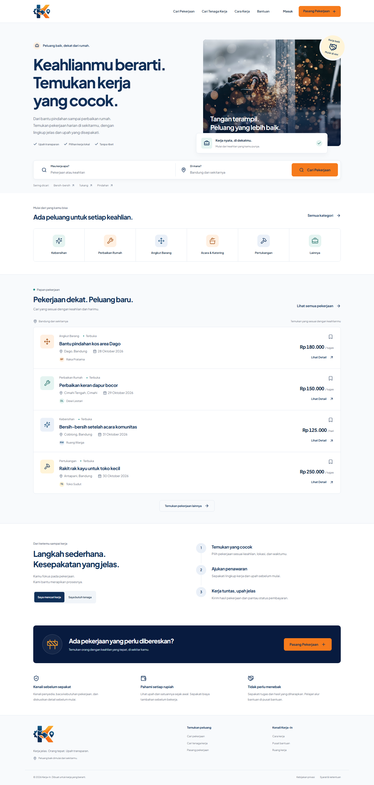
</p>
<p align="center">
<i>Gambar 6.1. Rancangan Antarmuka I-01 - Beranda</i>
</p>

Tabel 6.1. Spesifikasi Objek Antarmuka I-01

| Id_Objek | Jenis | Konten | Keterangan |
| :--- | :--- | :--- | :--- |
| I-01-O01 | Heading dan teks | Keahlianmu berarti. Temukan kerja yang cocok. | Reaksi sistem: Menampilkan pengantar tentang layanan pencarian pekerjaan harian. |
| I-01-O02 | Text Field | Mau kerja apa? / Pekerjaan atau keahlian | Reaksi sistem: Menerima kata kunci pekerjaan atau keahlian untuk digunakan saat pencarian. |
| I-01-O03 | Text Field | Di mana? / Bandung dan sekitarnya | Reaksi sistem: Menerima nama kota atau daerah untuk digunakan saat pencarian. |
| I-01-O04 | Button | Cari Pekerjaan | Reaksi sistem: Menjalankan pencarian saat tombol diklik atau Enter ditekan. Kolom kosong menampilkan semua contoh pekerjaan. Layar tujuan: Pencarian Pekerjaan (I-02). |
| I-01-O05 | Link | Bersih-bersih; Tukang; Pindahan | Layar tujuan: Pencarian Pekerjaan (I-02), dengan kategori Kebersihan, Pertukangan, atau Angkut Barang sesuai tautan yang dipilih. |
| I-01-O06 | Daftar kategori | Kebersihan; Perbaikan Rumah; Angkut Barang; Acara & Katering; Pertukangan; Lainnya | Reaksi sistem: Menyaring pekerjaan sesuai kategori yang dipilih. Pilihan Semua kategori menampilkan daftar tanpa filter kategori. Layar tujuan: Pencarian Pekerjaan (I-02). |
| I-01-O07 | Daftar pekerjaan dan Button | Pekerjaan dekat. Peluang baru.; Simpan; Lihat Detail | Reaksi sistem: Menampilkan empat contoh pekerjaan. Tombol Simpan menambahkan atau menghapus pekerjaan dari daftar tersimpan di browser. Layar tujuan: Detail Pekerjaan (I-03) saat judul atau Lihat Detail diklik. |
| I-01-O08 | Segmented Button | Saya mencari kerja; Saya butuh tenaga | Reaksi sistem: Mengganti penjelasan Cara Kerja sesuai pilihan mencari kerja atau membutuhkan tenaga, tanpa berpindah halaman. |
| I-01-O09 | Button dan Link | Pasang Pekerjaan; Lihat semua pekerjaan; Temukan pekerjaan lainnya | Layar tujuan: Pasang Pekerjaan — Detail (I-16) saat Pasang Pekerjaan diklik. Layar tujuan: Pencarian Pekerjaan (I-02) saat tautan daftar pekerjaan diklik. |
| I-01-O10 | Image dan informasi | Tangan terampil. Peluang yang lebih baik.; penjelasan kepercayaan | Reaksi sistem: Menonaktifkan animasi masuk jika pengguna mengaktifkan pengaturan pengurangan gerakan. |

## 6.2 Rancangan Antarmuka I-02

**Antarmuka:** *I-02*  
**Nama Layar:** *Pencarian Pekerjaan*  

<p align="center">
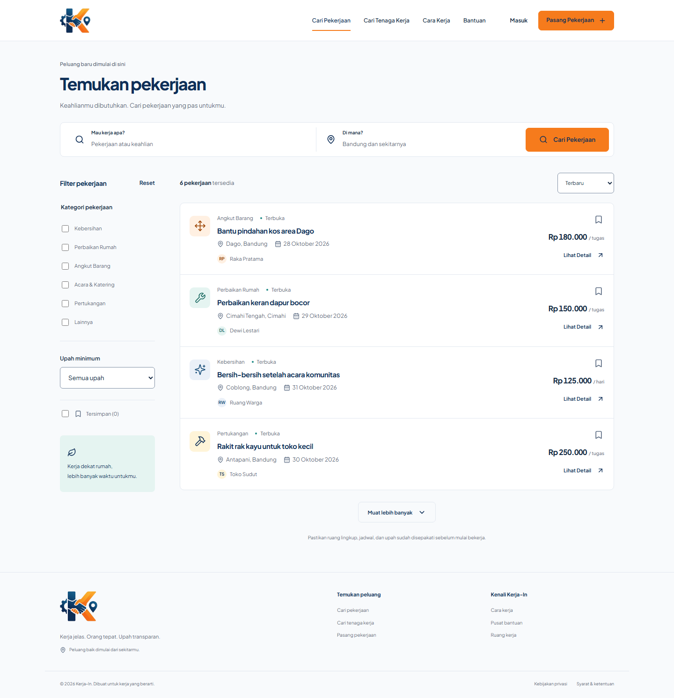
</p>
<p align="center">
<i>Gambar 6.2. Rancangan Antarmuka I-02 - Pencarian Pekerjaan</i>
</p>

Tabel 6.2. Spesifikasi Objek Antarmuka I-02

| Id_Objek | Jenis | Konten | Keterangan |
| :--- | :--- | :--- | :--- |
| I-02-O01 | Heading dan Label | Temukan pekerjaan; 6 pekerjaan tersedia | Reaksi sistem: Memperbarui jumlah pekerjaan sesuai hasil penyaringan dan mengumumkan perubahan kepada pengguna pembaca layar. |
| I-02-O02 | Text Field dan Button | Pekerjaan atau keahlian; Kota atau daerah; Cari Pekerjaan | Reaksi sistem: Mencari pekerjaan berdasarkan isian tanpa membedakan huruf besar dan kecil, lalu menampilkan hasil setelah pesan Mencari pekerjaan…. |
| I-02-O03 | Checkbox Group | Kategori pekerjaan | Reaksi sistem: Menampilkan pekerjaan yang sesuai dengan salah satu kategori terpilih. Jika tidak ada kategori dipilih, semua kategori ditampilkan. |
| I-02-O04 | Combo Box | Upah minimum; Semua upah; Rp150.000; Rp200.000 | Reaksi sistem: Menampilkan contoh pekerjaan dengan upah setidaknya sebesar pilihan pengguna. Satuan per tugas atau per hari tetap ditampilkan tanpa dikonversi. |
| I-02-O05 | Checkbox | Tersimpan (n) | Reaksi sistem: Menampilkan hanya pekerjaan tersimpan saat pilihan diaktifkan. Angka pada label menunjukkan jumlah pekerjaan yang tersimpan di browser. |
| I-02-O06 | Combo Box | Terbaru; Upah tertinggi | Reaksi sistem: Pilihan Terbaru mengikuti urutan data contoh. Pilihan Upah tertinggi mengurutkan pekerjaan dari nominal terbesar. |
| I-02-O07 | Button dan chip | Reset; Hapus filter; kata kunci/kategori aktif | Reaksi sistem: Menghapus seluruh filter pencarian dan mode pekerjaan tersimpan, lalu menampilkan kembali empat hasil awal. |
| I-02-O08 | Listing Row dan Button | Judul; kategori; lokasi; tanggal; penyedia; upah/satuan; Simpan; Lihat Detail | Reaksi sistem: Tombol Simpan menambahkan atau menghapus pekerjaan dari daftar tersimpan di browser. Layar tujuan: Detail Pekerjaan (I-03) saat judul atau Lihat Detail diklik. |
| I-02-O09 | Button | Muat lebih banyak | Reaksi sistem: Menambahkan paling banyak empat hasil ke daftar. Tombol disembunyikan jika semua hasil sudah ditampilkan. |
## 6.3 Rancangan Antarmuka I-03

**Antarmuka:** *I-03*  
**Nama Layar:** *Detail Pekerjaan*  

<p align="center">
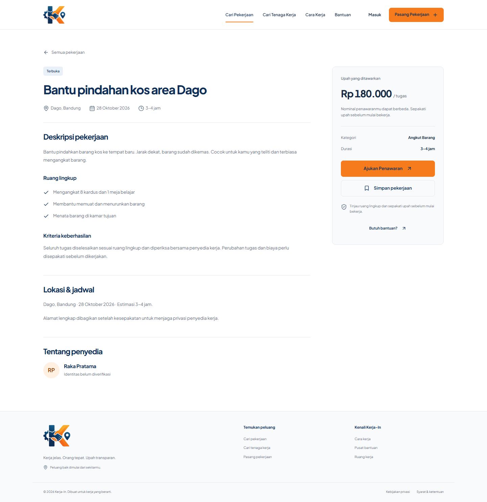
</p>
<p align="center">
<i>Gambar 6.3. Rancangan Antarmuka I-03 - Detail Pekerjaan</i>
</p>

Tabel 6.3. Spesifikasi Objek Antarmuka I-03

| Id_Objek | Jenis | Konten | Keterangan |
| :--- | :--- | :--- | :--- |
| I-03-O01 | Heading dan Badge | Bantu pindahan kos area Dago; Terbuka | Reaksi sistem: Menampilkan judul dan status pekerjaan yang dipilih. Layar tujuan: Halaman Tidak Ditemukan (I-28) jika pekerjaan tidak dikenali. |
| I-03-O02 | Metadata dan Ringkasan | Dago, Bandung; 28 Oktober 2026; 3–4 jam; Rp180.000 / tugas | Reaksi sistem: Menampilkan lokasi, jadwal, durasi, kategori, dan upah beserta satuannya. |
| I-03-O03 | Text Block dan List | Deskripsi pekerjaan; Ruang lingkup; Kriteria keberhasilan; Lokasi & jadwal | Reaksi sistem: Menampilkan deskripsi tugas, ruang lingkup, kriteria hasil, serta lokasi dan jadwal. Informasi lokasi menjelaskan bahwa alamat lengkap dibagikan setelah kesepakatan. |
| I-03-O04 | Identity Block | Raka Pratama; Identitas belum diverifikasi | Reaksi sistem: Menampilkan nama penyedia kerja dan keterangan bahwa identitasnya belum diverifikasi. |
| I-03-O05 | Button | Ajukan Penawaran | Layar tujuan: Formulir Penawaran (I-04) saat Ajukan Penawaran diklik. Reaksi sistem: Jika sudah ada penawaran aktif, tombol diganti dengan status Penawaran sudah diajukan dan tautan ke Lamaran Saya (I-13). |
| I-03-O06 | Toggle Button dan Link | Simpan pekerjaan; Butuh bantuan?; Semua pekerjaan | Reaksi sistem: Menambahkan atau menghapus pekerjaan dari daftar tersimpan di browser. Layar tujuan: Pusat Bantuan dan Keluhan (I-23) melalui Butuh bantuan?, atau Pencarian Pekerjaan (I-02) melalui Semua pekerjaan. |

## 6.4 Rancangan Antarmuka I-04

**Antarmuka:** *I-04*  
**Nama Layar:** *Formulir Penawaran*  

<p align="center">
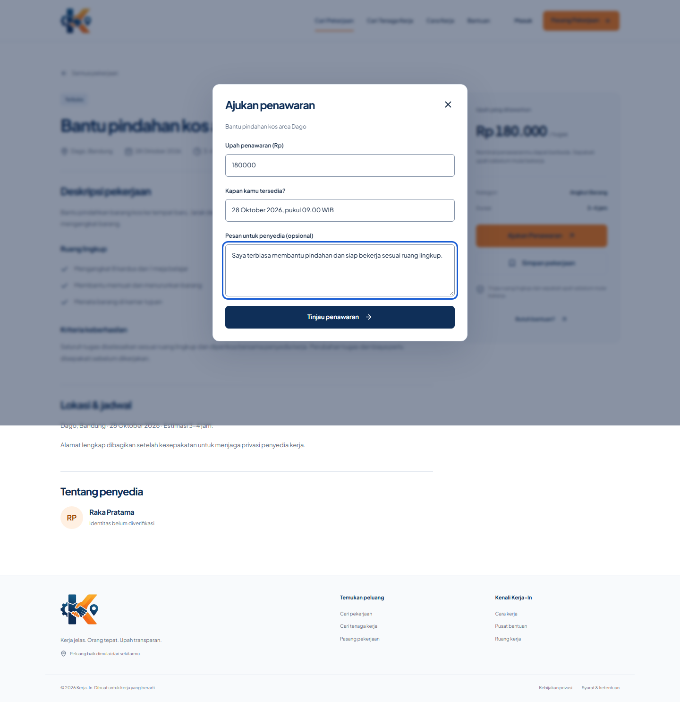
</p>
<p align="center">
<i>Gambar 6.4. Rancangan Antarmuka I-04 - Formulir Penawaran</i>
</p>

Tabel 6.4. Spesifikasi Objek Antarmuka I-04

| Id_Objek | Jenis | Konten | Keterangan |
| :--- | :--- | :--- | :--- |
| I-04-O01 | Dialog dan Label | Ajukan penawaran; Bantu pindahan kos area Dago | Reaksi sistem: Membuka dialog penawaran tanpa meninggalkan detail pekerjaan dan menjaga fokus keyboard di dalam dialog. |
| I-04-O02 | Numeric Field | Upah penawaran (Rp) | Reaksi sistem: Mengisi nominal awal sesuai upah pekerjaan dan menerima nilai Rp1.000–Rp100.000.000 dalam kelipatan Rp1.000. Pengguna tidak dapat melanjutkan jika isian tidak valid. |
| I-04-O03 | Text Field | Kapan kamu tersedia? | Reaksi sistem: Menerima ketersediaan dalam bentuk teks, wajib diisi hingga 120 karakter. Isian ini tidak membuat pemesanan jadwal. |
| I-04-O04 | Text Area | Pesan untuk penyedia (opsional) | Reaksi sistem: Menerima pesan tambahan hingga 1.000 karakter. Kolom boleh dikosongkan. |
| I-04-O05 | Button | Tinjau penawaran | Layar tujuan: Tinjau Penawaran (I-05) jika isian valid. Reaksi sistem: Penawaran belum disimpan atau dikirim pada tahap ini. |
| I-04-O06 | Icon Button dan interaksi keyboard | Tutup (X); Escape; klik latar dialog | Reaksi sistem: Menutup dialog tanpa mengirim penawaran dan mengembalikan fokus ke tombol pembuka. Isian dapat tetap tersedia jika dialog dibuka kembali pada tampilan yang sama. |

## 6.5 Rancangan Antarmuka I-05

**Antarmuka:** *I-05*  
**Nama Layar:** *Tinjau Penawaran*  

<p align="center">
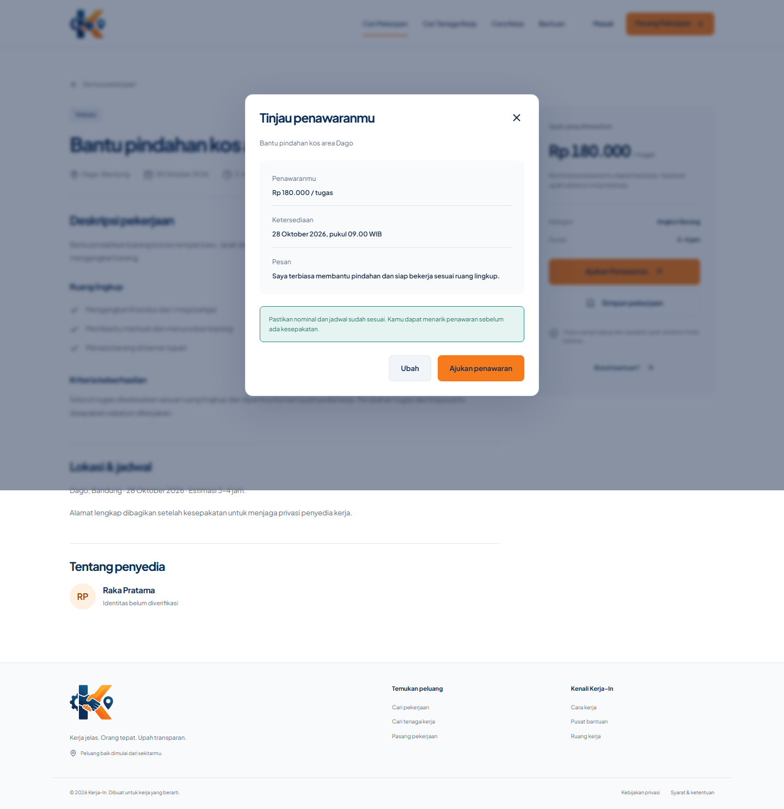
</p>
<p align="center">
<i>Gambar 6.5. Rancangan Antarmuka I-05 - Tinjau Penawaran</i>
</p>

Tabel 6.5. Spesifikasi Objek Antarmuka I-05

| Id_Objek | Jenis | Konten | Keterangan |
| :--- | :--- | :--- | :--- |
| I-05-O01 | Dialog dan Ringkasan | Tinjau penawaranmu; Penawaranmu; Ketersediaan; Pesan | Reaksi sistem: Menampilkan ringkasan upah, ketersediaan, dan pesan yang diisi pada Formulir Penawaran (I-04). |
| I-05-O02 | Notice | Pastikan nominal dan jadwal sudah sesuai. | Reaksi sistem: Menampilkan pengingat untuk memeriksa nominal dan jadwal, serta informasi bahwa penawaran dapat ditarik sebelum ada kesepakatan. |
| I-05-O03 | Button | Ubah | Layar tujuan: Formulir Penawaran (I-04), dengan isian sebelumnya tetap tersedia. |
| I-05-O04 | Button | Ajukan penawaran | Reaksi sistem: Menyimpan penawaran di browser dengan status Menunggu tanggapan, menutup dialog, dan menampilkan pemberitahuan. Penawaran belum dikirim ke server. |
| I-05-O05 | Status dan Link | Penawaran sudah diajukan.; Lihat lamaran saya | Reaksi sistem: Mengganti tombol pengajuan pada Detail Pekerjaan (I-03) dengan status Penawaran sudah diajukan. Layar tujuan: Lamaran Saya (I-13) melalui Lihat lamaran saya. |

## 6.6 Rancangan Antarmuka I-06

**Antarmuka:** *I-06*  
**Nama Layar:** *Pencarian Tenaga Kerja*  

<p align="center">
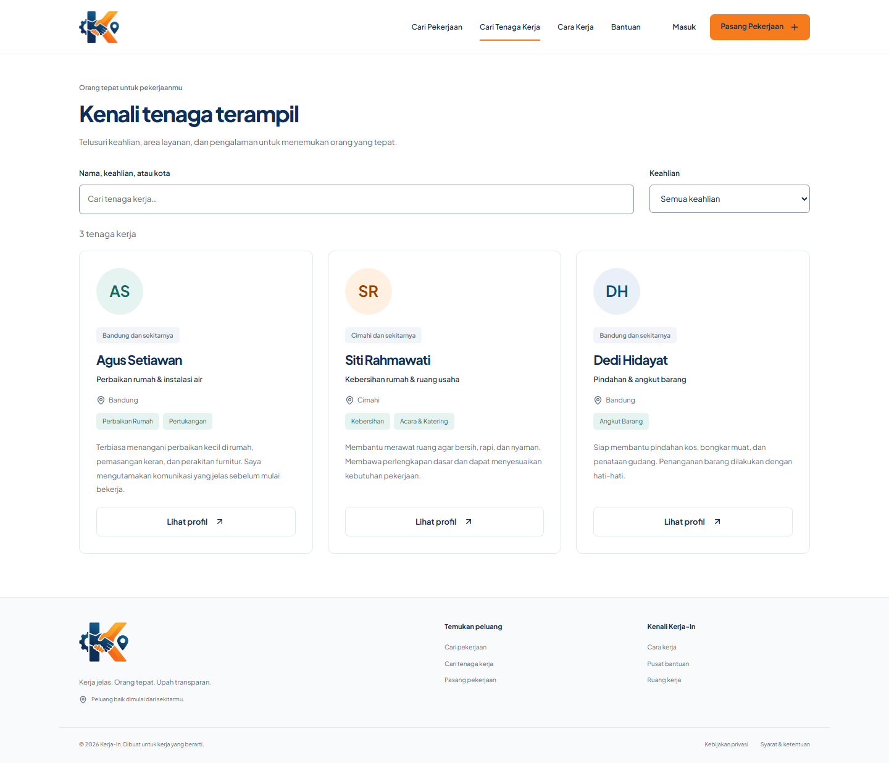
</p>
<p align="center">
<i>Gambar 6.6. Rancangan Antarmuka I-06 - Pencarian Tenaga Kerja</i>
</p>

Tabel 6.6. Spesifikasi Objek Antarmuka I-06

| Id_Objek | Jenis | Konten | Keterangan |
| :--- | :--- | :--- | :--- |
| I-06-O01 | Heading dan Label | Kenali tenaga terampil; n tenaga kerja | Reaksi sistem: Menampilkan jumlah profil tenaga kerja yang sesuai dengan pencarian. Profil yang tersedia merupakan data contoh. |
| I-06-O02 | Text Field | Nama, keahlian, atau kota; Cari tenaga kerja… | Reaksi sistem: Langsung menyaring profil berdasarkan nama, keahlian, atau kota saat pengguna mengetik, tanpa membedakan huruf besar dan kecil. |
| I-06-O03 | Combo Box | Keahlian; Semua keahlian | Reaksi sistem: Menyaring profil berdasarkan kategori keahlian yang dipilih, bersama kata kunci pencarian jika ada. |
| I-06-O04 | Profile Card | Inisial; nama; spesialisasi; kota; tag; bio; Area layanan | Reaksi sistem: Menampilkan identitas singkat, keahlian, dan area layanan tanpa menambahkan rating atau klaim identitas terverifikasi. |
| I-06-O05 | Link | Lihat profil | Layar tujuan: Profil Tenaga Kerja (I-07) sesuai profil yang dipilih. |
| I-06-O06 | Empty State dan Button | Belum ada profil yang cocok; Reset pencarian | Reaksi sistem: Menampilkan pesan jika tidak ada profil yang cocok. Tombol Reset pencarian mengosongkan kata kunci dan kategori agar seluruh profil kembali ditampilkan. |

## 6.7 Rancangan Antarmuka I-07

**Antarmuka:** *I-07*  
**Nama Layar:** *Profil Tenaga Kerja*  

<p align="center">
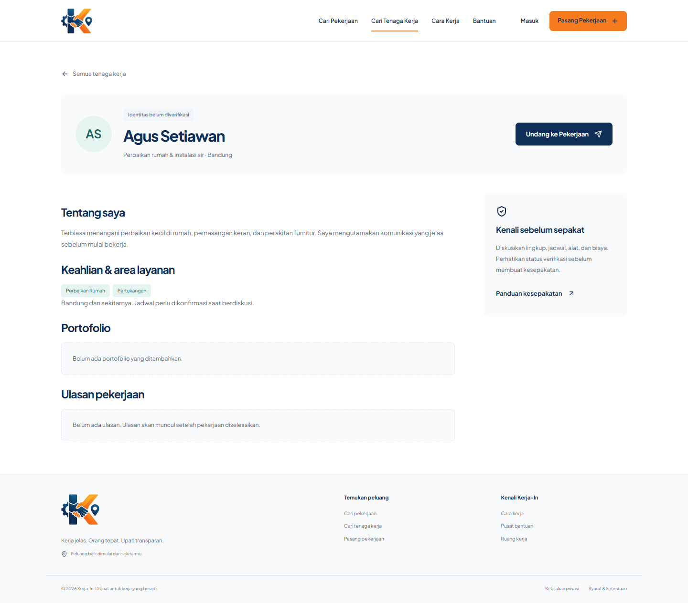
</p>
<p align="center">
<i>Gambar 6.7. Rancangan Antarmuka I-07 - Profil Tenaga Kerja</i>
</p>

Tabel 6.7. Spesifikasi Objek Antarmuka I-07

| Id_Objek | Jenis | Konten | Keterangan |
| :--- | :--- | :--- | :--- |
| I-07-O01 | Link | Semua tenaga kerja | Layar tujuan: Pencarian Tenaga Kerja (I-06). Reaksi sistem: Jika profil yang dibuka tidak dikenali, sistem menampilkan Halaman Tidak Ditemukan (I-28). |
| I-07-O02 | Identity Block | Agus Setiawan; Perbaikan rumah & instalasi air; Bandung | Reaksi sistem: Menampilkan nama, keahlian, dan area layanan dari profil contoh. |
| I-07-O03 | Badge | Identitas belum diverifikasi | Reaksi sistem: Menampilkan status Identitas belum diverifikasi. |
| I-07-O04 | Button | Undang ke Pekerjaan | Layar tujuan: Dialog Undangan Tenaga Kerja (I-26). Reaksi sistem: Setelah undangan dicatat, tombol berubah menjadi Undangan tersimpan dan dinonaktifkan selama tampilan tersebut masih terbuka. |
| I-07-O05 | Text Block dan Tag | Tentang saya; Keahlian & area layanan | Reaksi sistem: Menampilkan biodata, keahlian, dan area layanan dari data contoh, serta mengingatkan bahwa jadwal perlu dikonfirmasi. |
| I-07-O06 | Empty State | Portofolio; Ulasan pekerjaan | Reaksi sistem: Menampilkan keterangan bahwa belum tersedia portofolio dan ulasan dari transaksi nyata. |
| I-07-O07 | Info Panel dan Link | Kenali sebelum sepakat; Panduan kesepakatan | Layar tujuan: Pusat Bantuan dan Keluhan (I-23) melalui Panduan kesepakatan. |

## 6.8 Rancangan Antarmuka I-08

**Antarmuka:** *I-08*  
**Nama Layar:** *Masuk*  

<p align="center">
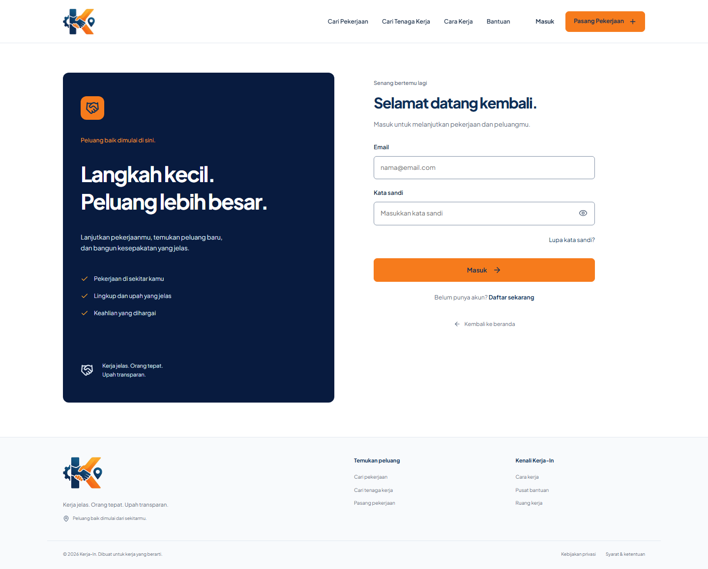
</p>
<p align="center">
<i>Gambar 6.8. Rancangan Antarmuka I-08 - Masuk</i>
</p>

Tabel 6.8. Spesifikasi Objek Antarmuka I-08

| Id_Objek | Jenis | Konten | Keterangan |
| :--- | :--- | :--- | :--- |
| I-08-O01 | Heading | Selamat datang kembali. | Reaksi sistem: Menampilkan sapaan dan pengantar untuk masuk ke akun. |
| I-08-O02 | Email Field | Email | Reaksi sistem: Menerima alamat email yang wajib diisi dengan format valid, hingga 254 karakter, dan mendukung pengisian otomatis oleh browser. |
| I-08-O03 | Password Field | Kata sandi | Reaksi sistem: Menerima kata sandi sepanjang 8–128 karakter dan mendukung pengisian otomatis oleh browser. |
| I-08-O04 | Toggle Button | Tampilkan kata sandi / Sembunyikan kata sandi | Reaksi sistem: Menampilkan atau menyembunyikan karakter kata sandi sesuai pilihan pengguna. |
| I-08-O05 | Button | Masuk | Reaksi sistem: Memeriksa isian dan menandai pengguna sudah masuk pada browser. Layar tujuan: Dashboard Tenaga Kerja (I-11) atau Dashboard Penyedia Kerja (I-12), sesuai mode akun. |
| I-08-O06 | Link | Lupa kata sandi?; Daftar sekarang; Kembali ke beranda | Layar tujuan: Pemulihan Kata Sandi (I-10), Daftar Akun (I-09), atau Beranda (I-01), sesuai tautan yang dipilih. |

## 6.9 Rancangan Antarmuka I-09

**Antarmuka:** *I-09*  
**Nama Layar:** *Daftar Akun*  

<p align="center">
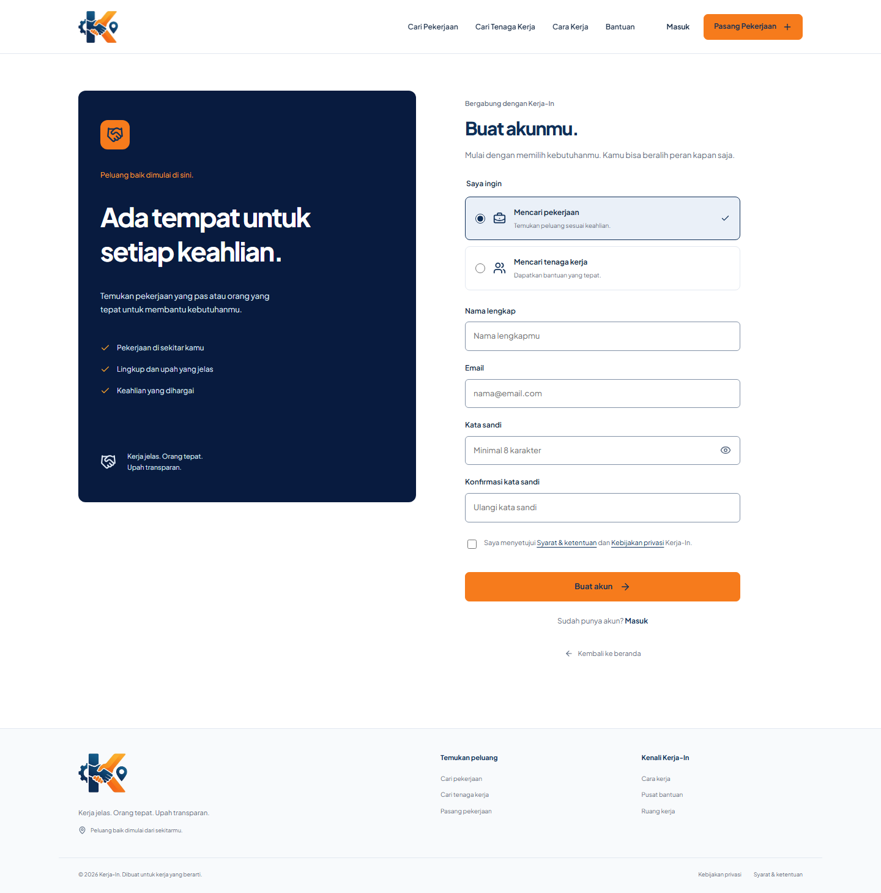
</p>
<p align="center">
<i>Gambar 6.9. Rancangan Antarmuka I-09 - Daftar Akun</i>
</p>

Tabel 6.9. Spesifikasi Objek Antarmuka I-09

| Id_Objek | Jenis | Konten | Keterangan |
| :--- | :--- | :--- | :--- |
| I-09-O01 | Heading dan Radio Group | Buat akunmu.; Saya ingin; Mencari pekerjaan; Mencari tenaga kerja | Reaksi sistem: Mengatur mode akun sebagai Tenaga Kerja atau Penyedia Kerja. Pilihan ini masih dapat diganti di ruang kerja dan bukan pengaturan hak akses server. |
| I-09-O02 | Text Field dan Email Field | Nama lengkap; Email | Reaksi sistem: Menerima nama yang tidak hanya berisi spasi hingga 80 karakter dan email berformat valid hingga 254 karakter. Nama digunakan pada profil dan dashboard. |
| I-09-O03 | Password Field | Kata sandi; Konfirmasi kata sandi | Reaksi sistem: Memeriksa panjang kata sandi 8–128 karakter dan kesesuaiannya dengan kolom konfirmasi. Jika berbeda, sistem menampilkan pesan kesalahan. Kata sandi tidak disimpan. |
| I-09-O04 | Toggle Button | Tampilkan kata sandi / Sembunyikan kata sandi | Reaksi sistem: Menampilkan atau menyembunyikan isi kedua kolom kata sandi. |
| I-09-O05 | Checkbox dan Link | Saya menyetujui Syarat & ketentuan dan Kebijakan privasi Kerja-In. | Reaksi sistem: Mewajibkan pengguna mencentang persetujuan sebelum melanjutkan. Layar tujuan: Syarat dan Ketentuan (I-25) atau Kebijakan Privasi (I-24), dibuka pada tab baru agar isian tetap tersedia. |
| I-09-O06 | Button | Buat akun | Reaksi sistem: Setelah isian valid, menyimpan nama, mode akun, dan status masuk di browser. Layar tujuan: Dashboard Tenaga Kerja (I-11) atau Dashboard Penyedia Kerja (I-12), sesuai pilihan pengguna. |
| I-09-O07 | Link | Masuk; Kembali ke beranda | Layar tujuan: Masuk (I-08) atau Beranda (I-01), sesuai tautan yang dipilih. |

## 6.10 Rancangan Antarmuka I-10

**Antarmuka:** *I-10*  
**Nama Layar:** *Pemulihan Kata Sandi*  

<p align="center">
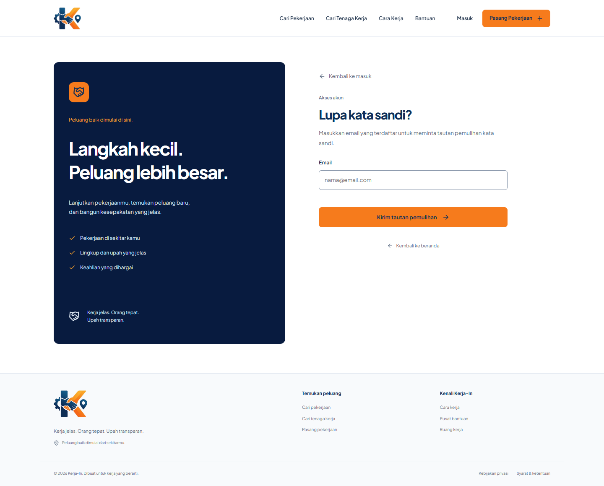
</p>
<p align="center">
<i>Gambar 6.10. Rancangan Antarmuka I-10 - Pemulihan Kata Sandi</i>
</p>

Tabel 6.10. Spesifikasi Objek Antarmuka I-10

| Id_Objek | Jenis | Konten | Keterangan |
| :--- | :--- | :--- | :--- |
| I-10-O01 | Heading dan Email Field | Lupa kata sandi?; Email | Reaksi sistem: Menerima alamat email dan memeriksa formatnya sebelum pengguna melanjutkan. |
| I-10-O02 | Button | Kirim tautan pemulihan | Reaksi sistem: Mengganti formulir dengan pesan konfirmasi. |
| I-10-O03 | Status | Periksa emailmu | Reaksi sistem: Menampilkan pesan bahwa tautan pemulihan akan dikirim jika email terdaftar, tanpa mengungkap keberadaan akun atau menyatakan email sudah terkirim. |
| I-10-O04 | Button dan Link | Gunakan email lain; Kembali ke masuk; Kembali ke beranda | Reaksi sistem: Pilihan Gunakan email lain menampilkan kembali formulir. Layar tujuan: Masuk (I-08) atau Beranda (I-01), sesuai tautan yang dipilih. |

## 6.11 Rancangan Antarmuka I-11

**Antarmuka:** *I-11*  
**Nama Layar:** *Dashboard Tenaga Kerja*  

<p align="center">
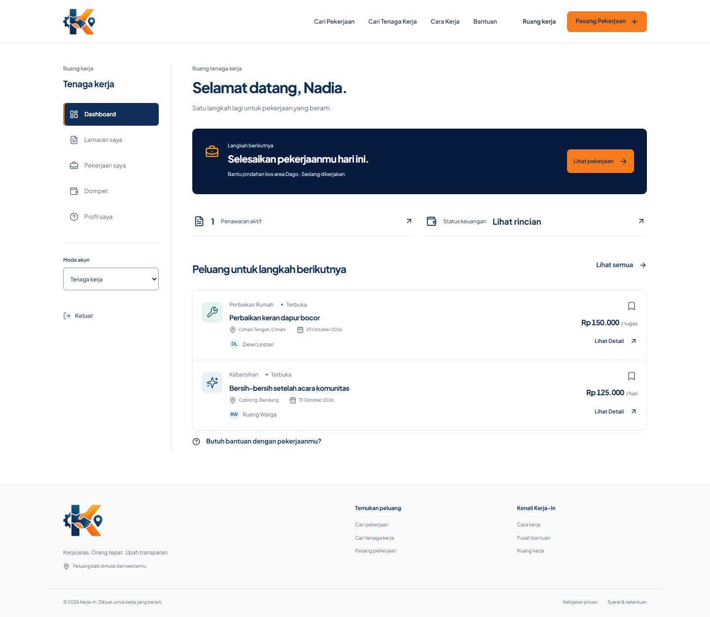
</p>
<p align="center">
<i>Gambar 6.11. Rancangan Antarmuka I-11 - Dashboard Tenaga Kerja</i>
</p>

Tabel 6.11. Spesifikasi Objek Antarmuka I-11

| Id_Objek | Jenis | Konten | Keterangan |
| :--- | :--- | :--- | :--- |
| I-11-O01 | Heading | Selamat datang, Nadia.; Ruang tenaga kerja | Reaksi sistem: Menampilkan sapaan menggunakan nama depan dari profil yang tersimpan di browser. |
| I-11-O02 | Action Panel dan Link | Langkah berikutnya; Selesaikan pekerjaanmu hari ini.; Lihat pekerjaan | Reaksi sistem: Menampilkan arahan sesuai status pekerjaan, terpisah dari daftar lamaran baru. Layar tujuan: Pekerjaan Saya (I-14) melalui Lihat pekerjaan. |
| I-11-O03 | Summary Link | n Penawaran aktif; Status keuangan; Lihat rincian | Reaksi sistem: Menghitung penawaran aktif tanpa menyertakan penawaran berstatus Ditarik. Layar tujuan: Lamaran Saya (I-13) atau Dompet (I-20), sesuai ringkasan yang dipilih. |
| I-11-O04 | Listing dan Link | Peluang untuk langkah berikutnya; Lihat semua | Reaksi sistem: Tombol Simpan menambahkan pekerjaan ke daftar tersimpan. Layar tujuan: Detail Pekerjaan (I-03) saat pekerjaan dipilih, atau Pencarian Pekerjaan (I-02) melalui Lihat semua. |
| I-11-O05 | Sidebar dan Combo Box | Dashboard; Lamaran saya; Pekerjaan saya; Dompet; Profil saya; Mode akun | Layar tujuan: Dashboard Tenaga Kerja (I-11), Lamaran Saya (I-13), Pekerjaan Saya (I-14), Dompet (I-20), atau Pengaturan Profil Saya (I-22), sesuai menu. Reaksi sistem: Memilih mode Penyedia kerja mengganti tampilan menjadi Dashboard Penyedia Kerja (I-12). |
| I-11-O06 | Button dan Link | Keluar; Butuh bantuan dengan pekerjaanmu? | Reaksi sistem: Tombol Keluar mengakhiri status masuk di browser tanpa menghapus profil, lalu membuka Masuk (I-08). Layar tujuan: Pusat Bantuan dan Keluhan (I-23) melalui tautan bantuan. |

## 6.12 Rancangan Antarmuka I-12

**Antarmuka:** *I-12*  
**Nama Layar:** *Dashboard Penyedia Kerja*  

<p align="center">
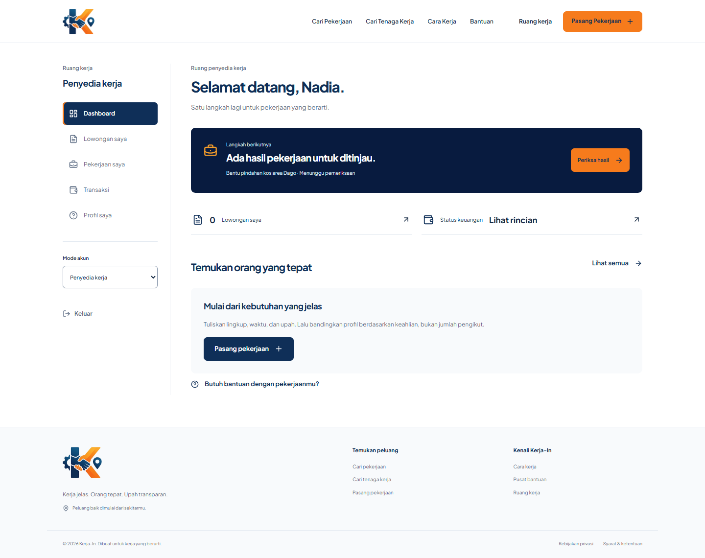
</p>
<p align="center">
<i>Gambar 6.12. Rancangan Antarmuka I-12 - Dashboard Penyedia Kerja</i>
</p>

Tabel 6.12. Spesifikasi Objek Antarmuka I-12

| Id_Objek | Jenis | Konten | Keterangan |
| :--- | :--- | :--- | :--- |
| I-12-O01 | Heading | Selamat datang, Nadia.; Ruang penyedia kerja | Reaksi sistem: Menampilkan sapaan dan ruang kerja sesuai mode Penyedia Kerja yang tersimpan di browser. |
| I-12-O02 | Action Panel dan Link | Ada hasil pekerjaan untuk ditinjau.; Periksa hasil | Reaksi sistem: Menampilkan Periksa hasil saat pekerjaan berstatus Menunggu pemeriksaan. Pada status lain, sistem menampilkan arahan untuk memantau pekerjaan. Layar tujuan: Pemeriksaan dan Transaksi (I-21). |
| I-12-O03 | Summary Link | n Lowongan saya; Status keuangan; Lihat rincian | Reaksi sistem: Menghitung lowongan yang tersimpan di browser. Layar tujuan: Lowongan Saya (I-15) atau Pemeriksaan dan Transaksi (I-21), sesuai ringkasan yang dipilih. |
| I-12-O04 | Link Button | Lihat semua; Pasang pekerjaan | Layar tujuan: Pencarian Tenaga Kerja (I-06) melalui Lihat semua, atau Pasang Pekerjaan — Detail (I-16) melalui Pasang pekerjaan. |
| I-12-O05 | Sidebar dan Combo Box | Dashboard; Lowongan saya; Pekerjaan saya; Transaksi; Profil saya; Mode akun | Layar tujuan: Dashboard Penyedia Kerja (I-12), Lowongan Saya (I-15), Pekerjaan Saya (I-14), Pemeriksaan dan Transaksi (I-21), atau Pengaturan Profil Saya (I-22), sesuai menu. Reaksi sistem: Memilih mode Tenaga kerja mengganti tampilan menjadi Dashboard Tenaga Kerja (I-11). |
| I-12-O06 | Button | Keluar | Reaksi sistem: Mengakhiri status masuk di browser. Tindakan ini belum mengakhiri sesi pada server. Layar tujuan: Masuk (I-08). |

## 6.13 Rancangan Antarmuka I-13

**Antarmuka:** *I-13*  
**Nama Layar:** *Lamaran Saya*  

<p align="center">
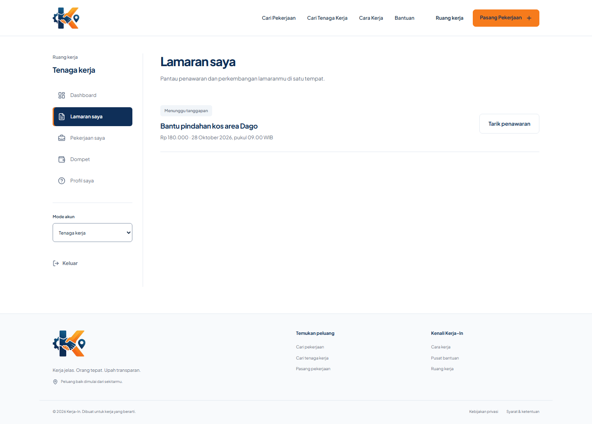
</p>
<p align="center">
<i>Gambar 6.13. Rancangan Antarmuka I-13 - Lamaran Saya</i>
</p>

Tabel 6.13. Spesifikasi Objek Antarmuka I-13

| Id_Objek | Jenis | Konten | Keterangan |
| :--- | :--- | :--- | :--- |
| I-13-O01 | Heading dan List | Lamaran saya; Pantau penawaran dan perkembangan lamaranmu di satu tempat. | Reaksi sistem: Menampilkan daftar penawaran yang tersimpan di browser. Data pada gambar merupakan contoh, bukan penawaran kepada pengguna nyata. |
| I-13-O02 | Status Badge | Menunggu tanggapan / Ditarik | Reaksi sistem: Menampilkan status Menunggu tanggapan atau Ditarik sesuai data penawaran di browser, bukan keputusan nyata dari penyedia kerja. |
| I-13-O03 | Link judul | Bantu pindahan kos area Dago | Layar tujuan: Detail Pekerjaan (I-03) sesuai pekerjaan pada penawaran yang dipilih. |
| I-13-O04 | Label | Rp180.000; ketersediaan penawar | Reaksi sistem: Menampilkan nominal dan ketersediaan yang sebelumnya disimpan melalui Tinjau Penawaran (I-05). |
| I-13-O05 | Button | Tarik penawaran | Reaksi sistem: Menampilkan tombol hanya untuk penawaran yang belum ditarik. Layar tujuan: Dialog Konfirmasi Penarikan Penawaran (I-27). |
| I-13-O06 | Empty State dan Link | Belum ada penawaran; Cari pekerjaan | Reaksi sistem: Menampilkan pesan jika belum ada penawaran. Layar tujuan: Pencarian Pekerjaan (I-02) melalui Cari pekerjaan. |

## 6.14 Rancangan Antarmuka I-14

**Antarmuka:** *I-14*  
**Nama Layar:** *Pekerjaan Saya*  

<p align="center">
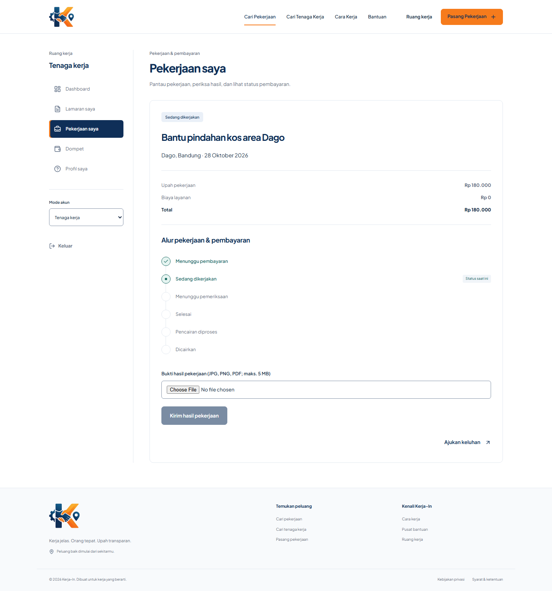
</p>
<p align="center">
<i>Gambar 6.14. Rancangan Antarmuka I-14 - Pekerjaan Saya</i>
</p>

Tabel 6.14. Spesifikasi Objek Antarmuka I-14

| Id_Objek | Jenis | Konten | Keterangan |
| :--- | :--- | :--- | :--- |
| I-14-O01 | Heading dan Ringkasan | Pekerjaan saya; Bantu pindahan kos area Dago | Reaksi sistem: Menampilkan lokasi, tanggal, upah Rp180.000, biaya layanan Rp0, dan total Rp180.000 dari data contoh pekerjaan. |
| I-14-O02 | Timeline | Alur pekerjaan & pembayaran; Status saat ini | Penanda ini bukan bukti pembayaran dari layanan keuangan. |
| I-14-O03 | File Picker | Bukti hasil pekerjaan (JPG, PNG, PDF; maks. 5 MB) | Reaksi sistem: Menerima berkas JPG, PNG, atau PDF hingga 5 MB. Jika tidak sesuai, pilihan berkas dikosongkan dan pesan kesalahan ditampilkan. Reaksi sistem: Berkas hanya dipilih pada perangkat dan belum diunggah ke server. |
| I-14-O04 | Button | Kirim hasil pekerjaan | Reaksi sistem: Mengaktifkan tombol setelah berkas valid dipilih. Saat diklik, status pekerjaan berubah menjadi Menunggu pemeriksaan. |
| I-14-O05 | Notice | Catatan revisi; Hasil pekerjaan menunggu pemeriksaan penyedia kerja. | Reaksi sistem: Menampilkan catatan dari Permintaan Revisi Pekerjaan (I-29) ketika pekerjaan perlu diperbaiki. Setelah hasil dikirim ulang, sistem menampilkan status menunggu pemeriksaan. |
| I-14-O06 | Button dan Link | Ajukan pencairan; Ajukan keluhan | Reaksi sistem: Tenaga Kerja dapat mengajukan pencairan saat pekerjaan Selesai. Status kemudian menjadi Pencairan diproses, tanpa menyatakan dana sudah diterima. Layar tujuan: Pusat Bantuan dan Keluhan (I-23) melalui Ajukan keluhan. |

## 6.15 Rancangan Antarmuka I-15

**Antarmuka:** *I-15*  
**Nama Layar:** *Lowongan Saya*  

<p align="center">
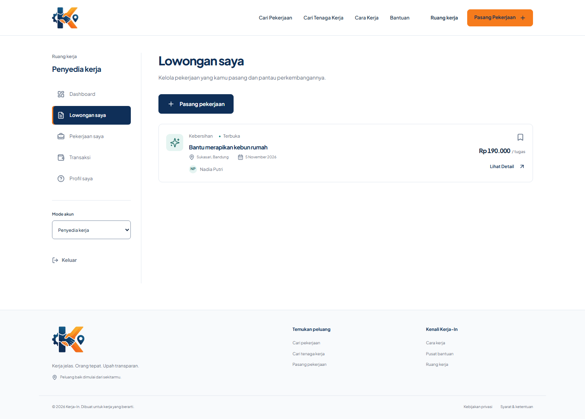
</p>
<p align="center">
<i>Gambar 6.15. Rancangan Antarmuka I-15 - Lowongan Saya</i>
</p>

Tabel 6.15. Spesifikasi Objek Antarmuka I-15

| Id_Objek | Jenis | Konten | Keterangan |
| :--- | :--- | :--- | :--- |
| I-15-O01 | Heading dan Label | Lowongan saya; Kelola pekerjaan yang kamu pasang dan pantau perkembangannya. | Reaksi sistem: Menampilkan lowongan yang tersimpan di browser. Gambar menggunakan contoh lowongan yang telah disiapkan. |
| I-15-O02 | Link Button | Pasang pekerjaan | Layar tujuan: Pasang Pekerjaan — Detail (I-16). |
| I-15-O03 | Listing Row | Judul; kategori; lokasi; tanggal; penyedia; upah/satuan | Reaksi sistem: Menampilkan informasi lowongan yang dibuat melalui Pasang Pekerjaan — Tinjau dan Terbitkan (I-19). Tampilan ini belum menyediakan pengubahan, penghapusan, atau daftar pelamar. |
| I-15-O04 | Toggle Button | Simpan | Reaksi sistem: Menambahkan atau menghapus lowongan yang dipilih dari daftar tersimpan di browser. |
| I-15-O05 | Link | Judul lowongan; Lihat Detail | Layar tujuan: Detail Pekerjaan (I-03) sesuai lowongan yang dipilih. |
| I-15-O06 | Empty State dan Link | Belum ada lowongan; Pasang pekerjaan | Reaksi sistem: Menampilkan pesan jika belum ada lowongan tersimpan. Layar tujuan: Pasang Pekerjaan — Detail (I-16) melalui Pasang pekerjaan. |

## 6.16 Rancangan Antarmuka I-16

**Antarmuka:** *I-16*  
**Nama Layar:** *Pasang Pekerjaan — Detail*  

<p align="center">
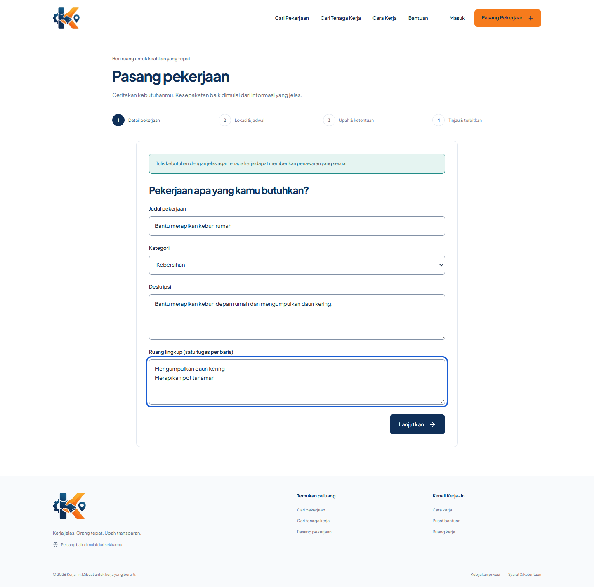
</p>
<p align="center">
<i>Gambar 6.16. Rancangan Antarmuka I-16 - Pasang Pekerjaan — Detail</i>
</p>

Tabel 6.16. Spesifikasi Objek Antarmuka I-16

| Id_Objek | Jenis | Konten | Keterangan |
| :--- | :--- | :--- | :--- |
| I-16-O01 | Stepper | Detail pekerjaan → Lokasi & jadwal → Upah & ketentuan → Tinjau & terbitkan | Reaksi sistem: Menandai Detail pekerjaan sebagai langkah pertama. Indikator langkah tidak dapat digunakan untuk melompati tahapan. |
| I-16-O02 | Notice | Tulis kebutuhan dengan jelas agar tenaga kerja dapat memberikan penawaran yang sesuai. | Reaksi sistem: Menampilkan panduan agar pengguna menjelaskan kebutuhan pekerjaan dengan jelas. |
| I-16-O03 | Text Field | Judul pekerjaan | Reaksi sistem: Menerima judul sepanjang 8–150 karakter dan mencegah pengguna melanjutkan jika isian tidak memenuhi batas tersebut. |
| I-16-O04 | Combo Box | Kategori | Reaksi sistem: Menyediakan enam pilihan kategori dengan Kebersihan sebagai pilihan awal. |
| I-16-O05 | Text Area | Deskripsi | Reaksi sistem: Menerima deskripsi wajib sepanjang 20–2.000 karakter. |
| I-16-O06 | Text Area | Ruang lingkup (satu tugas per baris) | Reaksi sistem: Menerima ruang lingkup wajib hingga 1.000 karakter. Setiap baris yang tidak kosong menjadi satu butir tugas saat lowongan disimpan di browser. |
| I-16-O07 | Button | Lanjutkan | Layar tujuan: Pasang Pekerjaan — Lokasi dan Jadwal (I-17) jika isian valid. Reaksi sistem: Draf belum disimpan permanen. Setelah judul diisi, peringatan muncul jika dokumen ditutup atau dimuat ulang; perpindahan halaman dalam aplikasi belum selalu terlindungi. |

## 6.17 Rancangan Antarmuka I-17

**Antarmuka:** *I-17*  
**Nama Layar:** *Pasang Pekerjaan — Lokasi dan Jadwal*  

<p align="center">
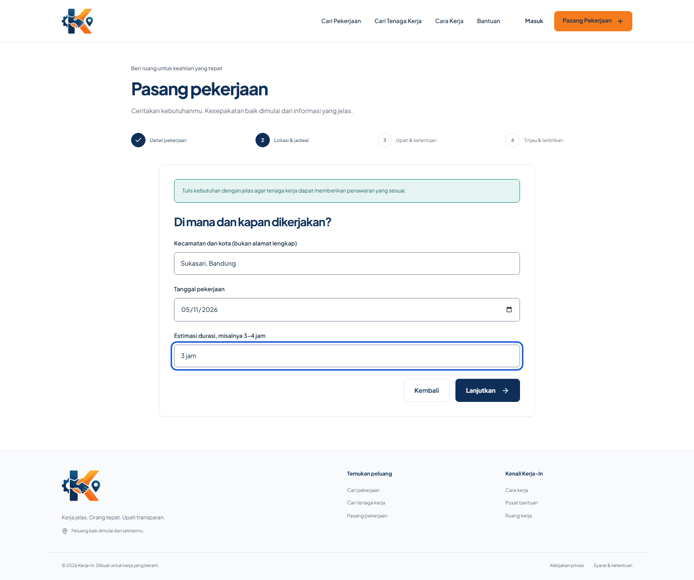
</p>
<p align="center">
<i>Gambar 6.17. Rancangan Antarmuka I-17 - Pasang Pekerjaan — Lokasi dan Jadwal</i>
</p>

Tabel 6.17. Spesifikasi Objek Antarmuka I-17

| Id_Objek | Jenis | Konten | Keterangan |
| :--- | :--- | :--- | :--- |
| I-17-O01 | Stepper dan Heading | Lokasi & jadwal; Di mana dan kapan dikerjakan? | Reaksi sistem: Menandai Lokasi & jadwal sebagai langkah kedua dan mempertahankan isian dari langkah sebelumnya. |
| I-17-O02 | Text Field | Kecamatan dan kota (bukan alamat lengkap) | Reaksi sistem: Menerima kecamatan dan kota, wajib diisi hingga 150 karakter, tanpa meminta alamat lengkap. |
| I-17-O03 | Date Picker | Tanggal pekerjaan | Reaksi sistem: Mewajibkan tanggal yang dapat dibaca oleh pemilih tanggal pada browser. |
| I-17-O04 | Text Field | Estimasi durasi, misalnya 3–4 jam | Reaksi sistem: Menerima perkiraan durasi dalam bentuk teks, wajib diisi hingga 150 karakter, tanpa menghitung durasi secara otomatis. |
| I-17-O05 | Button | Kembali | Layar tujuan: Pasang Pekerjaan — Detail (I-16), tanpa menghapus isian sebelumnya. |
| I-17-O06 | Button | Lanjutkan | Layar tujuan: Pasang Pekerjaan — Upah dan Ketentuan (I-18) jika isian valid. Lowongan belum diterbitkan. |

## 6.18 Rancangan Antarmuka I-18

**Antarmuka:** *I-18*  
**Nama Layar:** *Pasang Pekerjaan — Upah dan Ketentuan*  

<p align="center">
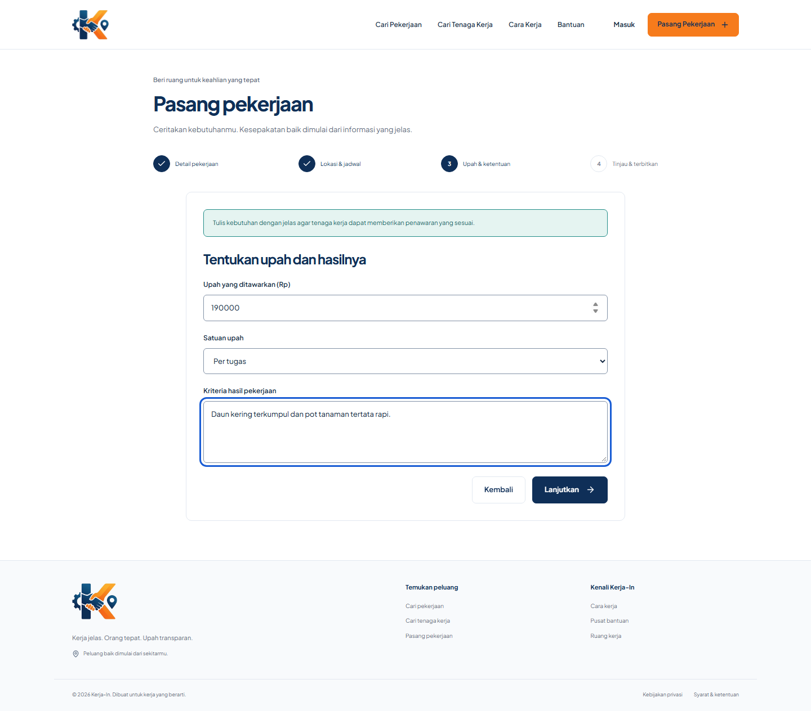
</p>
<p align="center">
<i>Gambar 6.18. Rancangan Antarmuka I-18 - Pasang Pekerjaan — Upah dan Ketentuan</i>
</p>

Tabel 6.18. Spesifikasi Objek Antarmuka I-18

| Id_Objek | Jenis | Konten | Keterangan |
| :--- | :--- | :--- | :--- |
| I-18-O01 | Stepper dan Heading | Upah & ketentuan; Tentukan upah dan hasilnya | Reaksi sistem: Menandai Upah & ketentuan sebagai langkah ketiga. |
| I-18-O02 | Numeric Field | Upah yang ditawarkan (Rp) | Reaksi sistem: Menerima nominal wajib Rp1.000–Rp100.000.000 dengan kelipatan Rp1. Isian ini tidak memproses pembayaran. |
| I-18-O03 | Combo Box | Satuan upah; Per tugas; Per hari | Reaksi sistem: Menyimpan pilihan satuan per tugas atau per hari untuk ditampilkan pada ringkasan dan detail pekerjaan. |
| I-18-O04 | Text Area | Kriteria hasil pekerjaan | Reaksi sistem: Menerima kriteria hasil wajib sepanjang 10–1.000 karakter dan menambahkannya ke deskripsi saat lowongan disimpan di browser. |
| I-18-O05 | Button | Kembali | Layar tujuan: Pasang Pekerjaan — Lokasi dan Jadwal (I-17), dengan isian sebelumnya tetap tersedia. |
| I-18-O06 | Button | Lanjutkan | Layar tujuan: Pasang Pekerjaan — Tinjau dan Terbitkan (I-19) jika isian valid. Lowongan belum disimpan. |

## 6.19 Rancangan Antarmuka I-19

**Antarmuka:** *I-19*  
**Nama Layar:** *Pasang Pekerjaan — Tinjau dan Terbitkan*  

<p align="center">
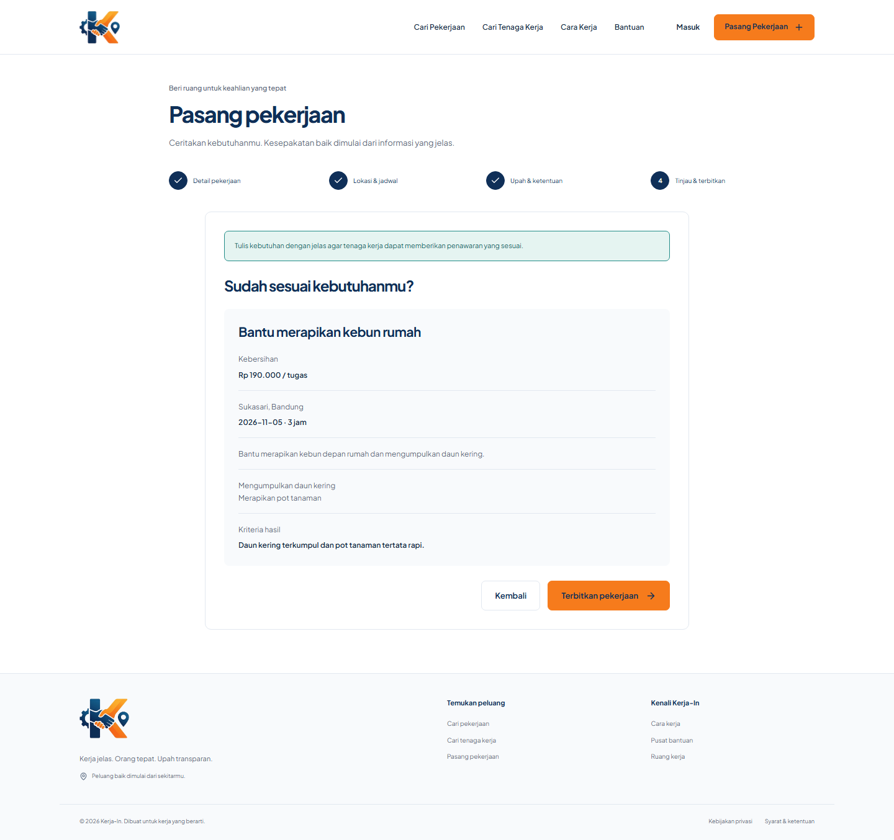
</p>
<p align="center">
<i>Gambar 6.19. Rancangan Antarmuka I-19 - Pasang Pekerjaan — Tinjau dan Terbitkan</i>
</p>

Tabel 6.19. Spesifikasi Objek Antarmuka I-19

| Id_Objek | Jenis | Konten | Keterangan |
| :--- | :--- | :--- | :--- |
| I-19-O01 | Stepper dan Heading | Tinjau & terbitkan; Sudah sesuai kebutuhanmu? | Reaksi sistem: Menandai Tinjau & terbitkan sebagai langkah terakhir sebelum lowongan disimpan di browser. |
| I-19-O02 | Review Panel | Judul; kategori; upah/satuan; area; tanggal; durasi; deskripsi; ruang lingkup; kriteria hasil | Reaksi sistem: Menampilkan ringkasan dari tiga langkah sebelumnya. Tanggal pada ringkasan mengikuti format isian; setelah lowongan disimpan, tanggal pada detail ditampilkan dalam format Indonesia. |
| I-19-O03 | Notice | Tulis kebutuhan dengan jelas agar tenaga kerja dapat memberikan penawaran yang sesuai. | Reaksi sistem: Menampilkan kembali panduan penulisan kebutuhan pekerjaan seperti pada langkah sebelumnya. |
| I-19-O04 | Button | Kembali | Layar tujuan: Pasang Pekerjaan — Upah dan Ketentuan (I-18) untuk memperbaiki isian, tanpa menghapus data langkah lain. |
| I-19-O05 | Button | Terbitkan pekerjaan | Reaksi sistem: Menyimpan lowongan di browser menggunakan nama penyedia dari profil dan mengaktifkan mode Penyedia Kerja. Lowongan belum diterbitkan ke server. Layar tujuan: Detail Pekerjaan (I-03) untuk lowongan yang baru dibuat. |

## 6.20 Rancangan Antarmuka I-20

**Antarmuka:** *I-20*  
**Nama Layar:** *Dompet*  

<p align="center">
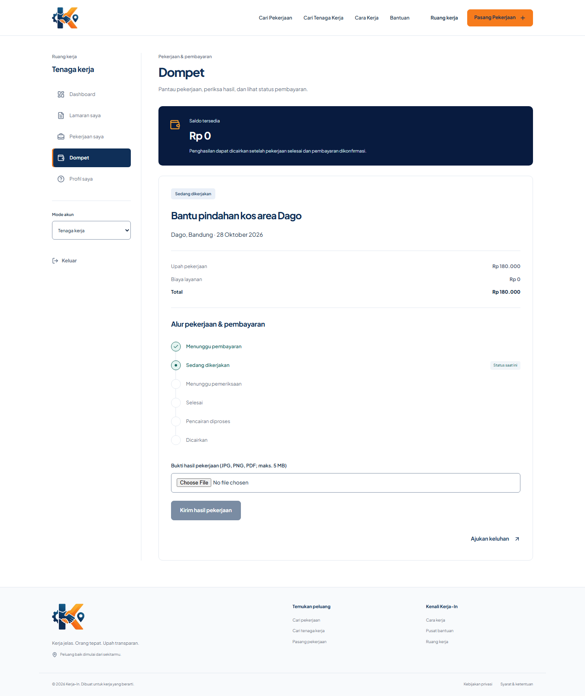
</p>
<p align="center">
<i>Gambar 6.20. Rancangan Antarmuka I-20 - Dompet</i>
</p>

Tabel 6.20. Spesifikasi Objek Antarmuka I-20

| Id_Objek | Jenis | Konten | Keterangan |
| :--- | :--- | :--- | :--- |
| I-20-O01 | Heading dan Wallet Panel | Dompet; Saldo tersedia; Rp0 | Reaksi sistem: Menampilkan saldo tersedia Rp0 dan penjelasan bahwa pencairan memerlukan pekerjaan selesai serta pembayaran terkonfirmasi. |
| I-20-O02 | Payment Breakdown | Upah pekerjaan; Biaya layanan; Total | Reaksi sistem: Menampilkan contoh rincian upah Rp180.000, biaya layanan Rp0, dan total Rp180.000. Angka tersebut bukan catatan transaksi keuangan dari server. |
| I-20-O03 | Timeline | Alur pekerjaan & pembayaran; Status saat ini | Reaksi sistem: Menampilkan tahapan sesuai status pekerjaan yang sama dengan Pekerjaan Saya (I-14) dan Pemeriksaan dan Transaksi (I-21). |
| I-20-O04 | Button kondisional | Kirim hasil pekerjaan; Ajukan pencairan | Reaksi sistem: Menyediakan pengiriman hasil seperti pada Pekerjaan Saya (I-14). Pengajuan pencairan hanya ditampilkan untuk Tenaga Kerja saat pekerjaan Selesai, bukan untuk Penyedia Kerja. |
| I-20-O05 | Notice dan Link | Permintaan pencairan sedang diproses.; Ajukan keluhan | Reaksi sistem: Menampilkan status permintaan pencairan sedang diproses, tanpa tombol untuk menyatakan dana sudah diterima. Layar tujuan: Pusat Bantuan dan Keluhan (I-23) melalui Ajukan keluhan. |

## 6.21 Rancangan Antarmuka I-21

**Antarmuka:** *I-21*  
**Nama Layar:** *Pemeriksaan dan Transaksi*  

<p align="center">
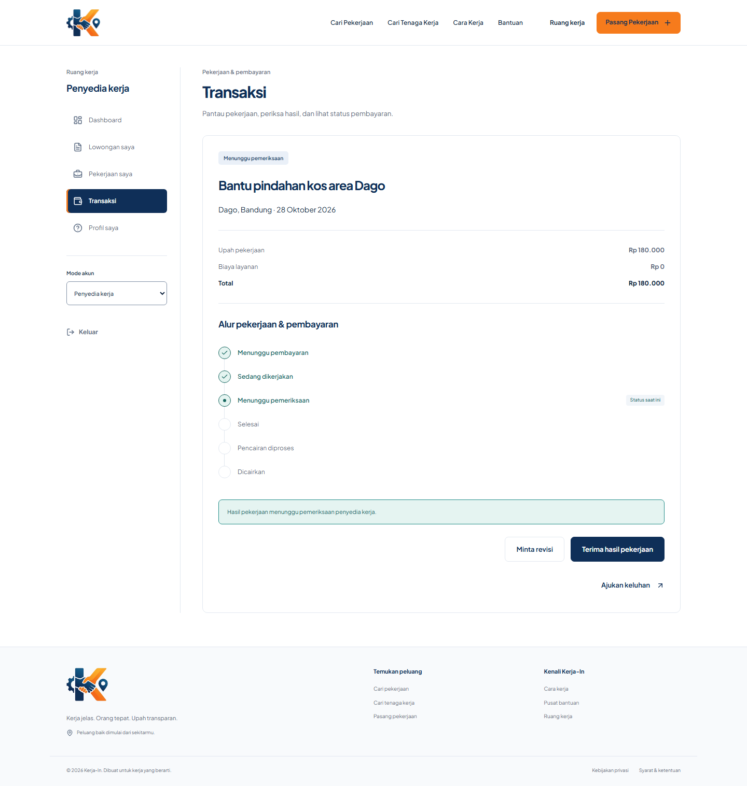
</p>
<p align="center">
<i>Gambar 6.21. Rancangan Antarmuka I-21 - Pemeriksaan dan Transaksi</i>
</p>

Tabel 6.21. Spesifikasi Objek Antarmuka I-21

| Id_Objek | Jenis | Konten | Keterangan |
| :--- | :--- | :--- | :--- |
| I-21-O01 | Heading dan Ringkasan | Transaksi; Bantu pindahan kos area Dago | Reaksi sistem: Menampilkan ringkasan pekerjaan yang menunggu pemeriksaan dalam mode Penyedia Kerja. |
| I-21-O02 | Payment Breakdown dan Timeline | Upah pekerjaan; Biaya layanan; Total; Status saat ini | Informasi tersebut bukan konfirmasi pembayaran nyata. |
| I-21-O03 | Button | Minta revisi | Layar tujuan: Dialog Permintaan Revisi Pekerjaan (I-29) untuk menjelaskan hasil yang perlu diperbaiki. |
| I-21-O04 | Button | Terima hasil pekerjaan | Reaksi sistem: Mengubah status menjadi Selesai dan menghapus catatan revisi. Tindakan ini tidak memindahkan dana. |
| I-21-O05 | Status kondisional | Hasil pekerjaan sudah diterima.; Pencairan diproses | Reaksi sistem: Menampilkan status penerimaan hasil atau proses pencairan sesuai tahapan pekerjaan. Tenaga Kerja dapat meminta pencairan setelah pekerjaan selesai, sedangkan Penyedia Kerja tidak mendapat tombol pencairan. Tidak ada kontrol untuk menyatakan dana sudah diterima. |
| I-21-O06 | Combo Box dan Link | Mode akun; Ajukan keluhan | Reaksi sistem: Menyesuaikan tampilan menurut mode akun. Kontrol pemeriksaan tidak ditampilkan kepada Tenaga Kerja; pembatasan ini belum menjadi pemeriksaan hak akses server. Layar tujuan: Pusat Bantuan dan Keluhan (I-23) melalui Ajukan keluhan. |

## 6.22 Rancangan Antarmuka I-22

**Antarmuka:** *I-22*  
**Nama Layar:** *Pengaturan Profil Saya*  

<p align="center">
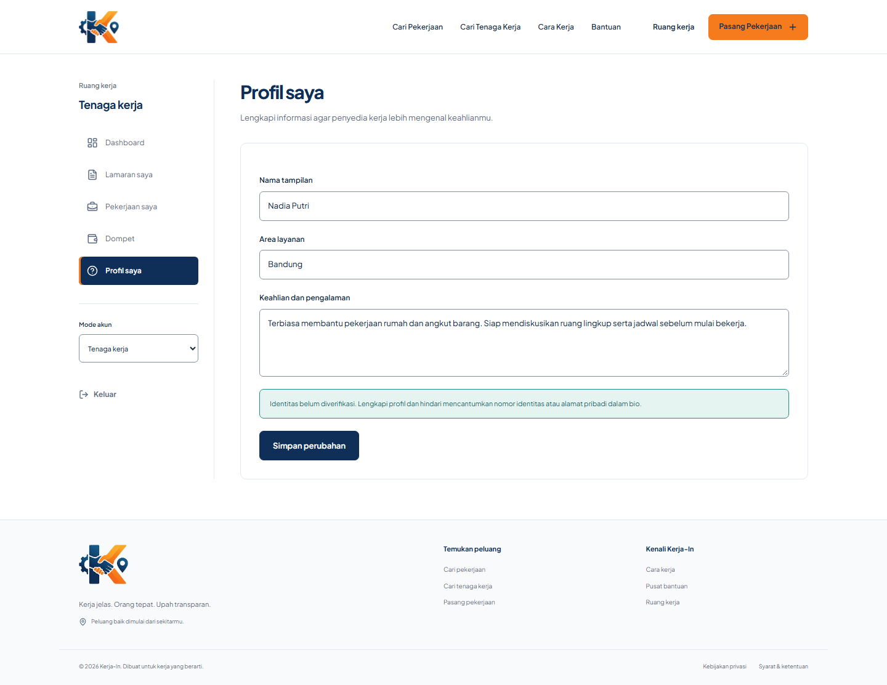
</p>
<p align="center">
<i>Gambar 6.22. Rancangan Antarmuka I-22 - Pengaturan Profil Saya</i>
</p>

Tabel 6.22. Spesifikasi Objek Antarmuka I-22

| Id_Objek | Jenis | Konten | Keterangan |
| :--- | :--- | :--- | :--- |
| I-22-O01 | Heading | Profil saya | Reaksi sistem: Menampilkan judul halaman pengaturan profil dan ajakan untuk melengkapi informasi keahlian. |
| I-22-O02 | Text Field | Nama tampilan; Area layanan | Reaksi sistem: Menerima nama tampilan hingga 80 karakter dan area layanan hingga 150 karakter. Keduanya wajib diisi; perubahan baru disimpan setelah tombol simpan diklik. |
| I-22-O03 | Text Area | Keahlian dan pengalaman | Reaksi sistem: Menerima keterangan keahlian dan pengalaman hingga 1.000 karakter. Kolom boleh kosong dan belum memperbarui daftar profil tenaga kerja contoh. |
| I-22-O04 | Notice | Identitas belum diverifikasi. | Reaksi sistem: Menampilkan status identitas belum diverifikasi dan pengingat agar tidak menulis nomor identitas atau alamat pribadi. |
| I-22-O05 | Button dan Status | Simpan perubahan; Perubahan profil disimpan. | Reaksi sistem: Memeriksa kolom wajib, menyimpan perubahan profil di browser, lalu memperbarui nama pada dashboard dan menampilkan pesan berhasil. |

## 6.23 Rancangan Antarmuka I-23

**Antarmuka:** *I-23*  
**Nama Layar:** *Pusat Bantuan dan Keluhan*  

<p align="center">
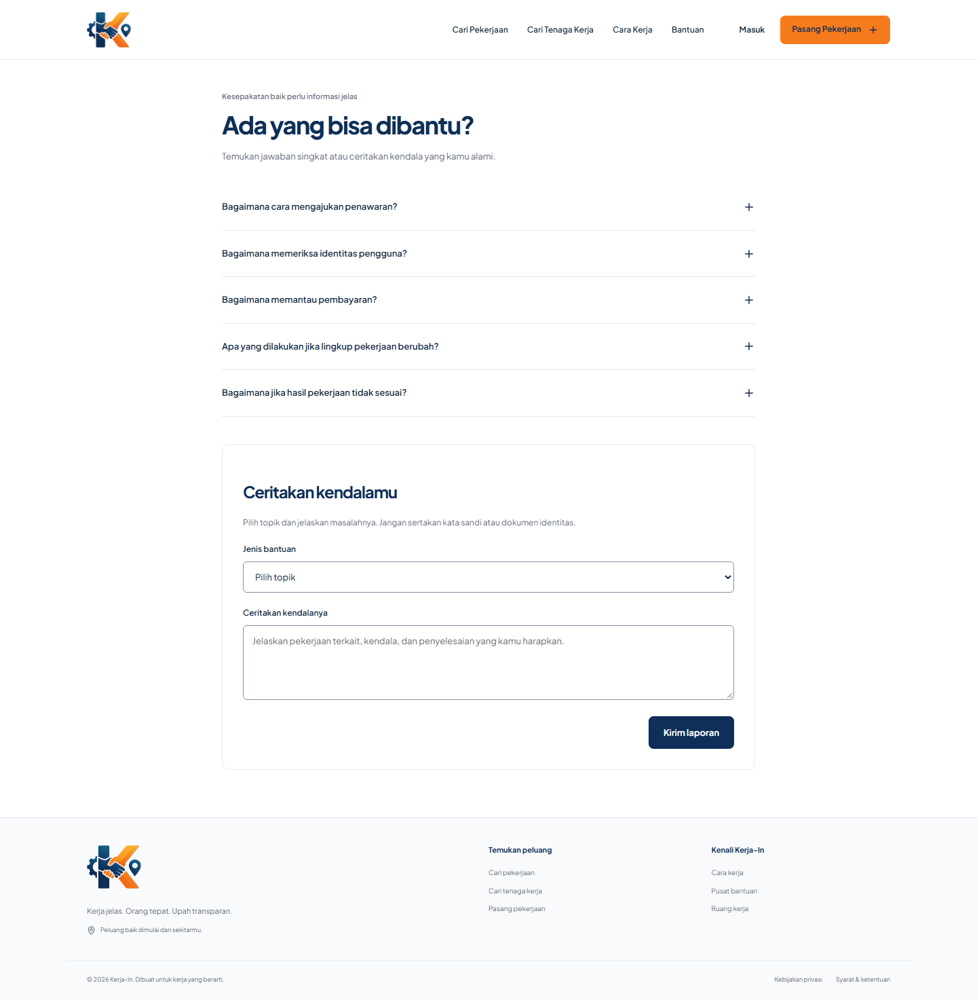
</p>
<p align="center">
<i>Gambar 6.23. Rancangan Antarmuka I-23 - Pusat Bantuan dan Keluhan</i>
</p>

Tabel 6.23. Spesifikasi Objek Antarmuka I-23

| Id_Objek | Jenis | Konten | Keterangan |
| :--- | :--- | :--- | :--- |
| I-23-O01 | Heading dan Accordion | Ada yang bisa dibantu?; pertanyaan umum | Reaksi sistem: Membuka jawaban saat pertanyaan dipilih, mencakup penawaran, identitas, pembayaran, perubahan lingkup, dan revisi. |
| I-23-O02 | Combo Box | Jenis bantuan; Lingkup pekerjaan; Pembayaran; Hasil pekerjaan; Akun & privasi | Reaksi sistem: Mewajibkan pengguna memilih jenis bantuan sebelum laporan dapat diproses. |
| I-23-O03 | Text Area | Ceritakan kendalanya | Reaksi sistem: Menerima uraian kendala sepanjang 20–1.000 karakter dan memeriksa bahwa isinya tetap minimal 20 karakter setelah spasi di awal dan akhir dihapus. |
| I-23-O04 | Button | Kirim laporan | Reaksi sistem: Membuat nomor laporan KIN-xxxxxx dan menyimpan laporan di browser. Laporan belum dikirim ke tim dukungan. |
| I-23-O05 | Status dan Button | Laporan dicatat; Nomor laporan; Menunggu peninjauan; Buat laporan lain | Reaksi sistem: Menampilkan nomor dan status laporan. Tombol Buat laporan lain mengosongkan formulir tanpa menghapus laporan yang sudah tersimpan. |
| I-23-O06 | Alert | Laporan belum dapat disimpan. Isianmu tetap tersedia; coba lagi. | Reaksi sistem: Menampilkan pesan jika laporan gagal disimpan dan mempertahankan isian agar pengguna dapat mencoba kembali. |

## 6.24 Rancangan Antarmuka I-24

**Antarmuka:** *I-24*  
**Nama Layar:** *Kebijakan Privasi*  

<p align="center">
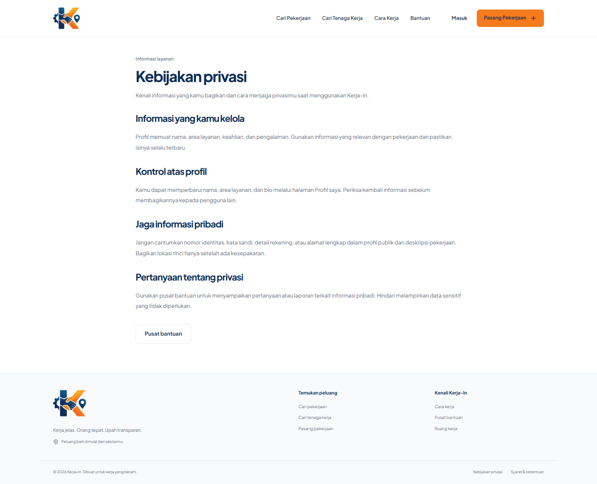
</p>
<p align="center">
<i>Gambar 6.24. Rancangan Antarmuka I-24 - Kebijakan Privasi</i>
</p>

Tabel 6.24. Spesifikasi Objek Antarmuka I-24

| Id_Objek | Jenis | Konten | Keterangan |
| :--- | :--- | :--- | :--- |
| I-24-O01 | Heading | Kebijakan privasi | Reaksi sistem: Menampilkan judul Kebijakan privasi. Isi kebijakan masih perlu ditinjau secara hukum sebelum layanan digunakan dalam produksi. |
| I-24-O02 | Text Block | Informasi yang kamu kelola; Kontrol atas profil | Reaksi sistem: Menampilkan penjelasan tentang data profil dan cara mengubahnya melalui Pengaturan Profil Saya (I-22). |
| I-24-O03 | Text Block | Jaga informasi pribadi; Pertanyaan tentang privasi | Reaksi sistem: Menampilkan pengingat agar pengguna tidak membagikan identitas, rekening, atau kata sandi. |
| I-24-O04 | Link Button | Pusat bantuan | Layar tujuan: Pusat Bantuan dan Keluhan (I-23). |

## 6.25 Rancangan Antarmuka I-25

**Antarmuka:** *I-25*  
**Nama Layar:** *Syarat dan Ketentuan*  

<p align="center">
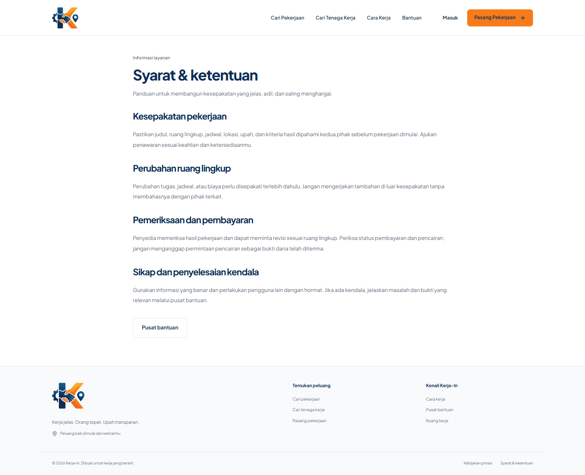
</p>
<p align="center">
<i>Gambar 6.25. Rancangan Antarmuka I-25 - Syarat dan Ketentuan</i>
</p>

Tabel 6.25. Spesifikasi Objek Antarmuka I-25

| Id_Objek | Jenis | Konten | Keterangan |
| :--- | :--- | :--- | :--- |
| I-25-O01 | Heading | Syarat & ketentuan | Reaksi sistem: Menampilkan panduan syarat dan ketentuan layanan, tanpa menyatakan dokumen telah disahkan secara hukum. |
| I-25-O02 | Text Block | Kesepakatan pekerjaan; Perubahan ruang lingkup | Reaksi sistem: Menampilkan panduan kesepakatan mengenai tugas, waktu, lokasi, upah, dan perubahan ruang lingkup sebelum pekerjaan dimulai. |
| I-25-O03 | Text Block | Pemeriksaan dan pembayaran; Sikap dan penyelesaian kendala | Reaksi sistem: Menjelaskan perbedaan permintaan pencairan dan dana diterima, serta mengarahkan pengguna untuk meminta bantuan jika ada kendala. |
| I-25-O04 | Link Button | Pusat bantuan | Layar tujuan: Pusat Bantuan dan Keluhan (I-23). |

## 6.26 Rancangan Antarmuka I-26

**Antarmuka:** *I-26*  
**Nama Layar:** *Undangan Tenaga Kerja*  

<p align="center">
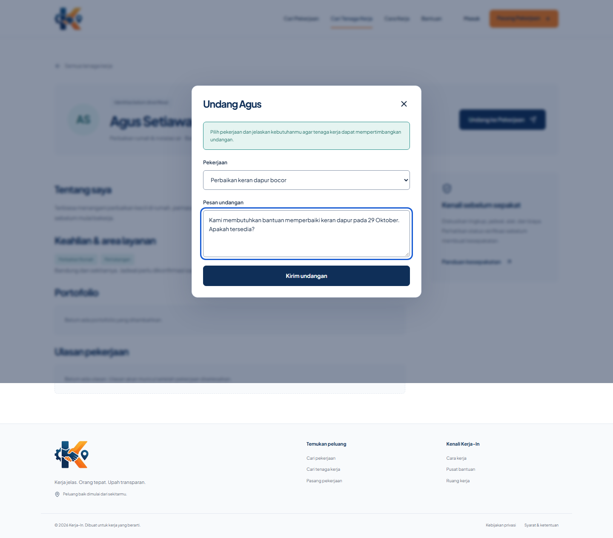
</p>
<p align="center">
<i>Gambar 6.26. Rancangan Antarmuka I-26 - Undangan Tenaga Kerja</i>
</p>

Tabel 6.26. Spesifikasi Objek Antarmuka I-26

| Id_Objek | Jenis | Konten | Keterangan |
| :--- | :--- | :--- | :--- |
| I-26-O01 | Dialog dan Notice | Undang Agus | Reaksi sistem: Membuka dialog undangan untuk tenaga kerja yang sedang dilihat dan meminta pengguna menjelaskan kebutuhan pekerjaan. |
| I-26-O02 | Combo Box | Pekerjaan; Pilih pekerjaan | Reaksi sistem: Mewajibkan pengguna memilih satu dari dua contoh pekerjaan. Pilihan belum diambil dari lowongan pengguna pada server. |
| I-26-O03 | Text Area | Pesan undangan | Reaksi sistem: Menerima pesan undangan yang wajib diisi minimal 10 karakter. |
| I-26-O04 | Button | Kirim undangan | Reaksi sistem: Mencatat undangan sementara, menutup dialog, dan menampilkan Undangan tersimpan. Undangan belum dikirim kepada tenaga kerja atau disimpan permanen. |
| I-26-O05 | Icon Button | Tutup (X) | Reaksi sistem: Menutup dialog dan mengembalikan fokus ke tombol pembuka. Menekan Escape atau mengeklik latar dialog memberikan hasil yang sama. |

## 6.27 Rancangan Antarmuka I-27

**Antarmuka:** *I-27*  
**Nama Layar:** *Konfirmasi Penarikan Penawaran*  

<p align="center">
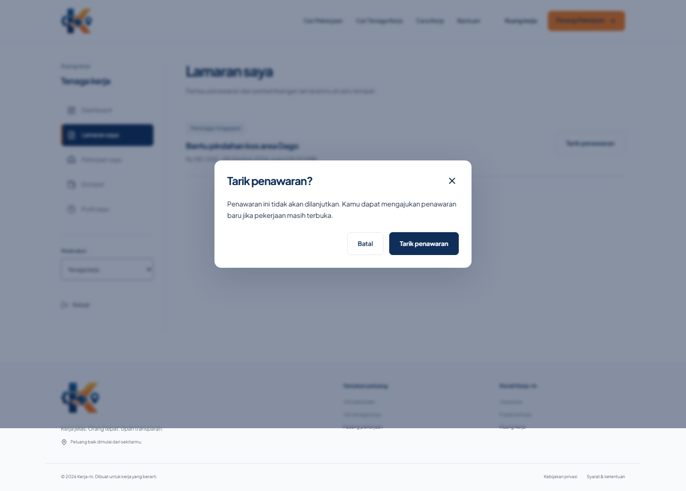
</p>
<p align="center">
<i>Gambar 6.27. Rancangan Antarmuka I-27 - Konfirmasi Penarikan Penawaran</i>
</p>

Tabel 6.27. Spesifikasi Objek Antarmuka I-27

| Id_Objek | Jenis | Konten | Keterangan |
| :--- | :--- | :--- | :--- |
| I-27-O01 | Dialog | Tarik penawaran? | Reaksi sistem: Menampilkan konfirmasi penarikan dan penjelasan bahwa penawaran dapat diajukan kembali selama pekerjaan masih terbuka. |
| I-27-O02 | Button | Batal | Reaksi sistem: Menutup dialog tanpa mengubah status penawaran. |
| I-27-O03 | Button | Tarik penawaran | Reaksi sistem: Mengubah status penawaran yang dipilih menjadi Ditarik pada data di browser, lalu memperbarui daftar dan jumlah penawaran aktif. |
| I-27-O04 | Icon Button | Tutup (X) | Reaksi sistem: Membatalkan penarikan, menutup dialog, dan mengembalikan fokus ke tombol pembuka. Menekan Escape atau mengeklik latar dialog memberikan hasil yang sama. |

## 6.28 Rancangan Antarmuka I-28

**Antarmuka:** *I-28*  
**Nama Layar:** *Halaman Tidak Ditemukan*  

<p align="center">
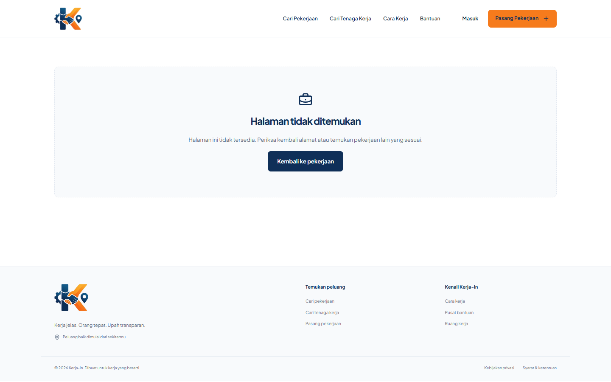
</p>
<p align="center">
<i>Gambar 6.28. Rancangan Antarmuka I-28 - Halaman Tidak Ditemukan</i>
</p>

Tabel 6.28. Spesifikasi Objek Antarmuka I-28

| Id_Objek | Jenis | Konten | Keterangan |
| :--- | :--- | :--- | :--- |
| I-28-O01 | Heading dan Text Block | Halaman tidak ditemukan; Halaman ini tidak tersedia. | Reaksi sistem: Menampilkan pesan jika halaman atau data yang diminta tidak ditemukan. Tampilan ini belum menjamin server memberikan kode kesalahan 404. |
| I-28-O02 | Link Button | Kembali ke pekerjaan | Layar tujuan: Pencarian Pekerjaan (I-02). |

## 6.29 Rancangan Antarmuka I-29

**Antarmuka:** *I-29*  
**Nama Layar:** *Permintaan Revisi Pekerjaan*  

<p align="center">
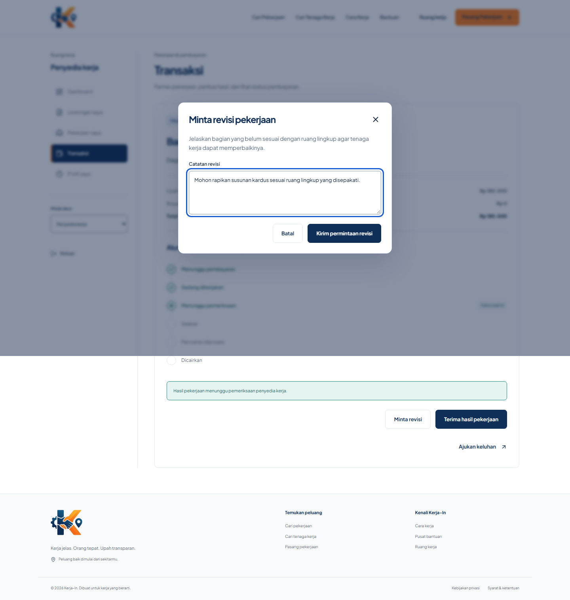
</p>
<p align="center">
<i>Gambar 6.29. Rancangan Antarmuka I-29 - Permintaan Revisi Pekerjaan</i>
</p>

Tabel 6.29. Spesifikasi Objek Antarmuka I-29

| Id_Objek | Jenis | Konten | Keterangan |
| :--- | :--- | :--- | :--- |
| I-29-O01 | Dialog | Minta revisi pekerjaan | Reaksi sistem: Membuka dialog saat Penyedia Kerja meminta revisi dari Pemeriksaan dan Transaksi (I-21). |
| I-29-O02 | Text Area | Catatan revisi | Reaksi sistem: Menerima catatan revisi wajib sepanjang 10–1.000 karakter. Catatan tidak diterapkan jika pengguna membatalkan pengisian. |
| I-29-O03 | Button | Kirim permintaan revisi | Reaksi sistem: Menyimpan catatan revisi di browser, mengubah status menjadi Sedang dikerjakan, dan menampilkan catatan pada pekerjaan aktif. |
| I-29-O04 | Button dan Icon Button | Batal; Tutup (X) | Reaksi sistem: Membatalkan permintaan revisi, menutup dialog, dan mengembalikan fokus ke tombol pembuka. Menekan Escape atau mengeklik latar dialog memberikan hasil yang sama. |

## 6.30 Rancangan Antarmuka Keseluruhan

Tabel 6.30. Rancangan Antarmuka Keseluruhan

| No | Tampilan Antarmuka |
| :--- | :--- |
| I-01 |  |
| I-02 |  |
| I-03 |  |
| I-04 |  |
| I-05 |  |
| I-06 |  |
| I-07 |  |
| I-08 |  |
| I-09 |  |
| I-10 |  |
| I-11 |  |
| I-12 |  |
| I-13 |  |
| I-14 |  |
| I-15 |  |
| I-16 |  |
| I-17 |  |
| I-18 |  |
| I-19 |  |
| I-20 |  |
| I-21 |  |
| I-22 |  |
| I-23 |  |
| I-24 |  |
| I-25 |  |
| I-26 |  |
| I-27 |  |
| I-28 |  |
| I-29 |  |

<br>

---

# BAB 7: Matriks Kerunutan

Matriks berikut memetakan kelas perancangan ke use case yang didukung berdasarkan Bab 6 Traceability SKPL dan identifikasi kelas pada Bab 3 DPPL.

Tabel 7.1. Matriks Kerunutan Kelas terhadap Use Case

| Kelas | Use Case Terkait |
| :--- | :--- |
| C01 - Pengguna | UC01 - Melakukan Registrasi<br>UC11 - Memberikan Penilaian Kerja |
| C02 - TenagaKerja | UC01 - Melakukan Registrasi<br>UC02 - Mengelola Verifikasi Identitas<br>UC04 - Mencari Lowongan Pekerjaan<br>UC05 - Mengajukan Penawaran Pekerjaan<br>UC08 - Menyerahkan Hasil Pekerjaan<br>UC10 - Melakukan Pencairan Dana<br>UC11 - Memberikan Penilaian Kerja |
| C03 - PenyediaKerja | UC01 - Melakukan Registrasi<br>UC03 - Mengelola Lowongan Pekerjaan<br>UC06 - Memilih Tenaga Kerja<br>UC07 - Melakukan Pembayaran Pekerjaan<br>UC09 - Memverifikasi Penyelesaian Pekerjaan<br>UC11 - Memberikan Penilaian Kerja |
| C04 - CustomerService | UC02 - Mengelola Verifikasi Identitas<br>UC12 - Menangani Keluhan |
| C05 - LowonganPekerjaan | UC03 - Mengelola Lowongan Pekerjaan<br>UC04 - Mencari Lowongan Pekerjaan<br>UC05 - Mengajukan Penawaran Pekerjaan<br>UC06 - Memilih Tenaga Kerja |
| C06 - PengajuanPenawaran | UC05 - Mengajukan Penawaran Pekerjaan<br>UC06 - Memilih Tenaga Kerja |
| C07 - TransaksiPekerjaan | UC06 - Memilih Tenaga Kerja<br>UC07 - Melakukan Pembayaran Pekerjaan<br>UC08 - Menyerahkan Hasil Pekerjaan<br>UC09 - Memverifikasi Penyelesaian Pekerjaan<br>UC11 - Memberikan Penilaian Kerja<br>UC12 - Menangani Keluhan |
| C08 - BuktiPenyerahan | UC08 - Menyerahkan Hasil Pekerjaan<br>UC09 - Memverifikasi Penyelesaian Pekerjaan |
| C09 - TagihanPembayaran | UC07 - Melakukan Pembayaran Pekerjaan |
| C10 - PencairanDana | UC10 - Melakukan Pencairan Dana |
| C11 - UlasanRating | UC11 - Memberikan Penilaian Kerja |
| C12 - TiketSengketa | UC12 - Menangani Keluhan |
| C13 - RiwayatSengketa | UC12 - Menangani Keluhan |
| C14 - Notifikasi | UC02 - Mengelola Verifikasi Identitas<br>UC05 - Mengajukan Penawaran Pekerjaan<br>UC06 - Memilih Tenaga Kerja<br>UC07 - Melakukan Pembayaran Pekerjaan<br>UC08 - Menyerahkan Hasil Pekerjaan<br>UC09 - Memverifikasi Penyelesaian Pekerjaan<br>UC10 - Melakukan Pencairan Dana<br>UC12 - Menangani Keluhan |
| C15 - PaymentGateway | UC07 - Melakukan Pembayaran Pekerjaan<br>UC10 - Melakukan Pencairan Dana |
| C16 - PenggunaUI | UC01 - Melakukan Registrasi<br>UC11 - Memberikan Penilaian Kerja |
| C17 - TenagaKerjaUI | UC01 - Melakukan Registrasi<br>UC02 - Mengelola Verifikasi Identitas<br>UC04 - Mencari Lowongan Pekerjaan<br>UC08 - Menyerahkan Hasil Pekerjaan<br>UC10 - Melakukan Pencairan Dana |
| C18 - PenyediaKerjaUI | UC01 - Melakukan Registrasi<br>UC03 - Mengelola Lowongan Pekerjaan<br>UC06 - Memilih Tenaga Kerja<br>UC07 - Melakukan Pembayaran Pekerjaan<br>UC09 - Memverifikasi Penyelesaian Pekerjaan |
| C19 - CustomerServiceUI | UC02 - Mengelola Verifikasi Identitas<br>UC12 - Menangani Keluhan |
| C20 - LowonganPekerjaanUI | UC03 - Mengelola Lowongan Pekerjaan<br>UC04 - Mencari Lowongan Pekerjaan<br>UC06 - Memilih Tenaga Kerja |
| C21 - PengajuanPenawaranUI | UC05 - Mengajukan Penawaran Pekerjaan<br>UC06 - Memilih Tenaga Kerja |
| C22 - TransaksiPekerjaanUI | UC06 - Memilih Tenaga Kerja<br>UC07 - Melakukan Pembayaran Pekerjaan<br>UC08 - Menyerahkan Hasil Pekerjaan<br>UC09 - Memverifikasi Penyelesaian Pekerjaan<br>UC11 - Memberikan Penilaian Kerja<br>UC12 - Menangani Keluhan |
| C23 - BuktiPenyerahanUI | UC08 - Menyerahkan Hasil Pekerjaan<br>UC09 - Memverifikasi Penyelesaian Pekerjaan |
| C24 - TagihanPembayaranUI | UC07 - Melakukan Pembayaran Pekerjaan |
| C25 - PencairanDanaUI | UC10 - Melakukan Pencairan Dana |
| C26 - UlasanRatingUI | UC11 - Memberikan Penilaian Kerja |
| C27 - TiketSengketaUI | UC12 - Menangani Keluhan |
| C28 - RiwayatSengketaUI | UC12 - Menangani Keluhan |
| C29 - NotifikasiUI | UC02 - Mengelola Verifikasi Identitas<br>UC05 - Mengajukan Penawaran Pekerjaan<br>UC06 - Memilih Tenaga Kerja<br>UC07 - Melakukan Pembayaran Pekerjaan<br>UC08 - Menyerahkan Hasil Pekerjaan<br>UC09 - Memverifikasi Penyelesaian Pekerjaan<br>UC10 - Melakukan Pencairan Dana<br>UC12 - Menangani Keluhan |
| C30 - PaymentGatewayUI | UC07 - Melakukan Pembayaran Pekerjaan<br>UC10 - Melakukan Pencairan Dana |
| C31 - PenggunaController | UC01 - Melakukan Registrasi<br>UC11 - Memberikan Penilaian Kerja |
| C32 - TenagaKerjaController | UC01 - Melakukan Registrasi<br>UC02 - Mengelola Verifikasi Identitas<br>UC04 - Mencari Lowongan Pekerjaan<br>UC08 - Menyerahkan Hasil Pekerjaan<br>UC10 - Melakukan Pencairan Dana |
| C33 - PenyediaKerjaController | UC01 - Melakukan Registrasi<br>UC03 - Mengelola Lowongan Pekerjaan<br>UC06 - Memilih Tenaga Kerja<br>UC07 - Melakukan Pembayaran Pekerjaan<br>UC09 - Memverifikasi Penyelesaian Pekerjaan |
| C34 - CustomerServiceController | UC02 - Mengelola Verifikasi Identitas<br>UC12 - Menangani Keluhan |
| C35 - LowonganPekerjaanController | UC03 - Mengelola Lowongan Pekerjaan<br>UC04 - Mencari Lowongan Pekerjaan<br>UC06 - Memilih Tenaga Kerja |
| C36 - PengajuanPenawaranController | UC05 - Mengajukan Penawaran Pekerjaan<br>UC06 - Memilih Tenaga Kerja |
| C37 - TransaksiPekerjaanController | UC06 - Memilih Tenaga Kerja<br>UC07 - Melakukan Pembayaran Pekerjaan<br>UC08 - Menyerahkan Hasil Pekerjaan<br>UC09 - Memverifikasi Penyelesaian Pekerjaan<br>UC11 - Memberikan Penilaian Kerja<br>UC12 - Menangani Keluhan |
| C38 - BuktiPenyerahanController | UC08 - Menyerahkan Hasil Pekerjaan<br>UC09 - Memverifikasi Penyelesaian Pekerjaan |
| C39 - TagihanPembayaranController | UC07 - Melakukan Pembayaran Pekerjaan |
| C40 - PencairanDanaController | UC10 - Melakukan Pencairan Dana |
| C41 - UlasanRatingController | UC11 - Memberikan Penilaian Kerja |
| C42 - TiketSengketaController | UC12 - Menangani Keluhan |
| C43 - RiwayatSengketaController | UC12 - Menangani Keluhan |
| C44 - NotifikasiController | UC02 - Mengelola Verifikasi Identitas<br>UC05 - Mengajukan Penawaran Pekerjaan<br>UC06 - Memilih Tenaga Kerja<br>UC07 - Melakukan Pembayaran Pekerjaan<br>UC08 - Menyerahkan Hasil Pekerjaan<br>UC09 - Memverifikasi Penyelesaian Pekerjaan<br>UC10 - Melakukan Pencairan Dana<br>UC12 - Menangani Keluhan |
| C45 - PaymentGatewayController | UC07 - Melakukan Pembayaran Pekerjaan<br>UC10 - Melakukan Pencairan Dana 

# Lampiran
- Link Figma: 