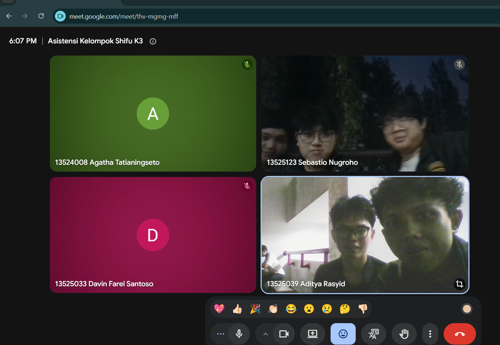

# Form Asistensi

## Tugas Besar IF2150 - Rekayasa Perangkat Lunak

| Informasi | Keterangan |
| --- | --- |
| **Hari** | Rabu |
| **Tanggal** | 28-10-2026 |
| **Kelas** | K-03 |
| **Nomor Kelompok** | 6 |
| **Nama Kelompok** | Shifu  |
| **Nama Perangkat Lunak** | Kerja-In |
| **Dokumen** | K03_G06_DPPL2.md |

### Anggota Kelompok

| NIM | Nama |
| --- | --- |
| 13525033 | Davin Farel Santoso |
| 13525039 | Aditya Rasyid |
| 13525096 | Muhammad Ridwan Nasir Firdaus |
| 13525102 | Karmel Tua Haloho |
| 13525123 | Sebastio Nugroho |

### Catatan

| Catatan |
| --- |
| 1. Pseudocode tidak perlu sama persis dengan yang alpro (atur-atur sesuai kebutuhan)  |
| 2. Query tidak perlu ditulis jika memang tidak ada |
| 3. Taruh link figma di lampiran |
| 4. UI sudah aman |

**Notes for this section:**  
*Catatan dapat dituliskan dalam bentuk paragraf atau poin-poin, disesuaikan saja.* 

## Dokumentasi

<!--  -->

  

  <i>Gambar 1. Dokumentasi kegiatan asistensi.</i>

